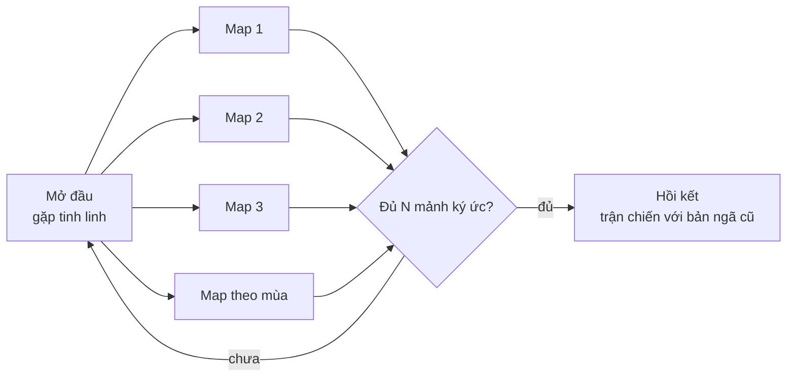

# Cốt truyện

> Trạng thái: Nháp
> Liên quan: [Nhân vật](characters.md) · [Level](../02-gameplay/levels.md) · [Tiến trình](../02-gameplay/progression.md)

## Tóm tắt
<!-- 5–10 câu: mở đầu, xung đột, cao trào, kết. -->
- Mạch chính: pháp sư đi tìm các mảnh ký ức, dần hé lộ quá khứ — có thể tới cuối game (sau nhiều mùa) mới hé lộ hết.
- Mỗi map có cốt truyện chính và nhiệm vụ phụ do nhà phát triển tạo; người chơi không bị bó buộc làm tuần tự.

Tóm tắt (user định hướng 2026-10-13; chi tiết là [ý tưởng]):
1. Pháp sư tỉnh dậy giữa một vùng đất khô héo, không nhớ gì; bên cạnh là một **tinh linh** nhỏ luôn đi theo.
2. Tinh linh chỉ cách cải tạo đất để một loài sinh vật trở lại — lần đầu tiên pháp sư thấy thế giới sống lại.
3. Mỗi vùng đất (map) hồi sinh trả lại **mảnh ký ức**: pháp sư dần biết mình từng là người **coi sinh vật là công cụ**, tạo ra thẻ bài để giam giữ chúng, và chính mình gây ra biến cố làm thế giới khô héo.
4. Trong khi đó, những ngày sống cùng sinh vật — chăm sóc, làm vườn, chiến đấu cùng — khiến pháp sư **trân trọng** chúng.
5. Hai bản ngã va chạm: bản ngã cũ trong ký ức muốn quay lại con đường sức mạnh; bản ngã mới muốn hàn gắn — **khủng hoảng danh tính**.
6. Tinh linh dần lộ mình là mảnh linh hồn của sinh vật từng thân thiết với pháp sư, ở lại để cảm hoá người mình thương.
7. Cao trào: **trận chiến cuối cùng** giữa bản ngã mới và bản ngã cũ.
8. Kết: _(chưa có — xem [Kết thúc](#kết-thúc))_.

## Cấu trúc hồi/chương
<!-- Bảng: chương | mục tiêu người chơi | sự kiện chính | cảm xúc. Mermaid flowchart nếu có nhánh. -->
[ý tưởng] Mỗi map = một chương; chương không phải làm theo thứ tự (P3). Trận chiến cuối mở khi có **đủ N mảnh ký ức** (không phải những mảnh cụ thể) → giữ tự do thứ tự.

| Chương | Mục tiêu người chơi | Sự kiện chính | Cảm xúc |
|---|---|---|---|
| Mở đầu | Hồi sinh loài đầu tiên, học cơ chế cơ bản | Tỉnh dậy, gặp tinh linh, loài đầu tiên trở lại | Tò mò, ấm lòng |
| Map 1 | Hồi sinh vùng đảo | Mảnh ký ức: lần đầu bản ngã cũ dùng thẻ bài giam sinh vật | Bất ngờ ("đó là mình sao?") |
| Map 2 | Hồi sinh khu rừng | Mảnh ký ức: rút sinh khí cả khu rừng để thử sức mạnh | Day dứt |
| Map 3 | Hồi sinh phế tích | Mảnh ký ức: sinh vật thân thiết mất đi; tinh linh lộ mình | Xúc động, hiểu ra |
| Map theo mùa | Hồi sinh vùng mới | Mỗi mùa thêm mảnh ký ức, đẩy mâu thuẫn hai bản ngã | Căng dần |
| Hồi kết | Đối mặt bản ngã cũ | Trận chiến cuối cùng | Cao trào → hy vọng |

**Nhiệm vụ:** chưa viết từng nhiệm vụ (đợi bố trí map — `local-level-design`). Khung cho mỗi map [ý tưởng]:

| Nhiệm vụ | Map | Loại | Điều kiện mở | Phần thưởng | Mảnh ký ức |
|---|---|---|---|---|---|
| Hồi sinh vùng đất | Mỗi map | Chính | Vào map | Mở loài của map | 1 mảnh khi đạt mốc hồi sinh |
| Câu chuyện của map | Mỗi map | Chính | Đạt mốc hồi sinh đầu tiên | Mảnh ký ức chính của map | 1 |
| Nhiệm vụ phụ | Mỗi map | Phụ | Gặp sinh vật/địa điểm liên quan | Tài nguyên, thẻ bài, phép | Không bắt buộc |

## Cách kể chuyện
<!-- Cutscene, hội thoại, môi trường, nhật ký... phù hợp sức một người làm. -->
**Cutscene:** user muốn **vài cutscene** (2026-10-13). [ý tưởng] Dành cho các khoảnh khắc lớn, số lượng ít:

| Cutscene | Khi nào | Milestone |
|---|---|---|
| Mở đầu | Tỉnh dậy giữa đất khô héo, gặp tinh linh | M2 (vertical slice) |
| Tinh linh lộ mình | Mảnh ký ức của map 3 | M3–M4 |
| Hồi kết | Trước và sau trận chiến với bản ngã cũ | Sau phát hành |

- Ước lượng [ý tưởng]: 3–6 ngày-người mỗi cutscene (dựng cảnh, camera, thoại, nhạc; dùng model có sẵn trong game). Công cụ trong Unity (vd Timeline, Cinemachine): chưa tra docs 6000.4 [chưa xác minh] — tra khi tới M2.

Các cách kể còn lại [ý tưởng], rẻ cho một người làm:
- **Mảnh ký ức** = cảnh hồi tưởng ngắn tại khối cốt truyện: khung hình tĩnh/màu đơn sắc + vài câu thoại của bản ngã cũ.
- **Tinh linh** nói vài câu ngắn theo sự kiện (loài trở lại, bắt được sinh vật, nhặt mảnh ký ức) — kể chuyện liên tục mà không cần hội thoại dài.
- **Môi trường kể chuyện**: thẻ bài cũ vỡ, đất khô quanh nơi bản ngã cũ từng ở — hồi sinh làm những dấu vết đó biến mất.
- Liên quan ý tưởng A4 trong [ideas](../ideas.md) (mỗi loài hồi sinh trả về một mảnh ký ức) — có thể dùng cho mảnh ký ức phụ.

## Kết thúc
<!-- Một hay nhiều kết; điều kiện; cảm xúc để lại. -->
- **Trận chiến cuối cùng** giữa bản ngã mới và bản ngã cũ (user, 2026-10-13).
- **Một kết — "Chấp nhận"** (user chọn, 2026-10-13): bản ngã mới thắng nhưng **không xoá** bản ngã cũ — nhận lấy ký ức và lỗi lầm, chọn con đường khác. [ý tưởng] Tinh linh yên lòng vì người mình thương đã thay đổi; ở lại hay ra đi để user quyết khi viết cảnh kết.
- Các hướng không chọn (đoàn tụ, nhiều kết) → [ideas](../ideas.md).
- **Phạm vi:** trận chiến cuối là nội dung chiến đấu riêng (trùm, cảnh). Câu chuyện kéo dài qua nhiều mùa → hồi kết ra **sau phát hành**. Ước lượng [ý tưởng]: 10–20 ngày-người (trận trùm + cảnh kết) — đã ghi ở [roadmap](../05-roadmap.md).
