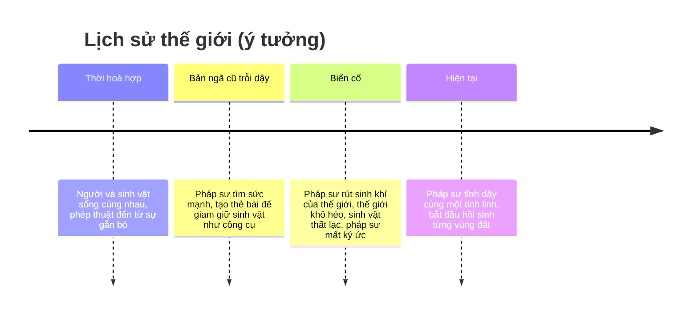

# Thế giới

> Trạng thái: Nháp
> Liên quan: [Nhân vật](characters.md) · [Cốt truyện](plot.md) · [Art style](../03-art-audio/art-style.md)

Tên riêng (thế giới, map, biến cố...) để trống — **user tự đặt** ([danh sách cần đặt tên](../summary.md#danh-sách-cần-đặt-tên)). Trong file dùng tên mô tả tạm.

## Bối cảnh
<!-- Thời gian, địa điểm, quy luật của thế giới (phép thuật, công nghệ...). -->
- Thế giới phép thuật dạng voxel. Các sinh vật phép thuật đã thất lạc; muốn đưa chúng trở lại phải tạo lại môi trường sống của từng loài.
- Nhân vật chính là một pháp sư mất ký ức, sinh tồn qua nhiều vùng đất.
- **Nguyên nhân** (user, 2026-10-13): chính pháp sư — trước khi mất ký ức — gây ra việc sinh vật thất lạc. Khi đó pháp sư có mục đích xấu và **coi sinh vật là công cụ**.

**Quy luật phép thuật** [ý tưởng] — viết để khớp cơ chế đã có:
- **Sinh khí** chảy giữa đất đai và sinh vật: một loài chỉ tồn tại được ở nơi có môi trường hợp với nó → lý do trong truyện của cơ chế môi trường sống và danh sách yêu cầu của loài (P1).
- **Phép sinh vật đến từ sự gắn bó**: sinh vật cho pháp sư mượn phép của mình; **nhập hồn** là hai linh hồn cùng chia một thân thể. Bản ngã cũ dùng nhập hồn để **chiếm** thân sinh vật; bản ngã mới học cách **mượn** — cùng một cơ chế, hai cách hiểu.
- **Thẻ bài** là phát minh của bản ngã cũ để giam giữ và sai khiến sinh vật như công cụ. Bản ngã mới dùng lại thẻ, nhưng như một **nơi trú ẩn** để sinh vật nghỉ ngơi và theo mình — câu chuyện đổi nghĩa của thẻ, cơ chế giữ nguyên.
- **Biến cố** _(chưa có tên)_: bản ngã cũ cố rút sinh khí của mọi sinh vật về cho mình (qua thẻ bài) → sinh khí của thế giới cạn, đất khô héo, sinh vật tan biến hoặc trốn đi; phép phản lại làm pháp sư mất ký ức.

## Lịch sử & phe phái
<!-- Sự kiện quá khứ ảnh hưởng hiện tại; các phe và quan hệ. -->
[ý tưởng] Giữ ít phe để vừa sức một người viết — đối thủ chính là bản ngã cũ của người chơi.

- Câu hỏi mở: có người nào khác còn sống (NPC) không, hay thế giới chỉ còn pháp sư, tinh linh và sinh vật? Có ai từng đi theo bản ngã cũ không?

## Địa điểm chính
<!-- Mỗi địa điểm: vai trò trong gameplay + cảm xúc muốn tạo. -->
- Mỗi map là một vùng có ranh giới trên world, có câu chuyện riêng (cốt truyện chính + nhiệm vụ phụ). Dự kiến 3 map lúc đầu, thêm map theo phiên bản/mùa.
- Đảo sandbox: vùng cô lập cho co-op — spin-off, tạm bỏ ([ideas](../ideas.md)).
- [ý tưởng] Mỗi map là một nơi bản ngã cũ từng làm một việc sai; hồi sinh map = hàn gắn vết thương đó, và mảnh ký ức của map hé lộ việc ấy. Chủ đề gợi theo bộ concept art tham khảo ([art style](../03-art-audio/art-style.md#tham-khảo)):

| Map | Chủ đề, cảnh quan | Việc bản ngã cũ đã làm ở đây | Cảm xúc muốn tạo |
|---|---|---|---|
| Map 1 _(chưa có tên)_ | Đảo vách đá phủ rêu, biển xanh, sinh vật biển phát sáng | Nơi đầu tiên dùng thẻ bài giam sinh vật | Tò mò → ấm lòng khi loài đầu tiên trở lại |
| Map 2 _(chưa có tên)_ | Rừng lá vàng, cây chết, thác đổ xuống hồ lá súng | Rút sinh khí cả khu rừng để thử sức mạnh | Day dứt → hy vọng khi rừng xanh lại |
| Map 3 _(chưa có tên)_ | Phế tích đá, cây hoa hồng/tím, đền thác nước | Nơi sinh vật thân thiết (nguồn gốc tinh linh) mất đi | Xúc động → hiểu ra |

- Các địa điểm cốt truyện trên map là **khối cốt truyện** (không phá/đặt được tới khi phá đảo map — [cơ chế](../02-gameplay/mechanics.md#sinh-map-theo-seed--khối-cốt-truyện)). Bố trí cụ thể: [levels](../02-gameplay/levels.md) (skill `local-level-design`).

## Tông giọng
<!-- Nghiêm túc/hài hước/u tối...; ví dụ câu thoại mẫu. -->
**Ấm áp, hy vọng** (user, 2026-10-13): cozy, chữa lành, có nét buồn man mác của mất mát. Quá khứ đen tối của bản ngã cũ được kể **nhẹ nhàng**, không ghê rợn — trọng tâm là thay đổi và hàn gắn. Hợp art tươi sáng.

Câu thoại mẫu [ý tưởng]:
- Tinh linh, khi loài đầu tiên trở lại: "Thấy không? Chúng vẫn nhớ đường về. Chỉ cần có chỗ để về."
- Mảnh ký ức (giọng bản ngã cũ): "Một công cụ tốt không cần được yêu thương. Chỉ cần nghe lời."
- Pháp sư (bản ngã mới), sau mảnh ký ức đó: "...Đó là mình sao?"
