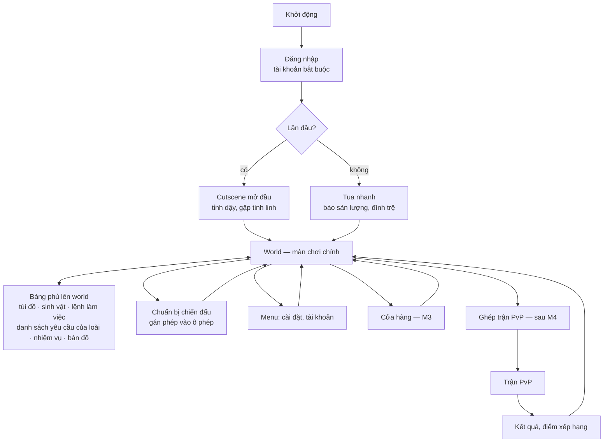
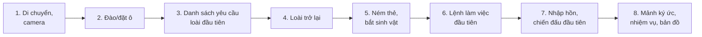

# Điều khiển & UI/UX

> Trạng thái: Nháp
> Liên quan: [Cơ chế](mechanics.md) · [Core loop](core-loop.md) · [Art style](../03-art-audio/art-style.md) · [Cốt truyện](../01-story/plot.md) · [Tech stack](../04-tech/tech-stack.md)

Phục vụ ràng buộc nền tảng PC + mobile ([vision](../00-vision.md)), không gắn pillar riêng. Onboarding gắn P3 (tinh linh dẫn dắt trong khung truyện) và P1 (bài học đầu tiên là hồi sinh một loài). Mọi đề xuất của AI (2026-10-13) đánh dấu `[ý tưởng]`.

**Đã quyết (user, 2026-10-13):**
- **Camera góc 3, xoay tự do** quanh nhân vật (bỏ ý tưởng B3 "góc nghiêng cố định" — [ideas](../ideas.md)).
- **Tay cầm để sau phát hành.** User lo tay cầm khó nhắm phép định hướng → cách nhắm dưới đây làm chung cho chuột, cảm ứng và tay cầm, để thêm tay cầm sau không phải làm lại.

## Điều khiển
**Nguyên tắc** [ý tưởng]
- **Nhắm theo tâm màn hình** cho mọi thiết bị: ô / sinh vật nằm dưới **tâm nhắm** là đích; ô đích được tô viền. Xoay camera = nhắm → chuột, vuốt màn hình và cần phải tay cầm cùng một cơ chế.
- **Hành động theo công cụ đang cầm:** **thanh công cụ** chứa cuốc (đào), khối (đặt), lệnh làm việc, thẻ bài, phép của pháp sư. Một nút **hành động chính** dùng công cụ đang cầm → mobile ít nút.
- **Chọn vùng bằng 2 điểm** (lệnh làm việc, vùng đào): nhắm góc 1 → hành động chính → nhắm góc 2 → hành động chính. Không cần kéo chuột/ngón tay → không tranh với vuốt xoay camera, tay cầm làm được y hệt.
- Con trỏ chuột khoá ở giữa khi chơi; mở menu / giữ Alt thì hiện con trỏ.

| Hành động | Bàn phím-chuột | Cảm ứng | Tay cầm (sau phát hành) | Milestone |
|---|---|---|---|---|
| Di chuyển | WASD | Joystick ảo nửa trái (hiện tại chỗ chạm) | Cần trái | M1 |
| Xoay camera / nhắm | Di chuột | Vuốt nửa phải màn hình | Cần phải | M1 |
| Thu phóng camera | Lăn chuột | Chụm 2 ngón | Nhấn cần phải (đổi gần/xa) | M1 |
| Nhảy | Space | Nút nhảy | A | M1 |
| Hành động chính (dùng công cụ đang cầm) | Chuột trái | Nút hành động chính | RT | M1 |
| Huỷ / bỏ điểm đang chọn | Chuột phải | Nút huỷ (hiện khi đang chọn) | B | M1 |
| Đổi công cụ | Phím 1–6 | Chạm ô trên thanh công cụ | LB / RB | M1 |
| Tương tác (nhặt, mở kho, nói chuyện NPC) | F | Nút ngữ cảnh (hiện khi có thứ để tương tác) | X | M1 |
| Chạy nhanh | Shift | Đẩy joystick hết cỡ | Nhấn cần trái | M2 |
| Ném thẻ bài | Chuột trái (khi cầm thẻ) | Nút hành động chính | RT | M2 |
| Khoá mục tiêu | Chuột giữa | Chạm thẳng vào sinh vật | Nhấn cần phải giữ lâu | M2 |
| Nhập hồn / thoát | R (nhắm sinh vật của mình) | Nút nhập hồn (hiện khi nhắm trúng) | Y | M2 |
| Đánh thường (khi nhập hồn) | Chuột trái | Nút hành động chính | RT | M2 |
| Phép 1–4 (khi nhập hồn) | Phím 1–4 (thanh công cụ đổi thành ô phép) | 4 nút quanh nút hành động chính | LB, RB, LT, X (khi nhập hồn X không dùng để tương tác; Y giữ cho nhập hồn / thoát) | M2 |
| Túi đồ / sinh vật / bản đồ | Tab / C / M | Nút menu → chọn | Select | M2 |
| Menu, tạm dừng | Esc | Nút menu | Start | M1 |

Phím cụ thể là đề xuất [ý tưởng]; cho người chơi **đổi phím** (M3) — Input System 1.19 có `PerformInteractiveRebinding()` để đổi lúc chạy, `SaveBindingOverridesAsJson` / `LoadBindingOverridesFromJson` để lưu ([docs](https://docs.unity3d.com/Packages/com.unity.inputsystem@1.19/manual/ActionBindings.html)).

**Nhắm phép và ném thẻ** [ý tưởng] — 3 kiểu, dùng chung cho mọi thiết bị:

| Kiểu | Cách dùng | Bàn phím-chuột | Cảm ứng | Tay cầm |
|---|---|---|---|---|
| Hướng (đạn, quả cầu lửa, ném thẻ) | Bay theo tâm nhắm; đang khoá mục tiêu thì bay về mục tiêu | Nhấn phím phép | Chạm nút = theo tâm/khoá; kéo trên nút = chỉnh hướng rồi thả | Nhấn nút; cần phải chỉnh tâm |
| Vùng (đặt vòng trên đất) | Giữ nút → **vòng nhắm** hiện trên mặt đất ở chỗ tâm nhắm (trong tầm phép) → dời vòng → thả để dùng | Giữ phím, di chuột, thả | Giữ nút, kéo, thả; kéo về nút huỷ để huỷ | Giữ nút, cần phải dời vòng, thả |
| Bản thân / không nhắm | Nhấn là dùng | Nhấn phím | Chạm nút | Nhấn nút |

- **Khoá mục tiêu** giúp mobile và tay cầm nhắm kịp trong chiến đấu: camera bám mục tiêu, phép hướng tự bay về mục tiêu. [ý tưởng] Khi ném thẻ, khoá mục tiêu không đổi tỉ lệ ném hụt do sinh vật chạy — tỉ lệ ném hụt vẫn do cân bằng quyết.
- PvP (sau M4): mọi thiết bị dùng cùng cách nhắm; trợ giúp nhắm (nếu có) phải như nhau giữa PC và mobile — quyết khi làm PvP.

**Camera** [ý tưởng]
- Camera theo sau nhân vật; khi địa hình chắn giữa camera và nhân vật (vách, trong hang) → kéo camera lại gần, tra va chạm trên lưới voxel ([world-tech](../04-tech/world-tech.md)).
- Trong hang: khoảng cách camera mặc định ngắn hơn.
- Cinemachine 3.1.7 + CinemachineDeoccluder (user duyệt 2026-10-13) (bản cho 6000.4; cần collider trên chunk) — [kiến trúc](../04-tech/architecture.md#nền-tảng-code-m1), [docs](https://docs.unity3d.com/Packages/com.unity.cinemachine@3.1/manual/CinemachineDeoccluder.html).

**Mobile** [ý tưởng]
- Nút cảm ứng tối thiểu 48 × 48 dp theo khuyến nghị Android ([docs](https://developer.android.com/guide/topics/ui/accessibility/apps)); iOS khuyến nghị 44 × 44 pt [chưa xác minh — trang HIG không đọc được, xem lại ở M1].
- Đặt UI trong `Screen.safeArea` (vùng không bị tai thỏ/bo góc che) ([docs 6000.4](https://docs.unity3d.com/6000.4/Documentation/ScriptReference/Screen-safeArea.html)).
- M3: người chơi tự kéo vị trí, cỡ các nút cảm ứng.

**Ước lượng** (chia 15–30 ngày-người của cơ chế "Điều khiển PC + mobile" — [cơ chế](mechanics.md)) [ý tưởng]:

| Phần | Nội dung | Ngày-người | Milestone |
|---|---|---|---|
| M1 | Di chuyển, camera góc 3 + tránh địa hình, tâm nhắm + tô viền ô, thanh công cụ, đào/đặt, chọn vùng 2 điểm, joystick ảo + vuốt camera | 5–10 | M1 |
| M2 | Khoá mục tiêu, ném thẻ, nhập hồn, 3 kiểu nhắm phép, nút cảm ứng theo ngữ cảnh, HUD đầy đủ | 5–10 | M2 |
| M3 | Đổi phím, tuỳ chỉnh bố cục nút cảm ứng, rà lại toàn bộ UI trên màn hình nhỏ | 5–10 | M3 |
| Sau phát hành | Tay cầm: bảng nút + điều hướng menu bằng tay cầm | 5–10 | Sau M4 |

Giả định: giao diện riêng của từng cơ chế (túi đồ, kho sinh vật, chuẩn bị chiến đấu...) đã tính trong ước lượng của cơ chế đó.

## Màn hình & luồng

| Màn hình / bảng | Nội dung | Milestone |
|---|---|---|
| Đăng nhập | Tài khoản, chọn máy chủ (nếu có) | M2 (M1 không cần) |
| World | Chơi chính, HUD | M1 |
| Tua nhanh | Thời gian vắng mặt, sản lượng nhận được, danh sách đình trệ (chạm để đi tới) | M2 |
| Lệnh làm việc | Danh sách lệnh, công đoạn, sinh vật đang làm, đình trệ | M1 (bản đơn giản) |
| Sinh vật | Đội hình hoạt động (x / giới hạn sinh vật), kho sinh vật, chi tiết cá thể (chỉ số, phân hạng, phân bổ điểm, trang bị) | M2 |
| Danh sách yêu cầu của loài | Mỗi loài: yêu cầu đã/chưa đạt; ghim một loài lên HUD; mức đáp ứng từ M2 (nhu cầu sinh vật) | M1 (bản đơn giản) |
| Kho | Sản lượng và vật liệu đang có, sức chứa (mở bằng tương tác với kho) | M1 (bản đơn giản) |
| Chuẩn bị chiến đấu | Chọn sinh vật, gán phép vào ô phép | M2 |
| Túi đồ | Vật phẩm, thẻ bài | M2 |
| Nhiệm vụ & mảnh ký ức | Nhiệm vụ chính/phụ theo map, mảnh ký ức đã có | M2 |
| Bản đồ | Map hiện tại, khối cốt truyện đã thấy, đánh dấu đình trệ | M2 |
| Cửa hàng | Gói, tiền nạp, mốc bảo hiểm công khai | M3 |
| PvP | Ghép trận, trận, kết quả | Sau M4 |

[ý tưởng] Bảng phủ không dừng mô phỏng — nông trại vẫn chạy khi người chơi mở túi đồ (game online, không có tạm dừng thật).

## HUD
[ý tưởng] HUD tối giản: chỉ hiện thứ cần cho việc đang làm; phần còn lại ẩn tới khi có thay đổi.

| Thành phần | Nội dung | Khi nào hiện | Milestone |
|---|---|---|---|
| Tâm nhắm + tô viền ô đích | Ô / sinh vật đang nhắm; tên loại ô | Luôn (trừ khi mở bảng) | M1 |
| Thanh công cụ | Công cụ đang cầm; khi nhập hồn đổi thành 4 ô phép + thời gian hồi | Luôn | M1 (công cụ), M2 (ô phép) |
| Loài đang ghim | Tiến độ danh sách yêu cầu của loài; cập nhật ngay khi đào/đặt ([core loop](core-loop.md#vòng-lặp-30-giây)) | Khi có loài được ghim | M1 |
| Đình trệ | Biểu tượng + số lượng; chạm → danh sách, đi tới; biểu tượng tại chỗ trên sinh vật | Khi có đình trệ | M1 |
| Số sinh vật hoạt động | x / giới hạn sinh vật | Trong bảng Sinh vật; lên HUD khi gần chạm giới hạn | M2 |
| Mana; máu khi chiến đấu / nhập hồn | Thanh mana dùng chung; máu của sinh vật đang nhập hồn | Khi chiến đấu, nhập hồn hoặc dùng phép | M2 |
| La bàn | Hướng khối cốt truyện gần nhất (tinh linh mức 1), đình trệ, đánh dấu của người chơi | Luôn, thu gọn | M2 |
| Lời tinh linh | Bong bóng thoại ngắn cạnh tinh linh — thay cho cửa sổ hướng dẫn | Theo sự kiện | M2 |
| Nút cảm ứng | Joystick, hành động chính, nhảy, nút ngữ cảnh (tương tác, nhập hồn, huỷ) | Chỉ trên mobile | M1 |

## Hướng dẫn người mới (onboarding)
[ý tưởng] **Tinh linh dẫn dắt, học bằng làm:** không có màn hướng dẫn chữ dài; tinh linh nói một câu ngắn và chỉ chỗ (dấu trên la bàn, tô viền ô). Thứ tự theo phần Mở đầu của [cốt truyện](../01-story/plot.md); mỗi bước mở thêm một nút/công cụ trên HUD → màn hình ban đầu rất gọn.

| # | Bước | Học gì | Tinh linh làm gì | Xong khi |
|---|---|---|---|---|
| 1 | Tỉnh dậy (sau cutscene mở đầu) | Di chuyển, xoay camera | Bay tới một chỗ, gọi người chơi theo | Tới chỗ tinh linh |
| 2 | Đất khô héo | Cuốc, khối; đào/đặt ô | Tô viền chỗ cần đào/đắp | Đào/đặt đủ số ô yêu cầu |
| 3 | Loài đầu tiên | Danh sách yêu cầu của loài; loài được ghim lên HUD sẵn | Giải thích loài này cần gì | Đạt đủ yêu cầu |
| 4 | Loài trở lại | — (phần thưởng cảm xúc) | Câu thoại khi loài đầu tiên trở lại ([world](../01-story/world.md)) | Xem xong |
| 5 | Bắt sinh vật đầu tiên | Thẻ bài, ném thẻ, khoá mục tiêu | Tặng thẻ bậc 1 (không tặng thẻ bậc cao); lần bắt này **chắc chắn thành công** (user, 2026-10-13) — người mới không mất thẻ khi đang học; phân hạng cá thể vẫn theo bậc thẻ như thường | Bắt được 1 sinh vật |
| 6 | Trồng cây | Lệnh làm việc, chọn vùng 2 điểm, công đoạn | Chỉ mảnh đất; giải thích sinh vật tự nhận việc. Sinh vật L1 làm 2 công đoạn của nó, **người chơi tự làm các công đoạn còn lại** (user, 2026-10-13 — [cơ chế](mechanics.md#lệnh-làm-việc)) | Thu hoạch xong vụ đầu |
| 7 | Sinh vật hoang chặn đường — **sau** lệnh làm việc đầu tiên (user, 2026-10-13) | Chuẩn bị chiến đấu, nhập hồn, nhắm phép | Nhắc gán phép, chỉ nút nhập hồn | Thắng trận đầu |
| 8 | Mảnh ký ức đầu tiên — khi đạt **mốc hồi sinh đầu tiên (3 loài)** của Map 1 ([levels](levels.md#map-1--đảo-vách-đá-biển)); không ngay sau bước 7 | Nhiệm vụ, mảnh ký ức, bản đồ | Báo mốc đạt, mở bảng nhiệm vụ, chỉ hướng khối cốt truyện | Nhặt mảnh ký ức |

**Dạy đúng lúc** (không đưa vào chuỗi trên) [ý tưởng]: tinh linh nói khi việc xảy ra lần đầu — đình trệ đầu tiên (không dàn dựng), lần đầu chạm giới hạn sinh vật (kho sinh vật), lần đầu vào lại game (tua nhanh), sinh vật đầu tiên đủ điều kiện tiến hoá, đạt ngưỡng PvP.

- Mỗi lời hướng dẫn chỉ hiện một lần; xem lại ở mục "Hỏi tinh linh" trong menu [ý tưởng].
- Người chơi bỏ qua bước nào cũng không bị kẹt: bước sau mở khi đạt điều kiện, không bắt buộc đúng thứ tự trừ bước 1–3 (P3).
- **Ước lượng:** chuỗi 8 bước + dạy đúng lúc ~4–8 ngày-người [ý tưởng], M2 — **hạng mục riêng** "Onboarding" trong [roadmap](../05-roadmap.md) (user, 2026-10-13), tách khỏi "Tinh linh hỗ trợ 5–10".
- M1 không làm onboarding: prototype chỉ cần một dòng chữ hướng dẫn phím.

Câu hỏi mở:
- Nút cảm ứng phép: 4 nút quanh nút chính có đủ chỗ trên màn hình điện thoại nhỏ không — thử ở M2.
