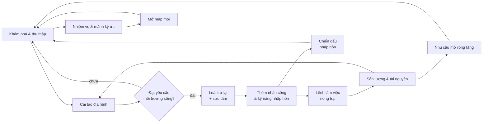

# Lối chơi cốt lõi (Core loop)

> Trạng thái: Chốt
> Chốt: 2026-10-13 (user).
> Liên quan: [Vision](../00-vision.md) · [Cơ chế](mechanics.md) · [Tiến trình](progression.md)

Trọng tâm: **hồi sinh môi trường sống** + **nông trại tự động hoá bằng sinh vật**. Chiến đấu (nhập hồn) và cốt truyện là vòng phụ.

## Vòng lặp 30 giây
<!-- Người chơi làm gì liên tục? Hành động → phản hồi → phần thưởng. -->
- Khám phá → thu thập tài nguyên → đào/đặt khối để cải tạo địa hình → thấy tiến độ yêu cầu môi trường sống của một loài tăng lên.
- Đặt/sửa lệnh làm việc (vd trồng cây trên một mảnh đất) → sinh vật rảnh nhận công đoạn → sản lượng vào kho.
- Phản hồi tức thì: thanh tiến độ môi trường sống cập nhật ngay khi đặt khối; sinh vật bị đình trệ hiện biểu tượng tại chỗ. (user chốt, 2026-10-13)

## Vòng lặp một phiên chơi
<!-- Một lần chơi (vd 10–30 phút) gồm những gì, kết thúc ra sao. -->
1. Vào game → tua nhanh: nhận sản lượng tính bù từ lần chơi trước.
2. Xử lý thông báo đình trệ (sửa đường đi, thêm kho, thêm sinh vật).
3. Chọn mục tiêu: hồi sinh một loài, làm nhiệm vụ (chính hoặc phụ), khám phá, chiến đấu (gán phép ở màn chuẩn bị chiến đấu).
4. Mở rộng lệnh làm việc → nhu cầu nhân công tăng → cần thêm loài → quay lại bước 3.
- Phiên kết thúc tự nhiên khi một loài mới định cư hoặc một nhiệm vụ xong. (user chốt, 2026-10-13)
- Thời lượng một phiên: **PC 30–60 phút, mobile 10–20 phút** (user, 2026-10-13).

## Vòng lặp dài hạn
<!-- Điều gì kéo người chơi quay lại qua nhiều phiên. -->
- Sưu tầm đủ loài, tộc, nguyên tố; sưu tầm phép; tiến hoá sinh vật.
- Thu thập mảnh ký ức — cốt truyện chính kéo dài qua mọi map.
- Đạt điều kiện để mở map mới; map mới đến theo phiên bản/mùa.
- Nông trại lớn dần → cần nhiều sinh vật hơn → cần hồi sinh thêm loài.

## Sơ đồ
<!-- Mermaid flowchart của các vòng lặp. -->

## Pillar phục vụ
<!-- Mỗi vòng lặp phục vụ pillar nào. -->
| Vòng lặp | Pillar |
|---|---|
| 30 giây: cải tạo → tiến độ môi trường sống | P1 |
| 30 giây: lệnh làm việc → sản lượng | P2 |
| Phiên: chọn mục tiêu tự do | P3 |
| Dài hạn: sưu tầm loài, mở map, mảnh ký ức | P1, P2, P3 |
| Chiến đấu (chuẩn bị chiến đấu, nhập hồn, ghép trận) | P2, P4 |
