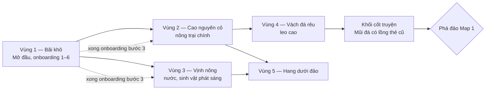

# Level / Nội dung

> Trạng thái: Nháp
> Liên quan: [Cốt truyện](../01-story/plot.md) · [Thế giới](../01-story/world.md) · [Tiến trình](progression.md) · [Cơ chế](mechanics.md) · [Điều khiển & UI](controls-ui.md) · [Kỹ thuật tạo world](../04-tech/world-tech.md)

Đã quyết (user, 2026-10-13): **Map 1 là map của vertical slice (M2)**, viết chi tiết; **Mở đầu nằm trong Map 1**; Map 2, 3 chỉ ghi khung (làm ở M4). Chủ đề 3 map lấy từ [world](../01-story/world.md#địa-điểm-chính) — vẫn là [ý tưởng]. Mọi bố trí vùng, loài, tài nguyên dưới đây là đề xuất của AI [ý tưởng] (2026-10-13). Tên map, vùng, loài: user tự đặt — dùng mã tạm (L1, L2...).

## Danh sách level/khu vực
| Map | Mục tiêu | Cơ chế giới thiệu | Thời lượng [ý tưởng] | Ước lượng công | Milestone |
|---|---|---|---|---|---|
| Map 1 — đảo vách đá, biển (gồm Mở đầu) | Hồi sinh đảo; mảnh ký ức "lần đầu dùng thẻ bài giam sinh vật" | Toàn bộ cơ chế cơ bản qua [onboarding](controls-ui.md#hướng-dẫn-người-mới-onboarding); nước, hang động, kiểu di chuyển bơi/bay | 4–6 giờ chơi tới phá đảo | 14–27 (xem dưới) | M2 |
| Map 2 — rừng lá vàng, thác, hồ lá súng | Hồi sinh khu rừng | [ý tưởng] Cây lớn mọc theo thời gian, thác/nước chảy nhiều tầng | 4–6 giờ | 30–60 (roadmap) | M4 |
| Map 3 — phế tích đá, hoa hồng/tím, đền thác | Hồi sinh phế tích | [ý tưởng] Công trình phế tích sửa được, vùng cốt truyện lớn nhất (tinh linh lộ mình) | 4–6 giờ | 30–60 (roadmap) | M4 |
| Map theo mùa | Mỗi mùa một vùng mới | Tuỳ mùa | — | Chưa ước lượng | Sau phát hành |

Thời lượng chưa có cơ sở — đo khi chơi thử slice ở M2.

### Kích thước & khung chung
- Mỗi map **128 × 128 × 48 ô** (user, 2026-10-13) = 192 chunk 16³ ([world-tech](../04-tech/world-tech.md#dữ-liệu-world)). Chạy được trên mobile tầm trung hay không: [chưa xác minh — đo ở M1].
- [ý tưởng] Mực nước biển ở y = 16; đất liền cao tới ~y = 40; hang ở y = 4–16; đáy y = 0–3 là đá không đào được.
- [ý tưởng] Ranh giới map: biển sâu (bơi được nhưng có dòng chảy đẩy lại) + sương mù ở rìa — không cần tường vô hình.
- **Bố cục vùng sinh theo seed có ràng buộc** (user, 2026-10-13): bộ sinh đặt các vùng theo seed, mỗi map có một bảng **ràng buộc bố cục** cố định. Ràng buộc của Map 1 [ý tưởng]:
  - Vùng 1 (Mở đầu) ở rìa đảo, giáp biển; vùng 3 (vịnh) và vùng 4 (vách đá) giáp biển; hang nằm dưới vùng 2–3.
  - Diện tích mỗi vùng trong khoảng ghi ở bảng vùng (±25%).
  - Đường đi bộ từ chỗ tỉnh dậy tới khối cốt truyện dài trong khoảng A–B ô; tới vùng 2 và 3 ngắn hơn C ô — A, B, C chỉnh khi chơi thử.
  - Không đạt ràng buộc → đổi seed con của bố cục, sinh lại (seed người chơi giữ nguyên, kết quả vẫn tất định).
  - Rủi ro: sinh lại nhiều lần làm chậm lúc tạo world — đo ở M2 [chưa xác minh].

### Map 1 — đảo vách đá, biển
Câu chuyện: nơi bản ngã cũ lần đầu dùng thẻ bài giam sinh vật ([world](../01-story/world.md#địa-điểm-chính)). Cảm xúc: tò mò → ấm lòng.

Vùng 1 không khoá cứng; mũi tên đứt là lúc tinh linh bắt đầu chỉ hướng sang vùng khác. Sau bước 3 của onboarding, người chơi tới vùng nào trước cũng được (P3).

**Bảng vùng** [ý tưởng]

| Vùng | Cỡ (cột chunk) | Địa hình / khối chủ đạo | Loài có thể trở lại | Yêu cầu môi trường sống chính | Tài nguyên |
|---|---|---|---|---|---|
| 1. Bãi khô (Mở đầu) | ~2 × 2 | Cát, đất khô, vài cây chết; thoải, dễ đi | L1, L2 | L1: N ô cỏ + 1 cây; L2: vũng nước ≥ N ô cạnh cỏ | Đất, cát, hạt cỏ, gỗ khô |
| 2. Cao nguyên cỏ | ~3 × 3 | Đồng cỏ, đồi thấp, đất trồng được | L3, L4, L5 | Đồng cỏ rộng, hoa, cây ăn quả, có lệnh làm việc trồng cây đang chạy | Đất tốt, gỗ, đá, hạt giống |
| 3. Vịnh nông | ~2 × 3 | Nước nông, bãi đá, san hô phát sáng | L6, L7 (bơi) | Nước ≥ N ô, độ sâu 1–3, đá ven bờ, vật phát sáng | Cát, đá, san hô, tảo |
| 4. Vách đá rêu | ~2 × 2 | Vách cao tới y ~40, rêu, gió | L8 (bay) | Điểm cao ≥ y X, đá phủ rêu, không có cây chắn | Đá, rêu |
| 5. Hang dưới đảo | Dưới vùng 2–3 | Hang noise 3D, tối, tinh thể | L9, L10 | Hang kín ≥ N ô, vật phát sáng, nước ngầm | Quặng (nguyên liệu rèn — M3), tinh thể phát sáng |
| Khối cốt truyện | 1 cột chunk | Mũi đá ở rìa vách, lồng thẻ bài cũ vỡ | — | — | — |
| Biển, rìa map | Phần còn lại | Biển sâu, sương | — | — | — |

**Loài** — 10 loài cho slice (khớp giả định của [roadmap](../05-roadmap.md) và [tóm tắt](../summary.md)); bảng dưới user đồng ý (2026-10-13):

| Mã | Vùng | Kiểu di chuyển | 2 năng lực làm việc | Ghi chú |
|---|---|---|---|---|
| L1 | 1 | Đi bộ | Xới, gieo | Loài đầu tiên (onboarding bước 3–5), yêu cầu dễ nhất |
| L2 | 1 | Đi bộ | Tưới, thu hoạch | Không bắt buộc trước onboarding bước 6 — người chơi tự làm công đoạn L1 không làm được (user, 2026-10-13) |
| L3 | 2 | Đi bộ | Vận chuyển, thu hoạch | Mở công đoạn vận chuyển vào kho |
| L4 | 2 | Đi bộ | Xới, vận chuyển | |
| L5 | 2 | Đi bộ | Gieo, tưới | |
| L6 | 3 | Bơi | Tưới, vận chuyển | Kiểu di chuyển bơi (M2) |
| L7 | 3 | Bơi | Thu hoạch, gieo | Phát sáng — hợp chủ đề "sinh vật biển phát sáng" |
| L8 | 4 | Bay | Vận chuyển, gieo | Kiểu di chuyển bay (M2) |
| L9 | 5 | Đi bộ | Xới, rèn | Rèn dùng ở M3 |
| L10 | 5 | Đi bộ | Vận chuyển, rèn | |

- Phủ đủ năng lực: mỗi công đoạn trồng cây (xới, gieo, tưới, thu hoạch) và vận chuyển có ≥ 3 loài; rèn có 2.
- Nguyên tố, tộc, nội tại, hình thái từng loài: _(chưa có)_ — viết cùng phần sinh vật & loài, tên do user đặt.
- Năng lực "rèn" lấy từ ý tưởng lò rèn ([cơ chế](mechanics.md#trang-bị)).

**Phần sắp đặt tay** [ý tưởng]
| Thứ | Ở đâu | Cố định gì |
|---|---|---|
| Ràng buộc bố cục vùng | Toàn map | Chỉ ràng buộc (giáp biển, diện tích, khoảng cách đi bộ); vị trí thật do seed |
| Chỗ tỉnh dậy + đường tinh linh dẫn (onboarding bước 1–2) | Vùng 1 | Vị trí, vài ô đất khô được tô viền để đào/đắp |
| Khối cốt truyện "Mũi đá có lồng thẻ cũ" | Rìa vùng 4 giáp biển, vị trí do seed chọn trong ràng buộc | Mẫu dựng tay + đường đi bộ từ vùng 2 lên (không cần bay/bơi); cờ khối cốt truyện cho mẫu và đường |
| Chỗ trận chiến đầu tiên (onboarding bước 7) | Giữa vùng 1 và 2 | Một sinh vật hoang chặn lối, chỉ xuất hiện sau bước 6 |

**Phần sinh theo seed** — chỉ luật và tham số, không vẽ tay [ý tưởng]:
| Preset vùng | Luật / tham số chính |
|---|---|
| Bãi khô | Độ cao thấp, biên độ noise nhỏ (thoải); cát gần biển, đất khô bên trong; mật độ cây chết thấp |
| Cao nguyên cỏ | Độ cao trung bình, đồi thoải; tỉ lệ ô trồng được cao; cây ăn quả rải rác; đá lộ ít |
| Vịnh nông | Mặt đất dưới mực nước 1–3 ô; san hô phát sáng theo noise cellular; bãi đá viền bờ |
| Vách đá rêu | Biên độ noise lớn, có vách đứng; rêu phủ mặt hướng lên; ít cây |
| Hang | Noise 3D có ngưỡng dưới vùng 2–3; ít nhất một lối ra mặt đất ở mỗi vùng; quặng + tinh thể theo độ sâu |

- Chuyển tiếp giữa các vùng: trộn tham số ở biên (vd 8 ô) để không có đường cắt thẳng.
- Kiểm tra sau khi sinh ([world-tech](../04-tech/world-tech.md#sinh-world-theo-seed)): đường tới khối cốt truyện đi được; mỗi vùng có đủ tài nguyên để đạt yêu cầu mở khoá của loài ở vùng đó — sai thì sinh lại phần đó.

**Điều kiện mở & phá đảo** [ý tưởng]
- **Mở Map 1:** từ đầu (chứa Mở đầu).
- **Phá đảo Map 1** (user đồng ý, 2026-10-13): hồi sinh ≥ 7 / 10 loài **và** nhặt mảnh ký ức chính tại khối cốt truyện → gỡ cờ khối cốt truyện (đào/đặt được ở đó). Hai điều kiện làm theo thứ tự nào cũng được.
- **Mảnh ký ức của Map 1:** 1 mảnh khi đạt mốc hồi sinh đầu tiên (vd 3 loài), 1 mảnh chính ở khối cốt truyện — theo khung nhiệm vụ của [plot](../01-story/plot.md#cấu-trúc-hồichương).

**Ước lượng Map 1** [ý tưởng] — chỉ phần nội dung; bộ sinh (15–25), khối cốt truyện (2–4), onboarding (4–8) đã tính riêng trong roadmap:

| Việc | Ngày-người |
|---|---|
| Bảng ràng buộc bố cục + 5 preset vùng (tham số) | 4–8 |
| Sắp đặt tay: chỗ tỉnh dậy, khối cốt truyện, chỗ trận đầu | 3–6 |
| Dữ liệu 10 loài: danh sách yêu cầu, vùng, năng lực | 2–4 |
| Viết nhiệm vụ chính/phụ của map | 2–4 |
| Chơi thử, chỉnh tham số | 3–5 |
| **Cộng** | **14–27** |

User chấp nhận (2026-10-13): roadmap M2 mục "sắp đặt map + viết nhiệm vụ" sửa 10–20 → 14–27. Phần đặt vùng theo ràng buộc trong bộ sinh tính trong "Sinh map theo seed 15–25" [giả định — có thể vượt].

### Map 2, Map 3 — khung (M4)
| | Map 2 — rừng | Map 3 — phế tích |
|---|---|---|
| Câu chuyện | Rút sinh khí cả khu rừng để thử sức mạnh | Nơi sinh vật thân thiết mất đi; tinh linh lộ mình |
| Số vùng [ý tưởng] | 4–5 (rừng lá vàng, cây chết, thác, hồ lá súng, hang rễ cây) | 4–5 (phế tích, đồi hoa, đền thác, hang đền) |
| Số loài [ý tưởng] | 8–10 | 8–10 |
| Khối cốt truyện | Cây cổ thụ bị rút sinh khí | Đền thác — cutscene tinh linh lộ mình ([plot](../01-story/plot.md#cách-kể-chuyện)) |
| Preset dùng lại | Hang (đổi vật liệu), cao nguyên (đổi thành nền rừng) | Hang, vách đá |
| Preset mới | Rừng, hồ lá súng | Phế tích, đồi hoa |
| Ước lượng | 30–60 | 30–60 |

**Điều kiện mở Map 2, 3** [ý tưởng]: mở cùng lúc khi xong onboarding (bước 8: mảnh ký ức đầu tiên) **và** đạt cấp độ người chơi X → người chơi tự chọn đi map nào trước (P3, [plot](../01-story/plot.md#cấu-trúc-hồichương)). Mở đồng thời → độ khó Map 2 và 3 phải ngang nhau; loài của mỗi map chỉ cần tài nguyên của chính map đó.

## Nguyên tắc thiết kế level
[ý tưởng]
- **Mỗi map 4–6 vùng**, mỗi vùng là một kiểu môi trường sống, gắn 1–3 loài. Loài gắn với vùng → người chơi đọc được "cải tạo chỗ này cho loài nào".
- **Không khoá cứng** (P3): thứ tự chỉ gợi bằng khoảng cách, độ khó yêu cầu và lời tinh linh. Chỉ onboarding bước 1–3 là bắt buộc ([controls-ui](controls-ui.md#hướng-dẫn-người-mới-onboarding)).
- **Ít sắp đặt tay:** mỗi map chỉ có bảng ràng buộc bố cục + 1–3 chỗ sắp đặt (khối cốt truyện, chỗ sự kiện). Còn lại sinh theo seed.
- **Mọi yêu cầu của loài đạt được bằng tài nguyên trong chính map đó** — trừ khi ghi rõ nguồn từ map khác. Map mở đồng thời thì không được phụ thuộc nhau.
- **Đường tới khối cốt truyện đi bộ được**, không cần sinh vật bay/bơi, không bị phá tới khi phá đảo.
- **Nông trại chạy được sớm:** người chơi tự làm được công đoạn (user, 2026-10-13) → một loài đầu tiên + người chơi đủ chạy lệnh trồng cây; thêm loài thì người chơi rảnh tay.
- **Mỗi map giới thiệu ít nhất một điều mới** (môi trường, kiểu di chuyển, hoặc cơ chế) — Map 1 nhiều nhất vì là slice.
- **Hang ở mọi map** — có loài và tài nguyên riêng (user, 2026-10-13); preset hang dùng lại, đổi vật liệu.

## Nội dung tái sử dụng
[ý tưởng]
| Thứ dùng lại | Cách dùng lại | Tiết kiệm |
|---|---|---|
| Bộ sinh world | Một bộ cho mọi map; map chỉ khác bảng ràng buộc bố cục + bảng preset | Map mới không cần code mới |
| Preset vùng | Hang, vách đá, đồng cỏ dùng lại ở map sau, đổi bảng vật liệu/cây | 1–3 ngày mỗi preset dùng lại |
| Mẫu khối cốt truyện | Cùng khung "nơi mảnh ký ức" (nền, lối vào, chỗ đặt mảnh), đổi đồ trang trí | Sắp đặt nhanh hơn |
| Mẫu yêu cầu của loài | Danh sách yêu cầu dựng từ vài loại chung: số ô loại khối, cây, độ cao/độ sâu, nước, ánh sáng, loài khác | Thêm loài = thêm dữ liệu, không code |
| Khung nhiệm vụ | 3 loại nhiệm vụ mỗi map theo [plot](../01-story/plot.md#cấu-trúc-hồichương) | Viết nhiệm vụ theo mẫu |
| Asset | Bộ vật liệu cơ bản chung + một bộ riêng mỗi map ([art style](../03-art-audio/art-style.md)) | Ít asset mới mỗi map |
| Map theo mùa | Chủ yếu là preset mới + loài mới + 1 khối cốt truyện | Giữ phần việc mỗi mùa nhỏ |

Câu hỏi mở:
- Giá trị A, B, C (khoảng cách đi bộ) và số N trong yêu cầu của từng loài — chỉnh khi chơi thử slice.
- Điều kiện mở Map 2, 3 (cấp độ người chơi X).
- Đã trả lời (user, 2026-10-13): chấp nhận 14–27 cho nội dung Map 1; bảng 10 loài và phá đảo ≥ 7 / 10 — đồng ý; người chơi tự làm được công đoạn; bố cục vùng sinh theo seed có ràng buộc.
