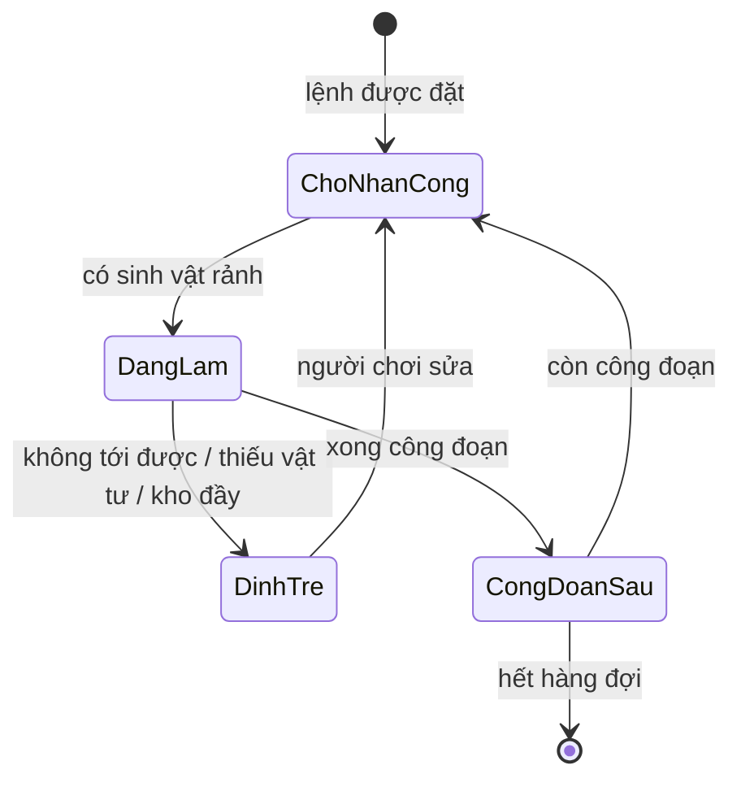
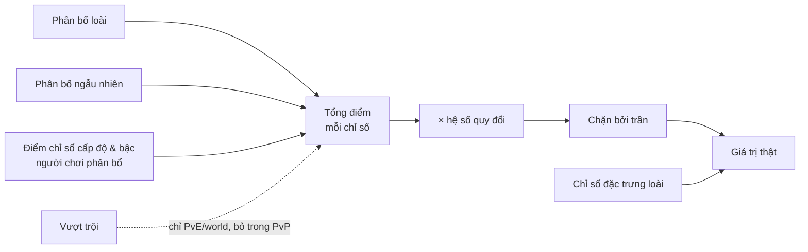

# Cơ chế

> Trạng thái: Đang xem xét
> Duyệt 2026-10-13 (user, cách (b) ở [roadmap](../05-roadmap.md#công-việc-m0-kế-hoạch--thiết-kế--ưu-tiên-hiện-tại)): **các cơ chế M1 đã duyệt** — voxel world, sinh vật & loài, chỉ số làm việc, môi trường sống, lệnh làm việc, tìm đường, điều khiển PC + mobile. Phần M2+ vẫn là nháp.
> Liên quan: [Core loop](core-loop.md) · [Điều khiển & UI](controls-ui.md) · [Kinh tế](economy.md)

## Danh sách cơ chế
<!-- Bảng: cơ chế | mô tả | pillar | thành phần phụ trách (client/server/...) | ưu tiên (phải có/nên có/có thì tốt) | ước lượng công | milestone. -->
Ước lượng (ngày-người) là ước lượng thô của AI, [chưa xác minh] — tính lại khi lập roadmap. Ưu tiên và milestone là [ý tưởng].

| Cơ chế | Mô tả | Pillar | Thành phần | Ưu tiên | Ước lượng | Milestone |
|---|---|---|---|---|---|---|
| Voxel world | Đào/đặt, chunk, lưu world; địa hình hiển thị **dạng khối bo cạnh, mép cỏ phủ** ([0011](../decisions/0011-dia-hinh-khoi-bo-canh.md); dữ liệu vẫn là lưới voxel); sinh vật, cây, vật phẩm là model riêng có khung chiếm chỗ nhiều ô voxel ([art style](../03-art-audio/art-style.md)) | P1 | Client | Phải có | 35–55 (bề mặt mịn +10–15): M1 tối giản 17–28 (+2–3 của 0009, +6–9 của 0011, +3–5 của 0012, +1 của 0013), M2 18–27 | M1 (tối giản — [0007](../decisions/0007-m1-toi-gian.md)), M2 |
| Nước chảy | Nước chảy theo ô (mực 0–7), tràn vào chỗ đào, không cạn; người chơi tạo được nguồn nước; ảnh hưởng môi trường sống, tưới nước, tìm đường; M1 dùng nước tĩnh | P1, P2 | Client | Phải có | 8–15 | M2 [ý tưởng] |
| Biến thể hiển thị | Mỗi cá thể sinh vật, cây, vật thể render khác nhau một chút theo seed riêng (kích thước, màu, hoa văn...), không giống hệt nhau | P2 | Client | Nên có | 3–6 | M2 [ý tưởng] |
| Biến thể | Dạng khác của loài: cá thể đặc biệt về màu sắc, hình thái; tách riêng với vượt trội | P1, P2 | Client + Backend (sinh khi nhận sinh vật) | Nên có | 3–5 + phần art mỗi biến thể | M3 [ý tưởng] |
| Sinh map theo seed | Phần không thuộc cốt truyện sinh theo seed của từng người chơi; bố cục vùng theo ràng buộc ([levels](levels.md)) | P1 (vùng môi trường sống cho từng loài), P3 | Client (+ công cụ sắp đặt?) | Phải có | 15–25 | M2 |
| Khối cốt truyện | Khối cốt truyện + đường đi tới nó không phá/đặt được cho tới khi phá đảo map | P3 | Client | Phải có | 2–4 | M2 |
| Sinh vật & loài | Nội tại, tộc, nguyên tố (đơn/đôi), độ hiếm (tag), cấp độ, bậc (1–3 tuỳ loài); 3 ô phép (bậc 1) / 4 ô phép (bậc 2+; loài 1 bậc có 4 ô từ đầu) | P2, P4 | Client | Phải có | 5–10: M1 2–4, M2 3–6 | M1 (3 loài), M2 |
| Chỉ số làm việc | 2 năng lực làm việc mỗi loài; tốc độ di chuyển, sức khoẻ, độ thuần thục 1–2; phân bố loài + phân bố ngẫu nhiên + điểm chỉ số (quỹ riêng, phân bổ lại bằng vật phẩm); vượt trội làm việc | P2 | Client (+ Backend từ M2: sinh và lưu chỉ số) | Phải có | 5–8: M1 1–2, M2 4–6 | M1 (thuần thục + tốc độ), M2 |
| Chỉ số chiến đấu | Máu, giáp, kháng phép, tốc độ đánh, sát thương... + chỉ số đặc trưng loài; phân bố loài + phân bố ngẫu nhiên + điểm chỉ số (quỹ riêng, phân bổ lại bằng vật phẩm); hệ số quy đổi, trần; vượt trội bị bỏ trong PvP | P2, P4 | Client + Backend (sinh chỉ số) + Game server (PvP) | Phải có | 6–10 | M2 |
| Môi trường sống | Cải tạo thế giới đạt yêu cầu → mở khoá loài | P1 | Client | Phải có | 10–20: M1 3–6, M2 7–14 | M1 (một vùng), M2 |
| Nhu cầu sinh vật | Danh sách yêu cầu mỗi loài; mức đáp ứng cao → loài xuất hiện nhiều hơn, ít bệnh/mệt, làm việc tốt hơn, đôi khi tặng quà | P1, P2 | Client | Phải có | 8–15 | M2 |
| Lệnh làm việc | Người chơi đặt lệnh, chia công đoạn, hệ thống phân sinh vật rảnh có năng lực làm việc phù hợp | P2 | Client | Phải có | 22–33: M1 8–12 (+1 của [0016](../decisions/0016-o-ruong-kho-nha-va-sinh-vat-ket.md)), M2 14–21 | M1 (một lệnh trồng cây, ô ruộng có hàng đợi), M2 |
| Nhà sinh vật | Mỗi sinh vật làm việc có nhà (công trình, hoặc nơi người chơi tự xây); có nhà mới làm việc; rảnh thì hoạt động quanh nhà; bị kẹt thì hiện lại ở nhà (user, 2026-10-14) | P2 | Client | Phải có | [ý tưởng] 6–10: M1 1, M2 5–9 | M1 (nhà mẫu đặt sẵn — [0016](../decisions/0016-o-ruong-kho-nha-va-sinh-vat-ket.md)), M2 |
| Người chơi làm công đoạn | Người chơi tự làm công đoạn của lệnh (vd cầm cuốc xới) khi thiếu loài có năng lực hoặc muốn làm nhanh (user, 2026-10-13); M1: tự xới, gieo, thu hoạch + phép Mưa để tưới ([0028](../decisions/0028-nhan-vat-tui-vat-roi-tu-trong-trot.md)) | P2 | Client | Phải có | 2–4 (nằm trong 12–20 của 0028) | M1 (0028) |
| Độ ưu tiên giữa các lệnh | Người chơi đặt thứ tự ưu tiên; ghép việc xét lệnh ưu tiên cao trước (user chốt, 2026-10-13) | P2 | Client | Nên có | [ý tưởng] 1–2 | M2 |
| Tìm đường sinh vật | Đi trên địa hình người chơi thiết kế; không tới được → đình trệ + thông báo | P2 | Client | Phải có | 12–22: M1 6–9 (+1 của [0015](../decisions/0015-tim-duong-khung-va-dao-duoi-chan.md), +1 sinh vật bị kẹt của [0016](../decisions/0016-o-ruong-kho-nha-va-sinh-vat-ket.md)), M2 6–13 | M1 (đi bộ, khung chiếm chỗ theo loài), M2 |
| Kiểu di chuyển bay, bơi | Luật ô đi được cho loài bay (không cần đất dưới chân) và bơi (ô có nước); Map 1 có loài bay, bơi ([levels](levels.md)) | P1, P2 | Client | Phải có | [ý tưởng] 4–8 | M2 |
| Tua nhanh | Khi vào lại game, tính sản lượng thay vì chạy animation; thời gian vắng mặt lấy từ giờ server | P2 | Client + Backend ([0003](../decisions/0003-server.md)) | Phải có | 8–15 | M2 |
| Chiến đấu PvE lõi | Sát thương, máu, trúng/né, sinh vật hoang tấn công và AI đơn giản, thắng/thua một trận trong world — nền cho nhập hồn và phép | P4 | Client (logic C# thuần, chạy được trên game server sau này) | Phải có | [ý tưởng] 10–20 | M2 |
| Nhập hồn | Nhập vào sinh vật, đổi bộ kỹ năng, dùng chung mana | P2, P4 | Client | Phải có | 25–40 + 3–6/loài | M2 |
| Phép của pháp sư | Phép khám phá, phát triển, tấn công đơn giản (quả cầu lửa, đi trên mặt nước...) | P1, P3 | Client | Phải có | 10–20 + 1–2/phép | M2 |
| Sưu tầm phép (phép sinh vật) | Mở khoá phép theo nhóm phép, độ hiếm; gán phép vào ô phép ở màn chuẩn bị chiến đấu | P2, P4 | Client | Phải có | 15–25 + 0,5–2/phép | M2 |
| Nhận sinh vật | Bắt, ấp nở, rút thưởng (chỉ ra loài đã hồi sinh); sinh vật mới mở khoá phép nó mang theo | P1, P2 | Client + Backend (rút thưởng) | Phải có | 10–20 | M2 |
| Đặt tên sinh vật | Người chơi đặt tên cho từng cá thể; các cá thể cùng loài của một người chơi không được trùng tên | P2 | Client + Backend (lưu tên, kiểm trùng) | Nên có | 1–2 [ý tưởng] | M2 |
| Thẻ bài & bắt sinh vật | Mỗi cá thể gắn một thẻ bài, thẻ cất trong kho sinh vật; ném thẻ để bắt (ném hụt: tỉ lệ nhỏ mất thẻ; bắt không thành: mất thẻ); tỉ lệ bắt theo chênh lệch cấp độ, bậc sinh vật, bậc thẻ; 4 bậc thẻ khác nhau tỉ lệ bắt và tỉ lệ vượt trội; bậc 4 chắc chắn bắt, chắc chắn vượt trội, có hiệu ứng | P1, P2 | Client + Backend (kết quả bắt, sinh chỉ số cá thể) | Phải có | 8–14 + art hiệu ứng mỗi loại thẻ | M2 [ý tưởng] |
| Giới hạn sinh vật & kho sinh vật | Giới hạn số sinh vật hoạt động (làm việc + chiến đấu) theo cấp độ người chơi và công trình; dư thì thả hoặc cất vào kho sinh vật | P2 | Client + Backend (sở hữu sinh vật) | Phải có | 3–6 | M2 |
| Trang bị | Trang bị cho sinh vật, nhiều bậc trang bị; ghép trang bị cùng loại cùng bậc lên bậc cao hơn; rèn ở lò rèn (nguyên liệu + sinh vật phù hợp); cộng chỉ số chiến đấu, tính trong PvP | P2, P4 | Client + Backend (sở hữu, ghép, kết quả rèn) | Phải có | 13–23 | M3 [ý tưởng] |
| Tiến hoá | Tăng bậc → mở ô phép thứ 4, mở rộng phạm vi phép mang được | P2, P4 | Client | Nên có | 10–15 | M3 |
| Nghiên cứu | Một nguồn phép mới; chi tiết _(chưa có)_ | P2 | Client | Nên có | [ý tưởng] 10–20 (chưa có thiết kế) | M3 |
| Tinh linh hỗ trợ | Tinh linh đi theo người chơi, hỗ trợ bằng thông tin; nâng cấp bằng mảnh ký ức → thông tin nhiều hơn | P1, P3 | Client | Nên có | 5–10 | M2 [ý tưởng] |
| Onboarding | Tinh linh dẫn người mới qua 8 bước học bằng làm + dạy đúng lúc ([controls-ui](controls-ui.md#hướng-dẫn-người-mới-onboarding)) | P3, P1 | Client | Phải có | 4–8 | M2 |
| Nhiệm vụ & mảnh ký ức | Cốt truyện chính + nhiệm vụ phụ mỗi map, không bắt buộc tuần tự | P3 | Client | Phải có | 15–25 | M2 |
| Mở map | Đạt điều kiện để mở map mới; điều kiện mở/phá đảo từng map ở [levels](levels.md) | P3 | Client | Phải có | 2–4 | M2 |
| Cấp độ người chơi | Tăng từ nhiều nguồn: mở khoá sinh vật mới, hoàn thành nhiệm vụ... | P1, P3 | Client + Backend | Phải có | 3–5 | M2 |
| Tiền tệ & cửa hàng | Tiền trong game, tiền nạp; làm đẹp (skin), hiệu ứng, tăng cơ hội, đẩy nhanh xây dựng, ưu đãi nạp (vật phẩm hỗ trợ, túi đồ +10%, giới hạn sinh vật +10%...) | — (mô hình kinh doanh, xem [vision](../00-vision.md)) | Client + Backend (xác thực thanh toán, bảo hiểm) | Phải có | 16–27 (gồm bảo hiểm gói +1–2) | M3 |
| Xếp hạng PvP | Điểm xếp hạng từ trận thắng, nhiều sinh vật hơn thì nhiều điểm hơn | P4 | Backend | Nên có | 5–10 | Sau M4 — cùng PvP [ý tưởng] |
| Chế độ nhiều người | PvP 1v1 thời gian thực qua ghép trận (theo hạng, rồi cấp độ trung bình), 3–5 sinh vật tuỳ thể thức, điểm xếp hạng; game server quyết định kết quả; mở khi đạt ngưỡng PvP. PvE diễn ra trong world riêng | P4 | Client + Backend + Game server ([0003](../decisions/0003-server.md)) | Nên có | 60–120 | Sau M4 — cập nhật sau phát hành [ý tưởng] |
| Điều khiển PC + mobile | Một bộ điều khiển và UI chạy trên cả hai; camera góc 3 xoay tự do; tay cầm sau phát hành — [controls-ui](controls-ui.md) | — (ràng buộc nền tảng, xem [vision](../00-vision.md)) | Client | Phải có | 15–30 (rải qua các milestone) | M1–M3 |

## Chi tiết từng cơ chế
<!-- Mỗi cơ chế: quy tắc, tham số chính (để tune), trường hợp biên, cách người chơi học. -->

### Luật M1 (M1 tối giản)
Viết sau rà soát 2026-10-13 để đủ luật cho prototype [0007](../decisions/0007-m1-toi-gian.md). **User duyệt 2026-10-13** (bắt đầu M1); số là số tạm, chỉnh khi chơi thử (`game-balance`).

#### Voxel world — luật M1
- Vật liệu: **đất, cỏ, đá, cát**; nước có sẵn (biển quanh đảo + hồ). Hai lớp đáy là đá không đào được. Ô nước không đào được (không lấy nước vào kho).
- **Biển tràn** (user, 2026-10-13, [0012](../decisions/0012-bien-tran-va-luat-dat-khoi-m1.md)): mực nước biển S = mực nước của world; đào một ô cao ≤ S kề mặt (6 hướng) ô nước hoặc biển ngoài map → nước lan qua mọi ô rỗng ≤ S thông với nó (khe chéo không thông) **theo nhịp** ([0013](../decisions/0013-nuoc-lan-theo-nhip.md)): rơi thẳng xuống ngay, lan ngang/dâng lên 1 ô mỗi nhịp (~8 nhịp/giây); đặt khối vào đường nước đang lan thì chặn được. Ô cao hơn S không ngập. Nước không tự rút — đặt khối/phá tường không làm khô vùng nào. Chảy dần (mực 0–7) là M2.
- **Đào** (cuốc): ô thành rỗng, ~~vật liệu +1 vào **kho vật liệu** của người chơi — một bộ đếm theo loại vật liệu, chưa giới hạn ở M1 (túi đồ đầy đủ là M2)~~ → **rơi ra vật rơi** (bản mini của khối), người chơi nhặt vào **túi đồ** (user, 2026-10-22, [0028](../decisions/0028-nhan-vat-tui-vat-roi-tu-trong-trot.md); xem [Nhân vật, túi đồ, tự trồng trọt — luật M1](#nhân-vật-túi-đồ-tự-trồng-trọt--luật-m1)).
- **Đặt** (khối): chọn loại trên thanh công cụ, tiêu 1 từ ~~kho vật liệu~~ túi đồ (0028); hết thì không đặt được. Đặt vào ô **rỗng hoặc ô nước** (nước ô đó mất), ô phải **kề mặt ít nhất một khối đặc** (user, 2026-10-13, [0012](../decisions/0012-bien-tran-va-luat-dat-khoi-m1.md)). Không đặt vào ô đang có người chơi, sinh vật, cây, kho.
- **Đào dưới chân sinh vật** (user, 2026-10-14, [0015](../decisions/0015-tim-duong-khung-va-dao-duoi-chan.md)): được phép; sinh vật chạy ra ô bên cạnh đứng được, không có thì rơi thẳng xuống. Nước lan vào ô sinh vật đứng cũng vậy. Sinh vật không đi vào nước (bơi M2); mỗi loài có khung chiếm chỗ 3 chiều (M1 đều 1 × 1 × 1).
- Cỏ đặt trực tiếp (chưa có cỏ tự lan). Ô đất/cỏ trên cùng, phía trên trống → ~~đặt lệnh trồng cây được~~ **đánh dấu xới được** bằng công cụ Xới ([0025](../decisions/0025-nguoi-choi-xoi-dat-chon-giong-hang-doi.md)); sinh vật xới xong thì ô thành **ô ruộng** (vật liệu riêng) mới gieo được ([0020](../decisions/0020-o-ruong-tao-khi-xoi-va-huy-vu.md)). Đào ô ruộng → +1 đất.

#### Nhân vật, túi đồ, tự trồng trọt — luật M1
Chốt (user, 2026-10-22, [0028](../decisions/0028-nhan-vat-tui-vat-roi-tu-trong-trot.md)); P2, P1; client; M1 12–20 ngày-người. Số là [số tạm].
- **Nhân vật đơn giản** (khối ghép, cao 2 ô), góc nhìn thứ ba; camera bay chỉ còn là chế độ debug.
- ~~**Tầm với:** mọi thao tác — đào, đặt, xới (đánh dấu, click ô ruộng), nhặt (Thu, click), gieo, thu hoạch, phép Mưa, mở kho — trong **8 ô** quanh nhân vật, đo Euclid từ tâm thân tới tâm ô ([0031](../decisions/0031-tam-voi-moi-thao-tac-8-o.md), user 2026-10-22; thay 0030).~~ → **Tầm thao tác 10 ô / tầm thực hiện 2 ô** (user, 2026-10-23, [0034](../decisions/0034-dieu-khien-pc-click-di-chuyen.md), M1 world 7l): chuột phải click được trong 10 ô; nhân vật tự đi tới gần 2 ô rồi mới đào, đặt, xới, gieo, tưới, thu hoạch, mở kho, đặt camera quan sát, xem bảng ô ruộng; Thu hút vật rơi trong 2 ô. Cách đo giữ nguyên.
- **Vật rơi:** đào → bản mini của khối rơi tại chỗ, nằm yên, không tự mất; cùng loại trong một ô gộp thành chồng. Nhặt bằng **hành động Thu** (hút mọi vật rơi trong tầm) hoặc click từng vật. Mất khối bên dưới → vật rơi rơi thẳng xuống mặt đặc, gộp nếu cùng loại; nước không cuốn, vật rơi chìm xuống đáy. Đặt khối vào ô có vật rơi → vật rơi bị đẩy lên ô không đặc đầu tiên phía trên; không còn ô nào → không đặt được (user, 2026-10-22, task contract sim 7e).
- **Túi đồ** khác kho. ~~Không có mức tối đa ([0004](../decisions/0004-tien-nap.md)).~~ Từ [0034](../decisions/0034-dieu-khien-pc-click-di-chuyen.md) (user, 2026-10-23): **có giới hạn ô** — ban đầu túi 10 ô + **túi phụ** 2 ô, lưới chia trang, mỗi loại một ô, tối đa 999/ô (quá thì sang ô mới); túi đầy → vật phẩm nằm lại thành vật rơi [ý tưởng]. Chuyển túi ↔ túi phụ ↔ kho: kéo thả cả chồng, hoặc chọn ô → Tab đổi đích (ưu tiên túi > túi phụ > kho) → 1 / 2 / 3 = toàn bộ / nửa / một phần ba (làm tròn lên, tối thiểu 1 [số tạm]). Đầu game có **túi hạt Cây A (4 hạt)** trên mặt đất gần chỗ xuất phát.
- **Tự trồng trọt:** click ô có biển canh tác → nhân vật tự đi tới và xới (thời gian như sinh vật thuần thục gốc) · mở túi → chọn túi hạt → **chế độ gieo** → click ô ruộng đã xới → gieo (−1 hạt) · ngoài chế độ gieo, click ô ruộng mở bảng ô ruộng như cũ · cây lớn 100% → click thu hoạch → nông sản + hạt vào túi.
- **Tưới:** người chơi không tưới tay; cần sinh vật biết tưới hoặc **phép Mưa** (có sẵn, 1 ô trong tầm, hồi 10 giây): ô ruộng chờ tưới → tưới xong; ô đất → cỏ.
- **Kho ↔ túi:** đứng trong tầm kho → mở kho → chuyển đồ hai chiều.
- **Máu + mana của nhân vật** (user, 2026-10-23, [0034](../decisions/0034-dieu-khien-pc-click-di-chuyen.md), M1 world 7l): đào, đặt khối, phép Mưa tốn mana (hành động khác không); mana hồi dần **khi di chuyển**; không đủ mana → không làm. Mất máu khi rơi từ chỗ quá cao, hoặc khi **nước ngập đầu** (mất dần). [số tạm] mana tối đa 100, đào 5 / đặt 3 / Mưa 15, hồi 2 mỗi ô đi; máu tối đa 100, rơi > 4 ô mất 10 mỗi ô vượt, ngập đầu 5/giây; [ý tưởng] hồi 1 máu/giây sau 5 giây không mất máu; máu 0 → hiện lại chỗ xuất phát, không mất đồ.
- **Gieo tay** (0034): cầm hạt (chuột phải ô trong túi / phím túi phụ) → chuột phải ô ruộng đã xới → đi tới, gieo; **chỉ gieo tay được ô ruộng không có hạt nào trong hàng đợi**. Bảng chọn giống + hàng đợi giữ nguyên. Thay "chế độ gieo" và luật "ô đang chờ gieo cùng loại → gieo bằng hạt túi" ở dưới khi 7l xong.
- **Chi tiết M1** (task contract sim 7f, user xác nhận 2026-10-22; brief 0040–0042):
  - *Tự xới:* đứng xới **6 giây** sau khi tới ô kề (bằng thời gian xới của sinh vật tốc độ 1000‰). Bấm đi/nhảy, đổi công cụ, dùng công cụ khác, vào chế độ gieo → huỷ, không giữ tiến độ. Không có đường → `Không tới được ô này`. Sinh vật xới xong trước → người chơi dừng. Ô xới lại: nút `Tự xới` trong bảng ô ruộng. Bỏ đánh dấu = chuột phải lên biển.
  - *Lệnh người chơi* vào mô phỏng giữa hai nhịp: công đoạn đang mở của ô xong ngay (người chơi làm); sinh vật đang làm công đoạn đó về rảnh; hạt kho đã giữ cho gieo trả lại kho; sinh vật không làm lại công đoạn người chơi đã làm.
  - *Gieo:* ô đã xới đứng yên → vụ mới (hàng đợi giữ nguyên); ô đang chờ gieo cùng loại → gieo xong bằng hạt túi; ô chờ gieo khác loại / chưa xới / đã có cây → không gieo, báo lý do. Hết hạt → thoát chế độ gieo.
  - *Phép Mưa:* ô không có tác dụng (không phải ô ruộng chờ tưới, không phải ô đất có ô trên trống) → không tính hồi.
  - *Thu hoạch:* với mọi công cụ / chế độ; Cây A +1 nông sản +1 hạt, Cây B +3 +2 (`sim_m1.json`); không chở về kho.
  - *Kho ↔ túi:* chỉ hạt và nông sản (khối không cất kho); mỗi click 1, Shift + click tất cả; túi → kho dừng khi kho chung đầy; có kho trong 8 ô mới chuyển được, ngoài tầm bảng kho chỉ xem.
- ~~Sinh vật vẫn làm như cũ (0025–0027).~~ → **Sinh vật chỉ làm công đoạn được giao** ([0036](../decisions/0036-sinh-vat-chi-lam-cong-doan-duoc-giao.md), user 2026-10-24, sim 7g): biển canh tác = giao xới; hàng đợi có hạt = giao trồng đủ chuỗi; nút **Tiếp tục** trên ô tiến trình = giao 1 công đoạn kế. Vụ người chơi tự gieo → sinh vật không tự tưới / thu hoạch / xới lại. Người chơi chen vào ô đã giao → sinh vật làm tiếp.

#### Sinh vật trở lại — luật M1
- Loài đạt đủ yêu cầu mở khoá → **2 cá thể** xuất hiện ở rìa map, đi về phía người chơi và **tự vào đội làm việc** (chưa có thẻ bài — bắt bằng thẻ từ M2).
- Chỉ số = base của loài (chưa có phân bố ngẫu nhiên). Chưa có giới hạn sinh vật (tối đa 3 loài × 2 = 6); đo hiệu năng dùng sinh vật giả.
- Yêu cầu mở khoá (ví dụ để thử): L1 (xới, gieo): ≥ 20 ô cỏ + 1 cây · L2 (tưới, thu hoạch): ≥ 10 ô cỏ cạnh hồ · L3 (vận chuyển, thu hoạch): ≥ 15 ô đá lộ thiên + 1 kho đã đặt.

#### Kho & lệnh trồng cây — luật M1
- **Một kho**, người chơi đặt bằng công cụ trên ô phẳng, chiếm 1 ô; sức chứa 50 sản lượng. → Thay bởi 0025 (cuối mục): nhiều kho thông nhau, M1 đặt kho bằng bố trí sẵn.
- ~~**Một loại cây.**~~ Hai loại cây từ 0025. Kho bắt đầu có 10 hạt; mỗi lần thu hoạch được 1 nông sản + 1 hạt → vòng lặp tự duy trì.
- Công đoạn: xới → gieo (trừ 1 hạt trong kho, chưa cần đi lấy) → tưới (chưa cần lấy nước) → cây lớn 120 giây → thu hoạch (nông sản nằm tại ô) → vận chuyển vào kho.
- Chưa có L3 → nông sản nằm tại ruộng, đình trệ "thiếu năng lực vận chuyển" — người chơi thấy vì sao cần thêm loài.
- Kho đầy → đình trệ "kho đầy".
- Chi tiết (user, 2026-10-14, [0016](../decisions/0016-o-ruong-kho-nha-va-sinh-vat-ket.md)):
  - ~~**Ô ruộng** = ô đất/cỏ có ô trống phía trên.~~ Thay bởi 0020 (dưới). Sinh vật **ưu tiên đứng ở ô kề** để xới/gieo/tưới/thu hoạch; không có ô kề nào tới được thì đứng ngay trên ô ruộng.
  - **Kho là công trình** có sức chứa, chiếm ô (không đi qua, không đứng lên); vận chuyển tới **một ô kề kho** là giao được.
  - **Mỗi ô ruộng có chuỗi công đoạn riêng và một hàng đợi vụ**: người chơi xếp lịch (vd lúa, lúa, cà, lúa — mỗi lần chọn thêm một vụ vào cuối). Ô được giao việc liên tục tới khi hết hàng đợi hoặc không đủ điều kiện sản xuất (vd hết hạt → chờ). **Ô ruộng cấp 1 có 2 chỗ trong hàng đợi.** M1 một loại cây; nhiều loại cây + cấp ô ruộng ở M2 [ý tưởng ước lượng 1–2].
  - Hàng đợi gồm cả vụ đang làm; thu hoạch xong vụ rời hàng đợi, vụ kế bắt đầu lại từ xới (Planner).
  - Mỗi lần thu hoạch: **1 lượt vận chuyển mang cả 1 nông sản + 1 hạt**; sức chứa 50 **tính chung** nông sản và hạt.
  - Hiển thị (bước 6): khi vận chuyển sinh vật mang một hộp nhỏ; khi xới, tưới... có biểu tượng nhỏ bên cạnh.
- Ô ruộng và huỷ vụ (user, 2026-10-19, [0020](../decisions/0020-o-ruong-tao-khi-xoi-va-huy-vu.md), M1 simulation bước 6a, làm sau 6b — [0021](../decisions/0021-lam-6b-truoc-6a.md)):
  - Lệnh trồng cây đặt lên vùng ô đất/cỏ có ô trống phía trên. **Sinh vật xới xong một ô → ô đó thành ô ruộng** (vật liệu mới, màu riêng, không có mép cỏ); từ đó mới gieo/tưới/thu hoạch. Xới ô cỏ làm giảm số ô cỏ của môi trường sống.
  - **Huỷ vụ:** đặt khối lên ô ruộng hoặc đào ô ruộng → vụ đang làm bị huỷ. Đã trừ hạt mà chưa thu hoạch → **trả 1 hạt vào kho ngay** (kho đầy vẫn trả); nông sản chưa thu thì mất. Hàng đã thu hoạch (nằm tại ô hoặc đang chở) vẫn chở vào kho.
  - Sau khi huỷ vụ, **ô rời lệnh, hàng đợi vụ bị xoá**. Đào: ô thành rỗng, +1 đất. Đặt khối lên: ô ruộng bên dưới **trở lại ô đất**. Muốn trồng lại phải đặt lệnh lại.
  - Thứ tự chọn việc giữ như cũ: công đoạn cũ nhất trước (sinh vật làm được cả xới lẫn gieo sẽ xới hết các ô rồi mới gieo).
  - Nước tràn lên ô ruộng tính như đặt khối; ô chưa xới bị đào/che → rời lệnh, không trả gì (Planner đề xuất, user xác nhận 2026-10-21 khi duyệt brief 0026).
- Đánh dấu xới, chọn giống, kho thông nhau (user, 2026-10-21, [0025](../decisions/0025-nguoi-choi-xoi-dat-chon-giong-hang-doi.md), M1 simulation bước 7b + 7c, làm trước bước 8; hàng đợi đổi thành ô đợi theo loại × số lượng ở [0026](../decisions/0026-hang-doi-o-doi-theo-loai.md), bước 7d; ô tiến trình, tạm dừng xới, huỷ vụ không trả hạt, bảng ô ruộng dạng ô vuông ở [0027](../decisions/0027-o-tien-trinh-tam-dung-xoi-khong-tra-hat.md), bước 7d). **Thay lệnh trồng cây theo vùng ở trên:**
  - **Công cụ Xới** (cùng cấp Đào/Đặt): người chơi đánh dấu **từng ô** đất/cỏ có ô trống phía trên → **biển canh tác** hiện ngay → sinh vật có năng lực xới tới xới → biển mất, ô thành ô ruộng. Xới không cần chọn giống trước. Bỏ lệnh vùng; "chọn thông minh" theo khuôn (2 × 2, 3 × 3, 1 × 3…) mở khoá sau này — [ideas](../ideas.md).
  - **Bấm ô ruộng → chọn giống** → vụ vào cuối hàng đợi (2 chỗ). Ô vừa xới: vụ đầu bắt đầu từ gieo. Vụ kế trên ô đã thu hoạch: **xới lại** rồi gieo. Hết hàng đợi → ô ruộng đứng yên.
  - **Hai loại cây** (tạm Cây A, Cây B — user đặt tên): khác thời gian lớn, hạt, sản lượng; số liệu bằng `game-balance`.
  - **Kho:** nông sản chở về **kho gần nhất tới được**; **các kho thông nhau** (hàng tính chung, sức chứa cộng dồn); **nút Kho** xem vật phẩm. Người chơi tự đặt thêm kho để M2.
  - Luật chi tiết do Planner đề xuất (trạng thái "đã xới", bỏ đánh dấu, xoá vụ trong hàng đợi, hạt theo loại): xem 0025.

### Lệnh làm việc
**Quy tắc**
- Người chơi đặt lệnh làm việc lên một vùng (vd một mảnh đất để trồng cây). Có thể xếp hàng (queue) nhiều loài cây, trồng lần lượt.
- Mỗi lệnh gồm nhiều công đoạn, vd: xới đất → gieo hạt → tưới nước → thu hoạch → vận chuyển.
- Hệ thống tìm sinh vật đang rảnh **có năng lực làm việc khớp với công đoạn** và phân vào công đoạn còn thiếu người làm. Sinh vật chỉ làm công đoạn thuộc 2 năng lực làm việc của loài (user, 2026-10-12) — xem [Chỉ số sinh vật](#chỉ-số-sinh-vật).
- Không dùng AI phức tạp: sinh vật chỉ thực hiện công đoạn được giao.
- **Người chơi tự làm được công đoạn** (user, 2026-10-13), vd cầm cuốc xới ô đất của lệnh → công đoạn đó xong cho ô ấy. Dùng khi chưa có loài đủ năng lực (onboarding bước 6 — [controls-ui](controls-ui.md#hướng-dẫn-người-mới-onboarding)) hoặc muốn làm nhanh. [ý tưởng] Ước lượng 2–4 ngày-người, M2. Chi tiết (user, 2026-10-14, [0014](../decisions/0014-ghep-viec-o-sim-buoc-1.md)): người chơi mở tab nhiệm vụ, nhận một công đoạn chưa giao cho sinh vật nào rồi tự đi tới làm; công đoạn dừng giữa chừng giữ tiến độ. M1 chỉ có sẵn trường dữ liệu.
- **Tối đa 2 sinh vật cùng làm một công đoạn** (user, 2026-10-13) → thời gian công đoạn giảm. Con thứ hai rút ngắn ít hơn con đầu (user chấp nhận đề xuất, 2026-10-13), vd thời gian × 0,6 thay vì × 0,5 — số liệu bằng `game-balance`.
- Tốc độ/hiệu quả làm công đoạn theo **độ thuần thục** của năng lực tương ứng (vd thuần thục cao rút ngắn thời gian tưới nước, vận chuyển được nhiều hàng hơn mỗi lượt). M1 (user, 2026-10-16, [0018](../decisions/0018-thuan-thuc-bang-muc.md)): thuần thục chỉ đổi tốc độ làm, qua **bảng mức thuần thục** (số tạm); vận chuyển nhiều hàng hơn mỗi lượt để M2.
- Nội tại của loài cộng thêm hiệu quả cho công đoạn (vd loài có nội tại gắn với nước tưới nhanh hơn — nội tại, không phải nguyên tố). (user chốt, 2026-10-13) M1 chưa có nội tại (hệ số = 1).
- Người chơi đặt độ ưu tiên giữa các lệnh. (user chốt, 2026-10-13; làm ở M2)

**Tham số chính:** thời gian gốc của công đoạn, độ thuần thục và tốc độ di chuyển của sinh vật, hiệu quả theo nội tại, sức chứa kho, số sinh vật tối đa mỗi lệnh.

**Trường hợp biên**
- Không có sinh vật rảnh → lệnh chờ, hiện trong danh sách việc thiếu nhân công.
- Không sở hữu loài nào có năng lực cho một công đoạn → công đoạn đó chờ; [ý tưởng] thông báo chỉ rõ năng lực còn thiếu (gợi ý loài cần hồi sinh — nối với P1).
- Sinh vật bị lấy đi (nhập hồn, chuyển lệnh) giữa công đoạn → công đoạn trả về trạng thái chờ, giữ tiến độ. (user chốt, 2026-10-13)
- Kho đầy → đình trệ ở khâu vận chuyển.

### Tìm đường sinh vật & đình trệ
- Người chơi phải thiết kế địa hình để sinh vật đi lại và làm việc được.
- Không có đường tới vị trí của công đoạn → công đoạn đó **đình trệ** và gửi thông báo cho người chơi.
- Thông báo chỉ rõ vị trí và lý do (không có đường / thiếu vật tư / kho đầy), bấm vào để xem tại chỗ. (user chốt, 2026-10-13)
- Mỗi loài có kiểu di chuyển (đi bộ, bay, bơi) — ảnh hưởng đường đi và là một lý do để sưu tầm thêm loài. (user chốt, 2026-10-13) **M1 chỉ đi bộ**; bay, bơi ở M2 ([0007](../decisions/0007-m1-toi-gian.md)).
- **Sinh vật chặn nhau khi đi** (user, 2026-10-16, [0019](../decisions/0019-chan-nhau-ranh-quanh-nha-khong-dung-tren-ruong.md), M1 simulation bước 6b): sinh vật không đi xuyên qua nhau. Gặp con khác chắn → chờ 1 giây rồi tìm đường khác; đối đầu ở lối hẹp → con ưu tiên thấp hơn nhường, kẹt quá 5 giây thì cho đi xuyên; con rảnh tự né khỏi đường. Ô ruộng đi qua được nhưng không dừng trên đó nếu không có việc ở chính ô đó.
- **Sinh vật bị kẹt** (user, 2026-10-14): kẹt vì bất kỳ lý do gì quá một khoảng thời gian → sinh vật biến mất và hiện lại ở **nhà** của nó (xem [Nhà sinh vật](#nhà-sinh-vật)). Kẹt = **không có đường về nhà** liên tục **30 giây** (số tạm, chỉnh bằng `game-balance`). Làm ở M1, simulation bước 4 ([0016](../decisions/0016-o-ruong-kho-nha-va-sinh-vat-ket.md)); ước lượng ~1 ngày-người.
  - Chỉ đếm khi sinh vật **rảnh** (không có việc, hoặc việc vừa bị cắt đường) mà không có đường về nhà; đang đi theo đường hợp lệ hoặc đang làm thì không đếm, có việc lại thì đếm lại từ 0. Hàng đang mang bị rơi khi cắt đường → theo sinh vật về nhà nếu chưa ai nhặt. (user, 2026-10-14, [0017](../decisions/0017-dinh-tre-thong-bao-nha-mau-va-dem-ket.md))
- **Thiếu năng lực** (user, 2026-10-14, [0017](../decisions/0017-dinh-tre-thong-bao-nha-mau-va-dem-ket.md)): không sinh vật **có nhà** nào sở hữu năng lực của công đoạn (đang bận vẫn tính là có) → đình trệ. M1: thông báo là danh sách sự kiện trong lõi mô phỏng (bắt đầu / hết đình trệ, không lặp mỗi nhịp); hiển thị ở simulation bước 6.

### Nhà sinh vật
Mô tả của user (2026-10-14, [0016](../decisions/0016-o-ruong-kho-nha-va-sinh-vat-ket.md)).
- Mỗi sinh vật làm việc có **nhà**: một công trình nhà, hoặc nơi người chơi tự xây — có tường bao quanh (cao 1 ô là đủ), có khoảng hở để lắp **cửa** (vật phẩm công trình, nhiều loại và kích thước), có 2 nội thất.
- **Sinh vật có nhà mới làm việc được.** Sinh vật rảnh hoạt động trong một bán kính quanh nhà. **M1** (user, 2026-10-16, [0019](../decisions/0019-chan-nhau-ranh-quanh-nha-khong-dung-tren-ruong.md)): bán kính **4 ô**; ở ngoài thì đi về; trong bán kính thì mỗi **5–10 giây** đi tới một ô ngẫu nhiên (số tạm, chỉnh bằng `game-balance`); không dừng trên ô ruộng.
- Nhà có nhiều kích thước; mẫu ban đầu **2 × 2 × 2**, sức chứa **2** sinh vật. Sức chứa nhà người chơi tự xây theo diện tích và tường bao.
- Phần mở đầu: sinh vật có nhà sẵn.
- **M1:** nhà mẫu là **khối đặc** chiếm 8 ô (chặn đi qua, chặn đặt khối, không cửa); sinh vật hiện lại ở ô kề nhà đứng được đầu tiên theo thứ tự cố định ([0017](../decisions/0017-dinh-tre-thong-bao-nha-mau-va-dem-ket.md)).
- **M1:** chỉ nhà mẫu 2 × 2 × 2 đặt bằng code/lệnh debug, mỗi sinh vật gắn một nhà; dùng làm nơi hiện lại khi kẹt + điều kiện "có nhà mới được giao việc" (simulation bước 4, ~1 ngày-người). **M2** [ý tưởng ước lượng]: nhà người chơi tự xây + nhiều kích thước + sức chứa theo diện tích 4–7; sinh vật rảnh đi quanh nhà 1–2.
- Câu hỏi mở: bán kính hoạt động quanh nhà; "nội thất" gồm những gì; nhà có tăng giới hạn sinh vật không ([Giới hạn sinh vật](#giới-hạn-sinh-vật--kho-sinh-vật)). Sinh vật hiện lại ở ô nào: M1 đã trả lời (ô kề, [0017](../decisions/0017-dinh-tre-thong-bao-nha-mau-va-dem-ket.md)); nhà người chơi tự xây (M2) chưa.

### Tua nhanh
- Khi game tắt: không tính gì.
- Khi người chơi vào lại: tính sản lượng và tua nhanh quá trình làm việc trong khoảng thời gian vắng mặt bằng tính toán, không chạy animation, rồi trả kết quả cuối cùng.
- [ý tưởng] **Một mô hình mô phỏng, hai cách hiển thị:** lệnh làm việc luôn chạy bằng mô hình thời gian trừu tượng (thời gian công đoạn + thời gian di chuyển ước tính theo độ dài đường đi). Khi người chơi đang ở gần thì hiển thị animation; khi tua nhanh thì chỉ chạy mô hình. Kết quả hai cách giống nhau, dễ kiểm thử.
- [ý tưởng] Có giới hạn tự nhiên: sức chứa kho, hạt giống trong hàng đợi — không cần giới hạn thời gian cứng.
- Thời gian vắng mặt lấy từ **giờ server** (chống chỉnh giờ thiết bị) — xem [0003](../decisions/0003-server.md).
- [ý tưởng] Prototype M1 dùng giờ thiết bị; nối giờ server từ M2.
- [ý tưởng] Không vào được server (mất mạng) → tạm không tua nhanh, tính bù khi có lại giờ server.

### Môi trường sống
- Sinh vật đã thất lạc. Muốn đưa một loài trở lại, người chơi làm việc, cải tạo thế giới và thu thập tài nguyên để tạo môi trường theo yêu cầu của loài đó → mở khoá loài.
- Yêu cầu tính trong một vùng: tỉ lệ loại khối (nước, cỏ, đá...), cây trồng, công trình, loài khác đang có. (user chốt, 2026-10-13)
- **Hang động có sinh vật và tài nguyên riêng** (user, 2026-10-13) → có loài sống dưới lòng đất, yêu cầu môi trường sống riêng ([world-tech](../04-tech/world-tech.md#sinh-world-theo-seed)).
- **Danh sách yêu cầu của loài** (user, 2026-10-12 — thay ý tưởng ba mức xuất hiện → ghé thăm → định cư): mỗi loài có một danh sách yêu cầu (user gọi là "list nhiệm vụ theo loài"). Người chơi hoàn thành dần từng yêu cầu:
  - đạt các yêu cầu mở khoá → loài trở lại;
  - đạt thêm các yêu cầu còn lại → mức đáp ứng tăng (xem [Nhu cầu sinh vật](#nhu-cầu-sinh-vật)).
- Câu hỏi mở: yêu cầu nào thuộc phần mở khoá (cố định hay "đạt N trong M yêu cầu"); danh sách hiện đầy đủ ngay hay lộ dần.

### Buổi trong ngày
Chốt (user, 2026-10-21, [0024](../decisions/0024-buoi-trong-ngay-va-chon-thoi-diem.md)); phục vụ P1; thành phần: client; **M1**, ước lượng 4–6 ngày-người [ý tưởng].
- Một ngày world = 24 giờ thực; 4 mốc giữa đêm, bình minh, giữa trưa, hoàng hôn.
- Người chơi chọn mốc bằng vòng 4 biểu tượng (kèm dòng "đang ở buổi …"). Chọn xong, bầu trời xoay tới mốc **theo chiều tiến** (không bao giờ ngược), buổi đổi thật rồi tiếp tục trôi.
- **Khung mốc** (user, 2026-10-21): chia ngày thành 4 phần bằng nhau, mỗi mốc sở hữu phần từ mốc đó tới mốc kế tiếp (giữa đêm [0; 0,25) · bình minh [0,25; 0,50) · giữa trưa [0,50; 0,75) · hoàng hôn [0,75; 1)). Pha còn trong khung của mốc nào thì chọn lại mốc đó không làm gì; đã trôi ra khỏi khung mới chọn được → cung xoay luôn trong (0; 0,75] ngày.
- **Không đổi** đồng hồ mô phỏng: lớn cây, xây dựng, nước lan, nhịp sim giữ nguyên.
- Tương tác lần đầu: điều kiện môi trường sống có thể yêu cầu đang ở buổi X. Loài ngày/đêm, cây theo buổi → M2+ ([ý tưởng]).

### Nhu cầu sinh vật
Mô tả của user (2026-10-12). Tên "nhu cầu sinh vật", "mức đáp ứng" là [ý tưởng].
- **Mục đích:** khiến người chơi tiếp tục cải thiện môi trường sống cho sinh vật, thay vì triệu hồi rồi bỏ đó (P1).
- Mỗi loài có một **danh sách yêu cầu**. Đáp ứng càng nhiều yêu cầu (**mức đáp ứng** càng cao) thì:
  - loài đó xuất hiện càng nhiều trong môi trường;
  - sinh vật ít bị **bệnh**, ít **mệt** hơn;
  - làm việc tốt hơn;
  - đôi lúc tặng quà cho người chơi.
- Chỉ số **sức khoẻ** của cá thể giảm khả năng bị bệnh (xem [Chỉ số sinh vật](#chỉ-số-sinh-vật)).
- Danh sách yêu cầu dùng chung với môi trường sống: một danh sách cho cả mở khoá loài lẫn mức đáp ứng (user, 2026-10-12) → một hệ dữ liệu cho cả hai cơ chế.
- **Bệnh, mệt tác động theo mức độ** (user, 2026-10-13): nhẹ → làm chậm; nặng hơn → nghỉ nhiều hơn; nặng nhất → dừng làm việc.
- **Nghỉ là chu kỳ bình thường** (user, 2026-10-13): sinh vật khoẻ mạnh cũng cần những khoảng nghỉ trước khi làm việc trở lại. Mỗi sinh vật có **độ bền làm việc** (user chấp nhận đề xuất, 2026-10-13): làm thì giảm, nghỉ thì hồi; về 0 thì nghỉ tới khi hồi đủ; mức đáp ứng nhu cầu cao → hồi nhanh hơn.
- Câu hỏi mở: chữa bệnh thế nào; quà là gì; mức đáp ứng tính theo vùng hay toàn map; ngưỡng các mức bệnh/mệt.

### Sinh vật & loài
- Mỗi loài có đặc điểm khác nhau, có tính sưu tầm. Loài được đặc trưng bởi **nội tại**; phép thì nhiều loài có thể dùng giống nhau.
- **Nội tại:** đặc điểm cố hữu của loài, tác dụng cả khi làm việc (phát triển) lẫn khi chiến đấu.
- **Ô phép:** sinh vật bậc 1 có 3 ô phép; từ bậc 2 có 4 ô. Ô thứ 4 là **ô đặc biệt**: chỉ ô này chứa được phép yêu cầu ô đặc biệt, và vẫn chứa được phép thường. Phép trong ô thay thế được.
- **Tộc:** một tộc gồm nhiều loài. **Nguyên tố:** đơn hoặc đôi. Danh sách trước mắt có 12 nguyên tố: Kim, Mộc, Thuỷ, Hoả, Thổ, Phong, Hàn, Lôi, Độc, Quang, Ám, Hỗn mang; đặc điểm từng nguyên tố: _(chưa có)_ (user, 2026-10-24 — [0037](../decisions/0037-phong-cach-sinh-vat-do-hiem-nguyen-to-bac.md)).
- **Cấp độ, bậc:** phép có yêu cầu cấp độ và bậc. **Tiến hoá** tăng bậc, mở rộng phạm vi phép mang được. Mỗi loài có **1 bậc (không tiến hoá), 2 hoặc 3 bậc** (user, 2026-10-24). **Loài chỉ có 1 bậc**: bậc đó tính tương đương bậc 2 hoặc 3 (ghi trong dữ liệu của loài) → có ô phép thứ 4 (ô đặc biệt) ngay từ đầu. Tiến hoá: sinh vật to hơn, thêm chi tiết, đổi hình, có thể đổi nhóm kích thước; số đo từng bậc (mét, 1 ô = 1 m) ghi trong spec của loài.
- **Độ hiếm của loài:** chỉ là tag, tạm thời không ảnh hưởng tỉ lệ xuất hiện, bắt hay rút thưởng (user, 2026-10-24). Các mức: _(chưa có)_.
- **Tên sinh vật:** người chơi đặt tên cho từng cá thể; các cá thể cùng loài (của một người chơi) không được trùng tên (user, 2026-10-24). Câu hỏi mở: tên có hiện trên đầu sinh vật không; có lọc từ ngữ xấu khi tên hiện cho người khác (PvP) không; độ dài tối đa.

### Nhận sinh vật
- Nguồn: bắt (bằng thẻ bài — xem [Thẻ bài & bắt sinh vật](#thẻ-bài--bắt-sinh-vật)), ấp nở, rút thưởng...
- Sinh vật mới mang theo bộ phép sinh vật cơ bản (tối đa 4). Phép nào người chơi chưa có thì được mở khoá.
- Sinh vật mới có tỉ lệ nhỏ mang theo một **phép của pháp sư** (yếu tố may mắn).
- **Cá thể:** mọi cá thể cùng loài có chung đặc điểm loài (nội tại, tộc, nguyên tố), nhưng mỗi cá thể có **chỉ số cá thể** riêng (phân bố ngẫu nhiên, có thể vượt trội), hợp với chiến đấu hoặc làm việc. Đây là lý do rút thưởng có giá trị. Chi tiết: [Chỉ số sinh vật](#chỉ-số-sinh-vật).
- **Biến thể** (user, 2026-10-12): một dạng khác của loài — cá thể đặc biệt về **màu sắc, hình thái**. Là phần **riêng biệt với vượt trội** (một cá thể có thể là biến thể, vượt trội, cả hai hoặc không). Khác **biến thể hiển thị** (khác biệt nhỏ ngẫu nhiên ở mọi cá thể).
  - Câu hỏi mở: tỉ lệ ra biến thể; biến thể có ảnh hưởng chỉ số không ([ý tưởng] không — chỉ để sưu tầm, giữ PvP công bằng); mỗi loài có mấy biến thể; có bảo hiểm cho biến thể không.
- **Vượt trội** được xét mỗi lần người chơi sở hữu một cá thể mới (bắt, ấp nở, rút thưởng...) → sở hữu càng nhiều thì càng nhiều lần có cơ hội ra cá thể vượt trội. Tỉ lệ mỗi lần không đổi. Tiền nạp **được** tăng tỉ lệ vượt trội (vd thẻ bài bậc cao) vì vượt trội bị bỏ trong PvP — [0004](../decisions/0004-tien-nap.md) điểm 4 (sửa 2026-10-12, thay câu cũ "không trực tiếp tăng"). Tỉ lệ: _(chưa có)_
- **Chặn quá may** (user, 2026-10-12): có cơ chế chặn trường hợp người chơi ra vượt trội nhiều bất thường, nhưng **không làm mất may mắn bình thường** — chỉ tác động khi vượt xa mức kỳ vọng. Khi rút gói, vượt trội có **bảo hiểm** (xem Rút thưởng gói bên dưới).
  - [ý tưởng] Cách làm: backend đếm số vượt trội trong N lần sở hữu gần nhất; vượt ngưỡng K (chọn K sao cho người chơi bình thường gần như không chạm, vd xác suất < 1%) → tạm hạ tỉ lệ vượt trội cho tới khi số vượt trội trong cửa sổ N về dưới K. N, K tính bằng skill cân bằng.
- Sinh vật mới chỉ vào đội hình hoạt động khi còn chỗ — xem [Giới hạn sinh vật & kho sinh vật](#giới-hạn-sinh-vật--kho-sinh-vật).

**Rút thưởng gói**
Các gói trong cửa hàng: gói sinh vật, gói sách phép, gói [trang bị](#trang-bị)...
- **Bảo hiểm** (user, 2026-10-12): mỗi gói đảm bảo ra phần thưởng hiếm khi rút đủ nhiều lần, và **công khai** việc này cho người chơi. Bảo hiểm sinh ra để đảm bảo **cá thể vượt trội** (user, 2026-10-12) — vượt trội không tính trong PvP nên bảo hiểm không làm lệch PvP.
  - [ý tưởng] Cách làm: mỗi gói có **mốc bảo hiểm** N — rút N lần liên tiếp chưa ra phần thưởng được bảo hiểm (gói sinh vật: cá thể vượt trội) thì lần thứ N chắc chắn ra; đếm riêng theo từng gói, ra phần thưởng hiếm thì đếm lại từ 0. Công khai trong cửa hàng: tỉ lệ từng loại phần thưởng, mốc N và số lần đã rút hiện tại.
  - Bảo hiểm (chống xui) và chặn quá may (chống may bất thường) cùng thu hẹp hai đầu may rủi, phần giữa giữ nguyên.
  - N và tỉ lệ tính bằng skill `game-balance` của kit (lệnh `pity`).
  - **Bảo hiểm ưu tiên hơn chặn quá may** (user, 2026-10-12): đã công khai mốc thì chạm mốc là phải ra.
  - Phần thưởng được bảo hiểm (user, 2026-10-12): gói sinh vật → cá thể vượt trội; gói sách phép → phép **độ hiếm cao hơn**; gói trang bị → trang bị bậc trang bị cao hơn.
- **Gói sách phép** (user, 2026-10-12): có tỉ lệ ra phép chưa sở hữu. Ra phép **đã sở hữu** → đổi thành **ma năng** (tài nguyên), dùng để đổi phép trong cửa hàng hoặc chế tác một số loại trang bị.
- Câu hỏi mở: bắt và ấp nở có tính vào bộ đếm bảo hiểm không ([ý tưởng] chỉ đếm lần rút gói); số lần đã rút có chuyển sang gói khác/mùa sau không.

**Rút thưởng sinh vật**
- Loài chưa mở khoá (chưa hồi sinh) không thể rút ra → không bỏ qua môi trường sống (giữ P1).
- Tỉ lệ tính theo số loài tối đa của từng gói, không theo số loài người chơi đã hồi sinh → hồi sinh ít loài không làm tăng tỉ lệ ra loài mong muốn.
- Kết quả rút thưởng do backend quyết định ([0003](../decisions/0003-server.md)).
- Rút thưởng dùng tiền trong game hoặc tiền nạp; tiền nạp có thể tăng cơ hội ra loài. Tiền nạp chỉ giúp nhanh hơn, không vượt được mức tối đa người không nạp cũng đạt được (xem [Chế độ nhiều người](#chế-độ-nhiều-người)).

### Thẻ bài & bắt sinh vật
Mô tả của user (2026-10-12).
- **Mỗi cá thể đều gắn với một thẻ bài.** Thẻ bài là thứ được cất vào **kho sinh vật** (xem [Giới hạn sinh vật & kho sinh vật](#giới-hạn-sinh-vật--kho-sinh-vật)).
- **Bắt bằng cách ném thẻ bài vào sinh vật** ngoài tự nhiên:
  - **Ném hụt** (thẻ không trúng sinh vật) → có tỉ lệ nhỏ bị mất thẻ.
  - **Ném trúng nhưng bắt không thành** (do tỉ lệ bắt) → **mất thẻ**; [ý tưởng] hiệu ứng thẻ nứt vỡ, sinh vật thoát ra.
- **Tỉ lệ bắt** phụ thuộc:
  1. **Chênh lệch cấp độ** giữa người chơi và sinh vật ngoài tự nhiên. Cấp độ sinh vật ngoài tự nhiên phụ thuộc **danh sách yêu cầu của loài** (user gọi là "bảng nhiệm vụ loài"). Bắt được sinh vật cấp độ cao sẵn → tiết kiệm tài nguyên nâng cấp, nhưng tỉ lệ bắt giảm. Thiết kế để người chơi **thiên về hoàn thành danh sách yêu cầu của loài** (P1).
  2. **Bậc của sinh vật.**
  3. **Bậc thẻ bài.**
- **Ngoại lệ onboarding** (user, 2026-10-13): lần bắt đầu tiên trong hướng dẫn người mới chắc chắn thành công, dùng thẻ bậc 1 — xem [controls-ui](controls-ui.md#hướng-dẫn-người-mới-onboarding).
- **Bốn bậc thẻ bài:**

| Bậc thẻ | Tỉ lệ bắt | Tỉ lệ ra cá thể vượt trội | Hiệu ứng thẻ |
|---|---|---|---|
| 1 | Thấp nhất | Thấp nhất | Không |
| 2 | Cao hơn | Cao hơn | Không |
| 3 | Cao hơn nữa | Cao hơn nữa | Không |
| 4 | **Chắc chắn bắt được** | **Chắc chắn vượt trội** | **Có** — hiệu ứng khi xuất hiện, hào quang, mây bao quanh... |

- [ý tưởng] Công thức (số liệu tính bằng skill `game-balance` của kit): `tỉ lệ bắt = min(1, gốc[bậc thẻ] × hệ số cấp độ(cấp sinh vật − cấp người chơi) × hệ số bậc(bậc sinh vật))`, bậc thẻ 4 = 1. Tỉ lệ vượt trội theo bậc thẻ thay cho tỉ lệ vượt trội chung khi bắt.
- [ý tưởng] Ném là thao tác ngắm của người chơi (client); kết quả trúng/bắt/vượt trội/mất thẻ do backend quyết định (cùng chỗ sinh chỉ số cá thể, biến thể — [0003](../decisions/0003-server.md)).
- **Tiền nạp và thẻ bài** (user chọn phương án b, 2026-10-12): thẻ bậc cao bán được bằng tiền nạp, dù tăng trực tiếp tỉ lệ vượt trội — vì vượt trội bị bỏ trong PvP ([0004](../decisions/0004-tien-nap.md) điểm 4 đã sửa).
- **Thẻ ưu tiên hơn chặn quá may** (user, 2026-10-12): vượt trội do thẻ (bậc 4, hoặc tỉ lệ của bậc 1–3) không bị chặn quá may hạ tỉ lệ; thẻ bậc 4 không tính vào bộ đếm chặn quá may.
- **Ấp nở:** người chơi **gắn thẻ vào trứng trước khi nở**; bậc thẻ quyết định chất lượng sinh vật nở ra (user, 2026-10-12).
- Câu hỏi mở:
  - Nguồn thẻ bài (chế tác, cửa hàng, gói, phần thưởng); tỉ lệ cụ thể từng bậc.
  - Sinh vật nhận từ rút thưởng gắn thẻ bậc mấy (ấp nở: người chơi tự gắn)?
  - Đổi sinh vật sang thẻ khác được không (vd lấy hiệu ứng của thẻ bậc 4)?
  - Sinh vật có bỏ chạy sau khi bắt hụt không?
  - Cấp độ sinh vật ngoài tự nhiên tăng thế nào theo danh sách yêu cầu (mỗi yêu cầu +N cấp?).

### Giới hạn sinh vật & kho sinh vật
Mô tả của user (2026-10-12).
- **Giới hạn sinh vật:** số sinh vật **hoạt động** (đang làm việc hoặc chiến đấu, tính chung một tổng) có giới hạn, tăng theo **cấp độ người chơi** và **công trình**. Khi mở hết: **54** với người không nạp, **60** với người nạp (user, 2026-10-13) — ưu đãi nạp +10%: 54 × 1,1 = 59,4, làm tròn lên 60.
  - Đây là **ngoại lệ** của nguyên tắc mức tối đa ([0004](../decisions/0004-tien-nap.md) điểm 2): người nạp có nhiều hơn 6 sinh vật hoạt động mà người không nạp không đạt được. Tác động: nông trại nhanh hơn; PvP không đổi (đội hình 3–5 sinh vật).
  - [ý tưởng] Ở mức giới hạn thấp hơn: +10% làm tròn lên (vd 20 → 22).
- Muốn có thêm sinh vật khi đã chạm giới hạn → bỏ bớt sinh vật cũ: thả đi, hoặc tạm cất vào **kho sinh vật**. Sinh vật trong kho sinh vật không tính vào giới hạn, không làm việc, không chiến đấu.
- **Kho sinh vật chứa thẻ bài** — mỗi cá thể gắn với một thẻ bài (user, 2026-10-12; xem [Thẻ bài & bắt sinh vật](#thẻ-bài--bắt-sinh-vật)).
- Tiền nạp: giới hạn sinh vật +10%, tối đa 54 → 60 (xem [Kinh tế](economy.md)).
- [ý tưởng] Sinh vật trong kho sinh vật vẫn được tính là đã sở hữu (giữ phép đã mở khoá, giữ tiến độ sưu tầm).
- Câu hỏi mở: kho sinh vật có giới hạn không; công trình nào tăng giới hạn, tăng bao nhiêu; thả sinh vật có nhận lại gì không; đổi sinh vật giữa kho và đội hình hoạt động có tốn gì không.

### Chỉ số sinh vật
Mô tả của user (2026-10-12). Số liệu trong ví dụ là minh hoạ. Các thông số cụ thể làm sau, bằng skill cân bằng `game-balance` của kit (tạo 2026-10-12).

Mỗi cá thể có **hai bảng chỉ số tách riêng**: **chỉ số làm việc** và **chỉ số chiến đấu**. Chỉ bảng chiến đấu cần cân bằng cho PvP.

**Quy tắc chung (cả hai bảng)**
- Mỗi chỉ số có **base** (theo loài), **hệ số quy đổi** và **trần**.
- **Hệ số quy đổi** đổi điểm thành giá trị thật, đại diện cho chỉ số và **giống nhau ở mọi loài**. Vd cộng 10 điểm vào máu → +250 máu; 10 điểm vào tốc độ đánh → +0,6 tốc độ đánh.
- **Trần** chặn chỉ số mất kiểm soát, vd tốc độ đánh tối đa 6.
- Điểm của một bảng gồm các phần:

| Phần điểm | Ví dụ (chiến đấu) | Do ai quyết định | Phân bổ lại được? | Tính trong PvP? |
|---|---|---|---|---|
| Phân bố loài | 200 | Loài — đặc trưng của loài; là phần tạo khác biệt chính giữa các loài | Không | Có |
| Phân bố ngẫu nhiên | 100 | Ngẫu nhiên khi cá thể sinh ra — làm nên sự riêng biệt của cá thể; ít điểm hơn phân bố loài | Không | Có |
| Điểm cộng cá thể (điểm vượt trội) | 0 → +20% base trở lên (vd 300 → 360+) | Ngẫu nhiên theo bậc thẻ (bắt, ấp nở); quyết định **phân hạng cá thể** (4 hạng) | Không | **Không** |
| Điểm chỉ số (cấp độ & bậc) | _(chưa có)_ | Người chơi phân bổ tự do | Có — tốn **vật phẩm phân bổ lại** | Có — người chơi nào rồi cũng đạt được |

- Phân bố loài + phân bố ngẫu nhiên là cố định, không phân bổ lại được. Phân bố loài giữ cho phần ngẫu nhiên không làm cá thể quá tệ.
- **Phân hạng cá thể** (user, 2026-10-12): tổng điểm cơ bản của mỗi cá thể khác nhau trong cùng loài, do **điểm cộng cá thể** (cộng trên base của loài). **Điểm cộng ≥ 20% base → cá thể vượt trội**; dưới ngưỡng đó là các phân hạng thấp hơn. Bậc thẻ bài quyết định phân phối điểm cộng (bậc 4: chắc chắn ≥ 20%).
  - **3 hạng dưới vượt trội** (user, 2026-10-13) → tổng 4 hạng, khớp 4 bậc thẻ bài. Ngưỡng từng hạng: _(chưa có — tính bằng skill `game-balance`)_. Tên các hạng — user tự đặt ([tóm tắt](../summary.md#danh-sách-cần-đặt-tên)).
  - **Trong PvP chỉ bỏ điểm cộng cá thể** (user, 2026-10-13): cùng loài, cùng cấp độ, cùng bậc thì cùng tổng điểm, chỉ khác phần điểm cộng → bỏ phần này là đủ. Điểm cộng của mọi hạng đều bị bỏ (hạng thấp cũng có điểm cộng, chỉ ít hơn 20% base).
- **Tổng điểm khác nhau giữa các loài nhưng không quá chênh**; khác biệt chủ yếu ở cách phân bố loài. Loài có tổng điểm thấp hơn đôi khi có phân bố "đẹp" hơn, hợp vai trò hơn.
- **Điểm chỉ số** nhận khi tăng cấp độ hoặc bậc (tiến hoá); **điểm làm việc và điểm chiến đấu là hai quỹ riêng**. Chỉ cộng thêm, không cắt bớt xuống dưới base. Phân bổ lại được nhưng cần dùng **vật phẩm phân bổ lại** (nguồn _(chưa có)_).
- Trong PvP: bỏ điểm cộng cá thể (gồm phần vượt trội) → cá thể cùng loài, cùng cấp độ và bậc có **cùng tổng điểm**, chỉ khác **cách phân bố** (phân bố ngẫu nhiên + phân bổ của người chơi).

**Chỉ số làm việc**
- Mỗi loài có **2 năng lực làm việc**, vd loài A: vận chuyển và tưới nước. Sinh vật chỉ làm công đoạn thuộc 2 năng lực này (xem [Lệnh làm việc](#lệnh-làm-việc)).

| Chỉ số | Tác dụng |
|---|---|
| Tốc độ di chuyển | Tốc độ đi lại khi làm việc trong world (khác tốc độ di chuyển khi chiến đấu) |
| Sức khoẻ | Sinh vật ít bị bệnh hơn (xem [Nhu cầu sinh vật](#nhu-cầu-sinh-vật)) |
| Độ thuần thục 1 | Hiệu quả năng lực làm việc 1, vd rút ngắn thời gian tưới nước |
| Độ thuần thục 2 | Hiệu quả năng lực làm việc 2, vd vận chuyển được nhiều hàng hơn mỗi lượt |

- Có phân bố loài và phân bố ngẫu nhiên như bảng chiến đấu.
- Cá thể **vượt trội về làm việc** có sẵn thêm một lượng điểm ở một loại chỉ số làm việc.

**Chỉ số chiến đấu**
- Chỉ số phân bổ được: máu, giáp, kháng phép, tốc độ đánh, sát thương vật lý cơ bản, sát thương phép cơ bản, tốc độ di chuyển... (danh sách đầy đủ _(chưa có)_).
- **Chỉ số đặc trưng loài:** vd tầm đánh, tỉ lệ chí mạng... — cố định theo loài, điểm chỉ số không thay đổi được.

**Cách làm**
- [ý tưởng] Lưu riêng từng phần điểm (loài, ngẫu nhiên, vượt trội, phân bổ của người chơi), không lưu tổng → PvP chỉ cần bỏ phần vượt trội, không phải tính lại.
- [ý tưởng] Phân bố ngẫu nhiên và vượt trội do backend sinh khi nhận sinh vật (cùng chỗ quyết định rút thưởng — [0003](../decisions/0003-server.md)); game server lấy chỉ số từ backend, không tin client.
- [ý tưởng] Base, hệ số quy đổi, trần để trong bảng dữ liệu tách khỏi code → skill cân bằng đọc/ghi bảng này, không cần sửa code.

**Câu hỏi mở** (số liệu làm bằng skill cân bằng)
- Số điểm chỉ số mỗi cấp độ/bậc; tổng điểm và cách phân bố loài của từng loài; tỉ lệ phân bố loài / ngẫu nhiên.
- Tỉ lệ ra cá thể vượt trội; một cá thể vượt trội được cả làm việc lẫn chiến đấu không.
- Nguồn vật phẩm phân bổ lại; phân bổ lại từng phần hay toàn bộ.
- Danh sách đầy đủ chỉ số chiến đấu và chỉ số đặc trưng loài; giá trị hệ số quy đổi, trần.

### Trang bị
Mô tả của user (2026-10-12). Công thức để sau.
- Trang bị dành cho **sinh vật**; ảnh hưởng chỉ số chiến đấu và **tính trong PvP**.
- Mỗi sinh vật mang **3 trang bị**; không chia loại ô, không giới hạn theo nguyên tố (user, 2026-10-12).
- Trang bị **không có chỉ số ngẫu nhiên, không có vượt trội** — cùng loại, cùng bậc trang bị thì như nhau (user, 2026-10-12).
- Có nhiều **bậc trang bị** (khác "bậc" tiến hoá của sinh vật).
- **Ghép trang bị:** ghép các trang bị cùng loại, cùng bậc → một trang bị bậc cao hơn. Số lượng cần ghép: _(chưa có)_
- **Rèn:** làm trang bị ở công trình **lò rèn**, cần nguyên liệu và sinh vật phù hợp. Một số loại trang bị chế tác bằng **ma năng** (xem Rút thưởng gói).
  - [ý tưởng] Rèn là một lệnh làm việc tại lò rèn; "sinh vật phù hợp" = sinh vật có năng lực làm việc rèn → độ thuần thục ảnh hưởng thời gian/kết quả. Nối nông trại (P2) với chiến đấu (P4).
- Nguồn: rèn, gói trang bị (rút thưởng gói), các nguồn khác _(chưa có)_.
- [ý tưởng] Trang bị chỉ cộng vào các chỉ số phân bổ được, có trần chung như chỉ số (không vượt trần) → giữ cân bằng bằng `game-balance` (kit).
- Câu hỏi mở: trang bị có giới hạn theo loài/tộc không; một sinh vật mang được 2–3 trang bị giống nhau không; công thức rèn và ghép; công trình lò rèn mở khi nào.

### Phép
Hai loại, **hai bộ sưu tầm riêng** — pháp sư không mang được phép sinh vật:
- **Phép của pháp sư:** phục vụ khám phá, phát triển, hoặc tấn công đơn giản (vd quả cầu lửa, đi trên mặt nước, **phép tưới nước biến ô đất thành ô cỏ** — user, 2026-10-19, [0020](../decisions/0020-o-ruong-tao-khi-xoi-va-huy-vu.md), M2; M1 vẫn đặt cỏ trực tiếp).
- **Phép sinh vật:** chiến đấu chủ yếu dựa vào phép sinh vật. Người chơi gán phép vào ô phép của sinh vật ở màn **chuẩn bị chiến đấu**.

**Nhóm phép** — ai được mang:

| Nhóm phép | Điều kiện mang |
|---|---|
| Phổ biến | Mọi sinh vật (vd phép lướt) |
| Tộc | Sinh vật thuộc tộc đó |
| Nguyên tố | Sinh vật có nguyên tố của phép (vd hệ lửa dùng phép lửa) |
| Loài | Chỉ loài đó |

Quy tắc nguyên tố: phép có yêu cầu nguyên tố thì sinh vật phải có nguyên tố đó mới mang được; phép không yêu cầu nguyên tố thì không xét.
Mọi phép còn có yêu cầu cấp độ và bậc; một số phép yêu cầu ô đặc biệt.

- **Độ hiếm:** mỗi phép có độ hiếm, mô tả tỉ lệ xuất hiện.
- **Nguồn phép sinh vật:** sinh vật mới sở hữu, nghiên cứu, rút thưởng gói sách phép...
- **Nguồn phép của pháp sư:** tỉ lệ nhỏ khi sở hữu sinh vật mới; các nguồn khác _(chưa có)_.

### Nhập hồn
- Người chơi nhập vào sinh vật: bộ kỹ năng của người chơi đổi thành bộ kỹ năng của sinh vật đó.
- Dùng chung một nguồn mana.
- Phép dùng khi nhập hồn là phép đang gán cho sinh vật đó.
- Chi tiết (thời gian nhập, điều kiện thoát, sinh vật đang làm việc có nhập được không): _(chưa có)_

### Tinh linh hỗ trợ
Mô tả của user (2026-10-13). Nhân vật: [characters](../01-story/characters.md#nhân-vật-chính-khác).
- Tinh linh luôn đi theo người chơi, đóng vai **người hỗ trợ**.
- **Nâng cấp bằng mảnh ký ức** thu thập được → cho **nhiều thông tin hơn**.
- [ý tưởng] Các mức thông tin (mở dần theo số mảnh ký ức):

| Mức | Thông tin tinh linh cho thêm |
|---|---|
| 1 | Hướng dẫn người mới; báo đình trệ; chỉ hướng khối cốt truyện gần nhất |
| 2 | Gợi ý yêu cầu còn thiếu trong danh sách yêu cầu của loài |
| 3 | Xem phân hạng cá thể của sinh vật ngoài tự nhiên trước khi ném thẻ |
| 4 | Ước tỉ lệ bắt với từng bậc thẻ; dấu hiệu biến thể gần đây |

- [ý tưởng] Nâng cấp tính theo **số mảnh ký ức đã thu thập** (không tiêu mảnh) → mảnh ký ức vẫn giữ vai trò cốt truyện.
- Câu hỏi mở: nâng cấp tự động hay người chơi chọn? Thông tin mức cao có làm game quá dễ không (vd mức 4)?

### Sinh map theo seed & khối cốt truyện
- Map là vùng có ranh giới trên world của từng người chơi. Nhà phát triển chỉ sắp đặt các thành phần phục vụ cốt truyện; phần còn lại sinh bằng công cụ/thuật toán theo seed của người chơi → các world tương đồng nhưng riêng biệt.
- Khi người chơi chưa phá đảo map: khối thuộc cốt truyện và đường đi tới nó không bị phá hay đặt.
- Đánh dấu khối cốt truyện bằng **1 bit trong dữ liệu mỗi ô** ([world-tech](../04-tech/world-tech.md#dữ-liệu-world)), gỡ khi phá đảo map. (Thay ý tưởng lớp mask riêng, 2026-10-13.)

### Chế độ nhiều người
- PvE: trong world riêng của mỗi người chơi.
- PvP: **thời gian thực**, ghép trận với người chơi khác; game server chạy trận và quyết định kết quả (chống gian lận) — xem [0003](../decisions/0003-server.md).
- PvP là chế độ mở sau: chỉ tham gia được khi đạt cấp độ người chơi hoặc một số yêu cầu nhất định. Yêu cầu cụ thể: _(chưa có)_
- [ý tưởng] Logic chiến đấu viết một lần, chạy được cả ở client (PvE) lẫn game server (PvP). Unity có build Dedicated Server, định nghĩa ký hiệu `UNITY_SERVER` để tách code chỉ chạy ở server ([docs 6000.4](https://docs.unity3d.com/6000.4/Documentation/Manual/dedicated-server-build.html)).
- **Thể thức:** trước mắt 1v1; mỗi người chơi mang 3–5 sinh vật tuỳ thể thức được chọn.
- **Ghép trận:** người chơi chọn được nhiều thể thức cùng lúc → ghép nhanh hơn. Ghép theo **hạng**; trong cùng hạng ưu tiên người có **cấp độ trung bình** gần nhau — trung bình cấp độ các sinh vật mang vào trận (user, 2026-10-12).
- **Điểm xếp hạng:** thắng được điểm để leo hạng; thể thức nhiều sinh vật hơn cho nhiều điểm hơn khi thắng.
- **Ngưỡng PvP:** điều kiện để được tham gia PvP — giúp người chơi trải nghiệm mode này sớm.
- **Chỉ số trong PvP** (user, 2026-10-12 — thay quy tắc cũ "phát triển sau ngưỡng không ảnh hưởng PvP" và ý tưởng chuẩn hoá về ngưỡng):
  - Điểm chỉ số từ cấp độ và bậc **vẫn tính**, vì người chơi nào rồi cũng đạt được.
  - Chỉ **bỏ phần điểm vượt trội** → cá thể cùng loài, cùng cấp độ và bậc có cùng tổng điểm, chỉ khác cách phân bố (xem [Chỉ số sinh vật](#chỉ-số-sinh-vật)).
  - **Trang bị tính trong PvP** (user, 2026-10-12). Bậc trang bị cao nhất người không nạp cũng đạt được bằng ghép/rèn ([0004](../decisions/0004-tien-nap.md)).
  - **Tiền nạp và PvP** (user, 2026-10-12): tiền nạp luôn ảnh hưởng **tốc độ** tiến trình theo cách này hay cách khác — không tránh được. Thứ chặn được là **mức tối đa**: ở mức tối đa mọi người như nhau (vượt trội bị bỏ, không mua được thứ người không nạp không đạt được).
  - Chênh lệch cấp độ/bậc giữa người mới qua ngưỡng và người chơi lâu năm được giảm bằng ghép trận theo hạng và cấp độ trung bình.
- Co-op đảo sandbox: spin-off, tạm bỏ qua — xem [ideas](../ideas.md).
- Chiến đấu **thời gian thực** (PvE và PvP — [vision](../00-vision.md), [0003](../decisions/0003-server.md)). Danh sách mode: _(chưa có)_
