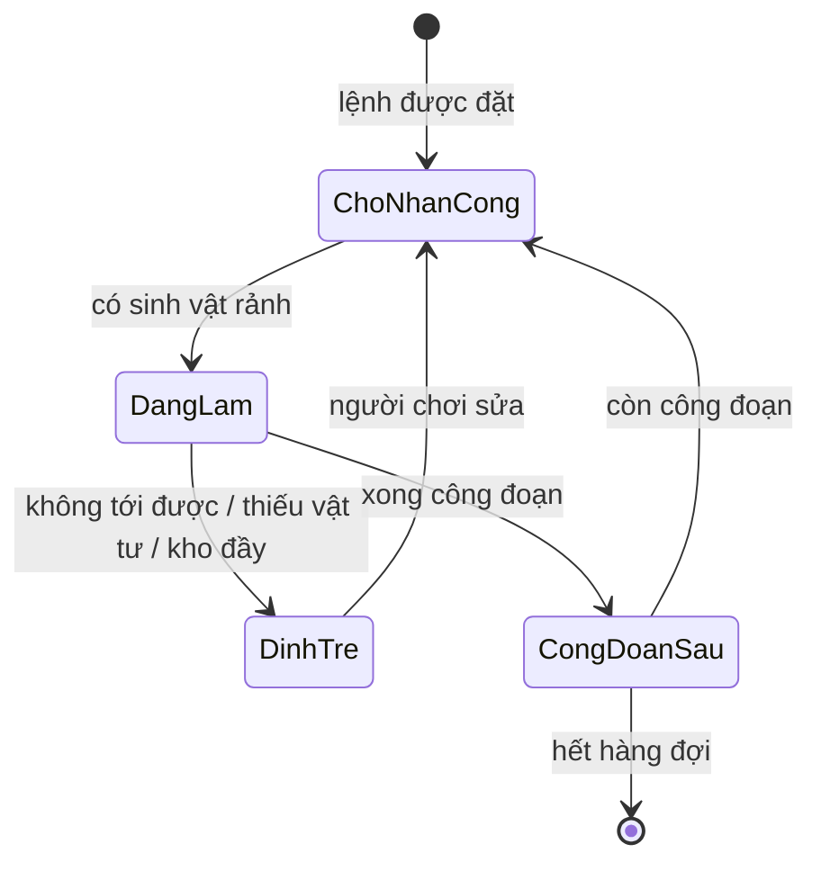

# Cơ chế

> Trạng thái: Nháp
> Liên quan: [Core loop](core-loop.md) · [Điều khiển & UI](controls-ui.md) · [Kinh tế](economy.md)

## Danh sách cơ chế
<!-- Bảng: cơ chế | mô tả | pillar | thành phần phụ trách (client/server/...) | ưu tiên (phải có/nên có/có thì tốt) | ước lượng công | milestone. -->
Ước lượng (ngày-người) là ước lượng thô của AI, [chưa xác minh] — tính lại khi lập roadmap. Ưu tiên và milestone là [ý tưởng].

| Cơ chế | Mô tả | Pillar | Thành phần | Ưu tiên | Ước lượng | Milestone |
|---|---|---|---|---|---|---|
| Voxel world | Đào/đặt khối, chunk, lưu world | P1 | Client | Phải có | 25–40 | M1 |
| Sinh map theo seed | Phần không thuộc cốt truyện sinh theo seed của từng người chơi | P3 | Client (+ công cụ sắp đặt?) | Phải có | 15–25 | M2 |
| Khối cốt truyện | Khối cốt truyện + đường đi tới nó không phá/đặt được cho tới khi phá đảo map | P3 | Client | Phải có | 2–4 | M2 |
| Sinh vật & loài | Nội tại, tộc, nguyên tố (đơn/đôi), cấp độ, bậc; 3 ô phép (bậc 1) / 4 ô phép (bậc 2+) | P2, P4 | Client | Phải có | 5–10 | M1 |
| Môi trường sống | Cải tạo thế giới đạt yêu cầu → mở khoá loài | P1 | Client | Phải có | 10–20 | M1 |
| Lệnh làm việc | Người chơi đặt lệnh, chia công đoạn, hệ thống phân sinh vật rảnh | P2 | Client | Phải có | 20–30 | M1 |
| Tìm đường sinh vật | Đi trên địa hình người chơi thiết kế; không tới được → đình trệ + thông báo | P2 | Client | Phải có | 10–20 | M1 |
| Tua nhanh | Khi vào lại game, tính sản lượng thay vì chạy animation; thời gian vắng mặt lấy từ giờ server | P2 | Client + Backend ([0003](../decisions/0003-server.md)) | Phải có | 8–15 | M2 |
| Nhập hồn | Nhập vào sinh vật, đổi bộ kỹ năng, dùng chung mana | P2, P4 | Client | Phải có | 25–40 + 3–6/loài | M2 |
| Phép của pháp sư | Phép khám phá, phát triển, tấn công đơn giản (quả cầu lửa, đi trên mặt nước...) | P1, P3 | Client | Phải có | 10–20 + 1–2/phép | M2 |
| Sưu tầm phép (phép sinh vật) | Mở khoá phép theo nhóm phép, độ hiếm; gán phép vào ô phép ở màn chuẩn bị chiến đấu | P2, P4 | Client | Phải có | 15–25 + 0,5–2/phép | M2 |
| Nhận sinh vật | Bắt, ấp nở, rút thưởng (chỉ ra loài đã hồi sinh); sinh vật mới mở khoá phép nó mang theo | P1, P2 | Client + Backend (rút thưởng) | Phải có | 10–20 | M2 |
| Tiến hoá | Tăng bậc → mở ô phép thứ 4, mở rộng phạm vi phép mang được | P2, P4 | Client | Nên có | 10–15 | M3 |
| Nghiên cứu | Một nguồn phép mới; chi tiết _(chưa có)_ | P2 | Client | _(?)_ | _(?)_ | _(?)_ |
| Nhiệm vụ & mảnh ký ức | Cốt truyện chính + nhiệm vụ phụ mỗi map, không bắt buộc tuần tự | P3 | Client | Phải có | 15–25 | M2 |
| Mở map | Đạt điều kiện để mở map mới | P3 | Client | Phải có | 2–4 | M2 |
| Cấp độ người chơi | Tăng từ nhiều nguồn: mở khoá sinh vật mới, hoàn thành nhiệm vụ... | P1, P3 | Client + Backend | Phải có | 3–5 | M2 |
| Tiền tệ & cửa hàng | Tiền trong game, tiền nạp; mua làm đẹp, hiệu ứng, tăng cơ hội, đẩy nhanh xây dựng | — (mô hình kinh doanh, xem [vision](../00-vision.md)) | Client + Backend (xác thực thanh toán) | Phải có | 15–25 | M3 |
| Xếp hạng PvP | Điểm xếp hạng từ trận thắng, nhiều sinh vật hơn thì nhiều điểm hơn | P4 | Backend | Nên có | 5–10 | Sau M4 — cùng PvP [ý tưởng] |
| Chế độ nhiều người | PvP 1v1 thời gian thực qua ghép trận, 3–5 sinh vật tuỳ thể thức, điểm xếp hạng; game server quyết định kết quả; mở khi đạt ngưỡng PvP. PvE diễn ra trong world riêng | P4 | Client + Backend + Game server ([0003](../decisions/0003-server.md)) | Nên có | 60–120 | Sau M4 — cập nhật sau phát hành [ý tưởng] |
| Điều khiển PC + mobile | Một bộ điều khiển và UI chạy trên cả hai | — (ràng buộc nền tảng, xem [vision](../00-vision.md)) | Client | Phải có | 15–30 (rải qua các milestone) | M1–M3 |

## Chi tiết từng cơ chế
<!-- Mỗi cơ chế: quy tắc, tham số chính (để tune), trường hợp biên, cách người chơi học. -->

### Lệnh làm việc
**Quy tắc**
- Người chơi đặt lệnh làm việc lên một vùng (vd một mảnh đất để trồng cây). Có thể xếp hàng (queue) nhiều loài cây, trồng lần lượt.
- Mỗi lệnh gồm nhiều công đoạn, vd: xới đất → gieo hạt → tưới nước → thu hoạch → vận chuyển.
- Hệ thống tìm sinh vật đang rảnh và phân vào công đoạn còn thiếu người làm.
- Không dùng AI phức tạp: sinh vật chỉ thực hiện công đoạn được giao.
- [ý tưởng] Tốc độ làm từng công đoạn phụ thuộc nội tại của loài (vd nguyên tố nước tưới nhanh hơn).
- [ý tưởng] Người chơi đặt độ ưu tiên giữa các lệnh.

**Tham số chính:** thời gian gốc của công đoạn, tốc độ theo nội tại, sức chứa kho, số sinh vật tối đa mỗi lệnh.

**Trường hợp biên**
- Không có sinh vật rảnh → lệnh chờ, hiện trong danh sách việc thiếu nhân công.
- Sinh vật bị lấy đi (nhập hồn, chuyển lệnh) giữa công đoạn → [ý tưởng] công đoạn trả về trạng thái chờ, giữ tiến độ.
- Kho đầy → đình trệ ở khâu vận chuyển.

### Tìm đường sinh vật & đình trệ
- Người chơi phải thiết kế địa hình để sinh vật đi lại và làm việc được.
- Không có đường tới vị trí của công đoạn → công đoạn đó **đình trệ** và gửi thông báo cho người chơi.
- [ý tưởng] Thông báo chỉ rõ vị trí và lý do (không có đường / thiếu vật tư / kho đầy), bấm vào để xem tại chỗ.
- [ý tưởng] Mỗi loài có kiểu di chuyển (đi bộ, bay, bơi) — ảnh hưởng đường đi và là một lý do để sưu tầm thêm loài.

### Tua nhanh
- Khi game tắt: không tính gì.
- Khi người chơi vào lại: tính sản lượng và tua nhanh quá trình làm việc trong khoảng thời gian vắng mặt bằng tính toán, không chạy animation, rồi trả kết quả cuối cùng.
- [ý tưởng] **Một mô hình mô phỏng, hai cách hiển thị:** lệnh làm việc luôn chạy bằng mô hình thời gian trừu tượng (thời gian công đoạn + thời gian di chuyển ước tính theo độ dài đường đi). Khi người chơi đang ở gần thì hiển thị animation; khi tua nhanh thì chỉ chạy mô hình. Kết quả hai cách giống nhau, dễ kiểm thử.
- [ý tưởng] Có giới hạn tự nhiên: sức chứa kho, hạt giống trong hàng đợi — không cần giới hạn thời gian cứng.
- Thời gian vắng mặt lấy từ **giờ server** (chống chỉnh giờ thiết bị) — xem [0003](../decisions/0003-server.md).
- [ý tưởng] Prototype M1 dùng giờ thiết bị; nối giờ server từ M2.
- [ý tưởng] Không vào được server (mất mạng) → tạm không tua nhanh, tính bù khi có lại giờ server.

### Môi trường sống
- Sinh vật đã thất lạc. Muốn đưa một loài trở lại, người chơi làm việc, cải tạo thế giới và thu thập tài nguyên để tạo môi trường theo yêu cầu của loài đó → mở khoá loài.
- [ý tưởng] Yêu cầu tính trong một vùng: tỉ lệ loại khối (nước, cỏ, đá...), cây trồng, công trình, loài khác đang có.
- [ý tưởng] Ba mức: xuất hiện → ghé thăm → định cư (theo mô hình Viva Piñata, [wiki](https://pinatajournal.wiki/wiki/Pinata)).

### Sinh vật & loài
- Mỗi loài có đặc điểm khác nhau, có tính sưu tầm. Loài được đặc trưng bởi **nội tại**; phép thì nhiều loài có thể dùng giống nhau.
- **Nội tại:** đặc điểm cố hữu của loài, tác dụng cả khi làm việc (phát triển) lẫn khi chiến đấu.
- **Ô phép:** sinh vật bậc 1 có 3 ô phép; từ bậc 2 có 4 ô. Ô thứ 4 là **ô đặc biệt**: chỉ ô này chứa được phép yêu cầu ô đặc biệt, và vẫn chứa được phép thường. Phép trong ô thay thế được.
- **Tộc:** một tộc gồm nhiều loài. **Nguyên tố:** đơn hoặc đôi.
- **Cấp độ, bậc:** phép có yêu cầu cấp độ và bậc. **Tiến hoá** tăng bậc, mở rộng phạm vi phép mang được.

### Nhận sinh vật
- Nguồn: bắt, ấp nở, rút thưởng...
- Sinh vật mới mang theo bộ phép sinh vật cơ bản (tối đa 4). Phép nào người chơi chưa có thì được mở khoá.
- Sinh vật mới có tỉ lệ nhỏ mang theo một **phép của pháp sư** (yếu tố may mắn).
- **Cá thể:** mọi cá thể cùng loài có chung đặc điểm loài (nội tại, tộc, nguyên tố), nhưng mỗi cá thể có **chỉ số cá thể** riêng, hợp với chiến đấu hoặc phát triển. Đây là lý do rút thưởng có giá trị. Chi tiết chỉ số: _(chưa có — user sẽ mô tả sau)_

**Rút thưởng sinh vật**
- Loài chưa mở khoá (chưa hồi sinh) không thể rút ra → không bỏ qua môi trường sống (giữ P1).
- Tỉ lệ tính theo số loài tối đa của từng gói, không theo số loài người chơi đã hồi sinh → hồi sinh ít loài không làm tăng tỉ lệ ra loài mong muốn.
- Kết quả rút thưởng do backend quyết định ([0003](../decisions/0003-server.md)).
- Rút thưởng dùng tiền trong game hoặc tiền nạp; tiền nạp có thể tăng cơ hội. Không ảnh hưởng chỉ số/sức mạnh trong PvP (xem Chế độ nhiều người).

### Phép
Hai loại, **hai bộ sưu tầm riêng** — pháp sư không mang được phép sinh vật:
- **Phép của pháp sư:** phục vụ khám phá, phát triển, hoặc tấn công đơn giản (vd quả cầu lửa, đi trên mặt nước).
- **Phép sinh vật:** chiến đấu chủ yếu dựa vào phép sinh vật. Người chơi gán phép vào ô phép của sinh vật ở màn **chuẩn bị chiến đấu**.

**Nhóm phép** — ai được mang:

| Nhóm phép | Điều kiện mang |
|---|---|
| Phổ biến | Mọi sinh vật (vd phép lướt) |
| Tộc | Sinh vật thuộc tộc đó |
| Nguyên tố | Sinh vật có nguyên tố của phép (vd hệ lửa dùng phép lửa) |
| Loài | Chỉ loài đó |

Quy tắc nguyên tố: phép có yêu cầu nguyên tố thì sinh vật phải có nguyên tố đó mới mang được; phép không yêu cầu nguyên tố thì không xét.
Mọi phép còn có yêu cầu cấp độ và bậc; một số phép yêu cầu ô đặc biệt.

- **Độ hiếm:** mỗi phép có độ hiếm, mô tả tỉ lệ xuất hiện.
- **Nguồn phép sinh vật:** sinh vật mới sở hữu, nghiên cứu, rút thưởng gói sách phép...
- **Nguồn phép của pháp sư:** tỉ lệ nhỏ khi sở hữu sinh vật mới; các nguồn khác _(chưa có)_.

### Nhập hồn
- Người chơi nhập vào sinh vật: bộ kỹ năng của người chơi đổi thành bộ kỹ năng của sinh vật đó.
- Dùng chung một nguồn mana.
- Phép dùng khi nhập hồn là phép đang gán cho sinh vật đó.
- Chi tiết (thời gian nhập, điều kiện thoát, sinh vật đang làm việc có nhập được không): _(chưa có)_

### Sinh map theo seed & khối cốt truyện
- Map là vùng có ranh giới trên world của từng người chơi. Nhà phát triển chỉ sắp đặt các thành phần phục vụ cốt truyện; phần còn lại sinh bằng công cụ/thuật toán theo seed của người chơi → các world tương đồng nhưng riêng biệt.
- Khi người chơi chưa phá đảo map: khối thuộc cốt truyện và đường đi tới nó không bị phá hay đặt.
- [ý tưởng] Đánh dấu khối cốt truyện bằng một lớp dữ liệu riêng (mask) phủ lên chunk, gỡ khi phá đảo map.

### Chế độ nhiều người
- PvE: trong world riêng của mỗi người chơi.
- PvP: **thời gian thực**, ghép trận với người chơi khác; game server chạy trận và quyết định kết quả (chống gian lận) — xem [0003](../decisions/0003-server.md).
- PvP là chế độ mở sau: chỉ tham gia được khi đạt cấp độ người chơi hoặc một số yêu cầu nhất định. Yêu cầu cụ thể: _(chưa có)_
- [ý tưởng] Logic chiến đấu viết một lần, chạy được cả ở client (PvE) lẫn game server (PvP). Unity có build Dedicated Server, định nghĩa ký hiệu `UNITY_SERVER` để tách code chỉ chạy ở server ([docs 6000.4](https://docs.unity3d.com/6000.4/Documentation/Manual/dedicated-server-build.html)).
- **Thể thức:** trước mắt 1v1; mỗi người chơi mang 3–5 sinh vật tuỳ thể thức được chọn.
- **Ghép trận:** người chơi chọn được nhiều thể thức cùng lúc → ghép nhanh hơn.
- **Điểm xếp hạng:** thắng được điểm để leo hạng; thể thức nhiều sinh vật hơn cho nhiều điểm hơn khi thắng.
- **Ngưỡng PvP:** khi người chơi đạt ngưỡng để chơi PvP, phát triển sau đó chỉ có tác dụng trong world riêng, không ảnh hưởng PvP. Thứ khác nhau giữa người chơi trong PvP chỉ là tập sinh vật và phép mang theo, không phải chỉ số hay sức mạnh.
- [ý tưởng] Cách làm: trong trận PvP, chỉ số sinh vật được **chuẩn hoá** về mức ngưỡng PvP (kiểu đồng bộ cấp độ).
- Câu hỏi mở: chỉ số cá thể có còn tác dụng trong PvP không, hay cũng bị chuẩn hoá?
- Co-op đảo sandbox: spin-off, tạm bỏ qua — xem [ideas](../ideas.md).
- Danh sách mode, chiến đấu theo lượt hay thời gian thực: _(chưa có)_
