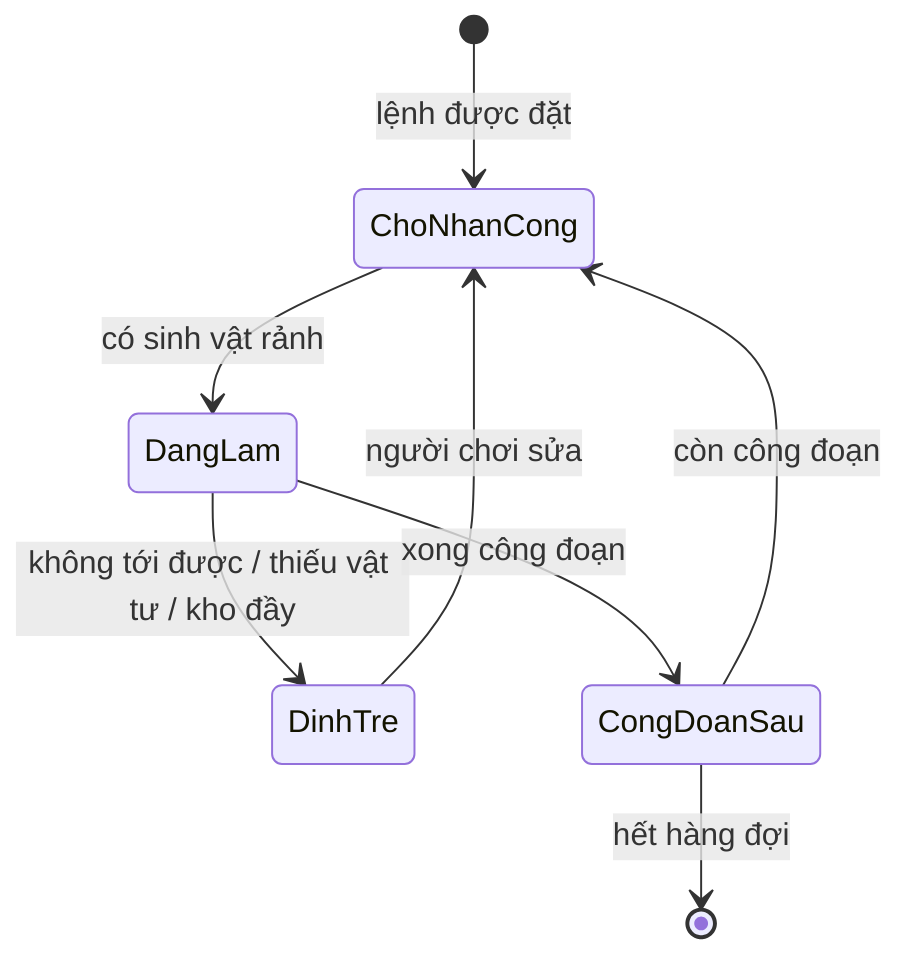
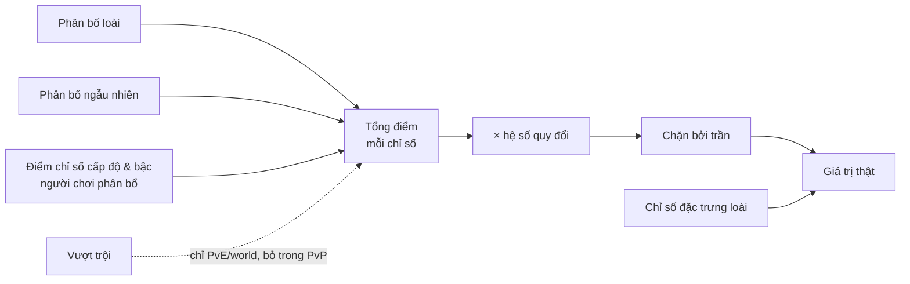

# Cơ chế

> Trạng thái: Nháp
> Liên quan: [Core loop](core-loop.md) · [Điều khiển & UI](controls-ui.md) · [Kinh tế](economy.md)

## Danh sách cơ chế
<!-- Bảng: cơ chế | mô tả | pillar | thành phần phụ trách (client/server/...) | ưu tiên (phải có/nên có/có thì tốt) | ước lượng công | milestone. -->
Ước lượng (ngày-người) là ước lượng thô của AI, [chưa xác minh] — tính lại khi lập roadmap. Ưu tiên và milestone là [ý tưởng].

| Cơ chế | Mô tả | Pillar | Thành phần | Ưu tiên | Ước lượng | Milestone |
|---|---|---|---|---|---|---|
| Voxel world | Đào/đặt khối, chunk, lưu world | P1 | Client | Phải có | 25–40 | M1 |
| Sinh map theo seed | Phần không thuộc cốt truyện sinh theo seed của từng người chơi | P3 | Client (+ công cụ sắp đặt?) | Phải có | 15–25 | M2 |
| Khối cốt truyện | Khối cốt truyện + đường đi tới nó không phá/đặt được cho tới khi phá đảo map | P3 | Client | Phải có | 2–4 | M2 |
| Sinh vật & loài | Nội tại, tộc, nguyên tố (đơn/đôi), cấp độ, bậc; 3 ô phép (bậc 1) / 4 ô phép (bậc 2+) | P2, P4 | Client | Phải có | 5–10 | M1 |
| Chỉ số làm việc | 2 năng lực làm việc mỗi loài; tốc độ di chuyển, sức khoẻ, độ thuần thục 1–2; phân bố loài + phân bố ngẫu nhiên + điểm chỉ số (quỹ riêng, phân bổ lại bằng vật phẩm); vượt trội làm việc | P2 | Client (+ Backend từ M2: sinh và lưu chỉ số) | Phải có | 5–8 | M1 |
| Chỉ số chiến đấu | Máu, giáp, kháng phép, tốc độ đánh, sát thương... + chỉ số đặc trưng loài; phân bố loài + phân bố ngẫu nhiên + điểm chỉ số (quỹ riêng, phân bổ lại bằng vật phẩm); hệ số quy đổi, trần; vượt trội bị bỏ trong PvP | P2, P4 | Client + Backend (sinh chỉ số) + Game server (PvP) | Phải có | 6–10 | M2 |
| Môi trường sống | Cải tạo thế giới đạt yêu cầu → mở khoá loài | P1 | Client | Phải có | 10–20 | M1 |
| Nhu cầu sinh vật | Danh sách yêu cầu mỗi loài; mức đáp ứng cao → loài xuất hiện nhiều hơn, ít bệnh/mệt, làm việc tốt hơn, đôi khi tặng quà | P1, P2 | Client | Phải có | 8–15 | M2 |
| Lệnh làm việc | Người chơi đặt lệnh, chia công đoạn, hệ thống phân sinh vật rảnh có năng lực làm việc phù hợp | P2 | Client | Phải có | 20–30 | M1 |
| Tìm đường sinh vật | Đi trên địa hình người chơi thiết kế; không tới được → đình trệ + thông báo | P2 | Client | Phải có | 10–20 | M1 |
| Tua nhanh | Khi vào lại game, tính sản lượng thay vì chạy animation; thời gian vắng mặt lấy từ giờ server | P2 | Client + Backend ([0003](../decisions/0003-server.md)) | Phải có | 8–15 | M2 |
| Nhập hồn | Nhập vào sinh vật, đổi bộ kỹ năng, dùng chung mana | P2, P4 | Client | Phải có | 25–40 + 3–6/loài | M2 |
| Phép của pháp sư | Phép khám phá, phát triển, tấn công đơn giản (quả cầu lửa, đi trên mặt nước...) | P1, P3 | Client | Phải có | 10–20 + 1–2/phép | M2 |
| Sưu tầm phép (phép sinh vật) | Mở khoá phép theo nhóm phép, độ hiếm; gán phép vào ô phép ở màn chuẩn bị chiến đấu | P2, P4 | Client | Phải có | 15–25 + 0,5–2/phép | M2 |
| Nhận sinh vật | Bắt, ấp nở, rút thưởng (chỉ ra loài đã hồi sinh); sinh vật mới mở khoá phép nó mang theo | P1, P2 | Client + Backend (rút thưởng) | Phải có | 10–20 | M2 |
| Giới hạn sinh vật & kho sinh vật | Giới hạn số sinh vật hoạt động (làm việc + chiến đấu) theo cấp độ người chơi và công trình; dư thì thả hoặc cất vào kho sinh vật | P2 | Client + Backend (sở hữu sinh vật) | Phải có | 3–6 | M2 |
| Tiến hoá | Tăng bậc → mở ô phép thứ 4, mở rộng phạm vi phép mang được | P2, P4 | Client | Nên có | 10–15 | M3 |
| Nghiên cứu | Một nguồn phép mới; chi tiết _(chưa có)_ | P2 | Client | _(?)_ | _(?)_ | _(?)_ |
| Nhiệm vụ & mảnh ký ức | Cốt truyện chính + nhiệm vụ phụ mỗi map, không bắt buộc tuần tự | P3 | Client | Phải có | 15–25 | M2 |
| Mở map | Đạt điều kiện để mở map mới | P3 | Client | Phải có | 2–4 | M2 |
| Cấp độ người chơi | Tăng từ nhiều nguồn: mở khoá sinh vật mới, hoàn thành nhiệm vụ... | P1, P3 | Client + Backend | Phải có | 3–5 | M2 |
| Tiền tệ & cửa hàng | Tiền trong game, tiền nạp; làm đẹp (skin), hiệu ứng, tăng cơ hội, đẩy nhanh xây dựng, ưu đãi nạp (vật phẩm hỗ trợ, túi đồ +10%, giới hạn sinh vật +10%...) | — (mô hình kinh doanh, xem [vision](../00-vision.md)) | Client + Backend (xác thực thanh toán) | Phải có | 15–25 | M3 |
| Xếp hạng PvP | Điểm xếp hạng từ trận thắng, nhiều sinh vật hơn thì nhiều điểm hơn | P4 | Backend | Nên có | 5–10 | Sau M4 — cùng PvP [ý tưởng] |
| Chế độ nhiều người | PvP 1v1 thời gian thực qua ghép trận (theo hạng, rồi cấp độ trung bình), 3–5 sinh vật tuỳ thể thức, điểm xếp hạng; game server quyết định kết quả; mở khi đạt ngưỡng PvP. PvE diễn ra trong world riêng | P4 | Client + Backend + Game server ([0003](../decisions/0003-server.md)) | Nên có | 60–120 | Sau M4 — cập nhật sau phát hành [ý tưởng] |
| Điều khiển PC + mobile | Một bộ điều khiển và UI chạy trên cả hai | — (ràng buộc nền tảng, xem [vision](../00-vision.md)) | Client | Phải có | 15–30 (rải qua các milestone) | M1–M3 |

## Chi tiết từng cơ chế
<!-- Mỗi cơ chế: quy tắc, tham số chính (để tune), trường hợp biên, cách người chơi học. -->

### Lệnh làm việc
**Quy tắc**
- Người chơi đặt lệnh làm việc lên một vùng (vd một mảnh đất để trồng cây). Có thể xếp hàng (queue) nhiều loài cây, trồng lần lượt.
- Mỗi lệnh gồm nhiều công đoạn, vd: xới đất → gieo hạt → tưới nước → thu hoạch → vận chuyển.
- Hệ thống tìm sinh vật đang rảnh **có năng lực làm việc khớp với công đoạn** và phân vào công đoạn còn thiếu người làm. Sinh vật chỉ làm công đoạn thuộc 2 năng lực làm việc của loài (user, 2026-10-12) — xem [Chỉ số sinh vật](#chỉ-số-sinh-vật).
- Không dùng AI phức tạp: sinh vật chỉ thực hiện công đoạn được giao.
- Tốc độ/hiệu quả làm công đoạn theo **độ thuần thục** của năng lực tương ứng (vd thuần thục cao rút ngắn thời gian tưới nước, vận chuyển được nhiều hàng hơn mỗi lượt).
- [ý tưởng] Nội tại của loài cộng thêm hiệu quả cho công đoạn (vd nguyên tố nước tưới nhanh hơn).
- [ý tưởng] Người chơi đặt độ ưu tiên giữa các lệnh.

**Tham số chính:** thời gian gốc của công đoạn, độ thuần thục và tốc độ di chuyển của sinh vật, hiệu quả theo nội tại, sức chứa kho, số sinh vật tối đa mỗi lệnh.

**Trường hợp biên**
- Không có sinh vật rảnh → lệnh chờ, hiện trong danh sách việc thiếu nhân công.
- Không sở hữu loài nào có năng lực cho một công đoạn → công đoạn đó chờ; [ý tưởng] thông báo chỉ rõ năng lực còn thiếu (gợi ý loài cần hồi sinh — nối với P1).
- Sinh vật bị lấy đi (nhập hồn, chuyển lệnh) giữa công đoạn → [ý tưởng] công đoạn trả về trạng thái chờ, giữ tiến độ.
- Kho đầy → đình trệ ở khâu vận chuyển.

### Tìm đường sinh vật & đình trệ
- Người chơi phải thiết kế địa hình để sinh vật đi lại và làm việc được.
- Không có đường tới vị trí của công đoạn → công đoạn đó **đình trệ** và gửi thông báo cho người chơi.
- [ý tưởng] Thông báo chỉ rõ vị trí và lý do (không có đường / thiếu vật tư / kho đầy), bấm vào để xem tại chỗ.
- [ý tưởng] Mỗi loài có kiểu di chuyển (đi bộ, bay, bơi) — ảnh hưởng đường đi và là một lý do để sưu tầm thêm loài.

### Tua nhanh
- Khi game tắt: không tính gì.
- Khi người chơi vào lại: tính sản lượng và tua nhanh quá trình làm việc trong khoảng thời gian vắng mặt bằng tính toán, không chạy animation, rồi trả kết quả cuối cùng.
- [ý tưởng] **Một mô hình mô phỏng, hai cách hiển thị:** lệnh làm việc luôn chạy bằng mô hình thời gian trừu tượng (thời gian công đoạn + thời gian di chuyển ước tính theo độ dài đường đi). Khi người chơi đang ở gần thì hiển thị animation; khi tua nhanh thì chỉ chạy mô hình. Kết quả hai cách giống nhau, dễ kiểm thử.
- [ý tưởng] Có giới hạn tự nhiên: sức chứa kho, hạt giống trong hàng đợi — không cần giới hạn thời gian cứng.
- Thời gian vắng mặt lấy từ **giờ server** (chống chỉnh giờ thiết bị) — xem [0003](../decisions/0003-server.md).
- [ý tưởng] Prototype M1 dùng giờ thiết bị; nối giờ server từ M2.
- [ý tưởng] Không vào được server (mất mạng) → tạm không tua nhanh, tính bù khi có lại giờ server.

### Môi trường sống
- Sinh vật đã thất lạc. Muốn đưa một loài trở lại, người chơi làm việc, cải tạo thế giới và thu thập tài nguyên để tạo môi trường theo yêu cầu của loài đó → mở khoá loài.
- [ý tưởng] Yêu cầu tính trong một vùng: tỉ lệ loại khối (nước, cỏ, đá...), cây trồng, công trình, loài khác đang có.
- **Danh sách yêu cầu của loài** (user, 2026-10-12 — thay ý tưởng ba mức xuất hiện → ghé thăm → định cư): mỗi loài có một danh sách yêu cầu (user gọi là "list nhiệm vụ theo loài"). Người chơi hoàn thành dần từng yêu cầu:
  - đạt các yêu cầu mở khoá → loài trở lại;
  - đạt thêm các yêu cầu còn lại → mức đáp ứng tăng (xem [Nhu cầu sinh vật](#nhu-cầu-sinh-vật)).
- Câu hỏi mở: yêu cầu nào thuộc phần mở khoá (cố định hay "đạt N trong M yêu cầu"); danh sách hiện đầy đủ ngay hay lộ dần.

### Nhu cầu sinh vật
Mô tả của user (2026-10-12). Tên "nhu cầu sinh vật", "mức đáp ứng" là [ý tưởng].
- **Mục đích:** khiến người chơi tiếp tục cải thiện môi trường sống cho sinh vật, thay vì triệu hồi rồi bỏ đó (P1).
- Mỗi loài có một **danh sách yêu cầu**. Đáp ứng càng nhiều yêu cầu (**mức đáp ứng** càng cao) thì:
  - loài đó xuất hiện càng nhiều trong môi trường;
  - sinh vật ít bị **bệnh**, ít **mệt** hơn;
  - làm việc tốt hơn;
  - đôi lúc tặng quà cho người chơi.
- Chỉ số **sức khoẻ** của cá thể giảm khả năng bị bệnh (xem [Chỉ số sinh vật](#chỉ-số-sinh-vật)).
- Danh sách yêu cầu dùng chung với môi trường sống: một danh sách cho cả mở khoá loài lẫn mức đáp ứng (user, 2026-10-12) → một hệ dữ liệu cho cả hai cơ chế.
- Câu hỏi mở: bệnh và mệt tác động gì (chậm, nghỉ, không làm việc?), chữa thế nào; quà là gì; mức đáp ứng tính theo vùng hay toàn map.

### Sinh vật & loài
- Mỗi loài có đặc điểm khác nhau, có tính sưu tầm. Loài được đặc trưng bởi **nội tại**; phép thì nhiều loài có thể dùng giống nhau.
- **Nội tại:** đặc điểm cố hữu của loài, tác dụng cả khi làm việc (phát triển) lẫn khi chiến đấu.
- **Ô phép:** sinh vật bậc 1 có 3 ô phép; từ bậc 2 có 4 ô. Ô thứ 4 là **ô đặc biệt**: chỉ ô này chứa được phép yêu cầu ô đặc biệt, và vẫn chứa được phép thường. Phép trong ô thay thế được.
- **Tộc:** một tộc gồm nhiều loài. **Nguyên tố:** đơn hoặc đôi.
- **Cấp độ, bậc:** phép có yêu cầu cấp độ và bậc. **Tiến hoá** tăng bậc, mở rộng phạm vi phép mang được.

### Nhận sinh vật
- Nguồn: bắt, ấp nở, rút thưởng...
- Sinh vật mới mang theo bộ phép sinh vật cơ bản (tối đa 4). Phép nào người chơi chưa có thì được mở khoá.
- Sinh vật mới có tỉ lệ nhỏ mang theo một **phép của pháp sư** (yếu tố may mắn).
- **Cá thể:** mọi cá thể cùng loài có chung đặc điểm loài (nội tại, tộc, nguyên tố), nhưng mỗi cá thể có **chỉ số cá thể** riêng (phân bố ngẫu nhiên, có thể vượt trội), hợp với chiến đấu hoặc làm việc. Đây là lý do rút thưởng có giá trị. Chi tiết: [Chỉ số sinh vật](#chỉ-số-sinh-vật).
- **Vượt trội** được xét mỗi lần người chơi sở hữu một cá thể mới (bắt, ấp nở, rút thưởng...) → sở hữu càng nhiều thì càng nhiều lần có cơ hội ra cá thể vượt trội. Tỉ lệ mỗi lần không đổi. Tiền nạp không trực tiếp tăng tỉ lệ vượt trội; chỉ gián tiếp qua việc sở hữu được nhiều cá thể hơn (user, 2026-10-12). Tỉ lệ: _(chưa có)_
- **Chặn quá may** (user, 2026-10-12): có cơ chế chặn trường hợp người chơi ra vượt trội nhiều bất thường, nhưng **không làm mất may mắn bình thường** — chỉ tác động khi vượt xa mức kỳ vọng. Vượt trội không có bảo hiểm (không tăng tỉ lệ khi xui); bảo hiểm chỉ áp cho rút thưởng gói (xem dưới).
  - [ý tưởng] Cách làm: backend đếm số vượt trội trong N lần sở hữu gần nhất; vượt ngưỡng K (chọn K sao cho người chơi bình thường gần như không chạm, vd xác suất < 1%) → tạm hạ tỉ lệ vượt trội cho tới khi số vượt trội trong cửa sổ N về dưới K. N, K tính bằng skill cân bằng.
- Sinh vật mới chỉ vào đội hình hoạt động khi còn chỗ — xem [Giới hạn sinh vật & kho sinh vật](#giới-hạn-sinh-vật--kho-sinh-vật).

**Rút thưởng gói**
Các gói trong cửa hàng: gói sinh vật, gói sách phép, gói trang bị (trang bị chưa có trong thiết kế — chờ user mô tả)...
- **Bảo hiểm** (user, 2026-10-12): mỗi gói đảm bảo ra phần thưởng hiếm khi rút đủ nhiều lần, và **công khai** việc này cho người chơi.
  - [ý tưởng] Cách làm: mỗi gói có **mốc bảo hiểm** N — rút N lần liên tiếp chưa ra phần thưởng hiếm nhất của gói thì lần thứ N chắc chắn ra; đếm riêng theo từng gói, ra phần thưởng hiếm thì đếm lại từ 0. Công khai trong cửa hàng: tỉ lệ từng loại phần thưởng, mốc N và số lần đã rút hiện tại.
  - Bảo hiểm (chống xui) và chặn quá may (chống may bất thường) cùng thu hẹp hai đầu may rủi, phần giữa giữ nguyên.
  - N và tỉ lệ tính bằng `local-game-balance` (lệnh `pity`).
- Câu hỏi mở: bảo hiểm có áp cho cá thể vượt trội không (hiện vượt trội không có bảo hiểm); số lần đã rút có chuyển sang gói khác/mùa sau không.

**Rút thưởng sinh vật**
- Loài chưa mở khoá (chưa hồi sinh) không thể rút ra → không bỏ qua môi trường sống (giữ P1).
- Tỉ lệ tính theo số loài tối đa của từng gói, không theo số loài người chơi đã hồi sinh → hồi sinh ít loài không làm tăng tỉ lệ ra loài mong muốn.
- Kết quả rút thưởng do backend quyết định ([0003](../decisions/0003-server.md)).
- Rút thưởng dùng tiền trong game hoặc tiền nạp; tiền nạp có thể tăng cơ hội ra loài. Tiền nạp chỉ giúp nhanh hơn, không vượt được mức tối đa người không nạp cũng đạt được (xem [Chế độ nhiều người](#chế-độ-nhiều-người)).

### Giới hạn sinh vật & kho sinh vật
Mô tả của user (2026-10-12).
- **Giới hạn sinh vật:** số sinh vật **hoạt động** (đang làm việc hoặc chiến đấu, tính chung một tổng) có giới hạn, tăng theo **cấp độ người chơi** và **công trình**.
- Muốn có thêm sinh vật khi đã chạm giới hạn → bỏ bớt sinh vật cũ: thả đi, hoặc tạm cất vào **kho sinh vật**. Sinh vật trong kho sinh vật không tính vào giới hạn, không làm việc, không chiến đấu.
- Tiền nạp: giới hạn sinh vật +10% (xem [Kinh tế](economy.md)).
- [ý tưởng] Sinh vật trong kho sinh vật vẫn được tính là đã sở hữu (giữ phép đã mở khoá, giữ tiến độ sưu tầm).
- Câu hỏi mở: kho sinh vật có giới hạn không; công trình nào tăng giới hạn, tăng bao nhiêu; thả sinh vật có nhận lại gì không; đổi sinh vật giữa kho và đội hình hoạt động có tốn gì không.

### Chỉ số sinh vật
Mô tả của user (2026-10-12). Số liệu trong ví dụ là minh hoạ. Các thông số cụ thể làm sau, bằng skill cân bằng `local-game-balance` (tạo 2026-10-12).

Mỗi cá thể có **hai bảng chỉ số tách riêng**: **chỉ số làm việc** và **chỉ số chiến đấu**. Chỉ bảng chiến đấu cần cân bằng cho PvP.

**Quy tắc chung (cả hai bảng)**
- Mỗi chỉ số có **base** (theo loài), **hệ số quy đổi** và **trần**.
- **Hệ số quy đổi** đổi điểm thành giá trị thật, đại diện cho chỉ số và **giống nhau ở mọi loài**. Vd cộng 10 điểm vào máu → +250 máu; 10 điểm vào tốc độ đánh → +0,6 tốc độ đánh.
- **Trần** chặn chỉ số mất kiểm soát, vd tốc độ đánh tối đa 6.
- Điểm của một bảng gồm các phần:

| Phần điểm | Ví dụ (chiến đấu) | Do ai quyết định | Phân bổ lại được? | Tính trong PvP? |
|---|---|---|---|---|
| Phân bố loài | 200 | Loài — đặc trưng của loài; là phần tạo khác biệt chính giữa các loài | Không | Có |
| Phân bố ngẫu nhiên | 100 | Ngẫu nhiên khi cá thể sinh ra — làm nên sự riêng biệt của cá thể; ít điểm hơn phân bố loài | Không | Có |
| Vượt trội | +50, +70, thậm chí +100 (tổng 350–400) | Ngẫu nhiên, chỉ cá thể vượt trội | Không | **Không** |
| Điểm chỉ số (cấp độ & bậc) | _(chưa có)_ | Người chơi phân bổ tự do | Có — tốn **vật phẩm phân bổ lại** | Có — người chơi nào rồi cũng đạt được |

- Phân bố loài + phân bố ngẫu nhiên là cố định, không phân bổ lại được. Phân bố loài giữ cho phần ngẫu nhiên không làm cá thể quá tệ.
- **Tổng điểm khác nhau giữa các loài nhưng không quá chênh**; khác biệt chủ yếu ở cách phân bố loài. Loài có tổng điểm thấp hơn đôi khi có phân bố "đẹp" hơn, hợp vai trò hơn.
- **Điểm chỉ số** nhận khi tăng cấp độ hoặc bậc (tiến hoá); **điểm làm việc và điểm chiến đấu là hai quỹ riêng**. Chỉ cộng thêm, không cắt bớt xuống dưới base. Phân bổ lại được nhưng cần dùng **vật phẩm phân bổ lại** (nguồn _(chưa có)_).
- Trong PvP: bỏ phần vượt trội → cá thể cùng loài, cùng cấp độ và bậc có **cùng tổng điểm**, chỉ khác **cách phân bố** (phân bố ngẫu nhiên + phân bổ của người chơi).

**Chỉ số làm việc**
- Mỗi loài có **2 năng lực làm việc**, vd loài A: vận chuyển và tưới nước. Sinh vật chỉ làm công đoạn thuộc 2 năng lực này (xem [Lệnh làm việc](#lệnh-làm-việc)).

| Chỉ số | Tác dụng |
|---|---|
| Tốc độ di chuyển | Tốc độ đi lại khi làm việc trong world (khác tốc độ di chuyển khi chiến đấu) |
| Sức khoẻ | Sinh vật ít bị bệnh hơn (xem [Nhu cầu sinh vật](#nhu-cầu-sinh-vật)) |
| Độ thuần thục 1 | Hiệu quả năng lực làm việc 1, vd rút ngắn thời gian tưới nước |
| Độ thuần thục 2 | Hiệu quả năng lực làm việc 2, vd vận chuyển được nhiều hàng hơn mỗi lượt |

- Có phân bố loài và phân bố ngẫu nhiên như bảng chiến đấu.
- Cá thể **vượt trội về làm việc** có sẵn thêm một lượng điểm ở một loại chỉ số làm việc.

**Chỉ số chiến đấu**
- Chỉ số phân bổ được: máu, giáp, kháng phép, tốc độ đánh, sát thương vật lý cơ bản, sát thương phép cơ bản, tốc độ di chuyển... (danh sách đầy đủ _(chưa có)_).
- **Chỉ số đặc trưng loài:** vd tầm đánh, tỉ lệ chí mạng... — cố định theo loài, điểm chỉ số không thay đổi được.

**Cách làm**
- [ý tưởng] Lưu riêng từng phần điểm (loài, ngẫu nhiên, vượt trội, phân bổ của người chơi), không lưu tổng → PvP chỉ cần bỏ phần vượt trội, không phải tính lại.
- [ý tưởng] Phân bố ngẫu nhiên và vượt trội do backend sinh khi nhận sinh vật (cùng chỗ quyết định rút thưởng — [0003](../decisions/0003-server.md)); game server lấy chỉ số từ backend, không tin client.
- [ý tưởng] Base, hệ số quy đổi, trần để trong bảng dữ liệu tách khỏi code → skill cân bằng đọc/ghi bảng này, không cần sửa code.

**Câu hỏi mở** (số liệu làm bằng skill cân bằng)
- Số điểm chỉ số mỗi cấp độ/bậc; tổng điểm và cách phân bố loài của từng loài; tỉ lệ phân bố loài / ngẫu nhiên.
- Tỉ lệ ra cá thể vượt trội; một cá thể vượt trội được cả làm việc lẫn chiến đấu không.
- Nguồn vật phẩm phân bổ lại; phân bổ lại từng phần hay toàn bộ.
- Danh sách đầy đủ chỉ số chiến đấu và chỉ số đặc trưng loài; giá trị hệ số quy đổi, trần.

### Phép
Hai loại, **hai bộ sưu tầm riêng** — pháp sư không mang được phép sinh vật:
- **Phép của pháp sư:** phục vụ khám phá, phát triển, hoặc tấn công đơn giản (vd quả cầu lửa, đi trên mặt nước).
- **Phép sinh vật:** chiến đấu chủ yếu dựa vào phép sinh vật. Người chơi gán phép vào ô phép của sinh vật ở màn **chuẩn bị chiến đấu**.

**Nhóm phép** — ai được mang:

| Nhóm phép | Điều kiện mang |
|---|---|
| Phổ biến | Mọi sinh vật (vd phép lướt) |
| Tộc | Sinh vật thuộc tộc đó |
| Nguyên tố | Sinh vật có nguyên tố của phép (vd hệ lửa dùng phép lửa) |
| Loài | Chỉ loài đó |

Quy tắc nguyên tố: phép có yêu cầu nguyên tố thì sinh vật phải có nguyên tố đó mới mang được; phép không yêu cầu nguyên tố thì không xét.
Mọi phép còn có yêu cầu cấp độ và bậc; một số phép yêu cầu ô đặc biệt.

- **Độ hiếm:** mỗi phép có độ hiếm, mô tả tỉ lệ xuất hiện.
- **Nguồn phép sinh vật:** sinh vật mới sở hữu, nghiên cứu, rút thưởng gói sách phép...
- **Nguồn phép của pháp sư:** tỉ lệ nhỏ khi sở hữu sinh vật mới; các nguồn khác _(chưa có)_.

### Nhập hồn
- Người chơi nhập vào sinh vật: bộ kỹ năng của người chơi đổi thành bộ kỹ năng của sinh vật đó.
- Dùng chung một nguồn mana.
- Phép dùng khi nhập hồn là phép đang gán cho sinh vật đó.
- Chi tiết (thời gian nhập, điều kiện thoát, sinh vật đang làm việc có nhập được không): _(chưa có)_

### Sinh map theo seed & khối cốt truyện
- Map là vùng có ranh giới trên world của từng người chơi. Nhà phát triển chỉ sắp đặt các thành phần phục vụ cốt truyện; phần còn lại sinh bằng công cụ/thuật toán theo seed của người chơi → các world tương đồng nhưng riêng biệt.
- Khi người chơi chưa phá đảo map: khối thuộc cốt truyện và đường đi tới nó không bị phá hay đặt.
- [ý tưởng] Đánh dấu khối cốt truyện bằng một lớp dữ liệu riêng (mask) phủ lên chunk, gỡ khi phá đảo map.

### Chế độ nhiều người
- PvE: trong world riêng của mỗi người chơi.
- PvP: **thời gian thực**, ghép trận với người chơi khác; game server chạy trận và quyết định kết quả (chống gian lận) — xem [0003](../decisions/0003-server.md).
- PvP là chế độ mở sau: chỉ tham gia được khi đạt cấp độ người chơi hoặc một số yêu cầu nhất định. Yêu cầu cụ thể: _(chưa có)_
- [ý tưởng] Logic chiến đấu viết một lần, chạy được cả ở client (PvE) lẫn game server (PvP). Unity có build Dedicated Server, định nghĩa ký hiệu `UNITY_SERVER` để tách code chỉ chạy ở server ([docs 6000.4](https://docs.unity3d.com/6000.4/Documentation/Manual/dedicated-server-build.html)).
- **Thể thức:** trước mắt 1v1; mỗi người chơi mang 3–5 sinh vật tuỳ thể thức được chọn.
- **Ghép trận:** người chơi chọn được nhiều thể thức cùng lúc → ghép nhanh hơn. Ghép theo **hạng**; trong cùng hạng ưu tiên người có **cấp độ trung bình** gần nhau — trung bình cấp độ các sinh vật mang vào trận (user, 2026-10-12).
- **Điểm xếp hạng:** thắng được điểm để leo hạng; thể thức nhiều sinh vật hơn cho nhiều điểm hơn khi thắng.
- **Ngưỡng PvP:** điều kiện để được tham gia PvP — giúp người chơi trải nghiệm mode này sớm.
- **Chỉ số trong PvP** (user, 2026-10-12 — thay quy tắc cũ "phát triển sau ngưỡng không ảnh hưởng PvP" và ý tưởng chuẩn hoá về ngưỡng):
  - Điểm chỉ số từ cấp độ và bậc **vẫn tính**, vì người chơi nào rồi cũng đạt được.
  - Chỉ **bỏ phần điểm vượt trội** → cá thể cùng loài, cùng cấp độ và bậc có cùng tổng điểm, chỉ khác cách phân bố (xem [Chỉ số sinh vật](#chỉ-số-sinh-vật)).
  - **Tiền nạp và PvP** (user, 2026-10-12): tiền nạp luôn ảnh hưởng **tốc độ** tiến trình theo cách này hay cách khác — không tránh được. Thứ chặn được là **mức tối đa**: ở mức tối đa mọi người như nhau (vượt trội bị bỏ, không mua được thứ người không nạp không đạt được).
  - Chênh lệch cấp độ/bậc giữa người mới qua ngưỡng và người chơi lâu năm được giảm bằng ghép trận theo hạng và cấp độ trung bình.
- Co-op đảo sandbox: spin-off, tạm bỏ qua — xem [ideas](../ideas.md).
- Danh sách mode, chiến đấu theo lượt hay thời gian thực: _(chưa có)_
