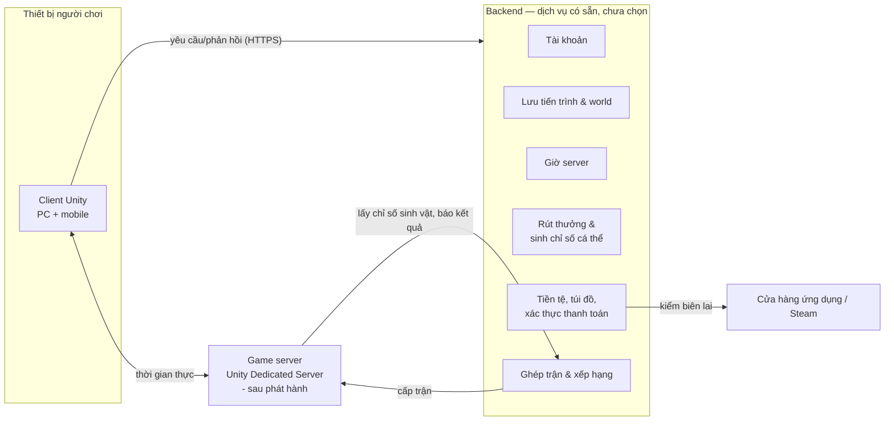
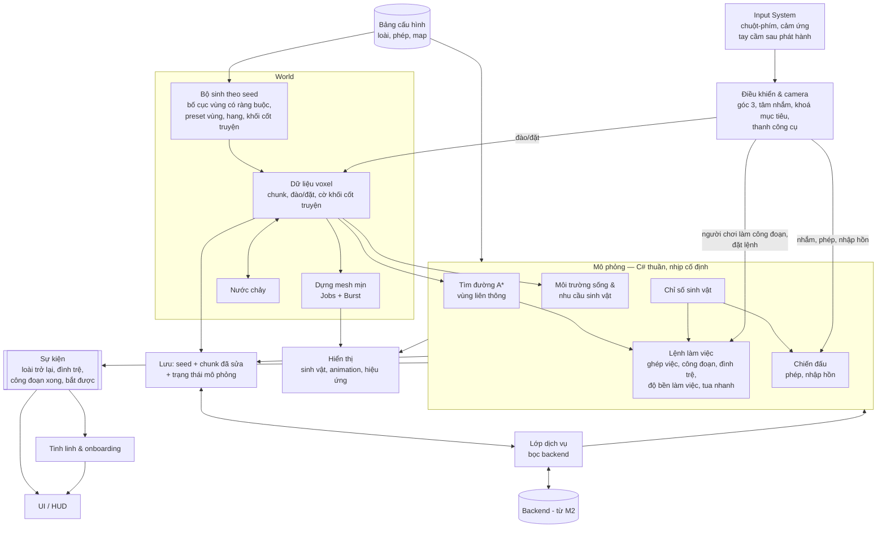

# Kiến trúc

> Trạng thái: Đang xem xét
> Đã chốt phần (user, 2026-10-13): nguyên tắc Client, nền tảng code M1. Phần còn lại vẫn là đề xuất [ý tưởng].
> Liên quan: [Thành phần](components.md) · [Công nghệ](tech-stack.md) · [Cơ chế](../02-gameplay/mechanics.md)

Toàn bộ file là đề xuất của AI [ý tưởng] (2026-10-12; phần Client và Dữ liệu rà lại 2026-10-13 theo world-tech, simulation-tech, controls-ui, levels), dựa trên [components.md](components.md) và [0003](../decisions/0003-server.md) (Chốt 2026-10-13). Dịch vụ backend và netcode chưa chọn → chỉ mô tả trách nhiệm, không gắn sản phẩm.

## Kiến trúc hệ thống
<!-- Mermaid: các thành phần trong components.md và cách chúng giao tiếp (client ↔ server ↔ dịch vụ). Chỉ có client thì ghi rõ "game offline, một thành phần". -->

- M1: chỉ có client, dữ liệu cục bộ, giờ thiết bị ([0003](../decisions/0003-server.md)).
- M2: thêm backend. Game server chỉ có sau phát hành, cùng PvP.

## Dữ liệu
<!-- Dữ liệu nào nằm ở đâu: cấu hình game, save game, tài khoản, số liệu. Định dạng, ai là nguồn chuẩn, đồng bộ thế nào. -->
| Dữ liệu | Nguồn chuẩn | Nơi dùng | Ghi chú |
|---|---|---|---|
| Cấu hình game: loài, phép, base chỉ số, hệ số quy đổi, trần, yêu cầu môi trường sống, nhu cầu sinh vật, tỉ lệ rút thưởng | Bảng dữ liệu trong repo | Client (đóng gói), backend, game server — cùng một bản | Có số phiên bản; skill cân bằng đọc/ghi bảng này |
| Tài khoản | Backend | Client | |
| World voxel | Backend | Client tải về, lưu cache | Seed + **phiên bản bộ sinh** + các chunk đã sửa ([world-tech](world-tech.md#lưu-trữ)); phần còn lại sinh lại từ seed |
| Cấu hình map: preset vùng, ràng buộc bố cục, mẫu khối cốt truyện, vị trí sự kiện | Bảng dữ liệu + file mẫu trong repo | Client (bộ sinh world) | Đi cùng phiên bản bộ sinh ([levels](../02-gameplay/levels.md)) |
| Trạng thái mô phỏng: vị trí sinh vật, tiến độ công đoạn, độ bền làm việc, mức bệnh/mệt, tồn kho | Client tính | Lưu lên backend cùng world | Thời điểm lưu = mốc tính tua nhanh lần sau ([simulation-tech](simulation-tech.md)) |
| Tiến độ onboarding, gợi ý tinh linh đã xem | Backend (cùng tiến trình) | Client | Mỗi gợi ý hiện một lần ([controls-ui](../02-gameplay/controls-ui.md#hướng-dẫn-người-mới-onboarding)) |
| Cài đặt người chơi: đổi phím, bố cục nút cảm ứng, âm lượng | Thiết bị | Client | Mỗi thiết bị một bố cục; đổi phím lưu bằng `SaveBindingOverridesAsJson` của Input System ([docs](https://docs.unity3d.com/Packages/com.unity.inputsystem@1.19/manual/ActionBindings.html)) |
| Sở hữu sinh vật + chỉ số cá thể (phân bố ngẫu nhiên, vượt trội) | Backend | Client chỉ đọc; game server đọc khi PvP | Backend sinh khi nhận sinh vật; áp chặn quá may |
| Phân bổ điểm chỉ số | Backend | Client gửi yêu cầu | Backend kiểm: đủ điểm, không dưới base, có vật phẩm phân bổ lại |
| Tiến trình: cấp độ người chơi, phép sở hữu, nhiệm vụ, mảnh ký ức, loài đã hồi sinh | Backend | Client | |
| Tiền tệ, túi đồ, vật phẩm | Backend | Client | |
| Lệnh làm việc, sản lượng nông trại | Client tính | Lưu lên backend | Xem câu hỏi mở bên dưới |
| Điểm xếp hạng, hạng | Backend | Client, ghép trận | Nhận kết quả từ game server |
| Trạng thái trận PvP | Game server | Client | Chỉ tồn tại trong trận |

Sản lượng nông trại do client tính → backend **phải** kiểm tra hợp lý trước khi nhận (yêu cầu chống gian lận của user, 2026-10-13) — xem [Bảo mật & chống gian lận](#bảo-mật--chống-gian-lận).

## Giao tiếp giữa các thành phần
<!-- API/giao thức, xác thực, xử lý mất mạng, versioning giữa client và server. Bỏ qua nếu chỉ có client. -->
- Client ↔ backend: yêu cầu/phản hồi qua SDK hoặc HTTPS của dịch vụ backend (chưa chọn). Mọi thao tác có giá trị (rút thưởng, phân bổ điểm, tiêu tiền) là **lệnh gửi backend**, client không tự đổi số.
- Client ↔ game server: kết nối thời gian thực qua netcode (chưa chọn — quyết định khi làm prototype trận mạng ở M3).
- Game server ↔ backend: lấy chỉ số sinh vật và phép của hai bên khi bắt đầu trận (không tin client); báo kết quả để tính điểm xếp hạng.
- **Phiên bản:** client gửi phiên bản app + phiên bản bảng cấu hình; backend từ chối phiên bản quá cũ → yêu cầu cập nhật.
- **Mất mạng:** game online — mất kết nối thì hiện màn kết nối lại; thao tác chưa gửi được thì xếp hàng gửi lại. Tua nhanh chờ giờ server ([cơ chế](../02-gameplay/mechanics.md#tua-nhanh)).

## Bảo mật & chống gian lận
**Yêu cầu** (user, 2026-10-13, khi Chốt [components](components.md)): bảo mật và kiểm tra tốt để tránh gian lận. Cách làm dưới đây là đề xuất của AI [ý tưởng]:

| Lớp | Cách làm | Chặn được |
|---|---|---|
| Không tin client | Mọi thao tác có giá trị (rút thưởng, tiêu tiền, phân bổ điểm, nhận sinh vật, kết quả bắt) là lệnh gửi backend; backend quyết định và trả kết quả | Sửa số trên máy |
| Xác thực | Mọi gọi backend kèm phiên đăng nhập của dịch vụ backend; client không chứa khoá bí mật (client dịch ngược được) | Gọi API giả danh |
| Kiểm tra hợp lý | Sản lượng ≤ trần (thời gian theo giờ server × số sinh vật hoạt động × hiệu quả tối đa); số ô đào/đặt và tài nguyên thu được trong một khoảng thời gian ≤ trần; tiến độ yêu cầu của loài khớp tài nguyên đã dùng; trạng thái mô phỏng hợp lệ (không quá giới hạn sinh vật, chỉ số ≤ trần) | Sửa save, tua nhanh giả |
| Giờ | Thời gian vắng mặt lấy từ giờ server, không từ thiết bị | Chỉnh giờ máy |
| Giới hạn tần suất | Mỗi loại lệnh có giới hạn số lần / phút | Spam, bot |
| Kiểm lại có chọn lọc | Dữ liệu nghi vấn → chạy lại kiểm tra bằng cùng code C# mô phỏng (bản headless) trên dữ liệu đã lưu — cần backend chạy được C# (tiêu chí chọn backend, [tech-stack](tech-stack.md#thành-phần-khác)) | Gian lận tinh vi hơn kiểm tra hợp lý |
| Xử lý vi phạm | Vượt trần → cắt về trần + ghi log; không khoá tài khoản tự động (tránh phạt nhầm) — người làm xem log rồi quyết | Giảm phạt nhầm |
| Phần thưởng PvE, nhiệm vụ, điểm kinh nghiệm | Client báo sự kiện (thắng trận, xong nhiệm vụ); backend tính phần thưởng + điểm kinh nghiệm theo bảng cấu hình, kiểm điều kiện (nhiệm vụ đã mở, chưa nhận, số lần / giờ ≤ trần) | Nhận thưởng lặp, nhiệm vụ giả |
| Bắt sinh vật | Client báo ném trúng/hụt + mục tiêu; backend quyết định mất thẻ khi hụt, kết quả bắt, chỉ số cá thể | Bắt chắc chắn, chọn cá thể |
| Thanh toán | Kiểm biên lai với cửa hàng ứng dụng / Steam ở backend | Mua giả |
| PvP | Game server lấy chỉ số, phép của hai bên từ backend; game server quyết định kết quả | Sửa chỉ số khi đấu |

- Không làm chống sửa bộ nhớ / chống dịch ngược riêng trên client [ý tưởng]: mọi giá trị đã nằm ở backend → chi phí cao, lợi ích thấp cho một người làm.
- Trần của kiểm tra hợp lý lấy từ cùng bảng cấu hình cân bằng (`game-balance`) → đổi số cân bằng thì trần đổi theo.
- **Ước lượng** [ý tưởng]: 5–10 ngày-người ở M2 (ngoài phần dựng backend 15–30); kiểm lại có chọn lọc có thể để M3.

## Client (Unity)
<!-- Các hệ thống chính trong client (input, gameplay, UI, save, audio...) — Mermaid; luồng scene; dữ liệu cấu hình (ScriptableObject?). Quy ước code điền khi bắt đầu M1. -->
Nguyên tắc (user duyệt 2026-10-13):
- **Logic tách khỏi hiển thị.** Mô phỏng (lệnh làm việc, chiến đấu) là C# thuần, không phụ thuộc scene → chạy được trong tua nhanh, trong kiểm thử, và trên game server (headless).
- **Tất định:** cùng seed + phiên bản bộ sinh → cùng world; mô phỏng chạy theo **nhịp cố định** với bộ sinh số ngẫu nhiên riêng ([simulation-tech](simulation-tech.md#nguyên-tắc)).
- **Một chiều dữ liệu:** input → lệnh vào mô phỏng / world; hiển thị, UI chỉ **đọc** trạng thái và nghe **sự kiện**.

| Hệ thống | Trách nhiệm | Chi tiết | Milestone |
|---|---|---|---|
| Input, điều khiển & camera | Bảng hành động chung cho chuột-phím và cảm ứng; tâm nhắm, khoá mục tiêu, chọn vùng 2 điểm; camera góc 3 tránh địa hình | [controls-ui](../02-gameplay/controls-ui.md) | M1 (cơ bản), M2 (chiến đấu), M3 (đổi phím) |
| Bộ sinh world | Bố cục vùng theo seed + ràng buộc, preset vùng, hang, dán khối cốt truyện, kiểm đường đi | [world-tech](world-tech.md#sinh-world-theo-seed), [levels](../02-gameplay/levels.md) | M1 (map nhỏ cố định), M2 (đầy đủ) |
| Voxel, mesh, nước | Dữ liệu chunk, đào/đặt nguyên ô, dựng mesh mịn, nước chảy | [world-tech](world-tech.md) | M1 (voxel, mesh), M2 (nước) |
| Mô phỏng nông trại | Nhịp cố định, ghép việc, A\*, đình trệ, độ bền làm việc, người chơi làm công đoạn, tua nhanh nhảy sự kiện | [simulation-tech](simulation-tech.md) | M1 tối giản: nhịp, A\* đi bộ, một lệnh trồng cây, đình trệ ([0007](../decisions/0007-m1-toi-gian.md)); M2: phần còn lại |
| Môi trường sống & nhu cầu | Đếm yêu cầu của loài theo vùng bằng sự kiện đổi ô, mức đáp ứng | [simulation-tech](simulation-tech.md#môi-trường-sống), [cơ chế](../02-gameplay/mechanics.md#môi-trường-sống) | M1 (một vùng = cả map), M2 |
| Chiến đấu | Phép, nhập hồn — viết để chạy được trên game server sau này | [cơ chế](../02-gameplay/mechanics.md#nhập-hồn) | M2 |
| Sự kiện, tinh linh & onboarding | Mô phỏng phát sự kiện; tinh linh nghe sự kiện để nói, chạy chuỗi onboarding, dạy đúng lúc | [controls-ui](../02-gameplay/controls-ui.md#hướng-dẫn-người-mới-onboarding) | M2 |
| UI / HUD | Đọc trạng thái + sự kiện; không đổi số trực tiếp | [controls-ui](../02-gameplay/controls-ui.md#hud) | M1 (tối thiểu), M2 |
| Lưu & lớp dịch vụ | M1 không lưu world ([0007](../decisions/0007-m1-toi-gian.md)); M2 lưu qua backend thật | [world-tech](world-tech.md#lưu-trữ) | M2 (M1 chỉ có lớp bọc giả) |

- **Lớp dịch vụ:** mọi gọi backend đi qua một lớp bọc → M1 dùng bản giả lưu cục bộ; M2 thay bằng dịch vụ thật; đổi nhà cung cấp không đụng gameplay (giảm rủi ro nhà cung cấp, [risks](risks.md)).
- **Sự kiện:** mô phỏng không gọi thẳng UI hay tinh linh — chỉ phát sự kiện. Khi tua nhanh, sự kiện được gom lại thành báo cáo (màn tua nhanh) thay vì phát từng cái.
- **Tìm đường trên lưới voxel:** tính lại theo vùng bị đổi khối (rủi ro M1 trong [risks](risks.md)). A\* tự viết: xem [tech-stack](tech-stack.md).
- **Luồng scene** [ý tưởng]: hai scene — **Khởi động** (đăng nhập, tải cấu hình, sinh/tải world) và **World** (chơi chính). Các bảng phủ (túi đồ, sinh vật...) là UI trong scene World, không phải scene riêng, vì mô phỏng vẫn chạy khi mở bảng ([controls-ui](../02-gameplay/controls-ui.md#màn-hình--luồng)). Trận PvP (sau phát hành) là scene riêng.
### Nền tảng code M1
**User duyệt 2026-10-13**, cùng các nguyên tắc ở đầu mục Client và hai kế hoạch prototype ([world-tech](world-tech.md#kế-hoạch-prototype-m1), [simulation-tech](simulation-tech.md#kế-hoạch-prototype-m1)). Đây là những gì dòng code đầu tiên của M1 dựa vào.

| Việc | Đề xuất | Lý do / nguồn |
|---|---|---|
| Tách assembly | `Game.Core` — **No Engine References**: dữ liệu ô, luật đào/đặt, mô phỏng, A\*, môi trường sống, đọc cấu hình · `Game.World` — job Burst sinh địa hình + dựng mesh, đọc/ghi dữ liệu của Core · `Game.Client` — MonoBehaviour: input, camera, hiển thị, UI · `Game.Core.Tests` (EditMode), `Game.World.Tests` | "No Engine References": "Unity does not add references to UnityEditor or UnityEngine assemblies" ([docs 6000.4](https://docs.unity3d.com/6000.4/Documentation/Manual/class-AssemblyDefinitionImporter.html)) → Core là C# thuần, chạy được trong test nhanh và sau này trên server |
| Test | Unity Test Framework: EditMode cho `Game.Core` (nhanh, không cần scene); PlayMode chỉ khi cần scene. Chạy dòng lệnh: `-batchmode -runTests -testPlatform EditMode -testResults <file>` → thêm vào `verify` khi chạy lại `/ai-workflow-kit:init` ở M1 | [Test Framework 6000.4](https://docs.unity3d.com/6000.4/Documentation/Manual/test-framework/test-framework-introduction.html), [EditMode vs PlayMode](https://docs.unity3d.com/6000.4/Documentation/Manual/test-framework/edit-mode-vs-play-mode-tests.html), [dòng lệnh](https://docs.unity3d.com/6000.4/Documentation/Manual/test-framework/reference-command-line.html) |
| Tất định — mô phỏng | Số nguyên (nhịp, tiến độ theo phần nghìn, toạ độ ô) → giống nhau mọi máy | Không phụ thuộc số thực |
| Tất định — sinh địa hình | Job Burst với `FloatMode.Deterministic` ("consistent across all supported platforms", "Only supported on 64-bit architectures", chỉ áp dụng cho code biên dịch bằng Burst; không bảo đảm NaN giống từng bit) → mọi bước sinh nằm trong Burst; Android chỉ build ARM64. Kiểm bằng mã băm world PC vs điện thoại ([world-tech](world-tech.md#kế-hoạch-prototype-m1) bước 1) | [Burst 1.8](https://docs.unity3d.com/Packages/com.unity.burst@1.8/manual/compilation-burstcompile.html); hỗ trợ từ Burst 1.8.25 ([changelog](https://docs.unity3d.com/Packages/com.unity.burst@1.8/changelog/CHANGELOG.html)); 6000.4.8f1 đi kèm Burst 1.8.29 [run 2026-10-13]. Đã đo 2026-10-13 [run]: macOS ARM64 và Android 14 ARM64 cho cùng mã băm; x64 [chưa xác minh] |
| Dữ liệu cấu hình | **JSON trong `design/data/`** là nguồn chuẩn (loài, yêu cầu, cây, vật liệu, hệ số), đóng gói cùng client, đọc vào class C# trong `Game.Core`. Không dùng ScriptableObject làm nguồn chuẩn | Backend và skill `game-balance` (đọc `design/data/` — `.ai/project.json`) dùng chung một bản |
| Camera | Cinemachine 3.1.7 + **CinemachineDeoccluder** (giữ tầm nhìn tới nhân vật). Cần collider trên chunk — đã có ở bước 4 world-tech (bake collider) | Bản 3.1.7 "released for Unity Editor version 6000.4" ([docs](https://docs.unity3d.com/6000.4/Documentation/Manual/com.unity.cinemachine.html)); Deoccluder "requires that potential obstacles have collider volumes" ([docs](https://docs.unity3d.com/Packages/com.unity.cinemachine@3.1/manual/CinemachineDeoccluder.html)); chi phí hiệu năng đo ở bước 6 world-tech |
| Voxel world | **Tự làm** (đã tra đề xuất C3, 2026-10-13 — không có asset vừa mượt, vừa voxel thuần, sửa lúc chạy, xác nhận chạy mobile Unity 6; xem [tech-stack](tech-stack.md#client-unity)) | Ưu tiên giải pháp có sẵn đã xét theo AGENTS.local |
| Lưu | M1 không lưu world ([0007](../decisions/0007-m1-toi-gian.md)) | — |
| Ngưỡng đo | ≥ 30 FPS trên 1 máy Android tầm trung; ≤ 5 ms/nhịp với 60 sinh vật giả ([risks](risks.md#kiểm-chứng-sớm-ở-m1)) | Số tạm, chỉnh sau lần đo đầu |

- Quy ước code: _(chưa có — điền khi bắt đầu M1)_
