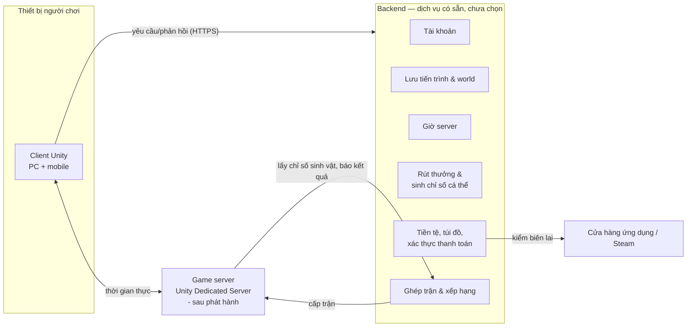
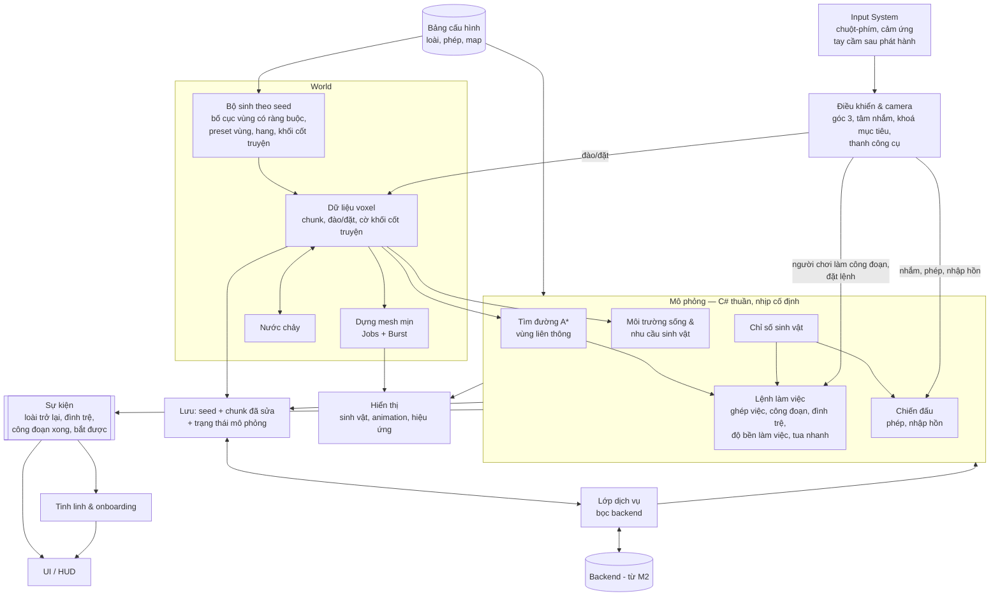

# Kiến trúc

> Trạng thái: Nháp
> Liên quan: [Thành phần](components.md) · [Công nghệ](tech-stack.md) · [Cơ chế](../02-gameplay/mechanics.md)

Toàn bộ file là đề xuất của AI [ý tưởng] (2026-10-12; phần Client và Dữ liệu rà lại 2026-10-13 theo world-tech, simulation-tech, controls-ui, levels), dựa trên [components.md](components.md) và [0003](../decisions/0003-server.md) (chưa Chốt). Dịch vụ backend và netcode chưa chọn → chỉ mô tả trách nhiệm, không gắn sản phẩm.

## Kiến trúc hệ thống
<!-- Mermaid: các thành phần trong components.md và cách chúng giao tiếp (client ↔ server ↔ dịch vụ). Chỉ có client thì ghi rõ "game offline, một thành phần". -->

- M1: chỉ có client, dữ liệu cục bộ, giờ thiết bị ([0003](../decisions/0003-server.md)).
- M2: thêm backend. Game server chỉ có sau phát hành, cùng PvP.

## Dữ liệu
<!-- Dữ liệu nào nằm ở đâu: cấu hình game, save game, tài khoản, số liệu. Định dạng, ai là nguồn chuẩn, đồng bộ thế nào. -->
| Dữ liệu | Nguồn chuẩn | Nơi dùng | Ghi chú |
|---|---|---|---|
| Cấu hình game: loài, phép, base chỉ số, hệ số quy đổi, trần, yêu cầu môi trường sống, nhu cầu sinh vật, tỉ lệ rút thưởng | Bảng dữ liệu trong repo | Client (đóng gói), backend, game server — cùng một bản | Có số phiên bản; skill cân bằng đọc/ghi bảng này |
| Tài khoản | Backend | Client | |
| World voxel | Backend | Client tải về, lưu cache | Seed + **phiên bản bộ sinh** + các chunk đã sửa ([world-tech](world-tech.md#lưu-trữ)); phần còn lại sinh lại từ seed |
| Cấu hình map: preset vùng, ràng buộc bố cục, mẫu khối cốt truyện, vị trí sự kiện | Bảng dữ liệu + file mẫu trong repo | Client (bộ sinh world) | Đi cùng phiên bản bộ sinh ([levels](../02-gameplay/levels.md)) |
| Trạng thái mô phỏng: vị trí sinh vật, tiến độ công đoạn, độ bền làm việc, mức bệnh/mệt, tồn kho | Client tính | Lưu lên backend cùng world | Thời điểm lưu = mốc tính tua nhanh lần sau ([simulation-tech](simulation-tech.md)) |
| Tiến độ onboarding, gợi ý tinh linh đã xem | Backend (cùng tiến trình) | Client | Mỗi gợi ý hiện một lần ([controls-ui](../02-gameplay/controls-ui.md#hướng-dẫn-người-mới-onboarding)) |
| Cài đặt người chơi: đổi phím, bố cục nút cảm ứng, âm lượng | Thiết bị | Client | Mỗi thiết bị một bố cục; đổi phím lưu bằng `SaveBindingOverridesAsJson` của Input System ([docs](https://docs.unity3d.com/Packages/com.unity.inputsystem@1.19/manual/ActionBindings.html)) |
| Sở hữu sinh vật + chỉ số cá thể (phân bố ngẫu nhiên, vượt trội) | Backend | Client chỉ đọc; game server đọc khi PvP | Backend sinh khi nhận sinh vật; áp chặn quá may |
| Phân bổ điểm chỉ số | Backend | Client gửi yêu cầu | Backend kiểm: đủ điểm, không dưới base, có vật phẩm phân bổ lại |
| Tiến trình: cấp độ người chơi, phép sở hữu, nhiệm vụ, mảnh ký ức, loài đã hồi sinh | Backend | Client | |
| Tiền tệ, túi đồ, vật phẩm | Backend | Client | |
| Lệnh làm việc, sản lượng nông trại | Client tính | Lưu lên backend | Xem câu hỏi mở bên dưới |
| Điểm xếp hạng, hạng | Backend | Client, ghép trận | Nhận kết quả từ game server |
| Trạng thái trận PvP | Game server | Client | Chỉ tồn tại trong trận |

**Câu hỏi mở:** sản lượng nông trại do client tính. Nếu sản lượng đổi được ra tiền trong game hoặc vật phẩm (dùng rút thưởng), sửa client là gian lận được → ảnh hưởng kinh tế chung, dù không ảnh hưởng PvP trực tiếp. [ý tưởng] Backend kiểm tra hợp lý: sản lượng tối đa theo thời gian × số sinh vật × độ thuần thục; vượt thì cắt và ghi lại.

## Giao tiếp giữa các thành phần
<!-- API/giao thức, xác thực, xử lý mất mạng, versioning giữa client và server. Bỏ qua nếu chỉ có client. -->
- Client ↔ backend: yêu cầu/phản hồi qua SDK hoặc HTTPS của dịch vụ backend (chưa chọn). Mọi thao tác có giá trị (rút thưởng, phân bổ điểm, tiêu tiền) là **lệnh gửi backend**, client không tự đổi số.
- Client ↔ game server: kết nối thời gian thực qua netcode (chưa chọn — quyết định khi làm prototype trận mạng ở M3).
- Game server ↔ backend: lấy chỉ số sinh vật và phép của hai bên khi bắt đầu trận (không tin client); báo kết quả để tính điểm xếp hạng.
- **Phiên bản:** client gửi phiên bản app + phiên bản bảng cấu hình; backend từ chối phiên bản quá cũ → yêu cầu cập nhật.
- **Mất mạng:** game online — mất kết nối thì hiện màn kết nối lại; thao tác chưa gửi được thì xếp hàng gửi lại. Tua nhanh chờ giờ server ([cơ chế](../02-gameplay/mechanics.md#tua-nhanh)).

## Client (Unity)
<!-- Các hệ thống chính trong client (input, gameplay, UI, save, audio...) — Mermaid; luồng scene; dữ liệu cấu hình (ScriptableObject?). Quy ước code điền khi bắt đầu M1. -->
Nguyên tắc:
- **Logic tách khỏi hiển thị.** Mô phỏng (lệnh làm việc, chiến đấu) là C# thuần, không phụ thuộc scene → chạy được trong tua nhanh, trong kiểm thử, và trên game server (headless).
- **Tất định:** cùng seed + phiên bản bộ sinh → cùng world; mô phỏng chạy theo **nhịp cố định** với bộ sinh số ngẫu nhiên riêng ([simulation-tech](simulation-tech.md#nguyên-tắc)).
- **Một chiều dữ liệu:** input → lệnh vào mô phỏng / world; hiển thị, UI chỉ **đọc** trạng thái và nghe **sự kiện**.

| Hệ thống | Trách nhiệm | Chi tiết | Milestone |
|---|---|---|---|
| Input, điều khiển & camera | Bảng hành động chung cho chuột-phím và cảm ứng; tâm nhắm, khoá mục tiêu, chọn vùng 2 điểm; camera góc 3 tránh địa hình | [controls-ui](../02-gameplay/controls-ui.md) | M1 (cơ bản), M2 (chiến đấu), M3 (đổi phím) |
| Bộ sinh world | Bố cục vùng theo seed + ràng buộc, preset vùng, hang, dán khối cốt truyện, kiểm đường đi | [world-tech](world-tech.md#sinh-world-theo-seed), [levels](../02-gameplay/levels.md) | M1 (map nhỏ cố định), M2 (đầy đủ) |
| Voxel, mesh, nước | Dữ liệu chunk, đào/đặt nguyên ô, dựng mesh mịn, nước chảy | [world-tech](world-tech.md) | M1 (voxel, mesh), M2 (nước) |
| Mô phỏng nông trại | Nhịp cố định, ghép việc, A\*, đình trệ, độ bền làm việc, người chơi làm công đoạn, tua nhanh nhảy sự kiện | [simulation-tech](simulation-tech.md) | M1, tua nhanh M2 |
| Môi trường sống & nhu cầu | Đếm yêu cầu của loài theo vùng, mức đáp ứng | [cơ chế](../02-gameplay/mechanics.md#môi-trường-sống) | M1 (một mức), M2 |
| Chiến đấu | Phép, nhập hồn — viết để chạy được trên game server sau này | [cơ chế](../02-gameplay/mechanics.md#nhập-hồn) | M2 |
| Sự kiện, tinh linh & onboarding | Mô phỏng phát sự kiện; tinh linh nghe sự kiện để nói, chạy chuỗi onboarding, dạy đúng lúc | [controls-ui](../02-gameplay/controls-ui.md#hướng-dẫn-người-mới-onboarding) | M2 |
| UI / HUD | Đọc trạng thái + sự kiện; không đổi số trực tiếp | [controls-ui](../02-gameplay/controls-ui.md#hud) | M1 (tối thiểu), M2 |
| Lưu & lớp dịch vụ | M1 lưu cục bộ qua bản giả; M2 thay bằng backend thật | [world-tech](world-tech.md#lưu-trữ) | M1, M2 |

- **Lớp dịch vụ:** mọi gọi backend đi qua một lớp bọc → M1 dùng bản giả lưu cục bộ; M2 thay bằng dịch vụ thật; đổi nhà cung cấp không đụng gameplay (giảm rủi ro nhà cung cấp, [risks](risks.md)).
- **Sự kiện:** mô phỏng không gọi thẳng UI hay tinh linh — chỉ phát sự kiện. Khi tua nhanh, sự kiện được gom lại thành báo cáo (màn tua nhanh) thay vì phát từng cái.
- **Tìm đường trên lưới voxel:** tính lại theo vùng bị đổi khối (rủi ro M1 trong [risks](risks.md)). A\* tự viết: xem [tech-stack](tech-stack.md).
- **Luồng scene** [ý tưởng]: hai scene — **Khởi động** (đăng nhập, tải cấu hình, sinh/tải world) và **World** (chơi chính). Các bảng phủ (túi đồ, sinh vật...) là UI trong scene World, không phải scene riêng, vì mô phỏng vẫn chạy khi mở bảng ([controls-ui](../02-gameplay/controls-ui.md#màn-hình--luồng)). Trận PvP (sau phát hành) là scene riêng.
- Quy ước code: _(chưa có — điền khi bắt đầu M1)_
