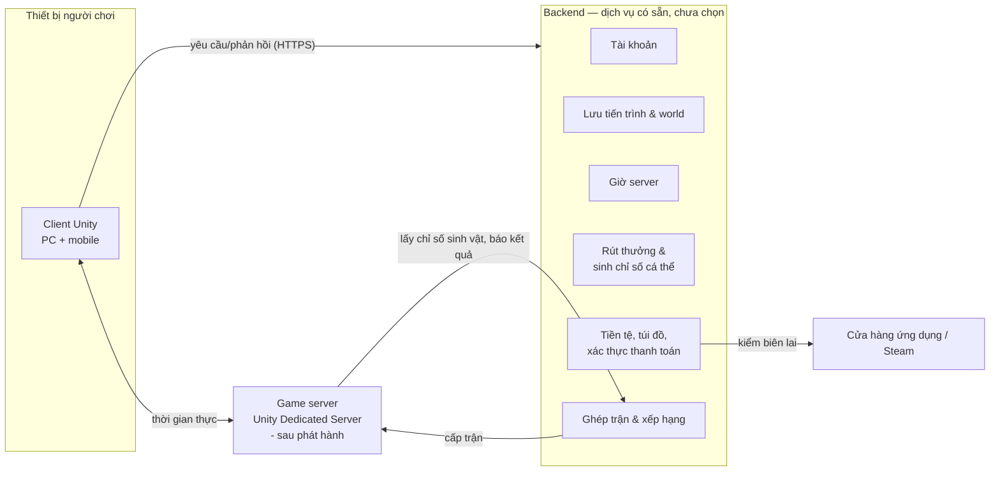
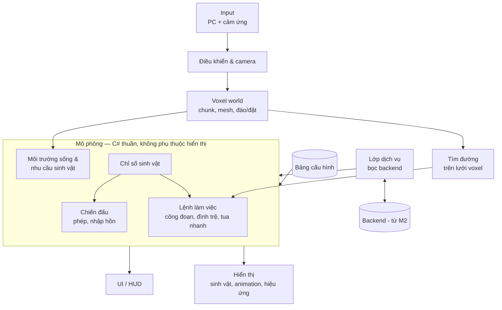

# Kiến trúc

> Trạng thái: Nháp
> Liên quan: [Thành phần](components.md) · [Công nghệ](tech-stack.md) · [Cơ chế](../02-gameplay/mechanics.md)

Toàn bộ file là đề xuất của AI [ý tưởng] (2026-10-12), dựa trên [components.md](components.md) và [0003](../decisions/0003-server.md) (chưa Chốt). Dịch vụ backend và netcode chưa chọn → chỉ mô tả trách nhiệm, không gắn sản phẩm.

## Kiến trúc hệ thống
<!-- Mermaid: các thành phần trong components.md và cách chúng giao tiếp (client ↔ server ↔ dịch vụ). Chỉ có client thì ghi rõ "game offline, một thành phần". -->

- M1: chỉ có client, dữ liệu cục bộ, giờ thiết bị ([0003](../decisions/0003-server.md)).
- M2: thêm backend. Game server chỉ có sau phát hành, cùng PvP.

## Dữ liệu
<!-- Dữ liệu nào nằm ở đâu: cấu hình game, save game, tài khoản, số liệu. Định dạng, ai là nguồn chuẩn, đồng bộ thế nào. -->
| Dữ liệu | Nguồn chuẩn | Nơi dùng | Ghi chú |
|---|---|---|---|
| Cấu hình game: loài, phép, base chỉ số, hệ số quy đổi, trần, yêu cầu môi trường sống, nhu cầu sinh vật, tỉ lệ rút thưởng | Bảng dữ liệu trong repo | Client (đóng gói), backend, game server — cùng một bản | Có số phiên bản; skill cân bằng đọc/ghi bảng này |
| Tài khoản | Backend | Client | |
| World voxel | Backend | Client tải về, lưu cache | Chỉ lưu phần khác với world sinh từ seed, theo chunk |
| Sở hữu sinh vật + chỉ số cá thể (phân bố ngẫu nhiên, vượt trội) | Backend | Client chỉ đọc; game server đọc khi PvP | Backend sinh khi nhận sinh vật; áp chặn quá may |
| Phân bổ điểm chỉ số | Backend | Client gửi yêu cầu | Backend kiểm: đủ điểm, không dưới base, có vật phẩm phân bổ lại |
| Tiến trình: cấp độ người chơi, phép sở hữu, nhiệm vụ, mảnh ký ức, loài đã hồi sinh | Backend | Client | |
| Tiền tệ, túi đồ, vật phẩm | Backend | Client | |
| Lệnh làm việc, sản lượng nông trại | Client tính | Lưu lên backend | Xem câu hỏi mở bên dưới |
| Điểm xếp hạng, hạng | Backend | Client, ghép trận | Nhận kết quả từ game server |
| Trạng thái trận PvP | Game server | Client | Chỉ tồn tại trong trận |

**Câu hỏi mở:** sản lượng nông trại do client tính. Nếu sản lượng đổi được ra tiền trong game hoặc vật phẩm (dùng rút thưởng), sửa client là gian lận được → ảnh hưởng kinh tế chung, dù không ảnh hưởng PvP trực tiếp. [ý tưởng] Backend kiểm tra hợp lý: sản lượng tối đa theo thời gian × số sinh vật × độ thuần thục; vượt thì cắt và ghi lại.

## Giao tiếp giữa các thành phần
<!-- API/giao thức, xác thực, xử lý mất mạng, versioning giữa client và server. Bỏ qua nếu chỉ có client. -->
- Client ↔ backend: yêu cầu/phản hồi qua SDK hoặc HTTPS của dịch vụ backend (chưa chọn). Mọi thao tác có giá trị (rút thưởng, phân bổ điểm, tiêu tiền) là **lệnh gửi backend**, client không tự đổi số.
- Client ↔ game server: kết nối thời gian thực qua netcode (chưa chọn — quyết định khi làm prototype trận mạng ở M3).
- Game server ↔ backend: lấy chỉ số sinh vật và phép của hai bên khi bắt đầu trận (không tin client); báo kết quả để tính điểm xếp hạng.
- **Phiên bản:** client gửi phiên bản app + phiên bản bảng cấu hình; backend từ chối phiên bản quá cũ → yêu cầu cập nhật.
- **Mất mạng:** game online — mất kết nối thì hiện màn kết nối lại; thao tác chưa gửi được thì xếp hàng gửi lại. Tua nhanh chờ giờ server ([cơ chế](../02-gameplay/mechanics.md#tua-nhanh)).

## Client (Unity)
<!-- Các hệ thống chính trong client (input, gameplay, UI, save, audio...) — Mermaid; luồng scene; dữ liệu cấu hình (ScriptableObject?). Quy ước code điền khi bắt đầu M1. -->
Nguyên tắc: **logic tách khỏi hiển thị**. Mô phỏng (lệnh làm việc, chiến đấu) là C# thuần, không phụ thuộc scene → chạy được trong tua nhanh, trong kiểm thử, và trên game server (headless).

- **Lớp dịch vụ:** mọi gọi backend đi qua một lớp bọc → M1 dùng bản giả lưu cục bộ; M2 thay bằng dịch vụ thật; đổi nhà cung cấp không đụng gameplay (giảm rủi ro nhà cung cấp, [risks](risks.md)).
- **Tìm đường trên lưới voxel:** tính lại theo vùng bị đổi khối (rủi ro M1 trong [risks](risks.md)). Chọn tự viết A* trên lưới hay dùng package của Unity: xem [tech-stack](tech-stack.md).
- Luồng scene, quy ước code: _(chưa có — điền khi bắt đầu M1)_
