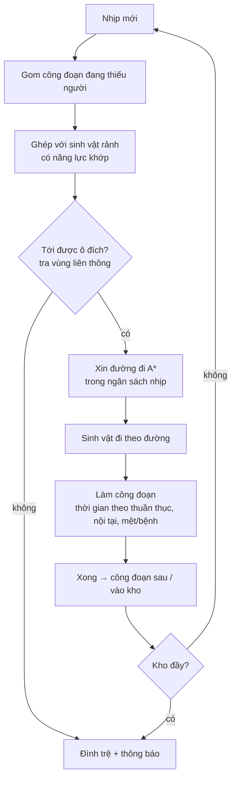

# Kỹ thuật mô phỏng nông trại

> Trạng thái: Đang xem xét
> Đã chốt phần (user, 2026-10-13): kế hoạch prototype M1, kỹ thuật môi trường sống. Phần còn lại vẫn là đề xuất.
> Liên quan: [Kỹ thuật tạo world](world-tech.md) · [Kiến trúc](architecture.md) · [Cơ chế](../02-gameplay/mechanics.md) · [Rủi ro](risks.md)

Phần kỹ thuật nặng thứ hai của M1 (sau world): **lệnh làm việc**, **tìm đường sinh vật**, **tua nhanh**. Luật chơi ở [cơ chế](../02-gameplay/mechanics.md#lệnh-làm-việc) — file này chỉ nói cách làm. Toàn bộ là đề xuất của AI [ý tưởng] (2026-10-13), trừ chỗ ghi nguồn.

## Nguyên tắc
- **Một mô hình mô phỏng, hai cách hiển thị** ([cơ chế](../02-gameplay/mechanics.md#tua-nhanh)): khi đang chơi, mô hình chạy theo nhịp và phần hiển thị vẽ sinh vật đi lại; khi tua nhanh, chỉ chạy mô hình, không vẽ.
- **C# thuần, không phụ thuộc scene** ([kiến trúc](architecture.md#client-unity)) → chạy được trong test tự động và trong tua nhanh.
- **Tất định:** cùng trạng thái + cùng thời gian → cùng kết quả. Không dùng thời gian khung hình, không dùng `UnityEngine.Random` trong mô phỏng — dùng bộ sinh số ngẫu nhiên có seed riêng của mô phỏng.
- **Nhịp cố định:** mô phỏng chạy theo nhịp cố định (vd 10 nhịp/giây), tách khỏi tốc độ khung hình; phần hiển thị nội suy vị trí giữa hai nhịp.

## Dữ liệu
| Thực thể | Trường chính |
|---|---|
| Lệnh làm việc | Vùng (tập ô), hàng đợi (vd loại cây), danh sách công đoạn, trạng thái, độ ưu tiên (M2) |
| Công đoạn | Loại = **năng lực làm việc** cần (vd tưới nước), ô đích, thời gian gốc, vật tư cần, **tối đa 2 sinh vật đang làm** (user, 2026-10-13), tiến độ (giữ khi bị gián đoạn) |
| Sinh vật (phần làm việc) | 2 năng lực làm việc, độ thuần thục ×2, tốc độ di chuyển, sức khoẻ, **độ bền làm việc** (giảm khi làm, hồi khi nghỉ — user chấp nhận 2026-10-13), mức bệnh/mệt, trạng thái (rảnh / đang đi / đang làm / nghỉ / bệnh / mệt), khung chiếm chỗ, kiểu di chuyển |
| Kho | Vị trí, sức chứa, tồn kho |
| Đình trệ | Công đoạn, lý do (không có đường / thiếu vật tư / kho đầy / không có loài có năng lực), vị trí |

Chỉ số dùng ở đây đọc từ [chỉ số làm việc](../02-gameplay/mechanics.md#chỉ-số-sinh-vật); con số cân bằng bằng skill `game-balance`.

## Một nhịp mô phỏng

**Ghép việc:**
- Mỗi nhịp, mỗi công đoạn thiếu người chọn sinh vật rảnh có năng lực khớp, điểm = (độ dài đường ước tính) chia cho (độ thuần thục). Sinh vật gần và giỏi được chọn trước.
- Ước tính bằng khoảng cách trên lưới (rẻ); chỉ chạy A\* thật cho cặp đã chọn.
- Giữ tiến độ khi sinh vật bị lấy đi giữa chừng (nhập hồn, chuyển lệnh) — đúng trường hợp biên trong cơ chế.

**Người chơi làm công đoạn** (user, 2026-10-13): hành động của người chơi trên ô của lệnh (xới, gieo, tưới, thu hoạch) gửi vào mô phỏng như một sự kiện "công đoạn xong tại ô" ở nhịp kế tiếp; công đoạn đó không còn thiếu người → ghép việc bỏ qua. [ý tưởng]

**Thời gian một công đoạn:** `thời gian gốc ÷ hệ số thuần thục × hệ số nội tại × hệ số mệt/bệnh × hệ số người làm`; hệ số người làm = 1 khi một sinh vật; khi 2 sinh vật cùng làm, con thứ hai giúp ít hơn con đầu (vd × 0,6 thay vì × 0,5 — user chấp nhận 2026-10-13). Các hệ số là bảng dữ liệu, tính bằng `game-balance`.

**Nghỉ:** độ bền làm việc về 0 → sinh vật về trạng thái nghỉ (tại chỗ hoặc về nơi ở — [ý tưởng]) cho tới khi hồi đủ, rồi mới nhận việc lại. Bệnh/mệt theo mức độ: làm chậm → nghỉ nhiều hơn → dừng (user, 2026-10-13).

## Tìm đường
- **A\* trên lưới ô** của [world-tech](world-tech.md#tìm-đường-trên-lưới): ô đi được theo khung chiếm chỗ (rộng w, cao h), đi bộ leo/xuống 1 ô.
- **Vùng liên thông:** chia các ô đi được thành vùng (mỗi kích thước khung có bản riêng). Hai ô khác vùng → biết ngay "không tới được" → **đình trệ ngay**, không tốn A\*.
  - Đào/đặt ô → chỉ tính lại vùng quanh chỗ sửa (gộp hoặc tách vùng).
- **Ngân sách mỗi nhịp:** giới hạn số lần A\* mỗi nhịp; yêu cầu dư xếp hàng sang nhịp sau → không giật khung hình khi nhiều sinh vật cùng cần đường.
- **Đường bị cắt** (người chơi đào giữa đường) → sinh vật dừng ở ô hiện tại, xin đường mới.
- Bản đồ lớn hơn hoặc nhiều sinh vật hơn mà A\* chậm → cân nhắc tìm đường phân cấp (chia chunk thành cụm, tìm trên cụm trước) [chưa xác minh — đo ở M1 trước].
- Kiểu di chuyển bay, bơi: M2 — thêm luật ô đi được (bay: bỏ yêu cầu đất dưới chân; bơi: ô có nước).

## Tua nhanh
Mô hình **nhảy sự kiện** thay vì chạy từng nhịp:
1. Lấy thời gian vắng mặt (giờ server từ M2; giờ thiết bị ở M1).
2. Cho **nước** đạt trạng thái yên trước ([world-tech](world-tech.md#nước-chảy)).
3. Với mỗi cặp sinh vật–công đoạn: thời lượng = (độ dài đường ÷ tốc độ) + thời gian làm. Lấy sự kiện xong sớm nhất → cập nhật kho, công đoạn → ghép việc mới → lặp.
4. Dừng khi hết thời gian, hoặc mọi lệnh dừng vì giới hạn tự nhiên (kho đầy, hết hạt giống trong hàng đợi) — đúng ý "không cần giới hạn thời gian cứng" trong cơ chế.
5. Trả về: sản lượng, các đình trệ xảy ra, vị trí cuối của sinh vật.

- Độ dài đường dùng **độ dài A\* thật** (đã có trong bộ đệm đường hoặc tính lại một lần), không phải khoảng cách thẳng → khớp với lúc chơi.
- **Kiểm chứng:** test tự động chạy cùng một nông trại theo hai cách (nhịp từng nhịp vs nhảy sự kiện) trong cùng khoảng thời gian → sản lượng lệch không quá một ngưỡng (vd ≤ 2%) — rủi ro "kết quả tua nhanh lệch lúc chơi" trong [risks](risks.md).
- Mệt/bệnh (nhu cầu sinh vật) tính theo thời gian trung bình của khoảng vắng mặt — chi tiết khi cơ chế bệnh/mệt có luật ([cơ chế](../02-gameplay/mechanics.md#nhu-cầu-sinh-vật)).

## Hiển thị
- Phần hiển thị chỉ **đọc** trạng thái mô phỏng: vị trí (nội suy giữa nhịp), trạng thái → animation (đi, làm, nghỉ), biểu tượng đình trệ tại chỗ.
- Sinh vật ở xa camera: không cần vẽ animation chi tiết; mô hình vẫn chạy.

## Hiệu năng
- Số sinh vật hoạt động tối đa = **giới hạn sinh vật** (theo cấp độ người chơi, công trình — [cơ chế](../02-gameplay/mechanics.md#giới-hạn-sinh-vật--kho-sinh-vật)). Khi mở hết: **54** (không nạp), **60** (có ưu đãi nạp) (user, 2026-10-13) → M1 đo với 60 sinh vật trên máy mobile tầm trung.
- Đo ở M1: ms mỗi nhịp mô phỏng, số A\* mỗi giây, thời gian tua nhanh 8 giờ vắng mặt.

## Môi trường sống
User duyệt 2026-10-13 (cùng bước 8 của kế hoạch prototype). Phần kỹ thuật của [môi trường sống](../02-gameplay/mechanics.md#môi-trường-sống) — trước đây chưa có (rà soát 2026-10-13).
- **Yêu cầu là dữ liệu:** mỗi yêu cầu thuộc một loại chung — số ô vật liệu X ≥ N, số cây loại Y ≥ N, số ô nước ≥ N, có điểm cao ≥ y, có công trình Z, có loài W đang ở. Thêm loài = thêm dữ liệu, không code ([levels](../02-gameplay/levels.md#nội-dung-tái-sử-dụng)).
- **Đếm theo sự kiện:** world phát sự kiện "ô đổi" (đào/đặt), "cây mọc/bị thu", "công trình đặt/bỏ" → bộ đếm của vùng chứa ô đó cộng/trừ ngay. Không quét lại cả vùng mỗi nhịp → HUD cập nhật tức thì ([core loop](../02-gameplay/core-loop.md)).
- **Vùng:** M1 = cả map; M2 = vùng của bố cục ([levels](../02-gameplay/levels.md#kích-thước--khung-chung)) — mỗi ô biết mình thuộc vùng nào (bảng theo cột chunk).
- **Đạt đủ yêu cầu mở khoá** → phát sự kiện "loài trở lại" → sinh cá thể theo [luật M1](../02-gameplay/mechanics.md#sinh-vật-trở-lại--luật-m1).
- Khi nạp world: tính lại bộ đếm một lần bằng cách quét vùng (không lưu bộ đếm).

## Kế hoạch prototype (M1)
Theo **M1 tối giản** ([0007](../decisions/0007-m1-toi-gian.md), user chốt 2026-10-13); **kế hoạch user duyệt 2026-10-13**. Chia các hạng mục "Lệnh làm việc 7–11", "Tìm đường 4–7", "Chỉ số làm việc 1–2", "Môi trường sống 3–6" của [roadmap](../05-roadmap.md):

| # | Bước | Xong khi | Ước lượng (ngày-người) |
|---|---|---|---|
| 1 | Lõi mô phỏng: nhịp cố định 10/giây, **số nguyên** (nhịp, tiến độ theo phần nghìn), seed; dữ liệu sinh vật / lệnh / công đoạn / kho; **ghép việc** theo năng lực + thuần thục, **đi theo khoảng cách ô** (chưa A\*), vận chuyển 2 chặng ([0014](../decisions/0014-ghep-viec-o-sim-buoc-1.md)) | Test: cùng đầu vào → cùng kết quả; thời gian xong = nhịp đi + nhịp làm | 3–5 · **Xong 2026-10-14** [run]: `Game.Core.Sim` (`SimRng` PCG32, `SimConfig` đọc `design/data/sim_m1.json`, `Simulation.Tick()` làm → đi → giao việc, `SimHash`); 18 test mới, EditMode 102/102; mã băm trạng thái trùng từng nhịp qua 2000 nhịp ([brief 0001](../../.ai/briefs/0001-sim-loi-mo-phong.md)) |
| 2 | A\* đi bộ (thay đi theo khoảng cách của bước 1), **khung chiếm chỗ 3 chiều theo loài**, không đi vào nước; tính lại khi đào/đặt (map nhỏ, chưa cần vùng liên thông); đào dưới chân → sinh vật chạy ra ([0015](../decisions/0015-tim-duong-khung-va-dao-duoi-chan.md)) | Đường đúng với khung 1 × 1 × 1, 1 × 1 × 2, 2 × 2 × 1; đào cắt đường → đình trệ "không có đường" | 4–6 |
| 3 | Lệnh trồng cây 5 công đoạn (ghép việc đã có từ bước 1); một kho | 3 loài (L1, L2, L3) làm xong một vụ, sản lượng vào kho | 2–4 |
| 4 | Đình trệ + thông báo: không có đường / kho đầy / thiếu năng lực | 3 lý do đều hiện đúng | 1–2 |
| 5 | Thuần thục + tốc độ vào thời gian công đoạn | Đổi thuần thục → thời gian đổi đúng công thức | 1 |
| 6 | Hiển thị: nội suy vị trí, trạng thái | Sinh vật đi mượt ở 30 và 60 FPS | 1–2 |
| 7 | Đo trên mobile với 60 sinh vật giả (sinh bằng lệnh debug) | ≤ 5 ms/nhịp (ngưỡng user duyệt 2026-10-13, số tạm) | 1 |
| 8 | Môi trường sống: đếm yêu cầu theo sự kiện, 3 loài × 2–3 yêu cầu | Đào/đặt → tiến độ đổi ngay; đủ yêu cầu → loài trở lại | 3–6 |
| | **Cộng** | | **16–27** |

**Chuyển sang M2:** tua nhanh nhảy sự kiện + test lệch ≤ 2% (trong "Tua nhanh 8–15"); vùng liên thông, ngân sách A\*, khung nhiều ô; vật tư, nhiều lệnh, độ ưu tiên; 2 sinh vật cùng làm một công đoạn; độ bền làm việc, nghỉ, bệnh/mệt (trong "Nhu cầu sinh vật"); người chơi làm công đoạn; bay, bơi.

## Câu hỏi mở
- Ngưỡng các mức bệnh/mệt; nghỉ tại chỗ hay về nơi ở?
- Đã trả lời (user, 2026-10-13): tối đa 54 sinh vật hoạt động, 60 nếu nạp; độ bền làm việc và con thứ hai giúp ít hơn con đầu — chấp nhận; bệnh/mệt theo mức độ (chậm → nghỉ nhiều → dừng), sinh vật khoẻ cũng cần nghỉ; tối đa 2 sinh vật cùng làm một công đoạn, giảm thời gian.
