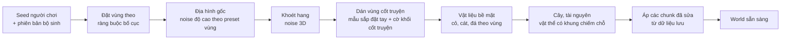
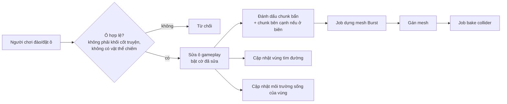
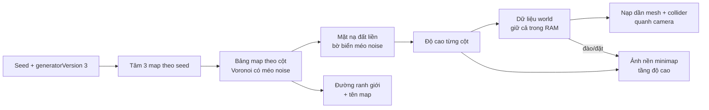

# Kỹ thuật tạo world

> Trạng thái: Đang xem xét
> Đã chốt phần (user, 2026-10-13): kế hoạch prototype M1. Phần còn lại vẫn là đề xuất.
> Liên quan: [Công nghệ](tech-stack.md) · [Kiến trúc](architecture.md) · [Art style](../03-art-audio/art-style.md) · [Cơ chế](../02-gameplay/mechanics.md) · [Rủi ro](risks.md)

Ưu tiên kỹ thuật số 1 (user, 2026-10-13): "tập trung vào các kỹ thuật cần có để build game, nhất là phần tạo world trước". File này gom mọi quyết định kỹ thuật của world: dữ liệu, sinh theo seed, dựng mesh, chỉnh sửa, va chạm, tìm đường, lưu trữ, hiệu năng. Docs tra 2026-10-12/13, Unity 6000.4. Đề xuất của AI ghi [ý tưởng].

## Yêu cầu đầu vào
Tổng hợp từ thiết kế (không thêm yêu cầu mới):

| Yêu cầu | Nguồn |
|---|---|
| Dữ liệu là lưới voxel; đào/đặt theo ô; 1 ô = 1 đơn vị | [art-style](../03-art-audio/art-style.md#quy-cách-kỹ-thuật) |
| Địa hình hiển thị **dạng khối bo cạnh, mép cỏ phủ**; dựng mesh trên lưới gameplay (×1) — thay "bề mặt mịn liền, dựng ×2" | [0011](../decisions/0011-dia-hinh-khoi-bo-canh.md), [art-style](../03-art-audio/art-style.md#hướng-phong-cách) |
| Nhân vật cao 1,5, rộng 1 → đi vừa rãnh rộng 1 ô, cao 2 ô | [art-style](../03-art-audio/art-style.md#quy-cách-kỹ-thuật) |
| Sinh vật, cây, vật phẩm là model riêng, chiếm **khung chiếm chỗ** nhiều ô | [art-style](../03-art-audio/art-style.md#hướng-phong-cách) |
| Map có ranh giới; phần cốt truyện sắp đặt tay (**khối cốt truyện**), phần còn lại sinh theo **seed** của người chơi | [cơ chế](../02-gameplay/mechanics.md#sinh-map-theo-seed--khối-cốt-truyện) |
| Môi trường sống tính theo vùng (tỉ lệ loại khối, cây trồng...) | [cơ chế](../02-gameplay/mechanics.md#môi-trường-sống) |
| Sinh vật tìm đường trên địa hình người chơi tạo; tua nhanh không cần scene | [cơ chế](../02-gameplay/mechanics.md#tìm-đường-sinh-vật--đình-trệ), [kiến trúc](architecture.md#client-unity) |
| PC + mobile; world lưu ở backend (game online) | [vision](../00-vision.md), [components](components.md) |

## Dữ liệu world
[ý tưởng]
- **Lưới gameplay** (1 ô = 1 đơn vị): nguồn chuẩn, dùng cho luật chơi, lưu trữ, tìm đường, môi trường sống **và dựng mesh** (mỗi mặt ô lộ ra là một mặt khối — [0011](../decisions/0011-dia-hinh-khoi-bo-canh.md)). Lưới dựng mesh ×2 của bản bề mặt mịn đã bỏ.
- **Mỗi ô gameplay** (2 byte):

| Trường | Kích thước | Ý nghĩa |
|---|---|---|
| Vật liệu | 8 bit | 0 = rỗng; cỏ, đất, đá, cát, nước, ô ruộng ([0020](../decisions/0020-o-ruong-tao-khi-xoi-va-huy-vu.md): chỉ có khi sinh vật xới xong)... |
| Cờ khối cốt truyện | 1 bit | Không phá/đặt được tới khi phá đảo map |
| Cờ đã sửa | 1 bit | Khác với world sinh từ seed → cần lưu |
| Mực nước | 3 bit | 0–7: lượng nước trong ô (nước chảy — user, 2026-10-13) [ý tưởng]. M1 ([0040](../decisions/0040-nuoc-chay-nguon-lan-gioi-han-m1.md)): với nước đang chảy là **mức lan** 1–7; nguồn giữ 7 như world sinh ra |
| Cờ nước đang chảy | 1 bit (bit 13) | M1 (0040, đề xuất Planner 2026-10-25): bật = nước đang chảy (rút được); tắt = **nguồn nước**. World sinh ra không bật → mã băm world không đổi |
| Cờ nước đang rơi | 1 bit (bit 14) | M1 (0040, đề xuất Planner): nước đang rơi; chạm đáy thì lan lại đủ N ô |
| Dự phòng | 1 bit | Vd độ ẩm |

- **Chiếm chỗ** (sinh vật, cây, vật phẩm) lưu ở **lớp riêng**: danh sách vật thể + khung chiếm chỗ → bảng tra ô → vật thể. Không nhét vào ô địa hình, vì vật thể nhiều ô và di chuyển được.
- **Chunk:** 16 × 16 × 16 ô gameplay [ý tưởng]. 16 là kích thước phổ biến: Minecraft chia chunk 16 × 16 theo chiều ngang, mỗi đoạn cao 16 ([Minecraft Wiki](https://minecraft.wiki/w/Chunk)); Godot Voxel Tools mặc định khối mesh 16, cho phép 32 — 32 ít draw call hơn nhưng sửa voxel chậm hơn ([Voxel Tools](https://voxel-tools.readthedocs.io/en/latest/performance/)).
- **Map 128 × 128 × 48 ô, có hang động** (user, 2026-10-13) → 8 × 8 × 3 = 192 chunk. World gồm 3 map liền nhau ([0022](../decisions/0022-world-nhieu-map-va-minimap-m1.md)) → xem [World nhiều map + minimap](#world-nhiều-map--minimap-m1).
- **Đào/đặt luôn theo nguyên ô** (user, 2026-10-13) → dữ liệu có/không + vật liệu là đủ, không cần mật độ trung gian.

## Sinh world theo seed
[ý tưởng] Chạy trên client (world riêng của người chơi), **tất định**: cùng seed + cùng **phiên bản bộ sinh** → cùng world.

- **Noise:** `Unity.Mathematics.noise` có `snoise` (simplex), `cnoise` (Perlin), `pnoise`, `cellular`... ([API](https://docs.unity3d.com/Packages/com.unity.mathematics@1.3/api/Unity.Mathematics.noise.html)); bản đi kèm Unity 6000.4.8f1 trên máy: Mathematics 1.3.3, Burst 1.8.29 [run 2026-10-13]. Burst dịch kiểu vector của Unity.Mathematics sang SIMD ([Burst](https://docs.unity3d.com/Packages/com.unity.burst@1.8/manual/csharp-type-support.html)); hàm `noise.*` là phép toán float thuần nên chạy được trong Burst — suy luận, docs không nói rõ [chưa xác minh].
- **Hang động** (user, 2026-10-13) có **sinh vật và tài nguyên riêng** → có môi trường sống dưới lòng đất ([cơ chế](../02-gameplay/mechanics.md#môi-trường-sống)). [ý tưởng] Khoét bằng noise 3D (vd `snoise` 3D hoặc `cellular` có ngưỡng); giữ lớp đá đáy map; kiểm hang nối được với mặt đất. Hang tối → cần ánh sáng (đèn, vật phát sáng) — xem art style.
- **Bố cục vùng** (user, 2026-10-13): vùng đặt theo seed, phải đạt **ràng buộc bố cục** của map (giáp biển, diện tích, khoảng cách đi bộ) — không đạt thì đổi seed con, sinh lại ([levels](../02-gameplay/levels.md#kích-thước--khung-chung)).
- **Vùng cốt truyện:** mẫu dựng tay (lưu dạng file dữ liệu), dán vào vị trí do bố cục vùng chọn (trong ràng buộc), bật cờ khối cốt truyện cho ô của nó và **đường đi tới nó**.
- **Kiểm tra sau khi sinh:** đường tới mọi khối cốt truyện phải đi được (chạy tìm đường) — sai thì sinh lại phần đó.
- Đổi bộ sinh làm world cũ khác đi → dữ liệu lưu phải ghi **phiên bản bộ sinh** (xem Lưu trữ).

## Dựng mesh khối bo cạnh
Theo [0011](../decisions/0011-dia-hinh-khoi-bo-canh.md) (user chốt 2026-10-13), thay bề mặt mịn liền:
- **Mặt khối:** mỗi mặt ô đặc giáp ô rỗng/nước → một tứ giác (cách "culling" của [0fps](https://0fps.net/2012/06/30/meshing-in-a-minecraft-game/)); không sinh mặt giữa hai ô đặc. World M1 hiện tại: 7.725 mặt lộ → 15.450 tam giác cho cả map, khi chưa bo cạnh (Surface Nets ×2 là 61.800) [run 2026-10-13].
- **Gộp mặt (greedy meshing)** [ý tưởng, chưa làm ở M1]: gộp các mặt đồng phẳng kề nhau thành tứ giác lớn; chỉ gộp được khi thuộc tính (vật liệu, AO) giống nhau ở mọi đỉnh và có thể sinh đỉnh chữ T ([0fps](https://0fps.net/2012/06/30/meshing-in-a-minecraft-game/), [0fps AO](https://0fps.net/2013/07/03/ambient-occlusion-for-minecraft-like-worlds/)). Bo cạnh + mép cỏ lượn sóng làm mặt kề nhau khác nhau → ít gộp được; chỉ xét nếu đo trên mobile thấy cần.
- **Bo cạnh lồi** (bước 5.2, đã làm): mỗi mặt lộ chia lưới 4 × 4 điểm (0, r, 1 − r, 1), mỗi điểm đặt lại lên mặt "lăn quả cầu bán kính r bên trong khối" (phép mở hình thái học): cạnh lồi thành cung tròn, góc lồi thành mặt cầu, cạnh lõm giữ vuông; pháp tuyến = hướng từ lõi ra. Vị trí một điểm chỉ phụ thuộc 8 ô quanh đỉnh lưới gần nhất → hai mặt chung điểm luôn ra cùng vị trí (mesh kín), chỉ 256 tổ hợp → tính sẵn bảng; r = 1/8. Cạnh mặt không có điểm dời → bỏ điểm giữa (không đỉnh chữ T); mặt không cạnh nào dời → 1 tứ giác; đường lưới trong chỉ giữ khi cạnh tương ứng cong (hoặc góc dời mà không cạnh kề nào cong), mỗi ô lưới rút gọn cắt tai thành tam giác → −34% tam giác (109.206 → 71.668 cả map) [run 2026-10-13]. **Đệm chunk 1 ô** (bản Surface Nets cần 2). World M1 có 4.520 cạnh lồi [run 2026-10-13].
- **Mép cỏ** (bước 5.3, đã làm): mỗi sườn x/z lộ của ô cỏ lộ mặt trên có một dải — từ brief 0014 (7b4) mặt cắt bo tròn như gối: mặt trên cuộn xuống (bán kính 0,08), mặt trước nhô 0,12 ô, đáy mặt trước sâu 0,205–0,355 ô cuộn vào (bán kính 0,06) rồi mặt dưới nghiêng lên chạm vách ở độ sâu 0,16, pháp tuyến mượt; mép dưới lượn sóng = 2 hàm sin theo toạ độ thế giới dọc cạnh, pha theo hash của đường cạnh (liền giữa hai ô kề và qua biên chunk); góc lồi có mảnh 1/4 vòng nối hai dải; đầu dải không nối tiếp thì bịt nắp. Chỉ hiển thị (collider vẫn mặt khối vuông); kín khi nhìn từ dưới (brief 0013, giữ ở 0014). Góc lõm của mặt trên ô cỏ (hai ô kề x, z đặc, ô chéo rỗng): bo cạnh làm lõm một góc R × R mà dải mép không phủ → mảnh phẳng phủ (nâng 0,002, chồm 0,01; +0,47% tam giác world M1) — sửa lỗi user báo 2026-10-24 (brief 0073). Sườn ô cỏ hiện màu đất. **[ý tưởng] 7b4** (user 2026-10-20, khi xem brief 0013, theo mép cỏ Pokopia): váy phẳng trông mỏng → đổi mặt cắt thành khối bo tròn như gối: mặt trên cuộn xuống, phần trước phồng ra (nhô ~0,12), đáy lượn sóng cuộn ngược vào vách (dày ~0,28), pháp tuyến mượt theo đường cong.
- **Bóng tối ở góc (AO theo đỉnh)** [ý tưởng, bước 5.4]: mỗi đỉnh tính từ 2 ô cạnh + 1 ô chéo; chia tứ giác theo đường chéo hợp AO để không lệch sáng ([0fps AO](https://0fps.net/2013/07/03/ambient-occlusion-for-minecraft-like-worlds/)).
- **Collider:** bake từ mặt khối vuông (chưa bo, chưa mép cỏ) — khớp đúng lưới.
- **Nối giữa các chunk:** mesher đọc ô đệm của chunk bên cạnh để biết mặt nào lộ và hình bo; sửa ô ở biên → dựng lại cả chunk bên cạnh (tối đa 8 chunk khi ở góc).

### Lịch sử: bề mặt mịn (đã thay bởi 0011)
Dùng ở bước 2–4 (2026-10-13); mã còn trong lịch sử git (commit `f05f917` trở về trước). Lý do thay: mặt lồi lõm thành chấm theo từng ô trên bậc 1 ô, nhìn không tự nhiên (user, 2026-10-13).

| Thuật toán | Cách làm | Hợp với game này |
|---|---|---|
| **Surface Nets** | Mỗi ô một đỉnh (trung bình các điểm cắt cạnh), ra mặt tứ giác; dễ làm, nhanh, ít mặt hơn Marching Cubes; đỉnh đặt ngây thơ trông vát cạnh ([0fps](https://0fps.net/2012/07/12/smooth-voxel-terrain-part-2/); gốc: Gibson 1998, [MERL TR99-24](https://merl.com/publications/TR99-24)) | ✅ **Đã thử** trong Blender: ×2 giữ được rãnh 1 ô, ~24.000 tam giác / mảnh 30 × 30 ô [run 2026-10-12] |
| Marching Cubes | Bảng 256 trường hợp, đỉnh nội suy trên cạnh; nhiều mặt nhất trong so sánh của 0fps ([bài báo 1987](https://courses.cs.duke.edu/cps124/fall01/resources/p163-lorensen.pdf), [0fps](https://0fps.net/2012/07/12/smooth-voxel-terrain-part-2/)) | Phương án dự phòng |
| Dual Contouring | Cần dữ liệu Hermite (điểm cắt + pháp tuyến), giữ cạnh sắc ([Ju et al. 2002](https://profiles.wustl.edu/en/publications/dual-contouring-of-hermite-data-2/)); giải bình phương tối thiểu tốn và dễ sai số ([0fps](https://0fps.net/2012/07/12/smooth-voxel-terrain-part-2/)) | Không cần — game muốn mịn, không cần cạnh sắc |
| Transvoxel | Thêm "ô chuyển tiếp" để nối chunk khác độ phân giải (chỉ khi chênh đúng ×2), không vướng bằng sáng chế ([transvoxel.org](https://transvoxel.org/)) | Dựa trên Marching Cubes → không dùng thẳng với Surface Nets; chỉ cần nếu làm LOD |

- Đã dùng: **Surface Nets ×2** + làm mượt có giới hạn (mỗi đỉnh lệch ≤ 0,2 ô); đọc mẫu −3..34 → đệm 2 ô mỗi phía [repo] [run 2026-10-13].

- **Chạy:** C# Job System + Burst; ghi mesh qua `Mesh.AllocateWritableMeshData` → `Mesh.ApplyAndDisposeWritableMeshData` ([tech-stack](tech-stack.md)).
- **Chỉ số đỉnh 16 bit đủ:** mesh 16 bit chứa tối đa 65.535 đỉnh; 32 bit không chắc chạy trên mọi máy (vd Android GPU Mali-400 không vẽ) ([Mesh.indexFormat](https://docs.unity3d.com/6000.4/Documentation/ScriptReference/Mesh-indexFormat.html)). Bản Surface Nets: chunk nặng nhất 3.800 tam giác, 2.019 đỉnh; cả map 61.800 tam giác [run 2026-10-13]. Mesh khối có ít tam giác hơn (15.450 cả map khi chưa bo) → vẫn 16 bit; đo lại sau bước 5.2–5.3.
- **Vật liệu:** màu theo vật liệu ghi vào đỉnh (bước 5.1); texture theo mặt — mặt khối thẳng trục nên UV lấy thẳng từ toạ độ, không cần triplanar (bước 5.4); material nhám, không bóng ([0011](../decisions/0011-dia-hinh-khoi-bo-canh.md)).
- **Nước chảy** (user, 2026-10-13) — xem mục Nước bên dưới.
- **Mép map** ([0009](../decisions/0009-dai-duong-va-suong-mu-o-ria-map.md), user 2026-10-13; cách làm là [ý tưởng]): ngoài map lấy mẫu bằng cột biên gần nhất → không sinh vách đứng ở mép (giữ khi đổi sang mesh khối); bộ sinh hạ độ cao dần về rìa để luôn có vành biển; đáy biển ở rìa nằm dưới mặt nước, trong sương mù.
- **LOD:** map có ranh giới → M1 **chưa làm LOD**; chỉ thêm nếu đo trên mobile thấy cần.

## Chỉnh sửa (đào / đặt)
[ý tưởng]

- Mục tiêu: dựng lại mesh sau khi sửa trong "một hoặc hai khung hình" — mức 0fps nêu cho game kiểu Minecraft ([0fps](https://0fps.net/2012/06/30/meshing-in-a-minecraft-game/)).
- Gom nhiều chunk bẩn vào một lần xin `MeshDataArray` (khuyến nghị của docs `Mesh.MeshData`).

## Nước chảy
User chọn nước **chảy được** (2026-10-13). [ý tưởng]
- **Mô phỏng theo ô:** mỗi ô có mực nước 0–7; mỗi nhịp, nước chảy xuống ô dưới nếu trống, rồi tràn ngang sang ô thấp mực hơn — cách làm phổ biến kiểu automat ô [chưa xác minh bằng nguồn]. Chỉ mô phỏng vùng đang "động" (quanh chỗ vừa đào/đặt), vùng đã yên thì ngủ.
- **Nguồn nước** (suối, biển) giữ mực cố định.
- **Nước không có nguồn không cạn** (user, 2026-10-13): tổng lượng nước được bảo toàn — chỉ chảy/lan, không mất đi. **Không làm ở M1** (0040) — M2 xem lại.
- **Người chơi tạo được nguồn nước** (user, 2026-10-13). Cách tạo: _(chưa có)_ — [ý tưởng] phép của pháp sư, hoặc công trình (vd giếng, đài phun).
- **Hiển thị:** mesh mặt nước riêng, cao theo mực nước, tách khỏi mesh địa hình; shader trong suốt. M1 (brief 0011, bước 7b2): mặt nước theo ô dùng `Water.mat` — shader `Game/Ocean` chế độ trong suốt, độ đục gốc 0,45, nhìn xiên và ở xa đục dần theo sương (không tính độ sâu); nhìn được từ dưới lên. Camera dưới nước: sương 0–40 màu nước. Camera bay không vào ô đặc, vào được ô nước (hộp 0,25 ô, trượt dọc vách). Mặt biển nền ngoài world vẫn đục.
- **Ảnh hưởng gameplay:** môi trường sống (tỉ lệ nước trong vùng), công đoạn tưới nước, tìm đường (ô ngập là vật cản với loài đi bộ, đi được với loài bơi — M2).
- **Tất định + tua nhanh:** mô phỏng chạy theo nhịp cố định, không phụ thuộc khung hình; khi tua nhanh, cho nước "yên" trước rồi mới tính sản lượng.
- ~~**Phạm vi (cũ, 0012/0013):** M1 dùng nước **tĩnh** + **biển loang theo nhịp** khi đào ([0012](../decisions/0012-bien-tran-va-luat-dat-khoi-m1.md), [0013](../decisions/0013-nuoc-lan-theo-nhip.md)): ô ≤ mực nước biển thông với nước/biển ngoài map thì ngập — rơi xuống ngay, lan ngang/dâng 1 ô mỗi nhịp cố định; mỗi ô đầy hoặc rỗng; mặt biển nền chỉ ngoài map, trong map vẽ mặt nước theo ô. Nước chảy dần ở M2. Ước lượng 8–15 ngày-người ([roadmap](../05-roadmap.md)).~~ → thay bởi 0040 bên dưới.
- **M1 — nguồn + lan giới hạn** ([0040](../decisions/0040-nuoc-chay-nguon-lan-gioi-han-m1.md), user chốt 2026-10-25; bước 5e):
  - **Nguồn** không cạn: ô nước có sẵn khi sinh world (biển, hồ, ao demo) và ô ≤ mực nước biển ngập theo luật 0013 (biển loang giữ nguyên).
  - **Rơi xuống:** nước trên ô trống chảy thẳng xuống — cả cột trống bên dưới trong cùng nhịp (như 0013). Nước rơi chạm đáy được lan lại đủ N ô.
  - **Lan ngang** từ nguồn hoặc chỗ chạm đáy (chỉ khi ô dưới là khối đặc hoặc nước) sang 4 ô ngang trống, mỗi ô xa thêm giảm 1 mức, đi tối đa **N = 7 ô** [số tạm], 1 ô mỗi nhịp. Không dâng lên.
  - **Hố được lấp:** ô trống nước chảy tới thành ô nước (vẽ đầy ô như hiện nay; mặt nước thấp dần theo mực chưa làm — đề xuất Planner).
  - **Rút:** ô nước đang chảy mất đường về nguồn (nguồn bị chặn, bị lấp) → mỗi nhịp tính lại theo ô kề, rút dần tới hết.
  - **Nhịp:** 8 nhịp/giây [số tạm], tất định, không phụ thuộc khung hình. N và số nhịp/giây trong `design/data/water_m1.json` (chưa chốt).
  - Chỉ tính lại ô quanh chỗ vừa đổi (hàng chờ), không quét cả world; world sinh ra đứng yên tới khi có đào/đặt gần đó.
  - **Chưa làm ở M1:** bảo toàn lượng nước ("nước không có nguồn không cạn"), vùng động/ngủ, người chơi tạo nguồn, mặt nước theo mực → M2 xem lại (8–15, [roadmap](../05-roadmap.md)).

## Va chạm
- **Chỉ nhân vật người chơi** (và camera) cần va chạm vật lý với địa hình. Sinh vật đi theo lưới (tìm đường), không cần vật lý → ít việc hơn [ý tưởng].
- `Physics.BakeMesh` an toàn đa luồng, tính trên luồng gọi nó → chạy được trong job; không bake cùng một mesh từ nhiều luồng; collider chỉ dùng lại kết quả bake nếu `cookingOptions` khớp; mesh cần bật Read/Write trong bản build ([docs 6000.4](https://docs.unity3d.com/6000.4/Documentation/ScriptReference/Physics.BakeMesh.html)).
- `cookingOptions` cho phép tắt bớt bước kiểm tra để bake nhanh khi sinh mesh lúc chạy — dữ liệu phải hợp lệ ([docs](https://docs.unity3d.com/6000.4/Documentation/ScriptReference/MeshCollider-cookingOptions.html)).

## Tìm đường trên lưới
[ý tưởng] — tự viết A\*, C# thuần ([tech-stack](tech-stack.md)).
- **Ô đi được** cho một khung chiếm chỗ rộng w, cao h: các ô dưới chân là đất đặc, đủ w × w ô trống phía trên cao h ô. Nhân vật 1 × 2 × 1 → rãnh rộng 1, cao 2 đi được.
- **Kiểu di chuyển:** M1 chỉ đi bộ (leo/xuống 1 ô); bay, bơi để M2 ([cơ chế](../02-gameplay/mechanics.md#tìm-đường-sinh-vật--đình-trệ)).
- **Sửa địa hình:** chỉ tính lại vùng bị đổi; đường đang đi bị cắt → tìm lại; không tìm được → **đình trệ**.
- Tua nhanh dùng **độ dài đường** ước tính, không chạy từng bước ([cơ chế](../02-gameplay/mechanics.md#tua-nhanh)).

## Lưu trữ
- **Lưu chunk đã sửa, không lưu cả world:** world sinh lại từ seed; chỉ lưu các chunk có ô bị sửa — cách Godot Voxel Tools làm mặc định ("only modified blocks are saved" — [docs](https://voxel-tools.readthedocs.io/en/latest/streams/)).
- Lưu kèm **phiên bản bộ sinh**. Khi bản cập nhật đổi bộ sinh: **chunk chưa sửa sinh lại theo cách mới**, chunk đã sửa giữ nguyên (user, 2026-10-13).
  - [ý tưởng] Ranh giới giữa chunk đã sửa và chunk sinh lại có thể lệch độ cao → chạy một bước "khâu biên" (nội suy độ cao vài ô quanh ranh giới, chỉ trên phía chunk sinh lại).
  - [ý tưởng] Vật thể người chơi đặt (cây trồng, công trình) làm chunk đó thành "đã sửa" → không bị sinh lại mất.
  - Vùng cốt truyện là mẫu cố định theo map → không đổi theo bộ sinh.
- [ý tưởng] Lưu ở backend theo chunk (nén); client giữ bản cache. Chỉ lưu từng ô thay đổi (gọn hơn) để sau, nếu dung lượng backend thành vấn đề ([risks](risks.md)).

## Hiệu năng & hiển thị
- Không có ngân sách tam giác/draw call chính thức cho mobile; Unity khuyên đo bằng Profiler; khung hình 33,33 ms ở 30 fps, 16,66 ms ở 60 fps ([Unity](https://unity.com/how-to/mobile-game-optimization-tips-part-2)).
- **SRP Batcher** (có trong URP): giảm đổi trạng thái giữa các draw call cho vật liệu cùng shader — hợp nhiều mesh chunk dùng chung một shader địa hình ([docs](https://docs.unity3d.com/6000.4/Documentation/Manual/SRPBatcher.html)). Không giảm số draw call.
- **GPU Resident Drawer**: vẽ GameObject bằng instancing, giảm draw call — cần đường render Forward+ (hoặc Deferred+), nền tảng có compute shader **trừ OpenGL ES** (Android phải Vulkan), MeshRenderer không dùng MaterialPropertyBlock... ([docs](https://docs.unity3d.com/6000.4/Documentation/Manual/urp/gpu-resident-drawer.html)) → hợp cho **cây, vật phẩm lặp lại**; mesh chunk là duy nhất nên ít lợi [suy luận].
  - Lưu ý: **biến thể hiển thị** nếu làm bằng MaterialPropertyBlock sẽ không được GPU Resident Drawer vẽ → nên làm biến thể qua dữ liệu instance/shader [ý tưởng, kiểm ở M2].
- **Culling** (2026-10-13):
  - Đã có: mesher (Surface Nets trước đây, mesh khối từ 0011) chỉ sinh mặt ở chỗ giáp đặc/rỗng → không có mặt bị chôn; chunk nằm hẳn trong đất không có mesh. Mỗi chunk là một Renderer riêng → Unity tự bỏ chunk ngoài tầm camera: *"By default, Cameras perform frustum culling"* ([docs](https://docs.unity3d.com/6000.4/Documentation/Manual/OcclusionCulling.html)).
  - Occlusion culling tính sẵn của Unity không dùng được: *"If your Project generates Scene geometry at runtime, then Unity's built-in occlusion culling is not suitable"* (cùng trang).
  - GPU occlusion culling của URP: cần GPU Resident Drawer (Android phải Vulkan), xấp xỉ mỗi vật bằng hình cầu bao, cảnh ít che khuất thì có thể chậm hơn ([docs](https://docs.unity3d.com/6000.4/Documentation/Manual/urp/gpu-culling.html)) → M1 không bật (map nhỏ, không hang, camera nhìn xuống).
  - M2 có hang + map 128 × 128 × 48 → cần cách bỏ mặt hang khi ở trên mặt đất [ý tưởng]: đánh dấu chunk chỉ có mặt hang, ẩn theo vị trí camera; hoặc GPU occlusion culling nếu Android dùng Vulkan; giới hạn khoảng cách vẽ. Chọn theo số đo ([risks](risks.md)).
- Cần đo ở M1 trên máy mobile tầm trung: thời gian dựng mesh một chunk, số tam giác hiển thị, thời gian bake collider ([risks](risks.md)).

## Kế hoạch prototype (M1)
Theo **M1 tối giản** ([0007](../decisions/0007-m1-toi-gian.md), user chốt 2026-10-13); **kế hoạch user duyệt 2026-10-13**. Chia hạng mục "Voxel world tối giản 17–28" của [roadmap](../05-roadmap.md) thành bước nhỏ (tìm đường ở [simulation-tech](simulation-tech.md#kế-hoạch-prototype-m1)), mỗi bước có tiêu chí xong đo được:

| # | Bước | Xong khi | Ước lượng (ngày-người) |
|---|---|---|---|
| 1 | Lưới gameplay + chunk 16³ + địa hình noise với **một seed cố định**, map nhỏ 64 × 64 × 32 (32 chunk), không hang | Cùng seed → cùng world (test); **mã băm world giống nhau trên PC và điện thoại** (kiểm tất định giữa nền tảng) | 3–5 · **Xong 2026-10-13** [run]: 23 test EditMode đạt; mã băm `86b0747d4b2be65b` trùng giữa macOS ARM64 và Android 14 ARM64 (24095PCADG), Burst bật, sinh 3 ms trên điện thoại. Máy x64 chưa thử |
| 2 | Surface Nets ×2 + làm mượt, 1 chunk | Mesh khớp bản thử Blender (rãnh 1 ô, ~tam giác) | 4–6 · **Xong 2026-10-13** [run]: rãnh 1 ô giữ bề rộng ≥ 0,9 ô; làm mượt ≤ 0,2 ô; chunk nặng nhất của world M1 6.776 tam giác / 3.881 đỉnh khi còn vách mép map — sau bước 3 (bỏ vách theo 0009) còn 3.800 / 2.019 (ước tính ~7.000; chỉ số 16 bit dư); đã đọc 1 ô đệm → đỉnh và pháp tuyến ở biên tính giống chunk bên cạnh |
| 3 | Nhiều chunk + nối biên (ô đệm) + Jobs/Burst | Không hở ở biên; đo thời gian dựng mesh / chunk | 4–7 · **Xong 2026-10-13** [run]: ghép cả map không có cạnh hở bên trong; đỉnh chung ở biên cùng pháp tuyến; không vách mép map; dựng song song = dựng từng chunk. Trên Mac (Editor, Burst): 32 chunk song song ~29 ms, 1 chunk ~4,3 ms. 4/93.058 cạnh không đa tạp (hai cột chạm góc chéo — tính chất của Surface Nets, nằm gọn trong chunk) |
| 4 | Đào/đặt nguyên ô + dựng lại chunk bẩn + collider; kho vật liệu của người chơi ([cơ chế](../02-gameplay/mechanics.md#voxel-world--luật-m1)) | Sửa ô → mesh cập nhật ≤ 2 khung hình trên PC | 3–5 · **Xong 2026-10-13** [run]: mesh + collider cập nhật **ngay trong khung hình sửa ô** (chờ 0 khung hình, test PlayMode); dựng lại từng phần sau 200 lần sửa ngẫu nhiên = dựng lại cả map. Trên Mac (Editor, Burst), mỗi lần sửa: 1 chunk — dựng mesh 4,5 ms + ghi 0,07 ms + bake collider 0,9 ms; góc 8 chunk — 8,3 + 0,3 + 1,3 ms. Đệm thật là 2 ô (không phải 1). Thử bằng chuột trong scene TerrainView: user chưa thử |
| 5 | ~~Màu vật liệu theo đỉnh (chưa triplanar)~~ — thay bằng 5.1–5.4 ([0011](../decisions/0011-dia-hinh-khoi-bo-canh.md)) | ~~Phân biệt được đất, cỏ, đá, cát~~ | ~~1–2~~ |
| 5.1 | Mesher khối (Jobs + Burst) thay Surface Nets: mặt lộ, màu đỉnh theo vật liệu (sườn ô cỏ = đất), đệm chunk 1 ô; material nhám | Dựng lại tăng dần = dựng toàn bộ sau 200 lần sửa; sửa ô → cập nhật ≤ 2 khung hình; không mặt thừa giữa hai ô đặc; tam giác = 2 × mặt lộ | 2–3 · **Xong 2026-10-13** [run]: `BlockMesher` + shader `Game/Terrain` (màu đỉnh, khuếch tán thuần, có bóng); EditMode 57/57, PlayMode 5/5. Cả map 15.450 tam giác (= 2 × 7.725 mặt lộ), chunk nặng nhất 938 tam giác / 1.876 đỉnh; mặt kín (0 cạnh hở trong map). Mac (Editor, Burst): 32 chunk song song 1,0 ms (Surface Nets ~29 ms); sửa ô 1 chunk 0,17 + 0,04 + 0,26 ms (mesh + ghi + bake), góc 8 chunk 0,43 + 0,16 + 0,58 ms, chờ 0 khung hình. Ảnh: bậc thang 1 ô lắt nhắt như dự đoán ở 0011; màu nhạt → chỉnh ở 5.4 |
| 5.2 | Bo cạnh lồi (dải vát + góc, pháp tuyến nội suy) | Mesh kín ở mọi tổ hợp 26 ô lân cận; đo tam giác/chunk; ảnh so sánh | 2–3 · **Xong 2026-10-13** [run]: EditMode 60/60, PlayMode 5/5. Mesh kín (cạnh có hướng cân bằng sau khi hàn đỉnh) ở **đủ 256 tổ hợp 8 ô quanh một đỉnh lưới** (hình bo chỉ phụ thuộc 8 ô này nên bao mọi tổ hợp 26 ô lân cận), 300 hình ngẫu nhiên 5 × 5 × 5 và cả map qua biên chunk. Tam giác: cả map **109.206** (14,1/mặt lộ; chưa bo 15.450, Surface Nets 61.800), chunk nặng nhất 6.612 tam giác / 5.940 đỉnh (16 bit đủ); collider vẫn 15.450. Mac (Editor, Burst): 32 chunk 3,4 ms; sửa ô 1 chunk 0,71 + 0,14 + 0,26 ms, góc 8 chunk 1,55 + 0,66 + 0,65 ms, chờ 0 khung hình. Ảnh: `client/Temp/McpShots/11_bevel-1.png`, `12_bevel_close.png` (không commit). **Tối ưu chia mặt** (user yêu cầu thử, 2026-10-13): 71.668 tam giác (9,3/mặt), chunk nặng nhất 4.396; kín ở 256 tổ hợp + 2.000 hình ngẫu nhiên + cả map; ảnh cận cảnh không đổi (`13_bevel_opt_close.png`) |
| 5.3 | Mép cỏ lượn sóng phủ xuống sườn | Tất định; mép liền giữa hai ô kề và qua biên chunk | 2–3 · **Xong 2026-10-13** [run]: EditMode 63/63 (3 test mới: tất định + điểm đáy váy trùng nhau ở 5 ranh giới ô mỗi sườn, kể cả qua biên chunk x = 16; độ sâu váy trong khoảng; chỉ có mép trên ô cỏ lộ mặt trên và sườn), PlayMode 5/5. Mép cỏ thêm 44.710 tam giác → **tổng 116.378** cả map, chunk nặng nhất 6.646 tam giác / 7.145 đỉnh. Mac (Editor, Burst): 32 chunk 5,8 ms; sửa ô 1 chunk 0,86 + 0,14 + 0,25 ms, góc 8 chunk 1,43 + 0,67 + 0,64 ms, chờ 0 khung hình. Ảnh: `14_lip_close.png`, `15_lip_overview.png` |
| 5.4 | Texture theo mặt + ánh sáng mềm (+ AO theo đỉnh nếu cần) | User duyệt ảnh chụp so với hướng art | 1–2 · **Chờ user duyệt ảnh** (2026-10-13) [run]: hoa văn tạo bằng code trong shader theo mã ở byte alpha màu đỉnh (toạ độ thế giới trên mặt chính — không texture); AO theo đỉnh kiểu 0fps + chia tứ giác theo AO; ánh sáng bọc 0,35; ánh sáng scene ở [art-style](../03-art-audio/art-style.md#kết-quả-thử-nghiệm-art-đang-làm). Sửa lỗi từ 5.1: shader chưa đổi màu đỉnh sRGB → linear (màu nhạt). EditMode 65/65 (AO góc lõm, giữ mã hoa văn), PlayMode 5/5; số tam giác không đổi (116.378) |
| 5b | Đảo + vành biển (generatorVersion 2), mặt nước tĩnh, sương mù có sẵn của Unity + màu nền trùng màu sương ([0009](../decisions/0009-dai-duong-va-suong-mu-o-ria-map.md)) | Từ giữa map không thấy mép map, không vách đứng | 2–3 · **Một phần (2026-10-13, user yêu cầu)** [run]: phần hiển thị đã có — mặt biển nền (mặt phẳng 800 × 800, shader `Game/Ocean`: gợn sóng bằng nhiễu, lấp lánh, nhận bóng; đặt ở y = waterLevel + 1 − 0,1 theo cấu hình, hồ trong map cũng hiện nước), sương mù tuyến tính 80–300 cùng màu chân trời, trời có mây (skybox `Game/SkyClouds`, mây tạo bằng code). **Bộ sinh đảo — xong (user đồng ý 2026-10-13)** [run]: generatorVersion 2 — độ cao cột = lerp(đáy biển, noise, smoothstep(islandMargin, islandMargin + islandFalloff, khoảng cách tới biên)), đáy biển = waterLevel − seaFloorDepth (3, 10, 3 trong `design/data/world_m1.json`); bãi cát tự có nhờ `sandBand`. Mã băm v2 `807d00bd048026a0`; v1 vẫn sinh lại đúng `86b0747d4b2be65b`. Test: vành biển (cột cách biên < 3 ô ở đúng đáy biển, nước tới mặt nước). EditMode 67/67, PlayMode 6/6. Mã băm v2 trùng trên Android (Xiaomi 24095PCADG, đo cùng bench bước 6, 2026-10-13) [run]. Ảnh: `22_island_low.png`, `23_island_overview.png` |
| 5c | Luật đặt khối (kề khối đặc, đặt được vào nước) + biển loang khi đào + mặt nước theo ô, mặt biển nền chỉ ngoài map ([0012](../decisions/0012-bien-tran-va-luat-dat-khoi-m1.md)) | Test EditMode: đặt không kề khối đặc bị từ chối, đặt vào nước được; đào ô ≤ S kề nước → vùng thông ngập, ô > S không ngập, vùng kín không ngập, tường không chạm đáy → nước luồn; ảnh vùng khô thấp hơn mực nước không hiện nước | 3–5 · **Xong 2026-10-13** [run]: `WorldEditor` (kết quả mới `NotAttached`; đặt vào ô nước; biển loang theo 6 hướng khi đào, ngoài map ở y ≤ S là biển) + 13 test `SeaFloodTests` (gồm tường chữ U: dựng tường không làm rút, kín tới đáy → khô, miệng U ra biển → ngập lại, đào chân tường → nước luồn, phá tường → ngập); mặt nước theo ô = submesh 1 của chunk (material biển), mặt biển nền thành vành khăn khoét map. EditMode 80/80, PlayMode 6/6. Thử trong Play: hố 3 × 3 đào tới y = 7 (dưới mực nước 10) khô, không hiện nước; đào rãnh thông biển → loang 39 ô, hố ngập 36/36. Ảnh: `24_dry_pit_top_1.png`, `25_pit_flooded_close.png` |
| 6 | Đo trên mobile tầm trung | ≥ 30 FPS khi đào/đặt liên tục; ghi ms/chunk, số tam giác | 2–3 · **Xong 2026-10-13** [run]: `TerrainBench` (scene Bench = bản sao TerrainView, tự chạy 3 s khởi động + 20 s đo, mỗi khung đào/đặt lại một ô ngẫu nhiên, 1/15 lần đào bờ biển cho nước lan), APK `Game/Build APK Bench` (IL2CPP, ARM64). **Xiaomi 24095PCADG** (8 nhân ARM64, Mali-G615 MC2, Vulkan, 2712 × 1220, chất lượng Mobile: bóng 2048 / 2 tầng / bóng mềm): **60,0 FPS** trung bình (chạm trần 60 đặt trong bench), p50 16,64 ms, p99 16,81 ms, max 41,6 ms; 1.200 lần sửa / 1.200 khung, 1,43 chunk mỗi lần dựng lại — mesh 4,08 ms (2,85 ms/chunk) + ghi 0,36 + bake 1,03 ms; 82.746 tam giác (nước 4.370); mã băm v2 `807d00bd048026a0` **trùng Mac**. Chưa đo dư địa trên 60 FPS (trần + vsync). Build tự bật `UnityConnectSettings.m_Enabled` → đã trả về 0. **Sửa sau đo:** mặt biển trên điện thoại lộ đường lưới mảnh (Mac không có, kể cả ảnh ×2) — nguyên nhân khả dĩ [chưa xác minh]: hàm nhiễu băm ô bằng số thực `frac(p × hằng)`, GPU Mali sắp xếp lại phép tính → cùng đỉnh lưới ra 2 giá trị ở 2 ô kề. Đổi sang băm số nguyên trong 3 shader (Terrain, Ocean, SkyClouds) → chạy lại trên máy: **hết đường lưới**, 60,1 FPS, p99 16,87 ms, max 25,0 ms [run] |
| 5d | Nước lan theo nhịp ([0013](../decisions/0013-nuoc-lan-theo-nhip.md)) | Test: rơi thẳng xuống trong 1 nhịp, lan ngang 1 ô/nhịp, đặt khối chặn được dòng đang lan, trạng thái cuối = luật 0012; client chạy nhịp cố định | 1 · **Xong 2026-10-13** [run]: `WorldEditor` giữ mặt trước dòng nước (`StepWater`, `SettleWater`, `HasPendingWater`); `TerrainChunkView` chạy 8 nhịp/giây, tối đa 4 nhịp/khung. 4 test EditMode (lan ngang 1 ô/nhịp, rơi xuống cả giếng trong 1 nhịp, đặt khối chặn dòng, kết quả = BFS tức thời của 0012) + 1 test PlayMode (đào bờ biển không ngập ngay, ngập sau vài nhịp). EditMode 84/84, PlayMode 7/7. Chưa có hiệu ứng mặt nước dâng dần trong một ô (mỗi ô vẫn đầy/rỗng) |
| 5e | Nước chảy: nguồn + lan giới hạn ([0040](../decisions/0040-nuoc-chay-nguon-lan-gioi-han-m1.md), user 2026-10-25) — rơi xuống, lan ngang tối đa N ô, hố được lấp, mất nguồn thì rút; N + nhịp trong `water_m1.json` | Test EditMode: hố cạnh ao đầy; nước rơi từ cao rồi lan đúng N ô; chặn/bỏ nguồn thì rút hết; biển 0013 vẫn đúng (test cũ đạt); tất định; mã băm world sinh ra không đổi; user xem | 2–4 · **Code + test xong 2026-10-25** [run] (brief 0075, task [m1-world-nuoc-chay](../../.ai/tasks/m1-world-nuoc-chay.md)): cờ bit 13/14 trong ô; `WorldEditor.StepFlow` (hàng chờ, tính từ trạng thái đầu nhịp rồi ghi); biển ưu tiên ô ≤ mực nước biển chạm nguồn; `water_m1.json`; EditMode 634, PlayMode 274, `SeaFloodTests` + mã băm không đổi. **Chờ user xem.** |
| 7a | Bộ sinh world nhiều map (generatorVersion 3, [0022](../decisions/0022-world-nhieu-map-va-minimap-m1.md)): 3 map liền nhau, ranh giới cong, đại dương bao quanh world, tên tạm trong JSON | Tất định: cùng seed → cùng world + cùng bảng map; mã băm trùng PC và điện thoại. Mỗi map 128 × 128 ±25% cột đất; mỗi đoạn ranh giới lệch khỏi đường thẳng nối hai đầu ≥ 8 ô; cột cách biên world < vành biển là biển | 2–3 · **Xong 2026-10-20** [run] (brief 0009): `WorldMapGenerator` + `WorldMapParams` (`design/data/world_maps_m1.json`) + `MapTable`; world 384 × 48 × 384 (1.728 chunk), khối đất méo noise ở giữa, 3 map Voronoi méo noise 2 tầng, mỗi map 1 hồ ở tâm. Sau job gộp mảnh rời của bảng map (`MapTable.MergeFragments`, số nguyên): ranh giới méo có thể cắt bờ biển 2 lần, để lại dải nước nông rời (seed 7: 25 cột). 5 seed: cột đất mỗi map 14.668–18.242; ranh giới lệch nhỏ nhất 9,46 ô. Mã băm v3 world `a7719c8999939263` / bảng map `ab2074e6196e5f51` trùng giữa macOS ARM64 và Xiaomi 24095PCADG (Android 14, Burst bật); sinh 12–23 ms trên Mac, 30 ms trên điện thoại. EditMode 246/246, PlayMode 8/8. Ảnh xem trước (menu `Game/Ảnh xem trước world nhiều map`) user duyệt |
| 7b | Nạp dần chunk quanh camera (mesh + collider), dữ liệu world giữ cả trong RAM | Đi/bay qua world không thấy lỗ trước mặt; ≥ 30 FPS trên điện thoại khi di chuyển liên tục; ghi bộ nhớ + ms dựng mỗi khung | 4–6 · **Xong 2026-10-20** [run] (brief 0010): `ChunkStreamPlan` (Game.Core) chọn cột nạp ≤ 128 / gỡ > 160, tối đa 2 cột mỗi khung; `BuildChunks` đọc mảng ô đã ghim; sương theo khoảng cách thật. Điện thoại (Xiaomi 24095PCADG, bay 30 ô/s): 45,6 FPS, 0 khung có lỗ, dựng chunk trung bình 7,2 ms/khung (p99 20,3, max 257), RAM hệ thống tối đa 816 MB, ô world 13,5 MB, nạp đầu 205 cột trong 275 ms; mã băm v3 trùng. EditMode 253 + PlayMode 13 |
| 7b2 | Nước trong + camera bay không xuyên khối (user chốt 2026-10-20, khi xem brief 0010): mặt nước trong ô trong suốt, thấy đáy; chỗ sâu thì đáy tan vào sương như trên cạn (không tính độ sâu riêng); camera dưới nước: tầm nhìn ngắn hơn + hiệu ứng nước, nhìn lên vẫn thấy bờ; camera vào được ô nước, không vào ô đặc — kiểm trên lưới ô world, tách theo trục để trượt dọc vách | Test: camera không vào ô đặc, vào được ô nước; user xem: thấy đáy nước nông, từ dưới nước thấy bờ; ≥ 30 FPS điện thoại | 1–2 · **Xong 2026-10-20** [run] (brief 0011): `FlyCameraCollision` trong Game.Core (hộp 0,25 ô, dời x → z → y, bước ≤ 0,25, trượt dọc vách); `Water.mat` (shader `Game/Ocean` chế độ trong suốt, độ đục 0,45, không tính độ sâu); `UnderwaterView` (sương 0–40 màu nước, nền sáng; sửa lần 1: mặt dưới mặt nước chiếu sáng như mặt trên). EditMode 260/260, PlayMode 15/15. Bench Xiaomi 24095PCADG: 43,0 FPS, holeFrames=0, sysMem 807 MB, mã băm v3 `a7719c8999939263` trùng. User duyệt (độ trong, va chạm, độ sáng nhìn từ dưới nước) |
| 7b3 | Biên world + góc nhìn trên HUD + mép cỏ kín (user chốt 2026-10-20, khi xem brief 0011): camera bay không ra khỏi world — trong 2 ô cuối trước mép x/z, tốc độ bay hướng ra ngoài giảm dần về 0 và sương dày dần tới che hết (cả bầu trời); trần bay = đỉnh world + 16 ô, cũng chậm dần ở 2 ô cuối (không sương); HUD hiện góc ngẩng/cúi của camera (0° = ngang mặt biển, nhìn lên dương); mép cỏ đóng mặt dưới để nhìn từ dưới nước thấy có độ dày, nhìn từ trên không đổi | Test: camera không vượt mép/trần, chậm dần trong 2 ô cuối; sương đúng theo khoảng cách tới mép; tia từ dưới lên vùng mép cỏ chạm mặt quay xuống, tia từ trên xuống không đổi; user xem; ≥ 30 FPS điện thoại | 1–2 [ý tưởng] (brief 0012: biên + HUD; brief 0013: mép cỏ) |
| 7b4 | Mép cỏ bo tròn ôm khối (user chốt 2026-10-20, khi xem brief 0013): mặt cắt như gối — mặt trên cuộn xuống, phần trước phồng ra, đáy lượn sóng cuộn vào vách; pháp tuyến mượt; vẫn liền giữa ô kề, qua biên chunk, kín từ dưới | Test: tất định + liền ở ranh giới ô/chunk; nhô và độ dày đúng số; tia từ dưới lên chạm mặt quay xuống; user xem (so với Pokopia); ≥ 30 FPS điện thoại | 0,5–1 [ý tưởng] (brief 0014) |
| 7c | Minimap: nền tầng độ cao từ bộ sinh, ranh giới cong, tên map, vị trí người chơi; phóng to/kéo (chuột + chụm 2 ngón) | Test: ảnh nền tất định, đúng màu tầng theo độ cao cột; ranh giới khớp bảng map; user xem | 2–3,5 · **Xong 2026-10-20** [run] (brief 0015 lõi `MinimapImage`/`MinimapOverlay`/`MinimapViewport` trong Game.Core, 29 test EditMode; brief 0016 giao diện `MinimapView` uGUI dựng lúc chạy, phím M / nút, chuột lăn/kéo, 1 ngón kéo, 2 ngón chụm, 8 test PlayMode); user xem Mac + điện thoại ổn [user 2026-10-20]. Bench điện thoại 36,1 FPS (7b4: 53,1 — theo dõi, nguyên nhân chưa xác minh) |
| 7d | Minimap cập nhật khi đào/đặt + dấu mốc: công trình đặc trưng của từng map (khối giữ chỗ, loại + tên tạm trong JSON) và 1 checkpoint mỗi map, vị trí chọn theo seed sau khi sinh world ([0023](../decisions/0023-dau-moc-cong-trinh-checkpoint-va-dan-duong.md)) | Test: đào/đặt cột → đúng một điểm ảnh đổi theo độ cao mới; vị trí dấu mốc tất định, trong đúng map, trên đất khô; mã băm world/bảng map không đổi; user xem dấu trên bản đồ và trong world | 1,5–2,5 · **Xong 2026-10-21** [run] (brief 0017 lõi `LandmarkPlacer` + `MinimapImage.UpdateColumn`, 10 test EditMode + 1 PlayMode; brief 0018 khối đánh dấu trong world + biểu tượng/tên trên bản đồ, material trong `Resources/Materials/Landmark.mat`, 4 test PlayMode); user xem Mac ổn [user 2026-10-21]. Bench điện thoại 52,0 FPS, 0 lỗ, mã băm v3 không đổi; đặt dấu mốc 26,5 ms. Dịch chuyển tới checkpoint + đường chỉ dẫn: M2 (0023) |
| 7e | Mô phỏng trên world lớn: **vùng mô phỏng** 64 × 64 cột trong Map 1 (tìm đường cấp mảng theo vùng), `SimDemo` tự tìm chỗ gần phẳng (cột kề chênh ≤ 1, nền nhà phẳng) gần checkpoint Map 1, scene SimView sang world 3 map (user, 2026-10-21) | Test mô phỏng cũ đạt; bộ nhớ tìm đường không theo cả world | 0,5–1,5 [ý tưởng] · **Phần 1 xong 2026-10-21** [run] (brief 0019 lõi: `SimBounds`, `GridPathfinder`/`Simulation` theo vùng, `SimDemo.FindSite`; 11 test EditMode, test cũ không sửa): mảng tìm đường 3,4 MB thay vì 121,5 MB; trại cách checkpoint Map 1 10,6 ô; 8000 nhịp 0 kẹt. **Phần 2 xong 2026-10-21** (brief 0020): scene SimView chạy trên world 3 map (nạp dần, bản đồ), trại tự đặt trong Map 1, camera ở trại; 3 test PlayMode; user xem Mac ổn [user 2026-10-21]. **7e xong**. 2026-10-22: demo chuyển sang đồng bằng san phẳng 48 × 48 giữa Map 1, trại giãn, bỏ `FindSite` (task `m1-demo-dong-bang`, user) |
| 7f | Buổi trong ngày ([0024](../decisions/0024-buoi-trong-ngay-va-chon-thoi-diem.md), user 2026-10-21): lõi `Game.Core` (pha từ giờ đồng hồ + offset, cung xoay chiều tiến, buổi, điều kiện buổi; số nguyên); bầu trời + ánh sáng + sương/mặt nước đổi theo pha; vòng chọn 4 mốc + nhãn buổi; `design/data/time_m1.json` | Test: cùng giờ + offset → cùng pha; chọn mốc → pha = mốc ngay lúc đó; còn trong khung mốc thì chọn lại mốc đó không đổi gì; cung luôn theo chiều tiến (trưa→bình minh = 0,75 ngày; cùng mốc = 0); biên buổi qua nửa đêm đúng; đồng hồ mô phỏng không đổi khi chọn mốc (hash sim trùng); xoay mượt ≥ 30 FPS trên điện thoại | 4–6 [ý tưởng] · **Xong 2026-10-21** [run] (brief 0022 lõi, 17 test EditMode; 0023 bầu trời + ánh sáng + sương/mặt nước theo pha, 1 EditMode + 17 PlayMode, user xem Mac ổn; 0024 vòng chọn 4 mốc + dòng "Đang ở buổi", phím T, bỏ F5–F8, 8 PlayMode): điện thoại Bench 37,3 / 35,0 FPS khi bầu trời xoay mỗi 5 giây + vòng mở (0023: 50,6), holeFrames 0, hash trùng; user xem Mac + điện thoại ổn [user 2026-10-21]. **7f xong** |
| 7g | Ô minimap tròn luôn hiện ở góc trên-phải thay nút "Bản đồ (M)" (user 2026-10-21, kèm ảnh tham khảo): vùng quanh người chơi, cố định Bắc lên trên, chữ "N" ở đỉnh vòng, ranh giới + dấu mốc + tên map đang đứng; bấm/chạm ô → mở bản đồ lớn hiện có; nút chọn thời điểm dời xuống dưới ô ([task](../../.ai/tasks/m1-world-buoc-7g-minimap-goc.md)) | Test: ô nhỏ theo vị trí người chơi; bấm/chạm mở bản đồ lớn; không đào xuyên qua ô; đào/đặt đổi điểm ảnh thì ô nhỏ cũng thấy; test cũ bản đồ + vòng thời điểm đạt; ≥ 30 FPS trên điện thoại | 1–1,5 [ý tưởng]; Executor 8 phút (brief 0025), user xem ổn, đã duyệt 2026-10-21 |
| 7h | Nhân vật người chơi đơn giản ([0028](../decisions/0028-nhan-vat-tui-vat-roi-tu-trong-trot.md), user 2026-10-22): khối ghép cao 2 ô, góc nhìn thứ ba, WASD + chuột + Space (bậc 1 ô), va chạm khối (cảm ứng: joystick ảo + kéo xoay — chuyển sang task Điều khiển cảm ứng, user 2026-10-22; 0,5–1 vẫn tính trong 3–5 này); camera bay thành chế độ debug; tầm với mọi thao tác 8 ô ([0031](../decisions/0031-tam-voi-moi-thao-tac-8-o.md), user 2026-10-22; trước đó 4 ô → 10/4 ô theo 0030; code ở brief 0038); nạp chunk, minimap, sương theo nhân vật | Đi, nhảy, không xuyên khối (test PlayMode); đào/đặt/xới trong tầm, ngoài tầm không làm được; user xem cảm giác điều khiển trên Mac; điện thoại ≥ 30 FPS, 0 khung lỗ chunk khi nhân vật tự đi trong SimView (7h b) | 3–5 · **Xong 2026-10-22** [run] trừ cảm ứng: (a) brief 0035, tầm với 8 ô brief 0038; (b) brief 0039 — Xiaomi 24095PCADG 49,4 FPS, 0 khung lỗ, đi 164 ô |
| 7i | Nạp chunk theo nhiều điểm nhìn ([0029](../decisions/0029-nhieu-diem-nhin-camera-quan-sat.md)): `ChunkStreamPlan` nhận danh sách điểm nhìn (bán kính riêng), cột nạp = hợp các vùng; M1 tối đa 2, số tối đa là cấu hình (sau nâng lên 4–5 tính cả người chơi) | Test EditMode: hợp vùng, gỡ khi điểm nhìn rời đi, tất định; điện thoại ≥ 30 FPS với 2 điểm nhìn ở hai map | 1–1,5 · **Xong 2026-10-23** [run] (brief 0051 + 0052): 6 test EditMode lõi + 2 PlayMode client + 2 PlayMode WalkBench; điện thoại 24095PCADG, WalkBench có điểm nhìn thứ hai ở tâm Map 2: 41,5 FPS, 0 lỗ, 401 cột / 1203 chunk (1 điểm nhìn: 42,0 FPS, 287 cột) |
| 7j | Camera quan sát tối giản (0029): công cụ đặt camera (vị trí + hướng đang nhìn, M1 tối đa 1), nút xem qua camera toàn màn hình / quay lại; khi xem, camera là điểm nhìn thứ hai | Test PlayMode: đặt, chuyển qua lại, chunk quanh camera được nạp; user xem | 1–2 · Code + test xong 2026-10-23 [run] (brief 0053): 8 test PlayMode (đặt/thay chỗ, vòng Tab, chờ nạp → xem → quay về gỡ đúng cột vùng camera, Esc không mở Cài đặt, khoá công cụ + nhân vật, hết chỗ điểm nhìn); Executor 12 phút; **chờ user xem** → user 2026-10-23: không duyệt riêng, **gộp vào 7l** ([0034](../decisions/0034-dieu-khien-pc-click-di-chuyen.md): đặt camera thành vật phẩm trong túi; phần xem / quay về V giữ) |
| 7k | Thử GPU occlusion culling (0029): bật GPU Resident Drawer + Forward+, đo có/không culling trên Mac và điện thoại | Ghi số FPS/ms GPU hai trường hợp; không lợi hoặc không chạy trên điện thoại → tắt, ghi kết quả | 1–2 · **Mac đo xong 2026-10-24** [run] (brief 0070, WalkBench, M1 MacBook Pro, Metal, 1920×1080, vsync ~60 FPS): A (tắt) 59,4 / 56,7 FPS, GPU 9,80 / 10,27 ms; B (GRD) 58,4 FPS, GPU 9,90 ms; C (GRD + occlusion) 59,6 FPS, GPU 10,55 ms — chênh nằm trong nhiễu (hai lần A lệch ~5%) → **trên Mac không thấy lợi**; GRD chạy được (crash vòng 1 không lặp lại khi build B sau A, C). Cấu hình repo vẫn tắt. **Còn: đo điện thoại** với `client/Builds/walkbench-gpu-{a,b,c}.apk` (B/C dùng Forward+) khi user cắm máy → Planner kết luận tắt/bật. Executor ~41 phút (2 vòng). **Điện thoại 2026-10-24** [run] (brief 0071, 24095PCADG, Vulkan, Thermal 2): A 44,1 / 44,2 FPS (GPU 21,6 ms); C (occlusion) **29,7 FPS** (GPU 32,6 ms) → **occlusion culling: tắt** (chậm hơn A, dưới 30 FPS); B (GRD) 60,9 FPS nhưng GPU 0,19 ms + bộ nhớ thấp hơn ~300 MB → nghi khung không vẽ world, kiểm bằng ảnh chụp ở brief 0072. **Kết luận 2026-10-24** [run] (brief 0072): ảnh B lúc 20 s màn hình đen, 40 s vẫn splash — GRD **không vẽ world trên điện thoại** (Mali-G615, Vulkan) → theo 0029 mục 4 **tắt cả GRD lẫn occlusion culling** (cấu hình repo vẫn tắt, không cần sửa). Mac chạy được nhưng không lợi. **7k xong.** Executor ~16 + ~17 phút. |
| 7l a | Điều khiển PC — luật lõi ([0034](../decisions/0034-dieu-khien-pc-click-di-chuyen.md), user 2026-10-23): tầm thao tác 10 / tầm thực hiện 2; máu + mana (tốn khi đào/đặt/Mưa, hồi theo ô đi, rơi cao, ngập đầu); túi ô vuông (giới hạn ô, 999/ô, trang vòng, túi phụ), chuyển theo ưu tiên túi > túi phụ > kho + 1/2/3; thứ tự ưu tiên chuột phải; số trong `design/data/*.json` | Test EditMode (Game.Core): biên tầm 10/10,1 và 2/2,1; mana đủ/thiếu, hồi theo ô; máu rơi 4/5 ô, ngập đầu / chưa ngập; chồng 999 → ô mới, túi đầy; trang cuối → trang 1; đích ưu tiên + Tab + chia 1/2/3 làm tròn; ưu tiên chuột phải (hạt lên cây chín → thu hoạch; khối luôn thấp nhất) | 2–3 · Code + test xong 2026-10-23 [run] (brief 0054): 23 test EditMode mới, Executor 9 phút; review đầy đủ đạt; client chưa dùng (7l b–d) |
| 7l b | Di chuyển + camera PC: click trái đi thẳng tới đích quy về độ cao chân (đổi hướng khi click mới, kẹt → dừng), dấu click tại điểm click, vòng + mũi tên dưới chân, A nhảy giữ hướng, Shift lướt; camera mặc định kiểu LoL bám nhân vật, chuột giữa xoay, Space về mặc định, X góc nhìn thứ nhất; bỏ WASD | Test PlayMode: click → tới đích ±0,1 ô; click cao/thấp hơn → đích cùng độ cao, dấu ở điểm click; tường 2 ô → dừng; click mới đổi hướng; nhảy khi đi vẫn tiến; lướt 4 ô, chạm khối dừng, hồi; Space → camera sau lưng; X → camera ở mắt, chuột giữa không xoay; user xem cảm giác trên Mac | 3–4 [ý tưởng] · Code + test xong 2026-10-23 [run] (brief 0055 + 0056, Executor 30 phút; 532 EditMode + 196 PlayMode); user chơi thử → **bản sửa brief 0057** ([0035](../decisions/0035-camera-quan-sat-dat-tren-o-xoay-khi-xem.md)): camera 10° / 9 ô, độ nhạy 0,3; camera quan sát đặt trên ô (chuyển từ 7l c) + giữ chuột giữa xoay khi xem — xong 2026-10-23 [run] (Executor 14 phút; 532 EditMode + 198 PlayMode qua MCP; review đầy đủ đạt); tổng 7l b Executor 44 phút so với ước lượng 3–4 ngày |
| 7l c | Chế độ + cầm vật phẩm: D/Q/E/R (bấm lại tắt), lớp đỏ nhạt trên khối dưới con trỏ (bỏ hộp viền trắng + tâm nhắm), vòng tầm thao tác khi ngoài tầm, chuột phải → tự đi tới 2 ô rồi làm; cầm khối (bản mờ, đỏ khi sai chỗ, hết khối → thoát), hạt (chỉ ô ruộng hàng đợi trống), camera quan sát thành vật phẩm (gộp 7j; đặt trên ô + xoay khi xem đã làm ở bản sửa 7l b — 0035); click trái ô ruộng → đi tới rồi mở bảng; F Thu 2 ô | Test PlayMode: mỗi chế độ chuột phải làm đúng việc sau khi tới 2 ô; ngoài 10 ô không làm + vòng hiện; Đào lên ô ruộng → ô ruộng bị đào; thứ tự ưu tiên như 7l a; hết mana → không làm; test 7j còn đúng sau khi đổi cách đặt; user xem | 2–3 [ý tưởng] · **c1** xong 2026-10-23 [run] (brief 0058: chế độ D/Q/E/R, chuột phải đi tới 2 ô, lớp đỏ, vòng tầm, F Thu 2 ô, click trái ô ruộng + Bỏ đánh dấu, Tab cầm tạm): Executor 23 phút; 528 EditMode + 213 PlayMode qua MCP; review đầy đủ + user xem đạt 2026-10-24. User xem góp ý → c2: vòng tầm chỉ hiện khi chuột phải ngoài tầm; F hiện vùng 2 ô + hiệu ứng gió hút về nhân vật. **c2** xong 2026-10-24 [run] (brief 0059: cầm vật phẩm từ túi — khối bản mờ / đỏ, hạt chỉ ô hàng đợi trống, camera quan sát là vật phẩm; bỏ Tab tạm; vòng tầm khi chuột phải ngoài tầm; F vùng 2 ô + gió, [0036](../decisions/0036-sinh-vat-chi-lam-cong-doan-duoc-giao.md) mục 5–6): Executor ≥ 73 phút (chỉ vòng 3 có giờ); 529 EditMode + 219 PlayMode qua MCP; review đầy đủ + user xem đạt. **c3** xong 2026-10-24 [run] (brief 0060: máu/mana nối vào client — đào/đặt/Mưa tốn mana, thiếu → không làm + thanh nháy, hồi theo ô đi, rơi cao, ngập đầu, hồi sinh ở chỗ xuất phát, thanh tạm trên-trái): Executor 13 phút; 530 EditMode + 230 PlayMode qua MCP; review đầy đủ + user xem đạt. **7l c xong**; tổng Executor ≥ ~1,8 giờ so với ước lượng 2–3 (+0,25–0,5) ngày |
| 7l d | Túi / túi phụ / kho ô vuông: B túi, P túi phụ giữa-dưới, kho mở bằng chuột phải; hình + số góc dưới-phải; trang; mở cùng lúc; kéo thả cả chồng; click trái → bảng thông tin lề trái (tên, cách kiếm, số trong túi, số trong kho); chuột phải ô → cầm vật, túi đóng; 1–0 dùng ô túi phụ | Test PlayMode: kéo thả giữa 3 nơi; chọn + Tab + 1/2/3; bảng thông tin đúng số; chuột phải ô → cầm; 1–0 khi túi đóng / 1–3 khi túi mở; P ẩn/hiện, mở túi luôn hiện túi phụ; user xem | 3–4 [ý tưởng] · Chia 3 brief (0061 lõi, 0062 giao diện, 0063 chuyển đồ). **d1** code + test xong 2026-10-24 [run] (brief 0061: `PlayerBag` = túi 10 + túi phụ 2 ô, 999/ô, túi đầy → vật nằm lại / rơi trên ô ruộng, camera quan sát chiếm 1 ô): Executor 16 phút; 542 EditMode + 230 PlayMode qua MCP; review đầy đủ đạt, user xem gộp cuối task. **d2** code + test xong 2026-10-24 [run] (brief 0062: `InventoryView` uGUI túi / túi phụ / kho, B, P, bảng thông tin, chuột phải ô → cầm, 1–0; bỏ bảng IMGUI cũ, K, 1–4, Alt-lăn): Executor 19 phút; 542 EditMode + 233 PlayMode; review đầy đủ đạt, user xem gộp cuối. **d3** code + test xong 2026-10-24 [run] (brief 0063: kéo thả cả chồng tự làm, ngưỡng 8 px; chọn ô → Tab → 1/2/3; `ItemTransfer.ToSlot`): Executor 18 phút; 543 EditMode + 242 PlayMode; review đầy đủ đạt. **7l d xong phần code** — tổng Executor 53 phút so với ước lượng 3–4 ngày; user xem gộp cuối task (user 2026-10-24) |
| 7l e | HUD gọn: bỏ chữ hướng dẫn (vào Cài đặt → Hướng dẫn), loài ghim, đình trệ, nút/dòng buổi, nhãn chữ sinh vật; avatar + máu + mana trên-trái; thông số FPS trên cùng; icon + vòng tiến trình trên ô ruộng; icon trạng thái trên sinh vật; menu phép (G): đổi buổi (icon buổi hiện tại → vòng 4 mốc), phép Mưa | Test PlayMode: phần tử bỏ không còn; icon ô ruộng đúng giai đoạn + tiến trình; menu phép mở vòng mốc; test cũ vòng thời điểm đạt; ≥ 30 FPS điện thoại với 20 ô ruộng có icon; user xem | 2–3 [ý tưởng] · Chia 2 brief (0064 HUD + menu phép, 0065 icon + FPS). **e1** code + test xong 2026-10-24 [run] (brief 0064: avatar + máu + mana, thông số trên cùng, Cài đặt → Hướng dẫn, thông báo tự ẩn 4 giây [số tạm], menu phép G thay T + dòng buổi): Executor 21 phút; 548 EditMode + 248 PlayMode qua MCP; review đầy đủ đạt, user xem gộp cuối task. **e2** code + test xong 2026-10-24 [run] (brief 0065: icon + vòng tiến trình trên ô ruộng, icon sinh vật, "!" đình trệ tại ô, bỏ nhãn chữ; WalkBench `targetPlots` 20): Executor ~17 phút; 560 EditMode + 254 PlayMode qua MCP; review đầy đủ đạt. **Đo điện thoại 2026-10-24** [run] (brief 0071, 24095PCADG, Thermal 2): 4 ô 43,7 FPS, 20 ô 44,2 FPS — nhưng `plotIconsVisibleAvg` = 0 (đường đi R=32 quanh trại, ô ruộng cách 3–16 ô quanh tâm → icon ngoài khung / quá `IconMaxCells`), nên chưa đo được chi phí icon. **Đo lại 2026-10-24** [run] (brief 0072: ô ruộng đặt trước mặt trên đường đi): 20 ô, avgFps 43,9 / 44,2, tối đa 16 icon trong khung; các khung có ≥ 10 icon (84 + 91 khung) chạy 16,8 ms (~59 FPS) → **đạt ≥ 30 FPS với 20 ô ruộng có icon** (mẫu khung có icon ít — Planner chấp nhận vì cách ngưỡng xa). **7l e xong phần code**, tổng Executor ~38 phút so với ước lượng 2–3 ngày; user xem gộp cuối task |
| 7l f | Bảng đổi phím trong Cài đặt → Điều khiển (từ M3, luật 0033 mục 2): mọi hành động 7l, cả nút chuột; lưu `settings.json`; Mặc định; trùng cùng ngữ cảnh → hỏi đổi chỗ; Esc cố định | Test PlayMode: đổi → lưu → nạp lại đúng; trùng → hỏi, Đổi chỗ / Huỷ; Mặc định trả về bảng gốc; user thử đổi chuột trái ↔ phải | 1,5–2,5 [ý tưởng] · **Code + test xong 2026-10-24** [run] (brief 0066: tab Cài đặt → Điều khiển, 34 hành động / 4 ngữ cảnh, đổi tương tác, trùng → Đổi chỗ / Huỷ, Mặc định, lưu `bindingOverrides` trong `settings.json`): Executor ~23 phút; test mới qua (EditMode `KeyRebindTests`, PlayMode `KeyRebindPlayTests`); review đầy đủ đạt; user xem (đổi chuột trái ↔ phải) gộp cuối task |
| | **Cộng** | | **52–84,5** (17–28 + 2–3 của 0009 − 1–2 của bước 5 cũ + 7–11 của 0011 + 3–5 của 0012 + 1 của 0013 + 9–15 của 0022 + 1–1,5 của 0023 + 4–6 của 0024 + 1–1,5 của 7g + 3–5 của 7h + 3–5,5 của 7i–7k + 2–4 của 0040) |

**Chuyển sang M2** (14–21, phần "voxel world đầy đủ" của [0007](../decisions/0007-m1-toi-gian.md)): hang noise 3D 4–5 · ~~map 128 × 128 × 48 + hiển thị theo khoảng cách 4–6~~ (về M1, bước 7a–7b — [0022](../decisions/0022-world-nhieu-map-va-minimap-m1.md)) · texture đầy đủ cho mọi vật liệu (mặt khối, không cần triplanar — 0011) 3–5 · lưới chiếm chỗ + vật thể nhiều ô 3–5 · lưu/nạp chunk đã sửa 2–4 · phiên bản bộ sinh 2. Khối cốt truyện (2–4) và sinh map theo seed (15–25) là hạng mục M2 riêng.

## World nhiều map + minimap (M1)
User chốt 2026-10-19 ([0022](../decisions/0022-world-nhieu-map-va-minimap-m1.md)): world liền một khối gồm 3 map, mỗi map khoảng 128 × 128; ranh giới cong ngẫu nhiên; minimap kiểu lai; nạp dần chunk ngay M1. Cách làm dưới đây là **[ý tưởng]** của AI, chốt từng phần khi viết brief.

- **Kích thước** (user chọn 2026-10-20, brief 0009): world 384 × 384 × 48. Đất liền là **một khối méo noise ở giữa world** (bán kính khoảng 132 ô) → 3 map khoảng 3 × 16.384 cột đất; phần còn lại là biển, cột cách biên world < 24 ô chắc chắn là đáy biển. Tổng 7.077.888 ô = 1.728 chunk 16³. Dữ liệu ô 2 byte → khoảng 14 MB nếu giữ cả world trong RAM [tính từ bảng ô ở trên].
- **Chia map — 3 múi, Voronoi có méo** (user chọn 2026-10-20): 3 tâm map cách đều 120° quanh tâm world (cách tâm world khoảng 64 ô), góc xoay theo seed → mỗi map giáp biển và giáp 2 map kia, diện tích gần bằng nhau. Mỗi cột (x, z) được dịch bằng noise 2 tầng (biên độ khoảng 16 ô), rồi thuộc về tâm gần nhất → ranh giới thành đường cong ngẫu nhiên. Kết quả là **bảng map theo cột** (1 byte/cột, 147.456 byte; cột biển = 255). Dùng chung đường tất định với bộ sinh hiện tại (Burst `FloatMode.Deterministic`, [kiến trúc](architecture.md#nền-tảng-code-m1)). Bộ sinh v3 là lớp + file cấu hình mới (`design/data/world_maps_m1.json`); `world_m1.json` (v2) giữ cho các scene cũ tới bước 7b/7e.
- **Đất liền** (user chọn 2026-10-20): bờ biển méo bằng noise quanh khối đất giữa world. **Cả world dùng chung một bộ noise độ cao**, mỗi map có 1 hồ ở tâm map. Preset noise riêng từng map để sau ([ideas](../ideas.md)). Map 1 (đảo vách đá) giáp biển ([levels](../02-gameplay/levels.md)) — mọi múi đều giáp biển.
- **Ảnh nền minimap:** lấy độ cao mặt đất từng cột thẳng từ bộ sinh, không dựng voxel. Mỗi 4 ô độ cao là một tầng màu (12 tầng với cao 48). Nước tô theo độ sâu. 1 điểm ảnh = 1 cột → ảnh 384 × 384 RGBA khoảng 590 KB. Tạo lại được từ seed nên không lưu.
- **Ranh giới + tên:** trích đường biên từ bảng map (điểm giữa các cặp cột khác map), làm mượt, rồi vẽ dạng đường vector để phóng to vẫn mịn. Tên map đặt ở trọng tâm map, giữ nguyên cỡ chữ khi phóng to. API UI vẽ đường [chưa xác minh — tra docs 6000.4 khi viết brief].
- **Phóng to/kéo:** đổi vùng hiển thị của ảnh. Chuột: cuộn để phóng, kéo để dịch. Cảm ứng: chụm 2 ngón. Mở bằng phím M ([controls-ui](../02-gameplay/controls-ui.md)).
- **Cập nhật khi sửa:** `WorldEditor` đào/đặt ô (x, y, z) → tính lại ô cao nhất của cột (x, z) trong dữ liệu world → ghi lại một điểm ảnh. Khi có lưu world (M2): lúc nạp lại phải tính lại các cột của chunk đã sửa.
- **Nạp dần chunk:** dữ liệu world sinh một lần lúc vào game. Thời gian sinh cần đo; ước tính tuyến tính từ 3 ms cho 131.072 ô trên điện thoại (bước 1) ra khoảng 160 ms cho 7 triệu ô [ước tính, chưa đo]. Chỉ cột chunk (cả 3 tầng) có ô gần nhất cách camera ≤ 128 ô theo phương ngang mới có mesh + collider; gỡ khi > 160 ô. Mỗi khung nạp tối đa 2 cột, gần trước (user chốt 2026-10-20, brief 0010). Sương tuyến tính 64–120 tính theo khoảng cách thật tới camera (không theo độ sâu — mép màn hình rộng nhìn xa hơn far clip), far clip 128; skybox dưới chân trời cùng màu sương nên phần chưa nạp không lộ (user chốt 2026-10-20). Dựng chunk đọc thẳng mảng ô đã ghim, không chép 14 MB mỗi lần.
- **Mô phỏng:** `GridPathfinder` cấp mảng theo số ô của world. Với cả world 7 triệu ô thì khoảng 85 MB → phải giới hạn trong một vùng mô phỏng (vd Map 1), hoặc cấp mảng theo vùng [chưa xác minh].

## Câu hỏi mở
- Cách người chơi tạo nguồn nước (phép, công trình?); nguồn nước có xoá/di chuyển được không?
- Môi trường sống trong hang: yêu cầu riêng (ánh sáng, độ ẩm, độ sâu?) — viết khi làm danh sách yêu cầu của loài.
- Đã trả lời (user, 2026-10-13): map 128 × 128 × 48, có hang (có sinh vật, tài nguyên riêng); nước chảy, không cạn, người chơi tạo được nguồn; đào/đặt theo nguyên ô; đổi bộ sinh → chunk chưa sửa sinh lại theo cách mới.
