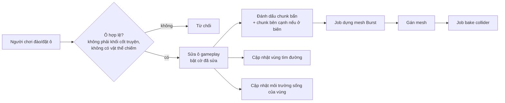

# Kỹ thuật tạo world

> Trạng thái: Đang xem xét
> Đã chốt phần (user, 2026-10-13): kế hoạch prototype M1. Phần còn lại vẫn là đề xuất.
> Liên quan: [Công nghệ](tech-stack.md) · [Kiến trúc](architecture.md) · [Art style](../03-art-audio/art-style.md) · [Cơ chế](../02-gameplay/mechanics.md) · [Rủi ro](risks.md)

Ưu tiên kỹ thuật số 1 (user, 2026-10-13): "tập trung vào các kỹ thuật cần có để build game, nhất là phần tạo world trước". File này gom mọi quyết định kỹ thuật của world: dữ liệu, sinh theo seed, dựng mesh, chỉnh sửa, va chạm, tìm đường, lưu trữ, hiệu năng. Docs tra 2026-10-12/13, Unity 6000.4. Đề xuất của AI ghi [ý tưởng].

## Yêu cầu đầu vào
Tổng hợp từ thiết kế (không thêm yêu cầu mới):

| Yêu cầu | Nguồn |
|---|---|
| Dữ liệu là lưới voxel; đào/đặt theo ô; 1 ô = 1 đơn vị | [art-style](../03-art-audio/art-style.md#quy-cách-kỹ-thuật) |
| Địa hình hiển thị **dạng khối bo cạnh, mép cỏ phủ**; dựng mesh trên lưới gameplay (×1) — thay "bề mặt mịn liền, dựng ×2" | [0011](../decisions/0011-dia-hinh-khoi-bo-canh.md), [art-style](../03-art-audio/art-style.md#hướng-phong-cách) |
| Nhân vật cao 1,5, rộng 1 → đi vừa rãnh rộng 1 ô, cao 2 ô | [art-style](../03-art-audio/art-style.md#quy-cách-kỹ-thuật) |
| Sinh vật, cây, vật phẩm là model riêng, chiếm **khung chiếm chỗ** nhiều ô | [art-style](../03-art-audio/art-style.md#hướng-phong-cách) |
| Map có ranh giới; phần cốt truyện sắp đặt tay (**khối cốt truyện**), phần còn lại sinh theo **seed** của người chơi | [cơ chế](../02-gameplay/mechanics.md#sinh-map-theo-seed--khối-cốt-truyện) |
| Môi trường sống tính theo vùng (tỉ lệ loại khối, cây trồng...) | [cơ chế](../02-gameplay/mechanics.md#môi-trường-sống) |
| Sinh vật tìm đường trên địa hình người chơi tạo; tua nhanh không cần scene | [cơ chế](../02-gameplay/mechanics.md#tìm-đường-sinh-vật--đình-trệ), [kiến trúc](architecture.md#client-unity) |
| PC + mobile; world lưu ở backend (game online) | [vision](../00-vision.md), [components](components.md) |

## Dữ liệu world
[ý tưởng]
- **Lưới gameplay** (1 ô = 1 đơn vị): nguồn chuẩn, dùng cho luật chơi, lưu trữ, tìm đường, môi trường sống **và dựng mesh** (mỗi mặt ô lộ ra là một mặt khối — [0011](../decisions/0011-dia-hinh-khoi-bo-canh.md)). Lưới dựng mesh ×2 của bản bề mặt mịn đã bỏ.
- **Mỗi ô gameplay** (2 byte):

| Trường | Kích thước | Ý nghĩa |
|---|---|---|
| Vật liệu | 8 bit | 0 = rỗng; cỏ, đất, đá, cát, nước... |
| Cờ khối cốt truyện | 1 bit | Không phá/đặt được tới khi phá đảo map |
| Cờ đã sửa | 1 bit | Khác với world sinh từ seed → cần lưu |
| Mực nước | 3 bit | 0–7: lượng nước trong ô (nước chảy — user, 2026-10-13) [ý tưởng] |
| Dự phòng | 3 bit | Vd độ ẩm, đã xới đất (lệnh làm việc) |

- **Chiếm chỗ** (sinh vật, cây, vật phẩm) lưu ở **lớp riêng**: danh sách vật thể + khung chiếm chỗ → bảng tra ô → vật thể. Không nhét vào ô địa hình, vì vật thể nhiều ô và di chuyển được.
- **Chunk:** 16 × 16 × 16 ô gameplay [ý tưởng]. 16 là kích thước phổ biến: Minecraft chia chunk 16 × 16 theo chiều ngang, mỗi đoạn cao 16 ([Minecraft Wiki](https://minecraft.wiki/w/Chunk)); Godot Voxel Tools mặc định khối mesh 16, cho phép 32 — 32 ít draw call hơn nhưng sửa voxel chậm hơn ([Voxel Tools](https://voxel-tools.readthedocs.io/en/latest/performance/)).
- **Map 128 × 128 × 48 ô, có hang động** (user, 2026-10-13) → 8 × 8 × 3 = 192 chunk.
- **Đào/đặt luôn theo nguyên ô** (user, 2026-10-13) → dữ liệu có/không + vật liệu là đủ, không cần mật độ trung gian.

## Sinh world theo seed
[ý tưởng] Chạy trên client (world riêng của người chơi), **tất định**: cùng seed + cùng **phiên bản bộ sinh** → cùng world.

- **Noise:** `Unity.Mathematics.noise` có `snoise` (simplex), `cnoise` (Perlin), `pnoise`, `cellular`... ([API](https://docs.unity3d.com/Packages/com.unity.mathematics@1.3/api/Unity.Mathematics.noise.html)); bản đi kèm Unity 6000.4.8f1 trên máy: Mathematics 1.3.3, Burst 1.8.29 [run 2026-10-13]. Burst dịch kiểu vector của Unity.Mathematics sang SIMD ([Burst](https://docs.unity3d.com/Packages/com.unity.burst@1.8/manual/csharp-type-support.html)); hàm `noise.*` là phép toán float thuần nên chạy được trong Burst — suy luận, docs không nói rõ [chưa xác minh].
- **Hang động** (user, 2026-10-13) có **sinh vật và tài nguyên riêng** → có môi trường sống dưới lòng đất ([cơ chế](../02-gameplay/mechanics.md#môi-trường-sống)). [ý tưởng] Khoét bằng noise 3D (vd `snoise` 3D hoặc `cellular` có ngưỡng); giữ lớp đá đáy map; kiểm hang nối được với mặt đất. Hang tối → cần ánh sáng (đèn, vật phát sáng) — xem art style.
- **Bố cục vùng** (user, 2026-10-13): vùng đặt theo seed, phải đạt **ràng buộc bố cục** của map (giáp biển, diện tích, khoảng cách đi bộ) — không đạt thì đổi seed con, sinh lại ([levels](../02-gameplay/levels.md#kích-thước--khung-chung)).
- **Vùng cốt truyện:** mẫu dựng tay (lưu dạng file dữ liệu), dán vào vị trí do bố cục vùng chọn (trong ràng buộc), bật cờ khối cốt truyện cho ô của nó và **đường đi tới nó**.
- **Kiểm tra sau khi sinh:** đường tới mọi khối cốt truyện phải đi được (chạy tìm đường) — sai thì sinh lại phần đó.
- Đổi bộ sinh làm world cũ khác đi → dữ liệu lưu phải ghi **phiên bản bộ sinh** (xem Lưu trữ).

## Dựng mesh khối bo cạnh
Theo [0011](../decisions/0011-dia-hinh-khoi-bo-canh.md) (user chốt 2026-10-13), thay bề mặt mịn liền:
- **Mặt khối:** mỗi mặt ô đặc giáp ô rỗng/nước → một tứ giác (cách "culling" của [0fps](https://0fps.net/2012/06/30/meshing-in-a-minecraft-game/)); không sinh mặt giữa hai ô đặc. World M1 hiện tại: 7.725 mặt lộ → 15.450 tam giác cho cả map, khi chưa bo cạnh (Surface Nets ×2 là 61.800) [run 2026-10-13].
- **Gộp mặt (greedy meshing)** [ý tưởng, chưa làm ở M1]: gộp các mặt đồng phẳng kề nhau thành tứ giác lớn; chỉ gộp được khi thuộc tính (vật liệu, AO) giống nhau ở mọi đỉnh và có thể sinh đỉnh chữ T ([0fps](https://0fps.net/2012/06/30/meshing-in-a-minecraft-game/), [0fps AO](https://0fps.net/2013/07/03/ambient-occlusion-for-minecraft-like-worlds/)). Bo cạnh + mép cỏ lượn sóng làm mặt kề nhau khác nhau → ít gộp được; chỉ xét nếu đo trên mobile thấy cần.
- **Bo cạnh lồi** (bước 5.2, đã làm): mỗi mặt lộ chia lưới 4 × 4 điểm (0, r, 1 − r, 1), mỗi điểm đặt lại lên mặt "lăn quả cầu bán kính r bên trong khối" (phép mở hình thái học): cạnh lồi thành cung tròn, góc lồi thành mặt cầu, cạnh lõm giữ vuông; pháp tuyến = hướng từ lõi ra. Vị trí một điểm chỉ phụ thuộc 8 ô quanh đỉnh lưới gần nhất → hai mặt chung điểm luôn ra cùng vị trí (mesh kín), chỉ 256 tổ hợp → tính sẵn bảng; r = 1/8. Cạnh mặt không có điểm dời → bỏ điểm giữa (không đỉnh chữ T); mặt không cạnh nào dời → 1 tứ giác; đường lưới trong chỉ giữ khi cạnh tương ứng cong (hoặc góc dời mà không cạnh kề nào cong), mỗi ô lưới rút gọn cắt tai thành tam giác → −34% tam giác (109.206 → 71.668 cả map) [run 2026-10-13]. **Đệm chunk 1 ô** (bản Surface Nets cần 2). World M1 có 4.520 cạnh lồi [run 2026-10-13].
- **Mép cỏ** (bước 5.3, đã làm): mỗi sườn x/z lộ của ô cỏ lộ mặt trên có một dải — mặt trên nhô ra 0,08 ô, váy buông xuống 0,13–0,31 ô, mép dưới lượn sóng = 2 hàm sin theo toạ độ thế giới dọc cạnh, pha theo hash của đường cạnh (liền giữa hai ô kề và qua biên chunk); góc lồi có mảnh 1/4 vòng nối hai dải; đầu dải không nối tiếp thì bịt nắp. Chỉ hiển thị (collider vẫn mặt khối vuông); váy chỉ có mặt ngoài. Sườn ô cỏ hiện màu đất.
- **Bóng tối ở góc (AO theo đỉnh)** [ý tưởng, bước 5.4]: mỗi đỉnh tính từ 2 ô cạnh + 1 ô chéo; chia tứ giác theo đường chéo hợp AO để không lệch sáng ([0fps AO](https://0fps.net/2013/07/03/ambient-occlusion-for-minecraft-like-worlds/)).
- **Collider:** bake từ mặt khối vuông (chưa bo, chưa mép cỏ) — khớp đúng lưới.
- **Nối giữa các chunk:** mesher đọc ô đệm của chunk bên cạnh để biết mặt nào lộ và hình bo; sửa ô ở biên → dựng lại cả chunk bên cạnh (tối đa 8 chunk khi ở góc).

### Lịch sử: bề mặt mịn (đã thay bởi 0011)
Dùng ở bước 2–4 (2026-10-13); mã còn trong lịch sử git (commit `f05f917` trở về trước). Lý do thay: mặt lồi lõm thành chấm theo từng ô trên bậc 1 ô, nhìn không tự nhiên (user, 2026-10-13).

| Thuật toán | Cách làm | Hợp với game này |
|---|---|---|
| **Surface Nets** | Mỗi ô một đỉnh (trung bình các điểm cắt cạnh), ra mặt tứ giác; dễ làm, nhanh, ít mặt hơn Marching Cubes; đỉnh đặt ngây thơ trông vát cạnh ([0fps](https://0fps.net/2012/07/12/smooth-voxel-terrain-part-2/); gốc: Gibson 1998, [MERL TR99-24](https://merl.com/publications/TR99-24)) | ✅ **Đã thử** trong Blender: ×2 giữ được rãnh 1 ô, ~24.000 tam giác / mảnh 30 × 30 ô [run 2026-10-12] |
| Marching Cubes | Bảng 256 trường hợp, đỉnh nội suy trên cạnh; nhiều mặt nhất trong so sánh của 0fps ([bài báo 1987](https://courses.cs.duke.edu/cps124/fall01/resources/p163-lorensen.pdf), [0fps](https://0fps.net/2012/07/12/smooth-voxel-terrain-part-2/)) | Phương án dự phòng |
| Dual Contouring | Cần dữ liệu Hermite (điểm cắt + pháp tuyến), giữ cạnh sắc ([Ju et al. 2002](https://profiles.wustl.edu/en/publications/dual-contouring-of-hermite-data-2/)); giải bình phương tối thiểu tốn và dễ sai số ([0fps](https://0fps.net/2012/07/12/smooth-voxel-terrain-part-2/)) | Không cần — game muốn mịn, không cần cạnh sắc |
| Transvoxel | Thêm "ô chuyển tiếp" để nối chunk khác độ phân giải (chỉ khi chênh đúng ×2), không vướng bằng sáng chế ([transvoxel.org](https://transvoxel.org/)) | Dựa trên Marching Cubes → không dùng thẳng với Surface Nets; chỉ cần nếu làm LOD |

- Đã dùng: **Surface Nets ×2** + làm mượt có giới hạn (mỗi đỉnh lệch ≤ 0,2 ô); đọc mẫu −3..34 → đệm 2 ô mỗi phía [repo] [run 2026-10-13].

- **Chạy:** C# Job System + Burst; ghi mesh qua `Mesh.AllocateWritableMeshData` → `Mesh.ApplyAndDisposeWritableMeshData` ([tech-stack](tech-stack.md)).
- **Chỉ số đỉnh 16 bit đủ:** mesh 16 bit chứa tối đa 65.535 đỉnh; 32 bit không chắc chạy trên mọi máy (vd Android GPU Mali-400 không vẽ) ([Mesh.indexFormat](https://docs.unity3d.com/6000.4/Documentation/ScriptReference/Mesh-indexFormat.html)). Bản Surface Nets: chunk nặng nhất 3.800 tam giác, 2.019 đỉnh; cả map 61.800 tam giác [run 2026-10-13]. Mesh khối có ít tam giác hơn (15.450 cả map khi chưa bo) → vẫn 16 bit; đo lại sau bước 5.2–5.3.
- **Vật liệu:** màu theo vật liệu ghi vào đỉnh (bước 5.1); texture theo mặt — mặt khối thẳng trục nên UV lấy thẳng từ toạ độ, không cần triplanar (bước 5.4); material nhám, không bóng ([0011](../decisions/0011-dia-hinh-khoi-bo-canh.md)).
- **Nước chảy** (user, 2026-10-13) — xem mục Nước bên dưới.
- **Mép map** ([0009](../decisions/0009-dai-duong-va-suong-mu-o-ria-map.md), user 2026-10-13; cách làm là [ý tưởng]): ngoài map lấy mẫu bằng cột biên gần nhất → không sinh vách đứng ở mép (giữ khi đổi sang mesh khối); bộ sinh hạ độ cao dần về rìa để luôn có vành biển; đáy biển ở rìa nằm dưới mặt nước, trong sương mù.
- **LOD:** map có ranh giới → M1 **chưa làm LOD**; chỉ thêm nếu đo trên mobile thấy cần.

## Chỉnh sửa (đào / đặt)
[ý tưởng]

- Mục tiêu: dựng lại mesh sau khi sửa trong "một hoặc hai khung hình" — mức 0fps nêu cho game kiểu Minecraft ([0fps](https://0fps.net/2012/06/30/meshing-in-a-minecraft-game/)).
- Gom nhiều chunk bẩn vào một lần xin `MeshDataArray` (khuyến nghị của docs `Mesh.MeshData`).

## Nước chảy
User chọn nước **chảy được** (2026-10-13). [ý tưởng]
- **Mô phỏng theo ô:** mỗi ô có mực nước 0–7; mỗi nhịp, nước chảy xuống ô dưới nếu trống, rồi tràn ngang sang ô thấp mực hơn — cách làm phổ biến kiểu automat ô [chưa xác minh bằng nguồn]. Chỉ mô phỏng vùng đang "động" (quanh chỗ vừa đào/đặt), vùng đã yên thì ngủ.
- **Nguồn nước** (suối, biển) giữ mực cố định.
- **Nước không có nguồn không cạn** (user, 2026-10-13): tổng lượng nước được bảo toàn — chỉ chảy/lan, không mất đi.
- **Người chơi tạo được nguồn nước** (user, 2026-10-13). Cách tạo: _(chưa có)_ — [ý tưởng] phép của pháp sư, hoặc công trình (vd giếng, đài phun).
- **Hiển thị:** mesh mặt nước riêng, cao theo mực nước, tách khỏi mesh địa hình; shader trong suốt.
- **Ảnh hưởng gameplay:** môi trường sống (tỉ lệ nước trong vùng), công đoạn tưới nước, tìm đường (ô ngập là vật cản với loài đi bộ, đi được với loài bơi — M2).
- **Tất định + tua nhanh:** mô phỏng chạy theo nhịp cố định, không phụ thuộc khung hình; khi tua nhanh, cho nước "yên" trước rồi mới tính sản lượng.
- **Phạm vi:** M1 dùng nước **tĩnh** + **biển loang tức thời** khi đào ([0012](../decisions/0012-bien-tran-va-luat-dat-khoi-m1.md)): ô ≤ mực nước biển thông với nước/biển ngoài map thì ngập ngay, mỗi ô đầy hoặc rỗng; mặt biển nền chỉ ngoài map, trong map vẽ mặt nước theo ô. Nước chảy dần ở M2. Ước lượng 8–15 ngày-người ([roadmap](../05-roadmap.md)).

## Va chạm
- **Chỉ nhân vật người chơi** (và camera) cần va chạm vật lý với địa hình. Sinh vật đi theo lưới (tìm đường), không cần vật lý → ít việc hơn [ý tưởng].
- `Physics.BakeMesh` an toàn đa luồng, tính trên luồng gọi nó → chạy được trong job; không bake cùng một mesh từ nhiều luồng; collider chỉ dùng lại kết quả bake nếu `cookingOptions` khớp; mesh cần bật Read/Write trong bản build ([docs 6000.4](https://docs.unity3d.com/6000.4/Documentation/ScriptReference/Physics.BakeMesh.html)).
- `cookingOptions` cho phép tắt bớt bước kiểm tra để bake nhanh khi sinh mesh lúc chạy — dữ liệu phải hợp lệ ([docs](https://docs.unity3d.com/6000.4/Documentation/ScriptReference/MeshCollider-cookingOptions.html)).

## Tìm đường trên lưới
[ý tưởng] — tự viết A\*, C# thuần ([tech-stack](tech-stack.md)).
- **Ô đi được** cho một khung chiếm chỗ rộng w, cao h: các ô dưới chân là đất đặc, đủ w × w ô trống phía trên cao h ô. Nhân vật 1 × 2 × 1 → rãnh rộng 1, cao 2 đi được.
- **Kiểu di chuyển:** M1 chỉ đi bộ (leo/xuống 1 ô); bay, bơi để M2 ([cơ chế](../02-gameplay/mechanics.md#tìm-đường-sinh-vật--đình-trệ)).
- **Sửa địa hình:** chỉ tính lại vùng bị đổi; đường đang đi bị cắt → tìm lại; không tìm được → **đình trệ**.
- Tua nhanh dùng **độ dài đường** ước tính, không chạy từng bước ([cơ chế](../02-gameplay/mechanics.md#tua-nhanh)).

## Lưu trữ
- **Lưu chunk đã sửa, không lưu cả world:** world sinh lại từ seed; chỉ lưu các chunk có ô bị sửa — cách Godot Voxel Tools làm mặc định ("only modified blocks are saved" — [docs](https://voxel-tools.readthedocs.io/en/latest/streams/)).
- Lưu kèm **phiên bản bộ sinh**. Khi bản cập nhật đổi bộ sinh: **chunk chưa sửa sinh lại theo cách mới**, chunk đã sửa giữ nguyên (user, 2026-10-13).
  - [ý tưởng] Ranh giới giữa chunk đã sửa và chunk sinh lại có thể lệch độ cao → chạy một bước "khâu biên" (nội suy độ cao vài ô quanh ranh giới, chỉ trên phía chunk sinh lại).
  - [ý tưởng] Vật thể người chơi đặt (cây trồng, công trình) làm chunk đó thành "đã sửa" → không bị sinh lại mất.
  - Vùng cốt truyện là mẫu cố định theo map → không đổi theo bộ sinh.
- [ý tưởng] Lưu ở backend theo chunk (nén); client giữ bản cache. Chỉ lưu từng ô thay đổi (gọn hơn) để sau, nếu dung lượng backend thành vấn đề ([risks](risks.md)).

## Hiệu năng & hiển thị
- Không có ngân sách tam giác/draw call chính thức cho mobile; Unity khuyên đo bằng Profiler; khung hình 33,33 ms ở 30 fps, 16,66 ms ở 60 fps ([Unity](https://unity.com/how-to/mobile-game-optimization-tips-part-2)).
- **SRP Batcher** (có trong URP): giảm đổi trạng thái giữa các draw call cho vật liệu cùng shader — hợp nhiều mesh chunk dùng chung một shader địa hình ([docs](https://docs.unity3d.com/6000.4/Documentation/Manual/SRPBatcher.html)). Không giảm số draw call.
- **GPU Resident Drawer**: vẽ GameObject bằng instancing, giảm draw call — cần đường render Forward+ (hoặc Deferred+), nền tảng có compute shader **trừ OpenGL ES** (Android phải Vulkan), MeshRenderer không dùng MaterialPropertyBlock... ([docs](https://docs.unity3d.com/6000.4/Documentation/Manual/urp/gpu-resident-drawer.html)) → hợp cho **cây, vật phẩm lặp lại**; mesh chunk là duy nhất nên ít lợi [suy luận].
  - Lưu ý: **biến thể hiển thị** nếu làm bằng MaterialPropertyBlock sẽ không được GPU Resident Drawer vẽ → nên làm biến thể qua dữ liệu instance/shader [ý tưởng, kiểm ở M2].
- **Culling** (2026-10-13):
  - Đã có: mesher (Surface Nets trước đây, mesh khối từ 0011) chỉ sinh mặt ở chỗ giáp đặc/rỗng → không có mặt bị chôn; chunk nằm hẳn trong đất không có mesh. Mỗi chunk là một Renderer riêng → Unity tự bỏ chunk ngoài tầm camera: *"By default, Cameras perform frustum culling"* ([docs](https://docs.unity3d.com/6000.4/Documentation/Manual/OcclusionCulling.html)).
  - Occlusion culling tính sẵn của Unity không dùng được: *"If your Project generates Scene geometry at runtime, then Unity's built-in occlusion culling is not suitable"* (cùng trang).
  - GPU occlusion culling của URP: cần GPU Resident Drawer (Android phải Vulkan), xấp xỉ mỗi vật bằng hình cầu bao, cảnh ít che khuất thì có thể chậm hơn ([docs](https://docs.unity3d.com/6000.4/Documentation/Manual/urp/gpu-culling.html)) → M1 không bật (map nhỏ, không hang, camera nhìn xuống).
  - M2 có hang + map 128 × 128 × 48 → cần cách bỏ mặt hang khi ở trên mặt đất [ý tưởng]: đánh dấu chunk chỉ có mặt hang, ẩn theo vị trí camera; hoặc GPU occlusion culling nếu Android dùng Vulkan; giới hạn khoảng cách vẽ. Chọn theo số đo ([risks](risks.md)).
- Cần đo ở M1 trên máy mobile tầm trung: thời gian dựng mesh một chunk, số tam giác hiển thị, thời gian bake collider ([risks](risks.md)).

## Kế hoạch prototype (M1)
Theo **M1 tối giản** ([0007](../decisions/0007-m1-toi-gian.md), user chốt 2026-10-13); **kế hoạch user duyệt 2026-10-13**. Chia hạng mục "Voxel world tối giản 17–28" của [roadmap](../05-roadmap.md) thành bước nhỏ (tìm đường ở [simulation-tech](simulation-tech.md#kế-hoạch-prototype-m1)), mỗi bước có tiêu chí xong đo được:

| # | Bước | Xong khi | Ước lượng (ngày-người) |
|---|---|---|---|
| 1 | Lưới gameplay + chunk 16³ + địa hình noise với **một seed cố định**, map nhỏ 64 × 64 × 32 (32 chunk), không hang | Cùng seed → cùng world (test); **mã băm world giống nhau trên PC và điện thoại** (kiểm tất định giữa nền tảng) | 3–5 · **Xong 2026-10-13** [run]: 23 test EditMode đạt; mã băm `86b0747d4b2be65b` trùng giữa macOS ARM64 và Android 14 ARM64 (24095PCADG), Burst bật, sinh 3 ms trên điện thoại. Máy x64 chưa thử |
| 2 | Surface Nets ×2 + làm mượt, 1 chunk | Mesh khớp bản thử Blender (rãnh 1 ô, ~tam giác) | 4–6 · **Xong 2026-10-13** [run]: rãnh 1 ô giữ bề rộng ≥ 0,9 ô; làm mượt ≤ 0,2 ô; chunk nặng nhất của world M1 6.776 tam giác / 3.881 đỉnh khi còn vách mép map — sau bước 3 (bỏ vách theo 0009) còn 3.800 / 2.019 (ước tính ~7.000; chỉ số 16 bit dư); đã đọc 1 ô đệm → đỉnh và pháp tuyến ở biên tính giống chunk bên cạnh |
| 3 | Nhiều chunk + nối biên (ô đệm) + Jobs/Burst | Không hở ở biên; đo thời gian dựng mesh / chunk | 4–7 · **Xong 2026-10-13** [run]: ghép cả map không có cạnh hở bên trong; đỉnh chung ở biên cùng pháp tuyến; không vách mép map; dựng song song = dựng từng chunk. Trên Mac (Editor, Burst): 32 chunk song song ~29 ms, 1 chunk ~4,3 ms. 4/93.058 cạnh không đa tạp (hai cột chạm góc chéo — tính chất của Surface Nets, nằm gọn trong chunk) |
| 4 | Đào/đặt nguyên ô + dựng lại chunk bẩn + collider; kho vật liệu của người chơi ([cơ chế](../02-gameplay/mechanics.md#voxel-world--luật-m1)) | Sửa ô → mesh cập nhật ≤ 2 khung hình trên PC | 3–5 · **Xong 2026-10-13** [run]: mesh + collider cập nhật **ngay trong khung hình sửa ô** (chờ 0 khung hình, test PlayMode); dựng lại từng phần sau 200 lần sửa ngẫu nhiên = dựng lại cả map. Trên Mac (Editor, Burst), mỗi lần sửa: 1 chunk — dựng mesh 4,5 ms + ghi 0,07 ms + bake collider 0,9 ms; góc 8 chunk — 8,3 + 0,3 + 1,3 ms. Đệm thật là 2 ô (không phải 1). Thử bằng chuột trong scene TerrainView: user chưa thử |
| 5 | ~~Màu vật liệu theo đỉnh (chưa triplanar)~~ — thay bằng 5.1–5.4 ([0011](../decisions/0011-dia-hinh-khoi-bo-canh.md)) | ~~Phân biệt được đất, cỏ, đá, cát~~ | ~~1–2~~ |
| 5.1 | Mesher khối (Jobs + Burst) thay Surface Nets: mặt lộ, màu đỉnh theo vật liệu (sườn ô cỏ = đất), đệm chunk 1 ô; material nhám | Dựng lại tăng dần = dựng toàn bộ sau 200 lần sửa; sửa ô → cập nhật ≤ 2 khung hình; không mặt thừa giữa hai ô đặc; tam giác = 2 × mặt lộ | 2–3 · **Xong 2026-10-13** [run]: `BlockMesher` + shader `Game/Terrain` (màu đỉnh, khuếch tán thuần, có bóng); EditMode 57/57, PlayMode 5/5. Cả map 15.450 tam giác (= 2 × 7.725 mặt lộ), chunk nặng nhất 938 tam giác / 1.876 đỉnh; mặt kín (0 cạnh hở trong map). Mac (Editor, Burst): 32 chunk song song 1,0 ms (Surface Nets ~29 ms); sửa ô 1 chunk 0,17 + 0,04 + 0,26 ms (mesh + ghi + bake), góc 8 chunk 0,43 + 0,16 + 0,58 ms, chờ 0 khung hình. Ảnh: bậc thang 1 ô lắt nhắt như dự đoán ở 0011; màu nhạt → chỉnh ở 5.4 |
| 5.2 | Bo cạnh lồi (dải vát + góc, pháp tuyến nội suy) | Mesh kín ở mọi tổ hợp 26 ô lân cận; đo tam giác/chunk; ảnh so sánh | 2–3 · **Xong 2026-10-13** [run]: EditMode 60/60, PlayMode 5/5. Mesh kín (cạnh có hướng cân bằng sau khi hàn đỉnh) ở **đủ 256 tổ hợp 8 ô quanh một đỉnh lưới** (hình bo chỉ phụ thuộc 8 ô này nên bao mọi tổ hợp 26 ô lân cận), 300 hình ngẫu nhiên 5 × 5 × 5 và cả map qua biên chunk. Tam giác: cả map **109.206** (14,1/mặt lộ; chưa bo 15.450, Surface Nets 61.800), chunk nặng nhất 6.612 tam giác / 5.940 đỉnh (16 bit đủ); collider vẫn 15.450. Mac (Editor, Burst): 32 chunk 3,4 ms; sửa ô 1 chunk 0,71 + 0,14 + 0,26 ms, góc 8 chunk 1,55 + 0,66 + 0,65 ms, chờ 0 khung hình. Ảnh: `client/Temp/McpShots/11_bevel-1.png`, `12_bevel_close.png` (không commit). **Tối ưu chia mặt** (user yêu cầu thử, 2026-10-13): 71.668 tam giác (9,3/mặt), chunk nặng nhất 4.396; kín ở 256 tổ hợp + 2.000 hình ngẫu nhiên + cả map; ảnh cận cảnh không đổi (`13_bevel_opt_close.png`) |
| 5.3 | Mép cỏ lượn sóng phủ xuống sườn | Tất định; mép liền giữa hai ô kề và qua biên chunk | 2–3 · **Xong 2026-10-13** [run]: EditMode 63/63 (3 test mới: tất định + điểm đáy váy trùng nhau ở 5 ranh giới ô mỗi sườn, kể cả qua biên chunk x = 16; độ sâu váy trong khoảng; chỉ có mép trên ô cỏ lộ mặt trên và sườn), PlayMode 5/5. Mép cỏ thêm 44.710 tam giác → **tổng 116.378** cả map, chunk nặng nhất 6.646 tam giác / 7.145 đỉnh. Mac (Editor, Burst): 32 chunk 5,8 ms; sửa ô 1 chunk 0,86 + 0,14 + 0,25 ms, góc 8 chunk 1,43 + 0,67 + 0,64 ms, chờ 0 khung hình. Ảnh: `14_lip_close.png`, `15_lip_overview.png` |
| 5.4 | Texture theo mặt + ánh sáng mềm (+ AO theo đỉnh nếu cần) | User duyệt ảnh chụp so với hướng art | 1–2 · **Chờ user duyệt ảnh** (2026-10-13) [run]: hoa văn tạo bằng code trong shader theo mã ở byte alpha màu đỉnh (toạ độ thế giới trên mặt chính — không texture); AO theo đỉnh kiểu 0fps + chia tứ giác theo AO; ánh sáng bọc 0,35; ánh sáng scene ở [art-style](../03-art-audio/art-style.md#kết-quả-thử-nghiệm-art-đang-làm). Sửa lỗi từ 5.1: shader chưa đổi màu đỉnh sRGB → linear (màu nhạt). EditMode 65/65 (AO góc lõm, giữ mã hoa văn), PlayMode 5/5; số tam giác không đổi (116.378) |
| 5b | Đảo + vành biển (generatorVersion 2), mặt nước tĩnh, sương mù có sẵn của Unity + màu nền trùng màu sương ([0009](../decisions/0009-dai-duong-va-suong-mu-o-ria-map.md)) | Từ giữa map không thấy mép map, không vách đứng | 2–3 · **Một phần (2026-10-13, user yêu cầu)** [run]: phần hiển thị đã có — mặt biển nền (mặt phẳng 800 × 800, shader `Game/Ocean`: gợn sóng bằng nhiễu, lấp lánh, nhận bóng; đặt ở y = waterLevel + 1 − 0,1 theo cấu hình, hồ trong map cũng hiện nước), sương mù tuyến tính 80–300 cùng màu chân trời, trời có mây (skybox `Game/SkyClouds`, mây tạo bằng code). **Bộ sinh đảo — xong (user đồng ý 2026-10-13)** [run]: generatorVersion 2 — độ cao cột = lerp(đáy biển, noise, smoothstep(islandMargin, islandMargin + islandFalloff, khoảng cách tới biên)), đáy biển = waterLevel − seaFloorDepth (3, 10, 3 trong `design/data/world_m1.json`); bãi cát tự có nhờ `sandBand`. Mã băm v2 `807d00bd048026a0`; v1 vẫn sinh lại đúng `86b0747d4b2be65b`. Test: vành biển (cột cách biên < 3 ô ở đúng đáy biển, nước tới mặt nước). EditMode 67/67, PlayMode 6/6. **Chưa so mã băm v2 trên Android** (scene HashCheck — cần điện thoại). Ảnh: `22_island_low.png`, `23_island_overview.png` |
| 5c | Luật đặt khối (kề khối đặc, đặt được vào nước) + biển loang khi đào + mặt nước theo ô, mặt biển nền chỉ ngoài map ([0012](../decisions/0012-bien-tran-va-luat-dat-khoi-m1.md)) | Test EditMode: đặt không kề khối đặc bị từ chối, đặt vào nước được; đào ô ≤ S kề nước → vùng thông ngập, ô > S không ngập, vùng kín không ngập, tường không chạm đáy → nước luồn; ảnh vùng khô thấp hơn mực nước không hiện nước | 3–5 · **Xong 2026-10-13** [run]: `WorldEditor` (kết quả mới `NotAttached`; đặt vào ô nước; biển loang theo 6 hướng khi đào, ngoài map ở y ≤ S là biển) + 13 test `SeaFloodTests` (gồm tường chữ U: dựng tường không làm rút, kín tới đáy → khô, miệng U ra biển → ngập lại, đào chân tường → nước luồn, phá tường → ngập); mặt nước theo ô = submesh 1 của chunk (material biển), mặt biển nền thành vành khăn khoét map. EditMode 80/80, PlayMode 6/6. Thử trong Play: hố 3 × 3 đào tới y = 7 (dưới mực nước 10) khô, không hiện nước; đào rãnh thông biển → loang 39 ô, hố ngập 36/36. Ảnh: `24_dry_pit_top_1.png`, `25_pit_flooded_close.png` |
| 6 | Đo trên mobile tầm trung | ≥ 30 FPS khi đào/đặt liên tục; ghi ms/chunk, số tam giác | 2–3 |
| | **Cộng** | | **28–45** (17–28 + 2–3 của 0009 − 1–2 của bước 5 cũ + 7–11 của 0011 + 3–5 của 0012) |

**Chuyển sang M2** (18–27, phần "voxel world đầy đủ" của [0007](../decisions/0007-m1-toi-gian.md)): hang noise 3D 4–5 · map 128 × 128 × 48 + hiển thị theo khoảng cách 4–6 · texture đầy đủ cho mọi vật liệu (mặt khối, không cần triplanar — 0011) 3–5 · lưới chiếm chỗ + vật thể nhiều ô 3–5 · lưu/nạp chunk đã sửa 2–4 · phiên bản bộ sinh 2. Khối cốt truyện (2–4) và sinh map theo seed (15–25) là hạng mục M2 riêng.

## Câu hỏi mở
- Cách người chơi tạo nguồn nước (phép, công trình?); nguồn nước có xoá/di chuyển được không?
- Môi trường sống trong hang: yêu cầu riêng (ánh sáng, độ ẩm, độ sâu?) — viết khi làm danh sách yêu cầu của loài.
- Đã trả lời (user, 2026-10-13): map 128 × 128 × 48, có hang (có sinh vật, tài nguyên riêng); nước chảy, không cạn, người chơi tạo được nguồn; đào/đặt theo nguyên ô; đổi bộ sinh → chunk chưa sửa sinh lại theo cách mới.
