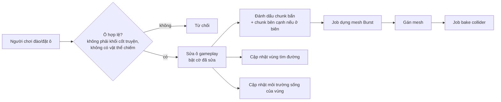

# Kỹ thuật tạo world

> Trạng thái: Đang xem xét
> Đã chốt phần (user, 2026-10-13): kế hoạch prototype M1. Phần còn lại vẫn là đề xuất.
> Liên quan: [Công nghệ](tech-stack.md) · [Kiến trúc](architecture.md) · [Art style](../03-art-audio/art-style.md) · [Cơ chế](../02-gameplay/mechanics.md) · [Rủi ro](risks.md)

Ưu tiên kỹ thuật số 1 (user, 2026-10-13): "tập trung vào các kỹ thuật cần có để build game, nhất là phần tạo world trước". File này gom mọi quyết định kỹ thuật của world: dữ liệu, sinh theo seed, dựng mesh, chỉnh sửa, va chạm, tìm đường, lưu trữ, hiệu năng. Docs tra 2026-10-12/13, Unity 6000.4. Đề xuất của AI ghi [ý tưởng].

## Yêu cầu đầu vào
Tổng hợp từ thiết kế (không thêm yêu cầu mới):

| Yêu cầu | Nguồn |
|---|---|
| Dữ liệu là lưới voxel; đào/đặt theo ô; 1 ô = 1 đơn vị | [art-style](../03-art-audio/art-style.md#quy-cách-kỹ-thuật) |
| Địa hình hiển thị **bề mặt mịn liền**; dựng mesh **×2** (mỗi ô gameplay = 2 × 2 × 2 ô dựng mesh) | [art-style](../03-art-audio/art-style.md#kết-quả-thử-nghiệm-art-đang-làm), [tech-stack](tech-stack.md) |
| Nhân vật cao 1,5, rộng 1 → đi vừa rãnh rộng 1 ô, cao 2 ô | [art-style](../03-art-audio/art-style.md#quy-cách-kỹ-thuật) |
| Sinh vật, cây, vật phẩm là model riêng, chiếm **khung chiếm chỗ** nhiều ô | [art-style](../03-art-audio/art-style.md#hướng-phong-cách) |
| Map có ranh giới; phần cốt truyện sắp đặt tay (**khối cốt truyện**), phần còn lại sinh theo **seed** của người chơi | [cơ chế](../02-gameplay/mechanics.md#sinh-map-theo-seed--khối-cốt-truyện) |
| Môi trường sống tính theo vùng (tỉ lệ loại khối, cây trồng...) | [cơ chế](../02-gameplay/mechanics.md#môi-trường-sống) |
| Sinh vật tìm đường trên địa hình người chơi tạo; tua nhanh không cần scene | [cơ chế](../02-gameplay/mechanics.md#tìm-đường-sinh-vật--đình-trệ), [kiến trúc](architecture.md#client-unity) |
| PC + mobile; world lưu ở backend (game online) | [vision](../00-vision.md), [components](components.md) |

## Dữ liệu world
[ý tưởng]
- **Hai lưới:**
  - **Lưới gameplay** (1 ô = 1 đơn vị): nguồn chuẩn, dùng cho luật chơi, lưu trữ, tìm đường, môi trường sống.
  - **Lưới dựng mesh** (×2): suy ra từ lưới gameplay khi dựng mesh, **không lưu**.
- **Mỗi ô gameplay** (2 byte):

| Trường | Kích thước | Ý nghĩa |
|---|---|---|
| Vật liệu | 8 bit | 0 = rỗng; cỏ, đất, đá, cát, nước... |
| Cờ khối cốt truyện | 1 bit | Không phá/đặt được tới khi phá đảo map |
| Cờ đã sửa | 1 bit | Khác với world sinh từ seed → cần lưu |
| Mực nước | 3 bit | 0–7: lượng nước trong ô (nước chảy — user, 2026-10-13) [ý tưởng] |
| Dự phòng | 3 bit | Vd độ ẩm, đã xới đất (lệnh làm việc) |

- **Chiếm chỗ** (sinh vật, cây, vật phẩm) lưu ở **lớp riêng**: danh sách vật thể + khung chiếm chỗ → bảng tra ô → vật thể. Không nhét vào ô địa hình, vì vật thể nhiều ô và di chuyển được.
- **Chunk:** 16 × 16 × 16 ô gameplay [ý tưởng] → 32 × 32 × 32 ô dựng mesh. 16 là kích thước phổ biến: Minecraft chia chunk 16 × 16 theo chiều ngang, mỗi đoạn cao 16 ([Minecraft Wiki](https://minecraft.wiki/w/Chunk)); Godot Voxel Tools mặc định khối mesh 16, cho phép 32 — 32 ít draw call hơn nhưng sửa voxel chậm hơn ([Voxel Tools](https://voxel-tools.readthedocs.io/en/latest/performance/)).
- **Map 128 × 128 × 48 ô, có hang động** (user, 2026-10-13) → 8 × 8 × 3 = 192 chunk.
- **Đào/đặt luôn theo nguyên ô** (user, 2026-10-13) → dữ liệu có/không + vật liệu là đủ, không cần mật độ trung gian; dựng mesh ×2 để giữ chi tiết 1 ô (như bản thử).

## Sinh world theo seed
[ý tưởng] Chạy trên client (world riêng của người chơi), **tất định**: cùng seed + cùng **phiên bản bộ sinh** → cùng world.

- **Noise:** `Unity.Mathematics.noise` có `snoise` (simplex), `cnoise` (Perlin), `pnoise`, `cellular`... ([API](https://docs.unity3d.com/Packages/com.unity.mathematics@1.3/api/Unity.Mathematics.noise.html)); bản đi kèm Unity 6000.4.8f1 trên máy: Mathematics 1.3.3, Burst 1.8.29 [run 2026-10-13]. Burst dịch kiểu vector của Unity.Mathematics sang SIMD ([Burst](https://docs.unity3d.com/Packages/com.unity.burst@1.8/manual/csharp-type-support.html)); hàm `noise.*` là phép toán float thuần nên chạy được trong Burst — suy luận, docs không nói rõ [chưa xác minh].
- **Hang động** (user, 2026-10-13) có **sinh vật và tài nguyên riêng** → có môi trường sống dưới lòng đất ([cơ chế](../02-gameplay/mechanics.md#môi-trường-sống)). [ý tưởng] Khoét bằng noise 3D (vd `snoise` 3D hoặc `cellular` có ngưỡng); giữ lớp đá đáy map; kiểm hang nối được với mặt đất. Hang tối → cần ánh sáng (đèn, vật phát sáng) — xem art style.
- **Bố cục vùng** (user, 2026-10-13): vùng đặt theo seed, phải đạt **ràng buộc bố cục** của map (giáp biển, diện tích, khoảng cách đi bộ) — không đạt thì đổi seed con, sinh lại ([levels](../02-gameplay/levels.md#kích-thước--khung-chung)).
- **Vùng cốt truyện:** mẫu dựng tay (lưu dạng file dữ liệu), dán vào vị trí do bố cục vùng chọn (trong ràng buộc), bật cờ khối cốt truyện cho ô của nó và **đường đi tới nó**.
- **Kiểm tra sau khi sinh:** đường tới mọi khối cốt truyện phải đi được (chạy tìm đường) — sai thì sinh lại phần đó.
- Đổi bộ sinh làm world cũ khác đi → dữ liệu lưu phải ghi **phiên bản bộ sinh** (xem Lưu trữ).

## Dựng mesh bề mặt mịn
| Thuật toán | Cách làm | Hợp với game này |
|---|---|---|
| **Surface Nets** | Mỗi ô một đỉnh (trung bình các điểm cắt cạnh), ra mặt tứ giác; dễ làm, nhanh, ít mặt hơn Marching Cubes; đỉnh đặt ngây thơ trông vát cạnh ([0fps](https://0fps.net/2012/07/12/smooth-voxel-terrain-part-2/); gốc: Gibson 1998, [MERL TR99-24](https://merl.com/publications/TR99-24)) | ✅ **Đã thử** trong Blender: ×2 giữ được rãnh 1 ô, ~24.000 tam giác / mảnh 30 × 30 ô [run 2026-10-12] |
| Marching Cubes | Bảng 256 trường hợp, đỉnh nội suy trên cạnh; nhiều mặt nhất trong so sánh của 0fps ([bài báo 1987](https://courses.cs.duke.edu/cps124/fall01/resources/p163-lorensen.pdf), [0fps](https://0fps.net/2012/07/12/smooth-voxel-terrain-part-2/)) | Phương án dự phòng |
| Dual Contouring | Cần dữ liệu Hermite (điểm cắt + pháp tuyến), giữ cạnh sắc ([Ju et al. 2002](https://profiles.wustl.edu/en/publications/dual-contouring-of-hermite-data-2/)); giải bình phương tối thiểu tốn và dễ sai số ([0fps](https://0fps.net/2012/07/12/smooth-voxel-terrain-part-2/)) | Không cần — game muốn mịn, không cần cạnh sắc |
| Transvoxel | Thêm "ô chuyển tiếp" để nối chunk khác độ phân giải (chỉ khi chênh đúng ×2), không vướng bằng sáng chế ([transvoxel.org](https://transvoxel.org/)) | Dựa trên Marching Cubes → không dùng thẳng với Surface Nets; chỉ cần nếu làm LOD |

Đề xuất [ý tưởng]: **Surface Nets ×2** + làm mượt có giới hạn (mỗi đỉnh lệch ≤ 0,2 ô — như bản thử).
- **Nối giữa các chunk:** dựng mesh một chunk cần thêm **1 lớp ô đệm** của chunk bên cạnh để mặt liền — cách làm thường gặp với thuật toán kiểu Surface Nets [chưa xác minh bằng nguồn]. Sửa ô ở biên → dựng lại cả chunk bên cạnh.
- **Chạy:** C# Job System + Burst; ghi mesh qua `Mesh.AllocateWritableMeshData` → `Mesh.ApplyAndDisposeWritableMeshData` ([tech-stack](tech-stack.md)).
- **Chỉ số đỉnh 16 bit đủ:** mesh 16 bit chứa tối đa 65.535 đỉnh; 32 bit không chắc chạy trên mọi máy (vd Android GPU Mali-400 không vẽ) ([Mesh.indexFormat](https://docs.unity3d.com/6000.4/Documentation/ScriptReference/Mesh-indexFormat.html)). Một chunk 16 × 16 ô ước ~7.000 tam giác (tỉ lệ từ bản thử 30 × 30) → vài nghìn đỉnh [chưa xác minh — đo ở M1] → dùng 16 bit.
- **Vật liệu:** gán vật liệu theo đỉnh (trộn ở ranh giới) + texture dán 3 hướng (triplanar) — bản thử gán theo mặt bị răng cưa ([art-style](../03-art-audio/art-style.md#kết-quả-thử-nghiệm-art-đang-làm)).
- **Nước chảy** (user, 2026-10-13) — xem mục Nước bên dưới.
- **LOD:** map có ranh giới → M1 **chưa làm LOD**; chỉ thêm nếu đo trên mobile thấy cần.

## Chỉnh sửa (đào / đặt)
[ý tưởng]

- Mục tiêu: dựng lại mesh sau khi sửa trong "một hoặc hai khung hình" — mức 0fps nêu cho game kiểu Minecraft ([0fps](https://0fps.net/2012/06/30/meshing-in-a-minecraft-game/)).
- Gom nhiều chunk bẩn vào một lần xin `MeshDataArray` (khuyến nghị của docs `Mesh.MeshData`).

## Nước chảy
User chọn nước **chảy được** (2026-10-13). [ý tưởng]
- **Mô phỏng theo ô:** mỗi ô có mực nước 0–7; mỗi nhịp, nước chảy xuống ô dưới nếu trống, rồi tràn ngang sang ô thấp mực hơn — cách làm phổ biến kiểu automat ô [chưa xác minh bằng nguồn]. Chỉ mô phỏng vùng đang "động" (quanh chỗ vừa đào/đặt), vùng đã yên thì ngủ.
- **Nguồn nước** (suối, biển) giữ mực cố định.
- **Nước không có nguồn không cạn** (user, 2026-10-13): tổng lượng nước được bảo toàn — chỉ chảy/lan, không mất đi.
- **Người chơi tạo được nguồn nước** (user, 2026-10-13). Cách tạo: _(chưa có)_ — [ý tưởng] phép của pháp sư, hoặc công trình (vd giếng, đài phun).
- **Hiển thị:** mesh mặt nước riêng, cao theo mực nước, tách khỏi mesh địa hình; shader trong suốt.
- **Ảnh hưởng gameplay:** môi trường sống (tỉ lệ nước trong vùng), công đoạn tưới nước, tìm đường (ô ngập là vật cản với loài đi bộ, đi được với loài bơi — M2).
- **Tất định + tua nhanh:** mô phỏng chạy theo nhịp cố định, không phụ thuộc khung hình; khi tua nhanh, cho nước "yên" trước rồi mới tính sản lượng.
- **Phạm vi:** M1 dùng nước **tĩnh** (mực cố định); nước chảy ở M2. Ước lượng 8–15 ngày-người ([roadmap](../05-roadmap.md)).

## Va chạm
- **Chỉ nhân vật người chơi** (và camera) cần va chạm vật lý với địa hình. Sinh vật đi theo lưới (tìm đường), không cần vật lý → ít việc hơn [ý tưởng].
- `Physics.BakeMesh` an toàn đa luồng, tính trên luồng gọi nó → chạy được trong job; không bake cùng một mesh từ nhiều luồng; collider chỉ dùng lại kết quả bake nếu `cookingOptions` khớp; mesh cần bật Read/Write trong bản build ([docs 6000.4](https://docs.unity3d.com/6000.4/Documentation/ScriptReference/Physics.BakeMesh.html)).
- `cookingOptions` cho phép tắt bớt bước kiểm tra để bake nhanh khi sinh mesh lúc chạy — dữ liệu phải hợp lệ ([docs](https://docs.unity3d.com/6000.4/Documentation/ScriptReference/MeshCollider-cookingOptions.html)).

## Tìm đường trên lưới
[ý tưởng] — tự viết A\*, C# thuần ([tech-stack](tech-stack.md)).
- **Ô đi được** cho một khung chiếm chỗ rộng w, cao h: các ô dưới chân là đất đặc, đủ w × w ô trống phía trên cao h ô. Nhân vật 1 × 2 × 1 → rãnh rộng 1, cao 2 đi được.
- **Kiểu di chuyển:** M1 chỉ đi bộ (leo/xuống 1 ô); bay, bơi để M2 ([cơ chế](../02-gameplay/mechanics.md#tìm-đường-sinh-vật--đình-trệ)).
- **Sửa địa hình:** chỉ tính lại vùng bị đổi; đường đang đi bị cắt → tìm lại; không tìm được → **đình trệ**.
- Tua nhanh dùng **độ dài đường** ước tính, không chạy từng bước ([cơ chế](../02-gameplay/mechanics.md#tua-nhanh)).

## Lưu trữ
- **Lưu chunk đã sửa, không lưu cả world:** world sinh lại từ seed; chỉ lưu các chunk có ô bị sửa — cách Godot Voxel Tools làm mặc định ("only modified blocks are saved" — [docs](https://voxel-tools.readthedocs.io/en/latest/streams/)).
- Lưu kèm **phiên bản bộ sinh**. Khi bản cập nhật đổi bộ sinh: **chunk chưa sửa sinh lại theo cách mới**, chunk đã sửa giữ nguyên (user, 2026-10-13).
  - [ý tưởng] Ranh giới giữa chunk đã sửa và chunk sinh lại có thể lệch độ cao → chạy một bước "khâu biên" (nội suy độ cao vài ô quanh ranh giới, chỉ trên phía chunk sinh lại).
  - [ý tưởng] Vật thể người chơi đặt (cây trồng, công trình) làm chunk đó thành "đã sửa" → không bị sinh lại mất.
  - Vùng cốt truyện là mẫu cố định theo map → không đổi theo bộ sinh.
- [ý tưởng] Lưu ở backend theo chunk (nén); client giữ bản cache. Chỉ lưu từng ô thay đổi (gọn hơn) để sau, nếu dung lượng backend thành vấn đề ([risks](risks.md)).

## Hiệu năng & hiển thị
- Không có ngân sách tam giác/draw call chính thức cho mobile; Unity khuyên đo bằng Profiler; khung hình 33,33 ms ở 30 fps, 16,66 ms ở 60 fps ([Unity](https://unity.com/how-to/mobile-game-optimization-tips-part-2)).
- **SRP Batcher** (có trong URP): giảm đổi trạng thái giữa các draw call cho vật liệu cùng shader — hợp nhiều mesh chunk dùng chung một shader địa hình ([docs](https://docs.unity3d.com/6000.4/Documentation/Manual/SRPBatcher.html)). Không giảm số draw call.
- **GPU Resident Drawer**: vẽ GameObject bằng instancing, giảm draw call — cần đường render Forward+ (hoặc Deferred+), nền tảng có compute shader **trừ OpenGL ES** (Android phải Vulkan), MeshRenderer không dùng MaterialPropertyBlock... ([docs](https://docs.unity3d.com/6000.4/Documentation/Manual/urp/gpu-resident-drawer.html)) → hợp cho **cây, vật phẩm lặp lại**; mesh chunk là duy nhất nên ít lợi [suy luận].
  - Lưu ý: **biến thể hiển thị** nếu làm bằng MaterialPropertyBlock sẽ không được GPU Resident Drawer vẽ → nên làm biến thể qua dữ liệu instance/shader [ý tưởng, kiểm ở M2].
- Cần đo ở M1 trên máy mobile tầm trung: thời gian dựng mesh một chunk, số tam giác hiển thị, thời gian bake collider ([risks](risks.md)).

## Kế hoạch prototype (M1)
Theo **M1 tối giản** ([0007](../decisions/0007-m1-toi-gian.md), user chốt 2026-10-13); **kế hoạch user duyệt 2026-10-13**. Chia hạng mục "Voxel world tối giản 17–28" của [roadmap](../05-roadmap.md) thành bước nhỏ (tìm đường ở [simulation-tech](simulation-tech.md#kế-hoạch-prototype-m1)), mỗi bước có tiêu chí xong đo được:

| # | Bước | Xong khi | Ước lượng (ngày-người) |
|---|---|---|---|
| 1 | Lưới gameplay + chunk 16³ + địa hình noise với **một seed cố định**, map nhỏ 64 × 64 × 32 (32 chunk), không hang | Cùng seed → cùng world (test); **mã băm world giống nhau trên PC và điện thoại** (kiểm tất định giữa nền tảng) | 3–5 · **Xong 2026-10-13** [run]: 23 test EditMode đạt; mã băm `86b0747d4b2be65b` trùng giữa macOS ARM64 và Android 14 ARM64 (24095PCADG), Burst bật, sinh 3 ms trên điện thoại. Máy x64 chưa thử |
| 2 | Surface Nets ×2 + làm mượt, 1 chunk | Mesh khớp bản thử Blender (rãnh 1 ô, ~tam giác) | 4–6 |
| 3 | Nhiều chunk + nối biên (ô đệm) + Jobs/Burst | Không hở ở biên; đo thời gian dựng mesh / chunk | 4–7 |
| 4 | Đào/đặt nguyên ô + dựng lại chunk bẩn + collider; kho vật liệu của người chơi ([cơ chế](../02-gameplay/mechanics.md#voxel-world--luật-m1)) | Sửa ô → mesh cập nhật ≤ 2 khung hình trên PC | 3–5 |
| 5 | Màu vật liệu theo đỉnh (chưa triplanar) | Phân biệt được đất, cỏ, đá, cát | 1–2 |
| 6 | Đo trên mobile tầm trung | ≥ 30 FPS khi đào/đặt liên tục; ghi ms/chunk, số tam giác | 2–3 |
| | **Cộng** | | **17–28** |

**Chuyển sang M2** (18–27, phần "voxel world đầy đủ" của [0007](../decisions/0007-m1-toi-gian.md)): hang noise 3D 4–5 · map 128 × 128 × 48 + hiển thị theo khoảng cách 4–6 · vật liệu trộn + triplanar 3–5 · lưới chiếm chỗ + vật thể nhiều ô 3–5 · lưu/nạp chunk đã sửa 2–4 · phiên bản bộ sinh 2. Khối cốt truyện (2–4) và sinh map theo seed (15–25) là hạng mục M2 riêng.

## Câu hỏi mở
- Cách người chơi tạo nguồn nước (phép, công trình?); nguồn nước có xoá/di chuyển được không?
- Môi trường sống trong hang: yêu cầu riêng (ánh sáng, độ ẩm, độ sâu?) — viết khi làm danh sách yêu cầu của loài.
- Đã trả lời (user, 2026-10-13): map 128 × 128 × 48, có hang (có sinh vật, tài nguyên riêng); nước chảy, không cạn, người chơi tạo được nguồn; đào/đặt theo nguyên ô; đổi bộ sinh → chunk chưa sửa sinh lại theo cách mới.
