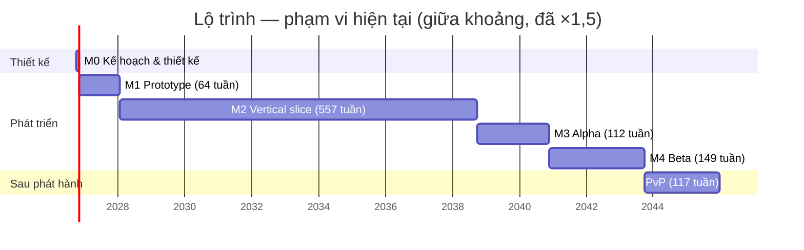

# Lộ trình

> Trạng thái: Đang xem xét
> Đã chốt phần (user, 2026-10-13) — ước lượng và giả định M1–M2. Mục "Công việc M0" là danh sách theo dõi, cập nhật không cần quyết định mới; M3+ vẫn là ước lượng thô; tính lại sau M1 bằng quyết định mới.
> Liên quan: [Vision](00-vision.md) · [Cơ chế](02-gameplay/mechanics.md) · [Thành phần](04-tech/components.md) · [Rủi ro](04-tech/risks.md)

## Quỹ thời gian
<!-- Một người làm: bao nhiêu giờ/tuần? Mốc mong muốn? -->
- Dự án indie cá nhân, dài hạn, không có timeline cố định.
- **~10 giờ/tuần** (user, 2026-10-12).
- Kỹ năng (user, 2026-10-12): **mạnh** code client (Unity/C#), backend/server. **Không tự làm**: art (model, animation), âm thanh, level design → dùng asset có sẵn / thuê ngoài; công sức tính ở phần tích hợp.

**Giả định quy đổi** (của AI, chỉnh nếu khác):
- 1 ngày-người = 8 giờ → 10 giờ/tuần ≈ **1,25 ngày-người/tuần**.
- Hệ số dự phòng cho người làm một mình: **×1,5**.

## Milestones
<!-- Mỗi milestone có tiêu chí XONG đo được và ghi rõ thành phần nào tham gia. -->
Ước lượng = ngày-người, thô, của AI [chưa xác minh]; nguồn từ bảng [cơ chế](02-gameplay/mechanics.md#danh-sách-cơ-chế) + các hạng mục ngoài cơ chế bên dưới. Cột "Thời gian" đã nhân ×1,5 và quy ra tuần ở 10 giờ/tuần.

| Milestone | Mục tiêu | Thành phần | Tiêu chí xong | Ước lượng | Thời gian | Trạng thái |
|---|---|---|---|---|---|---|
| M0 — Kế hoạch & thiết kế | Đủ kế hoạch để bắt đầu prototype | design/ | Vision, core loop, thành phần hệ thống ở trạng thái Chốt; cơ chế M1 và roadmap M1–M2 đã duyệt (cách (b), 2026-10-13) | — | — | **Xong (2026-10-13)** |
| M1 — Prototype | Kiểm chứng core loop có vui không | Client | **M1 tối giản** ([0007](decisions/0007-m1-toi-gian.md)). Graybox chơi được vòng lặp 30 giây: cải tạo địa hình → 3 loài trở lại → đặt lệnh trồng cây → sản lượng vào kho. Đo được (user duyệt 2026-10-13): ≥ 30 FPS trên 1 máy Android tầm trung (ghi model khi thử); mô phỏng ≤ 5 ms/nhịp với 60 sinh vật giả; thử chơi 3–5 người, 20 phút, theo câu hỏi ở [risks](04-tech/risks.md#kiểm-chứng-sớm-ở-m1) | 76,5–124 | 86–139 tuần (~20–32 tháng) | **Đang làm** (từ 2026-10-13) |
| M2 — Vertical slice | Một lát cắt hoàn chỉnh | Client + Backend | 1 map đủ art, âm thanh, UI; chạy qua backend (tài khoản, lưu, giờ server, rút thưởng); nhập hồn + chiến đấu PvE với phép sinh vật | 325,5–621 | 391–745 tuần (~7,5–14,3 năm) | Chưa bắt đầu |
| M3 — Alpha | Đủ tính năng | Client + Backend | Mọi cơ chế "phải có" chạy được; prototype trận mạng nhỏ (kiểm chứng netcode) | 67–120 | 80–144 tuần | Chưa bắt đầu |
| M4 — Beta | Đủ nội dung, sửa lỗi | Client + Backend | Chơi hết 3 map không bị chặn; phát hành thử | 83–166 | 100–199 tuần | Chưa bắt đầu |
| Phát hành | | Client + Backend + vận hành | | — | — | Chưa bắt đầu |
| Sau phát hành — PvP | PvP thời gian thực | Client + Backend + Game server | Ghép trận theo hạng, game server quyết định kết quả | 65–130 | 78–156 tuần | Chưa bắt đầu |

**Tổng M1–M4:** 554,5–1.035,5 ngày-người → ×1,5 = 832–1.553 → **~12,8–24,0 năm** ở 10 giờ/tuần (cập nhật 2026-10-21: ô minimap tròn luôn hiện ở góc, bấm để phóng to (world 7g) → M1 +1–1,5 [ý tưởng]. Trước đó 2026-10-21: buổi trong ngày + chọn thời điểm → M1 +4–6 — [0024](decisions/0024-buoi-trong-ngay-va-chon-thoi-diem.md). Trước đó 2026-10-20: dấu mốc trên bản đồ = công trình đặc trưng + checkpoint (world 7d 0,5–1 → 1,5–2,5) → M1 +1–1,5; dịch chuyển tới checkpoint + đường chỉ dẫn → M2 +3,5–6 — [0023](decisions/0023-dau-moc-cong-trinh-checkpoint-va-dan-duong.md). Trước đó (2026-10-20): mép cỏ bo tròn ôm khối (world 7b4) → M1 +0,5–1. Trước đó (2026-10-20): biên world + góc nhìn HUD + mép cỏ kín (world 7b3) → M1 +1–2. Trước đó (2026-10-20): nước trong + camera bay không xuyên khối (world 7b2) → M1 +1–2. Trước đó (2026-10-19): world 3 map liền nhau, ranh giới cong, minimap, nạp dần chunk → M1 +9–15, M2 −4–6 ("map 128 × 128 × 48 + hiển thị theo khoảng cách" về M1) — [0022](decisions/0022-world-nhieu-map-va-minimap-m1.md). Trước đó (2026-10-19): ô ruộng chỉ có sau khi xới + huỷ vụ khi đặt khối lên / đào ô ruộng, simulation bước 6a trước 6b → M1 +2,5–4 — [0020](decisions/0020-o-ruong-tao-khi-xoi-va-huy-vu.md). Trước đó (2026-10-16): sinh vật chặn nhau khi đi 2–4, rảnh về quanh nhà + lang thang 1,5–2 (chuyển từ M2, ở M2 ước 1–2), không dừng trên ô ruộng 0,5 → M1 +4–6,5, M2 −1–2 — [0019](decisions/0019-chan-nhau-ranh-quanh-nha-khong-dung-tren-ruong.md). Trước đó (2026-10-14): ô ruộng có hàng đợi + đứng ô kề + kho chặn đường, nhà mẫu + sinh vật bị kẹt, M1 +3; nhà tự xây, đi quanh nhà, nhiều loại cây, M2 +6–11 — [0016](decisions/0016-o-ruong-kho-nha-va-sinh-vat-ket.md). Trước đó: khung chiếm chỗ theo loài + sinh vật chạy ra khi đào dưới chân +1 — [0015](decisions/0015-tim-duong-khung-va-dao-duoi-chan.md). Trước đó (2026-10-13): nước lan theo nhịp +1 — [0013](decisions/0013-nuoc-lan-theo-nhip.md). Trước đó: biển tràn + luật đặt khối + mặt nước theo ô, M1 +3–5 — [0012](decisions/0012-bien-tran-va-luat-dat-khoi-m1.md). Trước đó: địa hình khối bo cạnh + mép cỏ thay bề mặt mịn, M1 +6–9 — [0011](decisions/0011-dia-hinh-khoi-bo-canh.md). Trước đó: đại dương + sương mù rìa map 2–3 ở M1, 2–4 ở M2 — [0009](decisions/0009-dai-duong-va-suong-mu-o-ria-map.md). Sau rà soát: C1 chuyển 56–96 từ M1 sang M2, tổng không đổi; thêm ước lượng còn thiếu — chiến đấu PvE lõi 10–20, bay/bơi 4–8, độ ưu tiên giữa lệnh 1–2, nghiên cứu 10–20. Trước đó: bảo mật & chống gian lận 5–10; nội dung Map 1 14–27 (trước 10–20), người chơi làm công đoạn 2–4, onboarding 4–8; nước chảy 8–15, tinh linh hỗ trợ 5–10, cutscene 3–6 × 2; thẻ bài & bắt sinh vật 8–14, trang bị 13–23, bảo hiểm gói 1–2, địa hình bề mặt mịn +10–15, biến thể hiển thị 3–6, biến thể 3–5 chưa tính art).

### Hạng mục theo milestone
Từ bảng [cơ chế](02-gameplay/mechanics.md#danh-sách-cơ-chế) (kể cả dòng có milestone [ý tưởng]) + hạng mục ngoài cơ chế.

**M1 (79–128,5) — tối giản, [0007](decisions/0007-m1-toi-gian.md) + [0009](decisions/0009-dai-duong-va-suong-mu-o-ria-map.md) + [0011](decisions/0011-dia-hinh-khoi-bo-canh.md):** Đảo + vành biển, mặt nước, sương mù có sẵn 2–3 · Voxel world tối giản 17–28 · Hiển thị khối bo cạnh + mép cỏ (thay bước "màu vật liệu" 1–2) +6–9 · Biển tràn + luật đặt khối + mặt nước theo ô ([0012](decisions/0012-bien-tran-va-luat-dat-khoi-m1.md)) 3–5 · Nước lan theo nhịp ([0013](decisions/0013-nuoc-lan-theo-nhip.md)) 1 · Sinh vật & loài (3 loài) 2–4 · Chỉ số làm việc (thuần thục + tốc độ) 1–2 · Môi trường sống (một vùng) 3–6 · Lệnh làm việc (một lệnh trồng cây, một kho; ô ruộng có hàng đợi, đứng ô kề — [0016](decisions/0016-o-ruong-kho-nha-va-sinh-vat-ket.md)) 8–12 · Tìm đường (đi bộ, khung chiếm chỗ theo loài — [0015](decisions/0015-tim-duong-khung-va-dao-duoi-chan.md); sinh vật bị kẹt — 0016) 6–9 · Nhà sinh vật tối thiểu (nhà mẫu đặt sẵn — 0016) 1 · Luật đi lại: chặn nhau 2–4, rảnh quanh nhà + lang thang 1,5–2, không dừng trên ô ruộng 0,5 ([0019](decisions/0019-chan-nhau-ranh-quanh-nha-khong-dung-tren-ruong.md)) 4–6,5 · Ô ruộng sau khi xới + huỷ vụ (simulation bước 6a, làm sau 6b — [0020](decisions/0020-o-ruong-tao-khi-xoi-va-huy-vu.md), [0021](decisions/0021-lam-6b-truoc-6a.md)) 2,5–4 · World 3 map liền nhau + ranh giới cong, minimap phóng to được, nạp dần chunk ([0022](decisions/0022-world-nhieu-map-va-minimap-m1.md), làm trước sim 6a) 9–15 · Dấu mốc trên bản đồ: công trình đặc trưng + checkpoint (world 7d, [0023](decisions/0023-dau-moc-cong-trinh-checkpoint-va-dan-duong.md)) +1–1,5 · Nước trong + camera bay không xuyên khối (world 7b2, user 2026-10-20) 1–2 · Biên world chậm dần + sương, góc nhìn trên HUD, mép cỏ kín (world 7b3, user 2026-10-20) 1–2 · Mép cỏ bo tròn ôm khối (world 7b4, user 2026-10-20) 0,5–1 · Buổi trong ngày: chu kỳ 24 giờ thực + chọn 4 mốc + điều kiện môi trường sống theo buổi ([0024](decisions/0024-buoi-trong-ngay-va-chon-thoi-diem.md), world bước 7f, user 2026-10-21) 4–6 · Ô minimap tròn luôn hiện ở góc, bấm để phóng to (world 7g, user 2026-10-21) 1–1,5 [ý tưởng] · Điều khiển (PC trước, cảm ứng cơ bản) 3–5 · Thử chơi + đo hiệu năng 2–4.

**M2 (325,5–621):**
- [ý tưởng ước lượng] Thêm 2026-10-20 ([0023](decisions/0023-dau-moc-cong-trinh-checkpoint-va-dan-duong.md), 3,5–6): chọn điểm trên bản đồ + dịch chuyển tới checkpoint 0,5–1 · tìm đường đi bộ trên toàn world (cấp bộ nhớ theo vùng) 2–3 · đường chỉ dẫn trong world + trên bản đồ 1–2.
- [ý tưởng ước lượng] Thêm 2026-10-14 ([0016](decisions/0016-o-ruong-kho-nha-va-sinh-vat-ket.md), 6–11): nhà người chơi tự xây + nhiều kích thước + sức chứa theo diện tích 4–7 · ~~sinh vật rảnh đi quanh nhà 1–2~~ (chuyển sang M1, [0019](decisions/0019-chan-nhau-ranh-quanh-nha-khong-dung-tren-ruong.md)) · hàng đợi nhiều loại cây + cấp ô ruộng 1–2.
- Phần chuyển từ M1 theo C1 (53–90): voxel world đầy đủ (hang, lưu chunk, triplanar, vật thể nhiều ô; ~~map 128 × 128 × 48 + hiển thị theo khoảng cách~~ về M1 — [0022](decisions/0022-world-nhieu-map-va-minimap-m1.md)) 14–21 · sinh vật & loài 3–6 · chỉ số làm việc 4–6 · môi trường sống theo vùng 7–14 · lệnh làm việc (nhiều lệnh, vật tư, 2 sinh vật cùng làm) 13–19 · tìm đường (khung nhiều ô, vùng liên thông, ngân sách A\*) 6–13 · điều khiển 2–5.
- Tường sương mù theo khoảng cách tới rìa map (shader) 2–4 ([0009](decisions/0009-dai-duong-va-suong-mu-o-ria-map.md)).
- Cơ chế mới thêm khi rà soát (15–30): Chiến đấu PvE lõi 10–20 · Kiểu di chuyển bay, bơi 4–8 · Độ ưu tiên giữa lệnh 1–2.
- Cơ chế (193–373): Nước chảy 8–15 · Tinh linh hỗ trợ 5–10 · Onboarding 4–8 · Người chơi làm công đoạn 2–4 · Cutscene mở đầu 3–6 · Thẻ bài & bắt sinh vật 8–14 · Biến thể hiển thị 3–6 · Sinh map theo seed 15–25 · Khối cốt truyện 2–4 · Chỉ số chiến đấu 6–10 · Nhu cầu sinh vật 8–15 · Tua nhanh 8–15 · Nhập hồn 40–70 · Phép của pháp sư 18–36 · Sưu tầm phép 25–65 · Nhận sinh vật 10–20 · Giới hạn sinh vật 3–6 · Nhiệm vụ & mảnh ký ức 15–25 · Mở map 2–4 · Cấp độ người chơi 3–5 · Điều khiển (phần M2) 5–10.
- [ý tưởng] Giả định nội dung slice để tính phần "+ x/loài, + x/phép": 5 loài nhập hồn được (×3–6), 8 phép của pháp sư (×1–2), 20 phép sinh vật (×0,5–2).
- [ý tưởng] Ngoài cơ chế (58–115): đo hiệu năng map đầy đủ trên mobile 3–6 · dựng backend (tài khoản, lưu cloud, giờ server, rút thưởng, sinh chỉ số cá thể) 15–30 · bảo mật & kiểm tra chống gian lận 5–10 (yêu cầu của user khi Chốt components, 2026-10-13 — [kiến trúc](04-tech/architecture.md#bảo-mật--chống-gian-lận)) · chọn + tích hợp asset art/âm thanh cho 1 map (không tự làm art) 20–40 · sắp đặt map + viết nhiệm vụ 14–27 (Map 1, [levels](02-gameplay/levels.md) — user chấp nhận 2026-10-13) · skill cân bằng 1–2.

**M3 (67–120):** Biến thể 3–5 (chưa tính art) · Tiến hoá 10–15 · Tiền tệ & cửa hàng (gồm bảo hiểm gói) 16–27 · Trang bị (ghép, rèn, lò rèn) 13–23 [ý tưởng milestone] · Điều khiển (phần M3) 5–10 · [ý tưởng] prototype trận mạng nhỏ 10–20 (kiểm chứng rủi ro netcode, [risks](04-tech/risks.md)) · Nghiên cứu [ý tưởng] 10–20 (chưa có thiết kế; C6 vẫn là lựa chọn cắt).

**M4 (83–166):** Cutscene tinh linh lộ mình 3–6 · [ý tưởng] 2 map còn lại (vision dự kiến 3 map lúc đầu), mỗi map 30–60 (sắp đặt, nhiệm vụ, loài/phép mới, tích hợp asset) · sửa lỗi, tối ưu mobile, đưa lên cửa hàng 20–40.

**Sau phát hành (65–130 + 10–20):** Chế độ nhiều người 60–120 · Xếp hạng PvP 5–10 · [ý tưởng] Hồi kết cốt truyện — trận chiến với bản ngã cũ + cảnh kết 10–20 ([plot](01-story/plot.md#kết-thúc)). Chi phí hosting game server _(chưa tra)_.

**Vận hành (liên tục từ M2):** [ý tưởng] backend 0,5–1 ngày-người/tháng (theo dõi, cập nhật, sự cố); chi phí dịch vụ _(chưa tra)_ — xem [0003](decisions/0003-server.md).

## Theo dõi M1 — giờ thực tế
Ghi theo AGENTS.local (so với ước lượng; sau 4–6 hạng mục tính lại hệ số). "Giờ" = thời gian thật từ lúc bắt đầu tới lúc kiểm chứng xong, làm cùng AI.

| Bước | Ước lượng (ngày-người) | Thực tế | Ghi chú |
|---|---|---|---|
| World bước 1 — lưới, chunk, noise theo seed, tất định | 3–5 | ~0,25 giờ (14:59–15:12, 2026-10-13) | Gồm dọn template, 23 test, build APK, so mã băm trên điện thoại. Chưa tính thời gian user duyệt; một bước chưa đủ để tính lại hệ số |
| World bước 2 — Surface Nets ×2 + làm mượt, 1 chunk | 4–6 | ~0,1 giờ (15:12–15:17, 2026-10-13) | 6 test mới (29 tổng), scene TerrainView + ảnh render. Đã làm sẵn phần đệm biên chunk của bước 3 |
| World bước 3 — nhiều chunk song song, nối biên, đo thời gian | 4–7 | ~0,1 giờ (15:30–15:33, 2026-10-13) | 5 test mới (34 tổng), bỏ vách mép map (0009). Không tính thời gian ghi 0009 + culling (15:17–15:30) |
| World bước 4 — đào/đặt, dựng lại chunk bẩn, collider, kho vật liệu | 3–5 | ~0,75 giờ (15:45–16:10 + 16:34–16:50, 2026-10-13) | 26 test mới (55 EditMode + 5 PlayMode). Gồm sửa 1 lỗi user gặp khi thử (`MissingReferenceException`), sửa UX (HUD, khung chọn vẽ đè ~3 px), cài + kiểm MCP for Unity ([0010](decisions/0010-mcp-for-unity.md)). Chưa tính thời gian user tự thử bằng chuột thật. Sau 4 bước: thực tế ≪ ước lượng (ước lượng tính cho người làm tay, chưa tính AI) — tính lại hệ số khi đủ 4–6 hạng mục gồm cả phần cần thử chơi |
| World bước 5.1 — mesher khối + màu theo vật liệu + material nhám ([0011](decisions/0011-dia-hinh-khoi-bo-canh.md)) | 2–3 | ~0,25 giờ (~16:52–17:06, 2026-10-13) | Gồm cập nhật 12 file thiết kế theo 0011. Thay Surface Nets: 4 test mới + viết lại test đường nối (57 EditMode + 5 PlayMode) |
| World bước 5.2 — bo cạnh lồi (bảng 256 tổ hợp, mesh kín), collider mặt vuông | 2–3 | ~0,2 giờ (17:10–17:21, 2026-10-13) | 3 test mới + helper kiểm mesh kín (60 EditMode + 5 PlayMode). Tam giác ×7 so với chưa bo — xem risks |
| World bước 5.2b + 5.3 — tối ưu chia mặt (−34% tam giác) + mép cỏ lượn sóng | 2–3 (5.3) | ~0,2 giờ (19:18–19:31, 2026-10-13) | 3 test mới (63 EditMode + 5 PlayMode); tối ưu sinh 2 lỗi đỉnh chữ T, test mesh kín bắt được, đã sửa |
| World bước 5.4 — hoa văn bằng code, AO theo đỉnh, ánh sáng mềm (chờ user duyệt ảnh) | 1–2 | ~0,15 giờ (19:32–19:41, 2026-10-13) | 2 test mới (65 EditMode + 5 PlayMode); sửa lỗi sRGB của 5.1 |
| World bước 5b (phần hiển thị) — biển nền, trời mây, sương mù; bóng hết răng cưa (user yêu cầu) | 2–3 (cả 5b) | ~0,2 giờ (19:37–19:49, 2026-10-13) | 1 test PlayMode mới (65 EditMode + 6 PlayMode). Chưa làm phần bộ sinh đảo |
| World bước 5b (bộ sinh đảo, generatorVersion 2) + ghi 0012 | (trong 2–3 của 5b) | ~0,3 giờ (19:58–20:16, 2026-10-13) | 1 test mới + test mã băm v1/v2 (67 EditMode + 6 PlayMode). Chưa so mã băm v2 trên Android |
| World bước 5c — luật đặt khối + biển loang + mặt nước theo ô ([0012](decisions/0012-bien-tran-va-luat-dat-khoi-m1.md)) | 3–5 | ~0,2 giờ (20:18–20:29, 2026-10-13) | 14 test mới (80 EditMode + 6 PlayMode); 1 test PlayMode cũ sửa theo luật đặt mới |
| World bước 5d — nước lan theo nhịp ([0013](decisions/0013-nuoc-lan-theo-nhip.md)), user thấy nước tràn "gần như ngay lập tức" | 1 | ~0,15 giờ (20:38–20:50, 2026-10-13) | 5 test mới (84 EditMode + 7 PlayMode) |
| World bước 6 — đo trên điện thoại (TerrainBench, APK Bench) + sửa đường lưới mặt biển trên điện thoại | 2–3 | ~0,45 giờ (20:53–21:08 + 21:12–21:24, 2026-10-13; gồm 2 lần build APK) | Xiaomi 24095PCADG: 60 FPS khi đào/đặt liên tục; mã băm v2 trùng. Hết hạng mục world của M1 |
| Simulation bước 1 — lõi mô phỏng, ghép việc, đi theo khoảng cách ([0014](decisions/0014-ghep-viec-o-sim-buoc-1.md)) | 3–5 | ≤ 0,75 giờ (Planner: task contract, 0014, brief — bắt đầu sau commit 10:30, commit brief 11:03; Executor 11:05–11:08; review ngay sau, 2026-10-14) | 18 test mới (102 EditMode). Lần đầu chia Planner/Executor (brief 0001); thời gian user trả lời câu hỏi nằm trong khoảng Planner |
| Simulation bước 2 — A\* đi bộ theo khung chiếm chỗ, đào dưới chân ([0015](decisions/0015-tim-duong-khung-va-dao-duoi-chan.md)) | 4–6 | ≤ 3,5 giờ đồng hồ, phần lớn là chờ (Planner từ sau 11:11 tới 14:22: 2 câu hỏi user, 0015, brief; Executor 14:25–14:28 + sửa 14:33–14:34; review 14:30, 14:36, 2026-10-14) | 16 test mới (118 EditMode). Review bắt 1 lỗi (rơi chỉ 1 ô) mà test trong brief không phủ — Planner cần viết test cho cả trường hợp biên nhiều bước |
| Simulation bước 3 — lệnh trồng cây, ô ruộng có hàng đợi vụ, đứng ô kề, kho chặn ô ([0016](decisions/0016-o-ruong-kho-nha-va-sinh-vat-ket.md)) | 3–5 | ~0,75 giờ (Planner ~15:00–15:31: 3 lượt hỏi user, 0016, brief; Executor 15:32–15:36 + 15:39–15:40; trả lời Vướng mắc + review tới 15:45, 2026-10-14) | 13 test mới (131 EditMode). Executor dừng đúng lúc: 1 số nhịp Planner tính sai (quên cộng nhịp giao việc), không tự sửa test |
| Simulation bước 4 — đình trệ + thông báo (`NoAbility`, sự kiện), nhà mẫu khối đặc, sinh vật bị kẹt ([0017](decisions/0017-dinh-tre-thong-bao-nha-mau-va-dem-ket.md)) | 3–4 | ~0,7 giờ (Planner ~16:10–16:30: 3 lượt hỏi user, 0017, brief; Executor 16:47–16:50; review 16:51–16:55, 2026-10-14) | 7 test mới (138 EditMode); mọi test cũ gắn nhà qua `TestWorlds.HomeAll`, 2 kỳ vọng đổi sang `NoAbility`. Không có Vướng mắc |
| Simulation bước 5 — thuần thục vào thời gian công đoạn qua bảng mức ([0018](decisions/0018-thuan-thuc-bang-muc.md)) | 1 | ≤ 0,6 giờ (Planner: 2 lượt hỏi user, 0018, task contract, brief — commit brief 21:20; Executor 21:32–21:34; review 21:35–21:38, 2026-10-16) | 25 test mới (163 EditMode), thuần thục 100 → 1000‰ nên test cũ không đổi số nhịp. Không có Vướng mắc. Đã đủ 17 dòng — có thể tính lại hệ số ước lượng khi user muốn |
| Simulation bước 6b phần 1 — sinh vật chặn nhau khi đi: chờ, đi vòng, nhường, né, đi xuyên ([0019](decisions/0019-chan-nhau-ranh-quanh-nha-khong-dung-tren-ruong.md) mục 1, brief 0007) | 2–4 | ≤ 3,6 giờ đồng hồ, gồm chờ (Planner: brief commit 11:02; Executor ≤ 11:02–12:35 → cần Opus; Planner trả lời 12:35–12:37; Executor 14:26–14:33; review 14:34, 2026-10-19). Giờ executor tự ghi lệch git, dùng giờ commit | 10 test mới (204 EditMode + 8 PlayMode); 1 lỗi thiết kế của Planner (Phasing tắt quá sớm → bế tắc) — executor dừng đúng lúc. 4 số trong `FarmTests` đổi theo Quyết định 12. Map M1 4000 nhịp: 0 chồng ô, 0 nhịp Phasing |
| Simulation bước 6b phần 2 — rảnh về quanh nhà + lang thang, không dừng trên ô ruộng ([0019](decisions/0019-chan-nhau-ranh-quanh-nha-khong-dung-tren-ruong.md) mục 2–3, brief 0008) | 2–2,5 | ~0,5 giờ đồng hồ, chưa tính lúc user xem (Planner: 2 câu hỏi user, brief commit 14:56; Executor 15:10–15:17; review code ngay sau; user xem SimView đạt, 2026-10-19) | 9 test mới (213 EditMode + 8 PlayMode). Test cũ chuyển sang `TestWorlds.NoWander()`, 3 số `FarmTests` +7 nhịp. Map M1 4000 nhịp: 0 lần rảnh trên ruộng / ngoài bán kính, 76 lần lang thang. Hết task 6b |
| World bước 7a — bộ sinh world nhiều map v3: 3 map, ranh giới cong, gộp mảnh rời ([0022](decisions/0022-world-nhieu-map-va-minimap-m1.md), brief 0009) | 2–3 | ~5,2 giờ đồng hồ, gồm chờ (Planner: brief commit 10:21; Executor 12:05–12:30 → cần Opus; Planner chẩn đoán qua MCP + trả lời, commit 14:00; Executor 14:00–14:15; review 14:16; Planner cài APK qua adb 15:28; user duyệt ảnh, 2026-10-20). Executor 40 phút | 33 test mới (246 EditMode + 8 PlayMode). 1 lỗi thiết kế của Planner (Voronoi méo cắt bờ biển → mảnh rời; chỉnh biên độ không chữa được) — executor dừng đúng lúc. Mã băm v3 trùng trên điện thoại |
| World bước 7b — nạp dần chunk quanh camera, scene sang world v3 ([0022](decisions/0022-world-nhieu-map-va-minimap-m1.md), brief 0010) | 4–6 | ~1,8 giờ đồng hồ, gồm chờ (Planner: brief commit 15:53; Executor 15:54–16:15; Planner đo điện thoại qua USB 16:30 + tự bay thử qua MCP 16:40; review 16:46; user xem → cần sửa 16:54; Executor 16:55–17:05, đo điện thoại 17:24; user duyệt 17:40, 2026-10-20). Executor ~30 phút | 12 test mới (253 EditMode + 13 PlayMode). 1 lỗi thiết kế của Planner (sương theo độ sâu + far clip phẳng → mép màn hình rộng lộ vùng chưa nạp; test `MissingWithin(120)` không bắt được). 45,6 FPS, 0 lỗ trên điện thoại. User thêm yêu cầu nước trong + camera không xuyên khối → 7b2 |
| World bước 7b2 — nước trong + camera bay không xuyên khối (brief 0011) | 1–2 | ≥ 1,4 giờ đồng hồ, gồm chờ (Planner: brief commit 17:55; Executor 17:59–18:32; Planner đo điện thoại qua USB 19:09; user xem → cần sửa; Executor sửa lần 1 19:11–19:20; user duyệt sau đó, 2026-10-20). Executor ~42 phút | 7 test mới EditMode + 2 PlayMode (260 EditMode + 15 PlayMode). 1 lỗi công thức của Planner (kẹp `MoveAxis` mất Skin — Executor tự sửa, lẽ ra phải dừng `cần Opus`). Sửa lần 1: từ dưới nước nhìn lên tối. 43,0 FPS, 0 lỗ trên điện thoại |
| World bước 7b3 phần 1 — biên world chậm dần + sương, góc nhìn trên HUD (brief 0012) | (trong 1–2 của 7b3) | Executor ~7 phút theo git (brief commit 19:50, code 19:56, kết quả 19:57, 2026-10-20; brief ghi "~20:25, ~35 phút" là sai so với git); review 20:54; user xem ổn, đã duyệt 2026-10-20 | 9 test EditMode + 4 PlayMode (269 EditMode + 19 PlayMode). Chép đúng brief, không lệch |
| World bước 7b3 phần 2 — đóng mặt dưới mép cỏ (brief 0013) | (trong 1–2 của 7b3) | Executor ~7 phút theo git (bắt đầu 21:14, code + kết quả 21:21, 2026-10-20; brief ghi "~21:40, ~26 phút" — giờ chưa tới lúc ghi, sai); review + đo điện thoại 21:25–21:31; user xem: đáy kín nhưng mép vẫn mỏng, không ôm khối → mép bo tròn làm ở 7b4 (brief 0014); 0013 đã duyệt | 2 test EditMode mới (271 EditMode + 19 PlayMode). Chép đúng brief. Mép cỏ thêm 22.540 → 44.376 tam giác (×1,97). 42,2 FPS, 0 lỗ trên điện thoại (Bench tạo lại từ TerrainView có WorldEdgeFog; 7b2: 43,0) |
| World bước 7b4 — mép cỏ bo tròn ôm khối (brief 0014) | 0,5–1 | Executor 8 phút (21:49–21:57 theo `date`, khớp git, 2026-10-20); review + đo điện thoại 21:58–22:08; user xem ổn, đã duyệt 2026-10-20 | 1 test EditMode mới + 3 test sửa (272 EditMode + 19 PlayMode). Chép đúng brief. Mép cỏ thêm 44.376 → 111.256 tam giác (×2,51); tổng tam giác MESHSTATS +68% (brief ước sai "~+3%"). 53,1 FPS, 0 lỗ trên điện thoại (tris 3,89 triệu; 7b3: 42,2 FPS với 2,09 triệu — FPS cao hơn dù nhiều tam giác hơn, chưa rõ lý do, có thể do nhiệt độ máy [chưa xác minh]) |
| World bước 7c — bản đồ: lõi (brief 0015) + giao diện uGUI, phím M, chuột, chụm 2 ngón (brief 0016) | 2–3,5 | Executor 0015: 4 phút (22:46–22:50); 0016: 14 phút (23:09–23:23 theo `date`, 2026-10-20); review 0016 2026-10-20; user xem Mac + điện thoại ổn, đã duyệt 2026-10-20 | 29 test EditMode (0015) + 8 PlayMode (0016) (301 EditMode + 27 PlayMode). 0016 lệch brief 1 chỗ: thêm `[RequireComponent(typeof(CanvasRenderer))]` cho 2 graphic (code mẫu của Planner thiếu → 8 test hỏng lần đầu). Điện thoại: dựng bản đồ 121,9 ms, font LegacyRuntime; 36,1 FPS, 0 lỗ (7b4: 53,1 — giảm chưa rõ lý do: Canvas luôn có nút hoặc máy nóng [chưa xác minh]) |
| World bước 7d phần 1 — bản đồ cập nhật khi đào/đặt + lõi đặt dấu mốc: checkpoint + công trình đặc trưng ([0023](decisions/0023-dau-moc-cong-trinh-checkpoint-va-dan-duong.md), brief 0017) | (trong 1,5–2,5 của 7d) | Executor 6 phút (23:45–23:51 theo `date`, 2026-10-20); review + user xem Mac ổn, đã duyệt 2026-10-21 | 10 test EditMode + 1 PlayMode (311 EditMode + 28 PlayMode). Seed mặc định: checkpoint cách trọng tâm map ≤ 1,3 ô; đặt dấu mốc 26 ms (Editor). Mã băm world v3 không đổi |
| World bước 7d phần 2 — hiển thị dấu mốc: khối đánh dấu trong world + biểu tượng/tên trên bản đồ (brief 0018) | (trong 1,5–2,5 của 7d) | Executor 17 phút (11:03–11:20) + sửa 18 phút (11:27–11:45) theo `date`, 2026-10-21; review + đo điện thoại 11:20–11:50; user xem Mac ổn, đã duyệt 2026-10-21 | 4 test PlayMode (311 EditMode + 32 PlayMode). Review lần 1 cần sửa: `RenderPipelineAsset.defaultMaterial` null trong bản build → `Build()` dừng (lỗi do brief, chỉ lộ ra trên điện thoại) → material trong `Resources/`. Điện thoại: 52,0 FPS (0016: 36,1), 0 lỗ, đặt dấu mốc 26,5 ms. **7d xong: tổng ~1,2 giờ đồng hồ (gồm review) so với ước lượng 1,5–2,5 ngày-người** |
| World bước 7e phần 1 — vùng mô phỏng 64 × 64 (tìm đường cấp mảng theo vùng) + `SimDemo.FindSite` tự tìm chỗ gần phẳng gần checkpoint Map 1 (brief 0019) | (trong 0,5–1,5 của 7e) | Executor 10 phút (11:59–12:09 theo `date`, 2026-10-21, gồm 1 lần dừng hỏi Planner); review 12:11–12:15, đã duyệt | 11 test EditMode (322 EditMode + 32 PlayMode). Không có cửa sổ 9 × 7 cùng độ cao trong Map 1 (tốt nhất 49/63 cột) → nới thành gần phẳng: cột kề chênh ≤ 1, nền 2 nhà phẳng, mỗi ô theo độ cao cột; không đổi world. Seed mặc định: trại cách checkpoint Map 1 10,6 ô, tìm 16,6 ms (Editor); mảng tìm đường 3,4 MB (cả world 121,5 MB); 8000 nhịp: 0 kẹt, 0 chồng ô, sản lượng 12 |
| World bước 7e phần 2 — scene SimView trên world 3 map (nạp dần, bản đồ), trại tự đặt trong Map 1, camera ở trại (brief 0020) | (trong 0,5–1,5 của 7e) | Executor 7 phút (12:16–12:23 theo `date`, 2026-10-21); review + user xem Mac ổn, đã duyệt 2026-10-21 | 3 test PlayMode (322 EditMode + 35 PlayMode). Hộp nhà/kho/sinh vật lấy material `Resources/Materials/Landmark.mat` (không phụ thuộc `defaultMaterial`). Tìm chỗ 17–22 ms. User thấy lỗi có từ trước: đào/đặt xuyên qua nhà, kho, dấu mốc → brief 0021. **7e xong: tổng ~0,7 giờ đồng hồ (gồm review) so với ước lượng 0,5–1,5 ngày-người** |
| World bước 7f — buổi trong ngày: lõi `Game.Core` (brief 0022) + bầu trời/ánh sáng/sương theo pha (brief 0023) + vòng chọn 4 mốc + dòng buổi, bỏ F5–F8 (brief 0024) ([0024](decisions/0024-buoi-trong-ngay-va-chon-thoi-diem.md)) | 4–6 | Executor 33 phút theo `date` (0022: 14:52–14:57; 0023: 15:33–15:48; 0024: 16:23–16:36, 2026-10-21); review + đo điện thoại 0023 tới 15:51, 0024 16:37–16:40; user xem 0022–0024 ổn [user 2026-10-21] | 17 test EditMode (0022) + 1 EditMode, 17 PlayMode (0023) + 8 PlayMode (0024) → 340 EditMode + 60 PlayMode. Điện thoại vòng mở sẵn: avgFps 37,3 (executor) / 35,0 (Planner đo lại, máy nóng: thermal 2, CPU 65 °C) so với 50,6 ở 0023 — vẫn ≥ 30; chưa tách được phần do UI hay do nhiệt |
| World bước 7g — ô minimap tròn luôn hiện ở góc trên-phải (Bắc lên trên, chữ N, ranh giới, dấu mốc, tên map), bấm/chạm để mở bản đồ lớn, nút Đóng trong bảng, dời vòng thời điểm xuống (brief 0025) | 1–1,5 | Executor 8 phút (17:06–17:14 theo `date`, 2026-10-21); review + đo điện thoại 17:17–17:22; user xem Mac + điện thoại ổn, đã duyệt 2026-10-21 | 8 test PlayMode mới → 340 EditMode + 68 PlayMode. Điện thoại (Mali-G615, Vulkan): mặt nạ tròn đúng, avgFps 35,3, p99Ms 50,0, holeFrames 0, hash trùng, máy nóng (thermal 2) — ngang 0024 (35,0–37,3) |
| Simulation bước 6a — ô ruộng có sau khi xới, đào/đặt khối/nước lên thì huỷ vụ ([0020](decisions/0020-o-ruong-tao-khi-xoi-va-huy-vu.md), brief 0026) | 2,5–4 | Executor 8 phút (17:37–17:45, executor tự ghi; commit code 17:43), 2026-10-21; Planner viết brief ≤ 17:23–17:37 (theo commit); review 17:47 + user xem SimView đạt, đã duyệt 2026-10-21 | 24 test EditMode mới + 1 PlayMode → 364 EditMode + 69 PlayMode. Lần chạy đầu 3 test mới đỏ do lỗi trong test (executor sửa test, không sửa code) |
| Điều khiển — tách công cụ đào/đặt (Tab), bản mờ khi đặt ([controls-ui](02-gameplay/controls-ui.md), brief 0027) | 0,5–1 (trong 3–5 của "Điều khiển") | Executor 7 phút (18:26–18:33 tự ghi), 2026-10-21; Planner task contract + brief ~18:05–18:25; review + user xem đạt, đã duyệt 2026-10-21 | 2 test EditMode + 7 PlayMode mới → 366 EditMode + 76 PlayMode. `WorldEditor.CheckPlace` (kiểm không sửa dữ liệu); shader `Game/GhostBlock` |
| Simulation bước 7 — đo điện thoại 60 sinh vật trên đồng bằng giữa Map 1 (brief 0028) | 1 | Executor 36 phút (19:03–19:39 tự ghi, gồm chờ kết nối điện thoại và 240 giây đo), 2026-10-21; Planner task contract + brief ~18:45–19:02 (theo commit); review 2026-10-21 | p95 0,956 ms/nhịp ≪ 5 ms, 31,9 FPS. 5 test EditMode + 3 PlayMode mới → 371 EditMode + 79 PlayMode. Lần đo thử đầu nhầm sang hộp Android TV (mDNS), đo lại trên điện thoại |

## Kiểm tra phạm vi
⚠️ **Vượt quỹ thời gian.** Sau C1 ([0007](decisions/0007-m1-toi-gian.md)), M1 còn ~20–32 tháng ở 10 giờ/tuần (sau 0011–0023); toàn bộ tới M4 ~12,7–23,8 năm. Rủi ro "mất động lực khi làm một mình" ([risks](04-tech/risks.md)) gần như chắc chắn xảy ra với phạm vi này.

**Quyết định của user (2026-10-12): tạm thời chưa cắt, giữ nguyên phạm vi** — làm cùng trợ giúp của AI. Ước lượng trên chưa tính tác động của AI; mức tăng tốc thật [chưa xác minh].
- [ý tưởng] Đo tốc độ thật trong M1: ghi giờ thực tế từng hạng mục so với ước lượng → sau 4–6 hạng mục, tính lại hệ số cho M2–M4 và xem lại các đề xuất cắt dưới đây.

**Đề xuất cắt (để dành, chưa áp dụng)** [ý tưởng]:

| # | Đề xuất | Tiết kiệm (ngày-người, trước ×1,5) | Ảnh hưởng |
|---|---|---|---|
| C1 | **M1 tối giản:** map voxel nhỏ cố định, không lưu chunk; 3 loài; 1 mức môi trường sống; 1 loại lệnh làm việc (trồng cây, 3–4 công đoạn); chỉ số làm việc chỉ gồm thuần thục + tốc độ; tìm đường lưới đơn giản; điều khiển PC trước, cảm ứng cơ bản. Ước lượng 39–67 → ×1,5 = 47–80 tuần (~11–19 tháng). **Đã áp dụng** ([0007](decisions/0007-m1-toi-gian.md), 2026-10-13) | M1 ngắn đi 56–96; tổng không đổi (phần cắt chuyển sang M2) | Biết sớm hơn ~1,5–2,5 năm game có vui không — giảm rủi ro lớn nhất |
| C2 | **Prototype giấy/HTML trước M1** (được phép trong M0): thử vòng môi trường sống + lệnh làm việc trong 3–5 ngày, trước khi đầu tư voxel | — (tốn 3–5) | Biết sớm vòng lặp có vui, tránh làm voxel cho một ý tưởng không vui |
| C3 | Voxel world dùng asset có sẵn thay vì tự làm — **đã tra 2026-10-13: không có asset khớp** (mượt + voxel thuần + sửa lúc chạy + mobile Unity 6) → tự làm ([tech-stack](04-tech/tech-stack.md#client-unity)) | 10–25 (ước đoán) | Phụ thuộc asset; phải kiểm tra hiệu năng mobile |
| C4 | Phát hành với **1 map** thay vì 3; map 2–3 thành cập nhật theo mùa (đúng hướng "thêm map theo mùa" trong vision) | 60–120 | Đổi "dự kiến 3 map lúc đầu" trong [vision](00-vision.md) |
| C5 | Vertical slice nhỏ hơn: 3 loài nhập hồn được, 12 phép sinh vật, 4 phép của pháp sư | 14–36 | Slice ít đa dạng hơn |
| C6 | Nghiên cứu để sau phát hành (chưa có thiết kế) | chưa ước lượng | Bớt một nguồn phép |

Áp dụng C4 + C5: tổng M1–M4 còn khoảng 444–820 → ×1,5 = 666–1.230 → **~10,2–18,9 năm**. C1 (đã áp dụng) không giảm tổng nhưng đưa câu trả lời "có vui không" về ~11–19 tháng. Vẫn dài; cần thêm giờ/tuần hoặc cắt sâu hơn (vd giảm số cơ chế "phải có" trước phát hành, đưa nhập hồn/phép pháp sư sang cập nhật sau).

## Sơ đồ
Phạm vi hiện tại (chưa cắt), lấy giữa khoảng, đã ×1,5, 10 giờ/tuần. Ngày bắt đầu 2026-11-02 là **giả định chỉ để vẽ**, không phải mốc cam kết.

## Công việc M0 (kế hoạch & thiết kế) — xong 2026-10-13, user chuyển sang M1
Cập nhật 2026-10-12. Chỉ user chuyển sang **Chốt** (nói "chốt <tên>" để AI đổi dòng trạng thái + bảng [README](README.md), hoặc tự sửa).

### A. Quyết định — xong 2026-10-13
| # | Quyết định | Trạng thái |
|---|---|---|
| A1 | [0003](decisions/0003-server.md) — backend (M2) + game server (PvP sau phát hành) | Chốt 2026-10-13 |
| A2 | [0004](decisions/0004-tien-nap.md) — tiền nạp ảnh hưởng tốc độ, chặn ở mức tối đa; ngoại lệ giới hạn sinh vật 54/60; túi đồ không có mức tối đa | Chốt 2026-10-13 |
| A3 | [0005](decisions/0005-render-pipeline.md) — client dùng URP | Chốt 2026-10-13 |

### B. Tài liệu trước khi sang M1 — duyệt 2026-10-13
`check_design.py` chỉ cho file **Chốt** khi không còn chỗ trống và `[ý tưởng]` → file chốt một phần để ở **Đang xem xét**, phần đã chốt ghi ở dòng thứ hai đầu file (cùng cách (b) của B3).
| # | Tài liệu | Kết quả | Còn lại |
|---|---|---|---|
| B1 | [00-vision.md](00-vision.md) | **Chốt** (người chơi 16+, ngân sách 0 đồng tới M2) | — |
| B2 | [02-gameplay/core-loop.md](02-gameplay/core-loop.md) | **Chốt** (2 ý tưởng nhận; phiên PC 30–60 phút, mobile 10–20 phút) | — |
| B3 | [02-gameplay/mechanics.md](02-gameplay/mechanics.md) | Cách (b): Đang xem xét, cơ chế M1 đã duyệt; 6 ý tưởng nhóm M1 chốt | Phần M2+ viết dần |
| B4 | [04-tech/components.md](04-tech/components.md) | Chốt, kèm yêu cầu bảo mật + kiểm tra chống gian lận ([kiến trúc](04-tech/architecture.md#bảo-mật--chống-gian-lận)) | Chọn dịch vụ backend (tra giá) trước M2 |
| B5 | [04-tech/tech-stack.md](04-tech/tech-stack.md) — phần Client | Phần Client chốt; file Đang xem xét | Netcode (M3), backend |
| B6 | [05-roadmap.md](05-roadmap.md) — phần M1–M2 | Phần M1–M2 chốt; file Đang xem xét | Tính lại bằng tốc độ thật sau 4–6 hạng mục M1 |
| B7 | [03-art-audio/art-style.md](03-art-audio/art-style.md) | Hướng phong cách chốt; file Đang xem xét | Bảng màu, độ bão hoà, ánh sáng; ngân sách polygon đo ở M1 |
| B8 | [01-story/naming.md](01-story/naming.md) | Tên game: **Viventa** | Tra trùng Steam, App Store, Google Play, nhãn hiệu trước khi dùng chính thức |

### C. Nên viết trước M1 (chưa cần Chốt)
- [x] [02-gameplay/controls-ui.md](02-gameplay/controls-ui.md) — bản đầu (2026-10-13): camera góc 3 xoay tự do, tay cầm sau phát hành, HUD, onboarding 8 bước có tinh linh. Onboarding 4–8 tách hạng mục riêng ở M2 (user, 2026-10-13).
- [x] [02-gameplay/levels.md](02-gameplay/levels.md) — bản đầu (2026-10-13): Map 1 chi tiết (gồm Mở đầu), Map 2, 3 khung. Nội dung Map 1 14–27 (user chấp nhận, đã cộng vào M2).
- [x] [04-tech/architecture.md](04-tech/architecture.md) — phần Client rà lại 2026-10-13: sơ đồ hệ thống client (world, mô phỏng, sự kiện → tinh linh/UI, lưu), bảng hệ thống theo milestone, luồng 2 scene [ý tưởng]; dữ liệu thêm cấu hình map, trạng thái mô phỏng, tiến độ onboarding, cài đặt người chơi.
- [x] [04-tech/risks.md](04-tech/risks.md) — rà 2026-10-13: thêm 7 rủi ro (60 sinh vật trên mobile, camera trong hang, nhắm phép trên điện thoại, người chơi làm công đoạn, bố cục vùng theo seed, map mở cùng lúc, ngoại lệ 54/60) + bảng kiểm chứng sớm ở M1.
- [x] Tạo skill cân bằng riêng (user, 2026-10-12) — nay là skill `game-balance` của kit (v0.7.0, 2026-10-12: pity, drop, streak — trước là `luck`, economy, curve) + quy tắc riêng của my-game ở `tools/balance_rules.py` (check, roll). Dữ liệu sẽ nằm ở `design/data/`.

- [ ] **Thử nghiệm art bằng AI** — đổi hướng (user, 2026-10-12):
  - [x] Địa hình mịn: dựng mesh ×2, đạt công cụ kiểm tra asset ([art-style](03-art-audio/art-style.md#kết-quả-thử-nghiệm-art-đang-làm)).
  - [x] Công cụ kiểm tra asset ([0006](decisions/0006-cong-cu-kiem-tra-asset.md), Chốt) — selftest trong `verify`.
  - [x] Tài liệu kỹ thuật mô phỏng nông trại (lệnh làm việc, tìm đường, tua nhanh) + kế hoạch prototype (8 bước, theo C1 từ 2026-10-13): [simulation-tech](04-tech/simulation-tech.md) (bản đầu 2026-10-13).
  - [ ] Tiếp tục dựng mesh world (ưu tiên trước mắt) — tài liệu kỹ thuật + kế hoạch prototype (6 bước, theo C1 từ 2026-10-13): [world-tech](04-tech/world-tech.md) (bản đầu 2026-10-13).
  - [ ] Ảnh concept theo hướng XING-ART nhưng tươi sáng hơn ([art-style](03-art-audio/art-style.md#hướng-phong-cách)).
  - Tạm dừng: sinh vật hoàn chỉnh (rig, animation, biến thể). Sinh vật/nhân vật có thể low-poly.
- [ ] Việc còn lại sau khi kit phát hành skill `concept-image` (v0.7.0) — từ [.ai/kit-requests/concept-image-skill.md](../.ai/kit-requests/concept-image-skill.md) mục 14:
  - [x] Lệnh kiểm tra lớp 2–3 (`tools/asset_gen/concept_check.py`: OWLv2 đếm, Qwen3-VL hỏi–đáp), khai báo trong `.ai/project.json`; kiểm chứng trên bộ ảnh đã biết lỗi: gộp 2 lớp bắt 7/7 (2026-10-12, [art-style](03-art-audio/art-style.md#kết-quả-thử-nghiệm-art-đang-làm)).
  - [ ] Thêm `--ref` cho `tools/asset_gen/hf_generate.py` (ảnh tham chiếu cấu trúc), rồi thêm `reference_arg` vào cấu hình.

### D. Không cần Chốt để sang M1 (viết dần, song song prototype)
Cốt truyện (world, characters, plot), progression, economy, levels, art-style, audio — theo thứ tự gợi ý ở [README](README.md). Skill (tạo 2026-10-12): cốt truyện → `local-game-story`; map/level → `local-level-design`; số liệu economy/progression → `game-balance` (kit); art/âm thanh → chưa có skill, chờ user quyết hướng dùng MCP (Blender, Figma, âm thanh).

**Đã chọn (b)** (user, 2026-10-13). Ghi lại hai cách đã cân nhắc: trạng thái tính theo file, mà mechanics.md còn nhiều phần M2+ (nhập hồn, phép, PvP...) chưa xong. Hai cách:
- (a) Tách các cơ chế M1 ra file riêng (vd `02-gameplay/mechanics-m1.md`) để Chốt riêng.
- (b) Giữ một file, đổi tiêu chí M0 thành "các cơ chế M1 trong mechanics.md đã được user duyệt" và đặt file ở "Đang xem xét".
