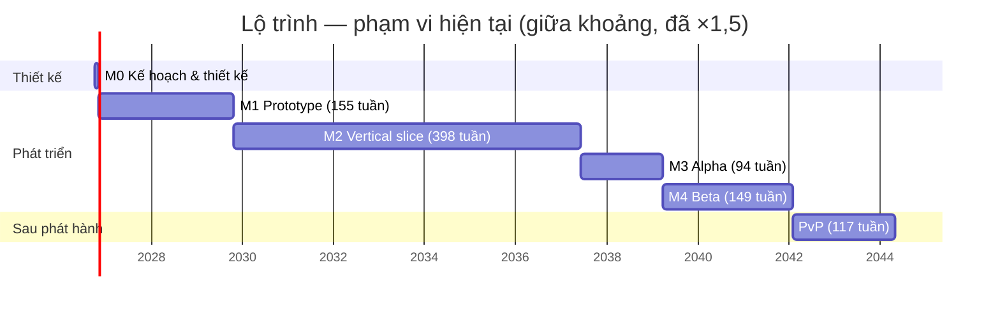

# Lộ trình

> Trạng thái: Nháp
> Liên quan: [Vision](00-vision.md) · [Cơ chế](02-gameplay/mechanics.md) · [Thành phần](04-tech/components.md) · [Rủi ro](04-tech/risks.md)

## Quỹ thời gian
<!-- Một người làm: bao nhiêu giờ/tuần? Mốc mong muốn? -->
- Dự án indie cá nhân, dài hạn, không có timeline cố định.
- **~10 giờ/tuần** (user, 2026-10-12).
- Kỹ năng (user, 2026-10-12): **mạnh** code client (Unity/C#), backend/server. **Không tự làm**: art (model, animation), âm thanh, level design → dùng asset có sẵn / thuê ngoài; công sức tính ở phần tích hợp.

**Giả định quy đổi** (của AI, chỉnh nếu khác):
- 1 ngày-người = 8 giờ → 10 giờ/tuần ≈ **1,25 ngày-người/tuần**.
- Hệ số dự phòng cho người làm một mình: **×1,5**.

## Milestones
<!-- Mỗi milestone có tiêu chí XONG đo được và ghi rõ thành phần nào tham gia. -->
Ước lượng = ngày-người, thô, của AI [chưa xác minh]; nguồn từ bảng [cơ chế](02-gameplay/mechanics.md#danh-sách-cơ-chế) + các hạng mục ngoài cơ chế bên dưới. Cột "Thời gian" đã nhân ×1,5 và quy ra tuần ở 10 giờ/tuần.

| Milestone | Mục tiêu | Thành phần | Tiêu chí xong | Ước lượng | Thời gian | Trạng thái |
|---|---|---|---|---|---|---|
| M0 — Kế hoạch & thiết kế | Đủ kế hoạch để bắt đầu prototype | design/ | Vision, core loop, cơ chế "phải có", thành phần hệ thống, roadmap M1–M2 ở trạng thái Chốt | — | — | Đang làm |
| M1 — Prototype | Kiểm chứng core loop có vui không | Client | Graybox chơi được vòng lặp 30 giây: cải tạo địa hình → 2–3 loài trở lại → đặt lệnh làm việc trồng cây → sản lượng vào kho; chạy được trên 1 máy mobile tầm trung | 95–163 | 114–196 tuần (~2,2–3,8 năm) | Chưa bắt đầu |
| M2 — Vertical slice | Một lát cắt hoàn chỉnh | Client + Backend | 1 map đủ art, âm thanh, UI; chạy qua backend (tài khoản, lưu, giờ server, rút thưởng); nhập hồn + chiến đấu PvE với phép sinh vật | 225–438 | 270–526 tuần (~5,2–10,1 năm) | Chưa bắt đầu |
| M3 — Alpha | Đủ tính năng | Client + Backend | Mọi cơ chế "phải có" chạy được; prototype trận mạng nhỏ (kiểm chứng netcode) | 57–100 + Nghiên cứu _(?)_ | 68–120 tuần | Chưa bắt đầu |
| M4 — Beta | Đủ nội dung, sửa lỗi | Client + Backend | Chơi hết 3 map không bị chặn; phát hành thử | 83–166 | 100–199 tuần | Chưa bắt đầu |
| Phát hành | | Client + Backend + vận hành | | — | — | Chưa bắt đầu |
| Sau phát hành — PvP | PvP thời gian thực | Client + Backend + Game server | Ghép trận theo hạng, game server quyết định kết quả | 65–130 | 78–156 tuần | Chưa bắt đầu |

**Tổng M1–M4:** 460–867 ngày-người → ×1,5 = 690–1.301 → **~10,6–20 năm** ở 10 giờ/tuần (cập nhật 2026-10-13: tinh linh hỗ trợ 5–10, cutscene 3–6 × 2; thẻ bài & bắt sinh vật 8–14, trang bị 13–23, bảo hiểm gói 1–2, địa hình bề mặt mịn +10–15, biến thể hiển thị 3–6, biến thể 3–5 chưa tính art).

### Hạng mục theo milestone
Từ bảng cơ chế, trừ dòng có ghi [ý tưởng].

**M1 (95–163):** Voxel world bề mặt mịn liền 35–55 · Sinh vật & loài 5–10 · Chỉ số làm việc 5–8 · Môi trường sống 10–20 · Lệnh làm việc 20–30 · Tìm đường 10–20 · Điều khiển PC + mobile (phần M1) 5–10 · [ý tưởng] Nội dung graybox (2–3 loài, 1 vùng) + thử hiệu năng mobile 5–10.

**M2 (225–438):**
- Cơ chế (179–346): Tinh linh hỗ trợ 5–10 · Cutscene mở đầu 3–6 · Thẻ bài & bắt sinh vật 8–14 · Biến thể hiển thị 3–6 · Sinh map theo seed 15–25 · Khối cốt truyện 2–4 · Chỉ số chiến đấu 6–10 · Nhu cầu sinh vật 8–15 · Tua nhanh 8–15 · Nhập hồn 40–70 · Phép của pháp sư 18–36 · Sưu tầm phép 25–65 · Nhận sinh vật 10–20 · Giới hạn sinh vật 3–6 · Nhiệm vụ & mảnh ký ức 15–25 · Mở map 2–4 · Cấp độ người chơi 3–5 · Điều khiển (phần M2) 5–10.
- [ý tưởng] Giả định nội dung slice để tính phần "+ x/loài, + x/phép": 5 loài nhập hồn được (×3–6), 8 phép của pháp sư (×1–2), 20 phép sinh vật (×0,5–2).
- [ý tưởng] Ngoài cơ chế (46–92): dựng backend (tài khoản, lưu cloud, giờ server, rút thưởng, sinh chỉ số cá thể) 15–30 · chọn + tích hợp asset art/âm thanh cho 1 map (không tự làm art) 20–40 · sắp đặt map + viết nhiệm vụ 10–20 · skill cân bằng 1–2.

**M3 (57–100 + ?):** Biến thể 3–5 (chưa tính art) · Tiến hoá 10–15 · Tiền tệ & cửa hàng (gồm bảo hiểm gói) 16–27 · Trang bị (ghép, rèn, lò rèn) 13–23 [ý tưởng milestone] · Điều khiển (phần M3) 5–10 · [ý tưởng] prototype trận mạng nhỏ 10–20 (kiểm chứng rủi ro netcode, [risks](04-tech/risks.md)) · Nghiên cứu _(chưa có ước lượng)_.

**M4 (83–166):** Cutscene tinh linh lộ mình 3–6 · [ý tưởng] 2 map còn lại (vision dự kiến 3 map lúc đầu), mỗi map 30–60 (sắp đặt, nhiệm vụ, loài/phép mới, tích hợp asset) · sửa lỗi, tối ưu mobile, đưa lên cửa hàng 20–40.

**Sau phát hành (65–130 + 10–20):** Chế độ nhiều người 60–120 · Xếp hạng PvP 5–10 · [ý tưởng] Hồi kết cốt truyện — trận chiến với bản ngã cũ + cảnh kết 10–20 ([plot](01-story/plot.md#kết-thúc)). Chi phí hosting game server _(chưa tra)_.

**Vận hành (liên tục từ M2):** [ý tưởng] backend 0,5–1 ngày-người/tháng (theo dõi, cập nhật, sự cố); chi phí dịch vụ _(chưa tra)_ — xem [0003](decisions/0003-server.md).

## Kiểm tra phạm vi
⚠️ **Vượt quỹ thời gian.** Riêng M1 (prototype để biết game có vui không) đã mất ~2,2–3,8 năm ở 10 giờ/tuần; toàn bộ tới M4 ~10,6–20 năm. Rủi ro "mất động lực khi làm một mình" ([risks](04-tech/risks.md)) gần như chắc chắn xảy ra với phạm vi này.

**Quyết định của user (2026-10-12): tạm thời chưa cắt, giữ nguyên phạm vi** — làm cùng trợ giúp của AI. Ước lượng trên chưa tính tác động của AI; mức tăng tốc thật [chưa xác minh].
- [ý tưởng] Đo tốc độ thật trong M1: ghi giờ thực tế từng hạng mục so với ước lượng → sau 4–6 hạng mục, tính lại hệ số cho M2–M4 và xem lại các đề xuất cắt dưới đây.

**Đề xuất cắt (để dành, chưa áp dụng)** [ý tưởng]:

| # | Đề xuất | Tiết kiệm (ngày-người, trước ×1,5) | Ảnh hưởng |
|---|---|---|---|
| C1 | **M1 tối giản:** map voxel nhỏ cố định, không lưu chunk; 3 loài; 1 mức môi trường sống; 1 loại lệnh làm việc (trồng cây, 3–4 công đoạn); chỉ số làm việc chỉ gồm thuần thục + tốc độ; tìm đường lưới đơn giản; điều khiển PC trước, cảm ứng cơ bản. Ước lượng 39–67 → ×1,5 = 47–80 tuần (~11–19 tháng) | M1 ngắn đi 50–87; tổng không đổi (phần cắt chuyển sang M2) | Biết sớm hơn ~1,5–2,5 năm game có vui không — giảm rủi ro lớn nhất |
| C2 | **Prototype giấy/HTML trước M1** (được phép trong M0): thử vòng môi trường sống + lệnh làm việc trong 3–5 ngày, trước khi đầu tư voxel | — (tốn 3–5) | Biết sớm vòng lặp có vui, tránh làm voxel cho một ý tưởng không vui |
| C3 | Voxel world dùng asset có sẵn thay vì tự làm — cần tra Asset Store (tính năng, giá) [chưa xác minh] | 10–25 (ước đoán) | Phụ thuộc asset; phải kiểm tra hiệu năng mobile |
| C4 | Phát hành với **1 map** thay vì 3; map 2–3 thành cập nhật theo mùa (đúng hướng "thêm map theo mùa" trong vision) | 60–120 | Đổi "dự kiến 3 map lúc đầu" trong [vision](00-vision.md) |
| C5 | Vertical slice nhỏ hơn: 3 loài nhập hồn được, 12 phép sinh vật, 4 phép của pháp sư | 14–36 | Slice ít đa dạng hơn |
| C6 | Nghiên cứu để sau phát hành (chưa có thiết kế) | chưa ước lượng | Bớt một nguồn phép |

Áp dụng C4 + C5: tổng M1–M4 còn khoảng 386–711 → ×1,5 = 579–1.067 → **~8,9–16,4 năm**. C1 không giảm tổng nhưng đưa câu trả lời "có vui không" về ~11–19 tháng. Vẫn dài; cần thêm giờ/tuần hoặc cắt sâu hơn (vd giảm số cơ chế "phải có" trước phát hành, đưa nhập hồn/phép pháp sư sang cập nhật sau).

## Sơ đồ
Phạm vi hiện tại (chưa cắt), lấy giữa khoảng, đã ×1,5, 10 giờ/tuần. Ngày bắt đầu 2026-11-02 là **giả định chỉ để vẽ**, không phải mốc cam kết.

## Công việc M0 (kế hoạch & thiết kế) — ưu tiên hiện tại
Cập nhật 2026-10-12. Chỉ user chuyển sang **Chốt** (nói "chốt <tên>" để AI đổi dòng trạng thái + bảng [README](README.md), hoặc tự sửa).

### A. Quyết định chờ Chốt
| # | Quyết định | Trạng thái | User cần làm |
|---|---|---|---|
| A1 | [0003](decisions/0003-server.md) — cần backend (M2) + game server (PvP sau phát hành) | Đề xuất | Đồng ý → Chốt. Chặn: components.md, architecture.md |
| A2 | [0004](decisions/0004-tien-nap.md) — tiền nạp ảnh hưởng tốc độ, chặn ở mức tối đa | Đề xuất | Đồng ý → Chốt. Chặn: vision (mô hình kinh doanh), economy.md |
| A3 | [0005](decisions/0005-render-pipeline.md) — client dùng URP | Đề xuất | Đồng ý → Chốt. Chặn: tech-stack.md, tạo project ở M1 |

### B. Tài liệu phải Chốt trước khi sang M1
| # | Tài liệu | Còn thiếu trước khi Chốt |
|---|---|---|
| B1 | [00-vision.md](00-vision.md) | Chấp nhận/sửa pitch [ý tưởng] và điểm khác biệt [ý tưởng] (khảo sát thị trường [chưa xác minh]); người chơi mục tiêu: độ tuổi, kinh nghiệm, thời lượng phiên; ngân sách. Phụ thuộc A2 |
| B2 | [02-gameplay/core-loop.md](02-gameplay/core-loop.md) | Thời lượng một phiên (PC, mobile); chấp nhận/bỏ 2 [ý tưởng] (phản hồi tức thì, phiên kết thúc khi loài định cư/nhiệm vụ xong) |
| B3 | [02-gameplay/mechanics.md](02-gameplay/mechanics.md) — **ít nhất các cơ chế M1**: voxel world, sinh vật & loài, chỉ số làm việc, môi trường sống, lệnh làm việc, tìm đường, điều khiển PC + mobile | Chấp nhận/bỏ các [ý tưởng] của nhóm M1: độ ưu tiên giữa lệnh; nội tại cộng hiệu quả công đoạn; công đoạn khi sinh vật bị lấy đi; thông báo đình trệ; kiểu di chuyển theo loài; yêu cầu môi trường sống tính theo vùng. (Ba mức đã thay bằng danh sách yêu cầu của loài — user, 2026-10-12.) File còn nhiều phần M2+ chưa xong → xem đề xuất ở cuối mục |
| B4 | [04-tech/components.md](04-tech/components.md) | Phụ thuộc A1. Chấp nhận/bỏ [ý tưởng]: backend dùng dịch vụ có sẵn; chỉ lưu phần world khác seed; bảng ranh giới trách nhiệm |
| B5 | [04-tech/tech-stack.md](04-tech/tech-stack.md) — phần Client | Phụ thuộc A3. Chấp nhận/bỏ [ý tưởng]: Input System; meshing tự viết bằng Jobs + Burst; A\* tự viết; uGUI; không dùng ECS |
| B6 | [05-roadmap.md](05-roadmap.md) — phần M1–M2 | Chấp nhận ước lượng thô + giả định (1 ngày-người = 8 giờ, ×1,5); phạm vi đã giữ nguyên (user, 2026-10-12) |
| B7 | [03-art-audio/art-style.md](03-art-audio/art-style.md) — **thống nhất art style trước khi bắt đầu** (user, 2026-10-12) | Đang trống. Cần: hướng phong cách (voxel/low-poly, màu, tỉ lệ sinh vật), tham khảo có link, nguồn asset (hỗ trợ URP — [0005](decisions/0005-render-pipeline.md); giấy phép; giá có nguồn), quy cách kỹ thuật (kích thước khối, số polygon trên mobile) |
| B8 | [01-story/naming.md](01-story/naming.md) — quy ước đặt tên (user, 2026-10-12) | **User tự đặt tên, AI chỉ duyệt** (skill `naming` của kit). Danh sách nhắc ở mục "Cần đặt tên". Cần trước M1: tên game (tạm được). Đang chờ user quyết: Aetharyn / Viventa |

### C. Nên viết trước M1 (chưa cần Chốt)
- [ ] [02-gameplay/controls-ui.md](02-gameplay/controls-ui.md) — đang trống; M1 cần điều khiển PC + cảm ứng.
- [ ] [04-tech/architecture.md](04-tech/architecture.md) — bản đầu đã viết; xem lại phần Client.
- [ ] [04-tech/risks.md](04-tech/risks.md) — rủi ro lớn + milestone kiểm chứng (đã có, chỉ cần rà).
- [x] Tạo skill cân bằng riêng (user, 2026-10-12) — nay là skill `game-balance` của kit (v0.7.0, 2026-10-12: pity, drop, streak — trước là `luck`, economy, curve) + quy tắc riêng của my-game ở `tools/balance_rules.py` (check, roll). Dữ liệu sẽ nằm ở `design/data/`.

- [ ] **Thử nghiệm art bằng AI** — đổi hướng (user, 2026-10-12):
  - [x] Địa hình mịn: dựng mesh ×2, đạt công cụ kiểm tra asset ([art-style](03-art-audio/art-style.md#kết-quả-thử-nghiệm-art-đang-làm)).
  - [x] Công cụ kiểm tra asset ([0006](decisions/0006-cong-cu-kiem-tra-asset.md), Chốt) — selftest trong `verify`.
  - [ ] Tiếp tục dựng mesh world (ưu tiên trước mắt) — tài liệu kỹ thuật + kế hoạch prototype 9 bước: [world-tech](04-tech/world-tech.md) (bản đầu 2026-10-13).
  - [ ] Ảnh concept theo hướng XING-ART nhưng tươi sáng hơn ([art-style](03-art-audio/art-style.md#hướng-phong-cách)).
  - Tạm dừng: sinh vật hoàn chỉnh (rig, animation, biến thể). Sinh vật/nhân vật có thể low-poly.
- [ ] Việc còn lại sau khi kit phát hành skill `concept-image` (v0.7.0) — từ [.ai/kit-requests/concept-image-skill.md](../.ai/kit-requests/concept-image-skill.md) mục 14:
  - [x] Lệnh kiểm tra lớp 2–3 (`tools/asset_gen/concept_check.py`: OWLv2 đếm, Qwen3-VL hỏi–đáp), khai báo trong `.ai/project.json`; kiểm chứng trên bộ ảnh đã biết lỗi: gộp 2 lớp bắt 7/7 (2026-10-12, [art-style](03-art-audio/art-style.md#kết-quả-thử-nghiệm-art-đang-làm)).
  - [ ] Thêm `--ref` cho `tools/asset_gen/hf_generate.py` (ảnh tham chiếu cấu trúc), rồi thêm `reference_arg` vào cấu hình.

### D. Không cần Chốt để sang M1 (viết dần, song song prototype)
Cốt truyện (world, characters, plot), progression, economy, levels, art-style, audio — theo thứ tự gợi ý ở [README](README.md). Skill (tạo 2026-10-12): cốt truyện → `local-game-story`; map/level → `local-level-design`; số liệu economy/progression → `game-balance` (kit); art/âm thanh → chưa có skill, chờ user quyết hướng dùng MCP (Blender, Figma, âm thanh).

**Đề xuất** [ý tưởng]: trạng thái tính theo file, mà mechanics.md còn nhiều phần M2+ (nhập hồn, phép, PvP...) chưa xong. Hai cách:
- (a) Tách các cơ chế M1 ra file riêng (vd `02-gameplay/mechanics-m1.md`) để Chốt riêng.
- (b) Giữ một file, đổi tiêu chí M0 thành "các cơ chế M1 trong mechanics.md đã được user duyệt" và đặt file ở "Đang xem xét".
