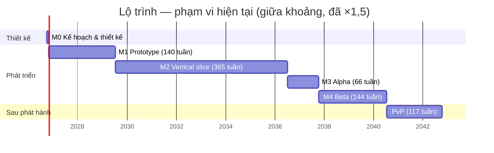

# Lộ trình

> Trạng thái: Nháp
> Liên quan: [Vision](00-vision.md) · [Cơ chế](02-gameplay/mechanics.md) · [Thành phần](04-tech/components.md) · [Rủi ro](04-tech/risks.md)

## Quỹ thời gian
<!-- Một người làm: bao nhiêu giờ/tuần? Mốc mong muốn? -->
- Dự án indie cá nhân, dài hạn, không có timeline cố định.
- **~10 giờ/tuần** (user, 2026-10-12).
- Kỹ năng (user, 2026-10-12): **mạnh** code client (Unity/C#), backend/server. **Không tự làm**: art (model, animation), âm thanh, level design → dùng asset có sẵn / thuê ngoài; công sức tính ở phần tích hợp.

**Giả định quy đổi** (của AI, chỉnh nếu khác):
- 1 ngày-người = 8 giờ → 10 giờ/tuần ≈ **1,25 ngày-người/tuần**.
- Hệ số dự phòng cho người làm một mình: **×1,5**.

## Milestones
<!-- Mỗi milestone có tiêu chí XONG đo được và ghi rõ thành phần nào tham gia. -->
Ước lượng = ngày-người, thô, của AI [chưa xác minh]; nguồn từ bảng [cơ chế](02-gameplay/mechanics.md#danh-sách-cơ-chế) + các hạng mục ngoài cơ chế bên dưới. Cột "Thời gian" đã nhân ×1,5 và quy ra tuần ở 10 giờ/tuần.

| Milestone | Mục tiêu | Thành phần | Tiêu chí xong | Ước lượng | Thời gian | Trạng thái |
|---|---|---|---|---|---|---|
| M0 — Kế hoạch & thiết kế | Đủ kế hoạch để bắt đầu prototype | design/ | Vision, core loop, cơ chế "phải có", thành phần hệ thống, roadmap M1–M2 ở trạng thái Chốt | — | — | Đang làm |
| M1 — Prototype | Kiểm chứng core loop có vui không | Client | Graybox chơi được vòng lặp 30 giây: cải tạo địa hình → 2–3 loài trở lại → đặt lệnh làm việc trồng cây → sản lượng vào kho; chạy được trên 1 máy mobile tầm trung | 85–148 | 102–178 tuần (~2–3,4 năm) | Chưa bắt đầu |
| M2 — Vertical slice | Một lát cắt hoàn chỉnh | Client + Backend | 1 map đủ art, âm thanh, UI; chạy qua backend (tài khoản, lưu, giờ server, rút thưởng); nhập hồn + chiến đấu PvE với phép sinh vật | 206–402 | 247–482 tuần (~4,7–9,3 năm) | Chưa bắt đầu |
| M3 — Alpha | Đủ tính năng | Client + Backend | Mọi cơ chế "phải có" chạy được; prototype trận mạng nhỏ (kiểm chứng netcode) | 40–70 + Nghiên cứu _(?)_ | 48–84 tuần | Chưa bắt đầu |
| M4 — Beta | Đủ nội dung, sửa lỗi | Client + Backend | Chơi hết 3 map không bị chặn; phát hành thử | 80–160 | 96–192 tuần | Chưa bắt đầu |
| Phát hành | | Client + Backend + vận hành | | — | — | Chưa bắt đầu |
| Sau phát hành — PvP | PvP thời gian thực | Client + Backend + Game server | Ghép trận theo hạng, game server quyết định kết quả | 65–130 | 78–156 tuần | Chưa bắt đầu |

**Tổng M1–M4:** 411–780 ngày-người → ×1,5 = 617–1.170 → **~9,5–18 năm** ở 10 giờ/tuần.

### Hạng mục theo milestone
Từ bảng cơ chế, trừ dòng có ghi [ý tưởng].

**M1 (85–148):** Voxel world 25–40 · Sinh vật & loài 5–10 · Chỉ số làm việc 5–8 · Môi trường sống 10–20 · Lệnh làm việc 20–30 · Tìm đường 10–20 · Điều khiển PC + mobile (phần M1) 5–10 · [ý tưởng] Nội dung graybox (2–3 loài, 1 vùng) + thử hiệu năng mobile 5–10.

**M2 (206–402):**
- Cơ chế (160–310): Sinh map theo seed 15–25 · Khối cốt truyện 2–4 · Chỉ số chiến đấu 6–10 · Nhu cầu sinh vật 8–15 · Tua nhanh 8–15 · Nhập hồn 40–70 · Phép của pháp sư 18–36 · Sưu tầm phép 25–65 · Nhận sinh vật 10–20 · Giới hạn sinh vật 3–6 · Nhiệm vụ & mảnh ký ức 15–25 · Mở map 2–4 · Cấp độ người chơi 3–5 · Điều khiển (phần M2) 5–10.
- [ý tưởng] Giả định nội dung slice để tính phần "+ x/loài, + x/phép": 5 loài nhập hồn được (×3–6), 8 phép của pháp sư (×1–2), 20 phép sinh vật (×0,5–2).
- [ý tưởng] Ngoài cơ chế (46–92): dựng backend (tài khoản, lưu cloud, giờ server, rút thưởng, sinh chỉ số cá thể) 15–30 · chọn + tích hợp asset art/âm thanh cho 1 map (không tự làm art) 20–40 · sắp đặt map + viết nhiệm vụ 10–20 · skill cân bằng 1–2.

**M3 (40–70 + ?):** Tiến hoá 10–15 · Tiền tệ & cửa hàng 15–25 · Điều khiển (phần M3) 5–10 · [ý tưởng] prototype trận mạng nhỏ 10–20 (kiểm chứng rủi ro netcode, [risks](04-tech/risks.md)) · Nghiên cứu _(chưa có ước lượng)_.

**M4 (80–160):** [ý tưởng] 2 map còn lại (vision dự kiến 3 map lúc đầu), mỗi map 30–60 (sắp đặt, nhiệm vụ, loài/phép mới, tích hợp asset) · sửa lỗi, tối ưu mobile, đưa lên cửa hàng 20–40.

**Sau phát hành (65–130):** Chế độ nhiều người 60–120 · Xếp hạng PvP 5–10. Chi phí hosting game server _(chưa tra)_.

**Vận hành (liên tục từ M2):** [ý tưởng] backend 0,5–1 ngày-người/tháng (theo dõi, cập nhật, sự cố); chi phí dịch vụ _(chưa tra)_ — xem [0003](decisions/0003-server.md).

## Kiểm tra phạm vi
⚠️ **Vượt quỹ thời gian.** Riêng M1 (prototype để biết game có vui không) đã mất ~2–3,4 năm ở 10 giờ/tuần; toàn bộ tới M4 ~9,5–18 năm. Rủi ro "mất động lực khi làm một mình" ([risks](04-tech/risks.md)) gần như chắc chắn xảy ra với phạm vi này.

**Quyết định của user (2026-10-12): tạm thời chưa cắt, giữ nguyên phạm vi** — làm cùng trợ giúp của AI. Ước lượng trên chưa tính tác động của AI; mức tăng tốc thật [chưa xác minh].
- [ý tưởng] Đo tốc độ thật trong M1: ghi giờ thực tế từng hạng mục so với ước lượng → sau 4–6 hạng mục, tính lại hệ số cho M2–M4 và xem lại các đề xuất cắt dưới đây.

**Đề xuất cắt (để dành, chưa áp dụng)** [ý tưởng]:

| # | Đề xuất | Tiết kiệm (ngày-người, trước ×1,5) | Ảnh hưởng |
|---|---|---|---|
| C1 | **M1 tối giản:** map voxel nhỏ cố định, không lưu chunk; 3 loài; 1 mức môi trường sống; 1 loại lệnh làm việc (trồng cây, 3–4 công đoạn); chỉ số làm việc chỉ gồm thuần thục + tốc độ; tìm đường lưới đơn giản; điều khiển PC trước, cảm ứng cơ bản. Ước lượng 35–61 → ×1,5 = 42–73 tuần (~10–17 tháng) | M1 ngắn đi 50–87; tổng không đổi (phần cắt chuyển sang M2) | Biết sớm hơn ~1,5–2,5 năm game có vui không — giảm rủi ro lớn nhất |
| C2 | **Prototype giấy/HTML trước M1** (được phép trong M0): thử vòng môi trường sống + lệnh làm việc trong 3–5 ngày, trước khi đầu tư voxel | — (tốn 3–5) | Biết sớm vòng lặp có vui, tránh làm voxel cho một ý tưởng không vui |
| C3 | Voxel world dùng asset có sẵn thay vì tự làm — cần tra Asset Store (tính năng, giá) [chưa xác minh] | 10–25 (ước đoán) | Phụ thuộc asset; phải kiểm tra hiệu năng mobile |
| C4 | Phát hành với **1 map** thay vì 3; map 2–3 thành cập nhật theo mùa (đúng hướng "thêm map theo mùa" trong vision) | 60–120 | Đổi "dự kiến 3 map lúc đầu" trong [vision](00-vision.md) |
| C5 | Vertical slice nhỏ hơn: 3 loài nhập hồn được, 12 phép sinh vật, 4 phép của pháp sư | 14–36 | Slice ít đa dạng hơn |
| C6 | Nghiên cứu để sau phát hành (chưa có thiết kế) | chưa ước lượng | Bớt một nguồn phép |

Áp dụng C4 + C5: tổng M1–M4 còn khoảng 337–624 → ×1,5 = 506–936 → **~7,8–14,4 năm**. C1 không giảm tổng nhưng đưa câu trả lời "có vui không" về ~10–17 tháng. Vẫn dài; cần thêm giờ/tuần hoặc cắt sâu hơn (vd giảm số cơ chế "phải có" trước phát hành, đưa nhập hồn/phép pháp sư sang cập nhật sau).

## Sơ đồ
Phạm vi hiện tại (chưa cắt), lấy giữa khoảng, đã ×1,5, 10 giờ/tuần. Ngày bắt đầu 2026-11-02 là **giả định chỉ để vẽ**, không phải mốc cam kết.

## Công việc M0 (kế hoạch & thiết kế) — ưu tiên hiện tại
- [ ] 00-vision.md → Chốt
- [ ] 02-gameplay/core-loop.md → Chốt
- [ ] 02-gameplay/mechanics.md: các cơ chế "phải có", mỗi cơ chế có thành phần phụ trách → Chốt
- [ ] 04-tech/components.md: xác định thành phần cần cho M1–M2 → Chốt
- [ ] 04-tech/tech-stack.md: công nghệ cho thành phần cần ở M1 (client: render pipeline) → Chốt — bản đầu đã viết 2026-10-12, chờ user xem
- [ ] 04-tech/risks.md: rủi ro lớn + milestone kiểm chứng
- [x] 05-roadmap.md: ước lượng M1–M2 (bản đầu, 2026-10-12) — user giữ nguyên phạm vi, xem lại sau khi đo tốc độ M1
- [ ] Chốt quyết định [0003](decisions/0003-server.md), [0004](decisions/0004-tien-nap.md), [0005](decisions/0005-render-pipeline.md)
- [ ] Tạo skill cân bằng riêng (user, 2026-10-12): tính base, phân bố loài/ngẫu nhiên, hệ số quy đổi, trần, điểm mỗi cấp độ/bậc, tỉ lệ vượt trội, tham số chặn quá may — đọc/ghi bảng dữ liệu chỉ số ([cơ chế](02-gameplay/mechanics.md#chỉ-số-sinh-vật)). Thời điểm: [ý tưởng] trước khi cân bằng chỉ số chiến đấu ở M2; ước lượng 1–2 ngày [chưa xác minh]
